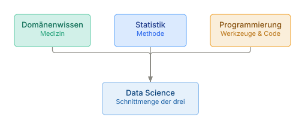
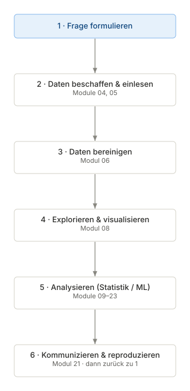

# 01 · Einführung und Lernpfad

> **Teil 1 – Grundlagen und Setup** · Dauer: ~30 min · Voraussetzung: keine

## Lernziele
- Den **Datenanalyse-Zyklus** kennen und jede Phase benennen können.
- Den Aufbau dieses Kurses und die Lernpfade überblicken.
- Eine erste Mini-Demo ausführen: Datensatz laden, Form und Mortalitätsrate ausgeben.

## Klinischer Aufhänger

500 Patient:innen einer Intensivstation, eine Tabelle mit Aufnahmeparametern und
die Frage deiner Chefärztin: *„Wer ist in den ersten 30 Tagen verstorben, und
lässt sich das vorhersagen?“*

Im Tabellenprogramm stößt du schnell an Grenzen: kein Schritt ist
nachvollziehbar, das Ergebnis kippt mit der Sortierung, und ein Jahr später
fängst du wieder bei null an. Data Science macht jeden Schritt explizit,
reproduzierbar und prüfbar.

## Zwei Wege durch den Kurs – wähle einen

**(A) Im Browser lernen – der Standard.** Installiere nur **Python _oder_ R**.
Jeden Codeblock kopierst du direkt in deine Konsole; die Daten liest er über
eine Web-Adresse (`https://…/data/kohorte.csv`) – du musst **nichts
herunterladen, klonen oder erzeugen**. Welche Pakete du brauchst, sagt dir das
nächste Modul.

**(B) Mit dem Repository arbeiten – optional, für volle Reproduzierbarkeit.**
Klonst du das Projekt, stehen `data/`, die Hilfsfunktionen in `lib/` und die
fertigen `code/`-Skripte lokal bereit. Nur dann gelten Abkürzungen wie
`pip install -r requirements.txt`, `source("tools/install_r_packages.R")` oder
`python data/generate_data.py`.

> **Merke:** Codeblöcke mit einer `https://…`-Adresse laufen auf beiden Wegen.
> Nichts in diesem Kurs verlangt, dass du das Repository klonst – es ist ein
> Komfort, keine Voraussetzung.

## 1 Warum Data Science in der Medizin?

Medizinische Daten wachsen schneller, als wir sie auswerten können: elektronische Akten, Labor, Bildgebung, Genomik, Wearables. Zugleich steigen die
Ansprüche an **Evidenz** und **Reproduzierbarkeit**, in der Forschung wie im
klinischen Alltag.

Data Science verbindet drei Disziplinen:



**Stolperstein:** Data Science *ersetzt* das klinische Urteil nicht, es
informiert es. Ein Modell mit 95 % Genauigkeit ist wertlos, wenn seine
Entscheidungen klinisch unsinnig sind. Domänenwissen bleibt in jeder Phase
unverzichtbar.

**Darüber hinaus:** Reproduzierbarkeit ist kein Luxus, sondern das Minimum. Ein
Ergebnis, das nach dem Sortieren verschwindet, ist keines. Fester Seed (`42`) und
versionierter Code sind Pflicht, nicht Kür.

## 2 Der Datenanalyse-Zyklus

Jede Datenanalyse, ob klinische Studie, Qualitätsprojekt oder Publikation, folgt demselben Kreislauf:



Schritt 3 kostet in der Praxis am meisten Zeit, deshalb widmet ihm dieser
Kurs ein eigenes Modul (Modul 06).

## 3 Kursüberblick und Lernpfade

| Teil | Module | Frage |
|------|--------|-------|
| **Teil 1 – Grundlagen und Setup** | 01–03 | Wie richte ich eine reproduzierbare Umgebung ein? |
| **Teil 2 – Datenimport, Datenbereinigung und Datenmanagement** | 04–07 | Wie komme ich von Rohdaten zu einer sauberen Tabelle? |
| **Teil 3 – Explorative Datenanalyse und deskriptive Statistik** | 08–09 | Wie verstehe und beschreibe ich meine Daten? |
| **Teil 4 – Statistische Inferenz und medizinische Statistik** | 10–22 | Wie ziehe ich belastbare Schlüsse, plane Studien und schreibe Berichte? |
| **Teil 5 – Machine Learning und KI in der Medizin** | 23–34 | Wie baue, validiere und erkläre ich klinische Modelle? |

**Empfohlene Lernpfade:**

- **Mein erstes Paper (statistischer Shortcut)** · 7 Module: 02–03 → 06 → 09–10 → 12 → 22
- **Schnell zur Auswertung** · 6 Module: 02–03 → 06 → 08–10
- **Datenextraktion im Fokus** · 5 Module: 02 → 04–07
- **Klinische Forschung / Publikation** · 15 Module: 06 → 09–22
- **Statistik-Vertiefung** · 13 Module: 09–21
- **Machine Learning / KI** · 12 Module: 23–34
- **Vollständig** · 34 Module: 01–34 in didaktischer Reihenfolge

## 4 Wie du mit dem Material arbeitest

Jedes Modul folgt demselben Bogen:

1. **Klinischer Aufhänger**: eine ärztliche Frage motiviert das Konzept.
2. **Konzept vor Code**: erst das Prinzip, dann das lauffähige Beispiel.
3. **Python und R nebeneinander**: beide Sprachen zeigen dasselbe Ergebnis.
4. **Übungen** (`uebungen.md`) zum Selbst-Ausprobieren.
5. **Lösungen** (`loesungen.md`), erst nach eigenem Versuch.

Alle Module nutzen denselben Datensatz: eine synthetische Intensivkohorte mit 500
fiktiven Patient:innen (`kohorte.csv`, `vitalwerte.csv`, `labor.csv`, `notizen.csv`),
reproduzierbar per Seed 42, und ohne Datenschutzproblem.
Details: [`data/README.md`](../../data/README.md).

## 4b Kohortenüberblick


## 5 In Python – erste Mini-Demo

Dieses erste Beispiel lädt die Kohorte direkt über eine Web-Adresse, du kannst
es unverändert in eine `.py`-Datei speichern **oder** Zeile für Zeile in eine
Python-Konsole einfügen, beides funktioniert ohne lokalen Projekt-Klon.

```python
import pandas as pd

cohort = pd.read_csv("{{DATEN}}kohorte.csv")

print("Dataset:", cohort.shape)
print(f"30-day mortality: {cohort['verstorben_30d'].mean():.1%}")
```

<div class="code-verbalization" markdown="1">
**Zeile für Zeile:**

* `import pandas as pd`: Lädt das Paket `pandas` (die zentrale Tabellen-Bibliothek für Python) und gibt ihm die Kurzbezeichnung `pd`.
* `cohort = pd.read_csv(...)`: Liest die Tabelle `kohorte.csv` direkt von der angegebenen Web-Adresse ein und speichert sie unter dem Namen `cohort`.
* `print("Dataset:", cohort.shape)`: Gibt die Größe der Tabelle aus, Anzahl Zeilen und Anzahl Spalten.
* `print(f"30-day mortality: ...")`: Berechnet den Mittelwert der Spalte `verstorben_30d` (Anteil verstorbener Patient:innen) und gibt ihn als Prozentzahl aus.
</div>

Ausgabe (synthetische Daten):
```
Dataset: (500, 16)
30-day mortality: 15.6%
```

---

**Stolperstein:** Kein Internetzugang oder ein Klinik-Netzwerk, das externe
Verbindungen sperrt? Dann lokal arbeiten: `python data/generate_data.py`
einmalig aus der Projektwurzel ausführen und anschließend `pd.read_csv("data/kohorte.csv")`
verwenden. Die vollständigen Skripte in `code/python.py`/`code/r.R` machen
genau das automatisch (lokal zuerst, Web-Adresse als Rückfallebene).

**Darüber hinaus:** `cohort.shape` zeigt `(Zeilen, Spalten)`. `cohort.info()`
ergänzt Datentypen und fehlende Werte je Spalte, der erste sinnvolle Griff nach
jedem Laden.

## 6 In R – dieselbe Demo

```r
library(readr)
cohort <- read_csv("{{DATEN}}kohorte.csv", show_col_types = FALSE)

cat("Dataset:", nrow(cohort), "x", ncol(cohort), "\n")
cat("30-day mortality:", round(mean(cohort$verstorben_30d), 3), "\n")
```

<div class="code-verbalization" markdown="1">
**Zeile für Zeile:**

* `library(readr)`: Lädt das Paket `readr`, das die Funktion zum Einlesen von CSV-Dateien bereitstellt.
* `cohort <- read_csv(...)`: Liest die Tabelle `kohorte.csv` direkt von der Web-Adresse ein und speichert sie unter dem Namen `cohort` (`show_col_types = FALSE` unterdrückt nur die Ausgabe der erkannten Spaltentypen).
* `cat("Dataset:", nrow(cohort), "x", ncol(cohort), "\n")`: Gibt die Anzahl Zeilen (`nrow`) und Spalten (`ncol`) der Tabelle aus.
* `cat("30-day mortality:", ...)`: Berechnet den Mittelwert der Spalte `verstorben_30d` und rundet ihn auf drei Nachkommastellen.
</div>

> **Merksatz:** Egal ob als Skript (`Rscript datei.R`) oder Zeile für Zeile aus
> dem Editor an die R-Konsole geschickt (Strg/Cmd+Enter), `read_csv()` mit einer
> Web-Adresse funktioniert überall identisch, ganz ohne Pfad-Ermittlung.

## Fallstricke und Merksätze
- **Data Science ersetzt nicht das klinische Urteil**, sondern informiert es.
 Modelle zeigen Muster, Ärztinnen und Ärzte interpretieren sie.

- **Reproduzierbarkeit ist kein Luxus.** Ein Ergebnis, das sich nach dem
 Sortieren ändert, ist kein Ergebnis. Fester Seed (hier: `42`) und
 versionierter Code sind Pflicht, nicht Kür.

- **80 % Datenaufbereitung, 20 % Analyse**, so die oft zitierte Faustregel.
 Das klingt frustrierend, ist aber normal. Saubere Daten *sind* der erste Analyseschritt.

- Alle Beispieldaten in diesem Kurs sind **vollständig fiktiv**. Für
 echte Patientendaten gelten DSGVO, Ethikvotum und ärztliche Schweigepflicht.

## Selbstcheck
1. **Welche drei Disziplinen verbindet Data Science?** – Domänenwissen (Medizin), Statistik (Methode) und Werkzeuge/Code.
2. **Warum ist Schritt 3 des Datenanalyse-Zyklus besonders zeitaufwändig?** – Rohdaten aus klinischen Systemen sind selten sauber: Encoding-Probleme, fehlende Werte, inkonsistente Formate müssen vor jeder Analyse behoben werden.
3. **Was ist der Vorteil eines festen Seeds (hier: 42)?** – Zufallsoperationen (z. B. Stichproben, Modellinitialisierung) liefern bei jedem Lauf dasselbe Ergebnis, Voraussetzung für Reproduzierbarkeit.
