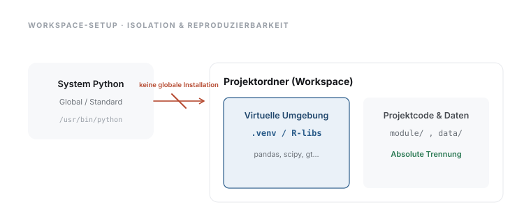

# 02 · Entwicklungsumgebung und Werkzeuge

> **Teil 1 – Grundlagen und Setup** · Dauer: ~60 min · Voraussetzung: Modul 01 (Einführung und Lernpfad)

## Lernziele
- Python via `uv` sowie R und RStudio auf dem eigenen Rechner installieren und starten.
- VS Code als Editor einrichten und mit einer Python-Umgebung verbinden.
- Ein **reproduzierbares Projektverzeichnis** anlegen und mit Git versionieren.
- Verstehen, warum virtuelle Umgebungen unverzichtbar sind.
- Ein erstes Skript ausführen, das die Umgebung prüft und den Datensatz lädt.

## Klinischer Aufhänger

Dein Kollege schickt dir eine Excel-Auswertung. Du öffnest sie, und die Formeln
schlagen fehl, weil er eine andere Excel-Version nutzt. Oder du rechnest sechs
Monate später dasselbe erneut und erhältst andere Zahlen, weil zwischenzeitlich
ein Update eingespielt wurde.

**Reproduzierbarkeit** bedeutet: gleicher Code + gleiche Umgebung = gleiches
Ergebnis, heute, morgen und in fünf Jahren.



## 1 Das Terminal – wohin die Befehle gehen

Viele Anleitungen in diesem Kurs zeigen **Terminal-Befehle**. Das Terminal ist ein
Textfenster, in das du Befehle tippst und mit Enter bestätigst – kein Klickmenü,
aber genau deshalb reproduzierbar und protokollierbar.

- **macOS:** Programm **„Terminal“** öffnen (Spotlight mit `Cmd`+`Leertaste`, dann
  „Terminal“ tippen).

- **Windows:** **„PowerShell“** öffnen (Startmenü, „PowerShell“ tippen).

- **Linux:** das Terminal-Programm der Distribution öffnen (unter Ubuntu z. B.
  `Strg`+`Alt`+`T`).

**Grundlage:** Zwei Dinge brauchst du ständig. `cd ORDNER` (*change directory*)
wechselt in einen Ordner – `cd ~/data-science-coach` bringt dich z. B. in den
Projektordner (so heißt der Kursordner nach `git clone`, siehe Abschnitt 3). Alle Kursbefehle setzen voraus, dass du **im Projektordner** stehst.
Und Zeilen, die mit `#` beginnen, sind Kommentare: sie erklären nur und werden nicht
ausgeführt.

### Erste sichere Terminal-Minute

Diese Befehle verändern nichts. Sie zeigen nur, wo du bist und welche Dateien im
Ordner liegen:

```bash
pwd      # print working directory: aktueller Ordner
ls       # list: Dateien und Unterordner anzeigen
```

<div class="code-verbalization" markdown="1">
**Zeile für Zeile:**

* `pwd`: Zeigt an, in welchem Ordner du gerade stehst (*print working directory*) – verändert nichts.
* `ls`: Listet die Dateien und Unterordner im aktuellen Ordner auf (*list*) – verändert ebenfalls nichts.
</div>

Wenn du dich vertippst: kein Drama. Mit der Pfeiltaste nach oben holst du den
letzten Befehl zurück, mit `Ctrl`+`C` brichst du einen laufenden Befehl ab.

| Zeichen | Bedeutung |
|---------|-----------|
| `$` oder `>` | Eingabeaufforderung; nicht mittippen |
| `# ...` | Kommentar; erklärt nur |
| `cd` | Ordner wechseln |
| `..` | ein Ordner nach oben |
| Tab | Namen automatisch ergänzen |

## 2 Was ist ein Paket – und warum installieren?

Python und R können von sich aus nur wenig: rechnen, Text verarbeiten, Dateien
lesen. Die eigentlichen Analysewerkzeuge – Tabellen bearbeiten, Modelle rechnen,
Grafiken zeichnen – liefern **Pakete** (auch *Bibliotheken* genannt): fertige,
von anderen geschriebene und geprüfte Funktionssammlungen. `pandas` bearbeitet
Tabellen in Python, `tidyverse` tut dasselbe in R, `statsmodels` rechnet
Regressionen.

Diese Pakete sind nicht vorinstalliert. Du lädst sie **einmalig** aus einem
zentralen Archiv herunter – für Python ist das **PyPI**, für R das **CRAN**.
Genau das tun die Befehle, die gleich kommen:

- Python: `pip install pandas` (bzw. `uv pip install …`) holt ein Paket von PyPI.
- R: `install.packages("tidyverse")` holt es vom CRAN.

Danach machst du das Paket in jedem Skript mit `import pandas` (Python) bzw.
`library(tidyverse)` (R) verfügbar. **Installieren = einmal herunterladen;
importieren = in dieser Sitzung benutzen.**

> **Nur im Browser lernen?** Dann installierst du genau die Pakete, die ein
> Codeblock in seinen ersten Zeilen lädt (`import …` bzw. `library(…)`), oder in
> einem Schritt die Kernliste (Abschnitt 3, „Ohne Klon“). Die Kurs-Datensätze musst du **nicht**
> herunterladen oder erzeugen: die Codeblöcke lesen sie direkt über eine
> Web-Adresse. Der Rest dieses Moduls (virtuelle Umgebung, Git, Projektordner)
> lohnt sich, sobald du reproduzierbar arbeiten willst – nötig zum Mitrechnen
> ist er nicht.

## 3 Python via `uv` installieren

`uv` ist ein moderner Python-Paketmanager, der Installationen isoliert und
reproduzierbar macht. Er installiert auch Python selbst.

**macOS / Linux:** `curl` lädt eine Datei aus dem Internet – hier das
Installationsskript von `uv` –, und `| sh` (*pipe an die Shell*) führt es
direkt aus. Zeile unverändert kopieren:
```bash
curl -LsSf https://astral.sh/uv/install.sh | sh
```

<div class="code-verbalization" markdown="1">
**Zeile für Zeile:**

* `curl -LsSf https://astral.sh/uv/install.sh`: Lädt das Installationsskript von `uv` von dieser Web-Adresse herunter, ohne es zu speichern (`-L` folgt Weiterleitungen, `-s` unterdrückt den Fortschrittsbalken, `-S` zeigt Fehler, `-f` bricht bei Serverfehlern ab).
* `| sh`: Leitet das heruntergeladene Skript direkt an die Shell weiter, die es sofort ausführt – Download und Ausführung passieren in einem einzigen Schritt, die Datei wird nicht separat gespeichert.
</div>

**Windows (PowerShell):**
```powershell
powershell -ExecutionPolicy ByPass -c "irm https://astral.sh/uv/install.ps1 | iex"
```

<div class="code-verbalization" markdown="1">
**Zeile für Zeile:**

* `-ExecutionPolicy ByPass`: Erlaubt für diesen einen Befehl das Ausführen eines Skripts, auch wenn Windows das sonst standardmäßig blockiert.
* `irm https://astral.sh/uv/install.ps1`: Lädt das Installationsskript von `uv` von dieser Web-Adresse herunter (*Invoke-RestMethod*, das PowerShell-Gegenstück zu `curl`).
* `| iex`: Führt das heruntergeladene Skript direkt aus (*Invoke-Expression*) – wie `| sh` unter macOS/Linux.
</div>

Nach der Installation Terminal neu starten, dann prüfen:
```bash
uv --version
```

<div class="code-verbalization" markdown="1">
**Zeile für Zeile:**

* `uv`: Ruft das gerade installierte Programm `uv` auf.
* `--version`: Diese Option lässt `uv` nur seine Versionsnummer ausgeben und sofort beenden – eine reine Kontrollabfrage, die nichts verändert.
</div>

**Projektumgebung einrichten** (einmalig, aus dem Projektordner):
```bash
uv venv .venv --python 3.12
source .venv/bin/activate        # macOS/Linux
# Windows: .venv\Scripts\activate
uv pip install -r requirements.txt
```

<div class="code-verbalization" markdown="1">
**Zeile für Zeile:**

* `uv venv .venv --python 3.12`: Legt im aktuellen Ordner einen neuen Unterordner `.venv` mit einer eigenen, isolierten Python-3.12-Umgebung an. Fehlt Python 3.12 auf dem Rechner, lädt `uv` es automatisch herunter. Die Angabe ist nötig: Die gepinnten Kurspakete (z. B. `numpy` 2.4, `scipy` 1.18) laufen erst ab Python 3.12, ein älteres System-Python bricht die Installation ab.
* `source .venv/bin/activate`: Sagt dieser Terminal-Sitzung, ab jetzt das Python und die Pakete aus `.venv` zu benutzen statt der globalen Installation (macOS/Linux).
* `# Windows: .venv\Scripts\activate`: Ein Kommentar, keine ausführbare Zeile – zeigt nur den entsprechenden Befehl für Windows.
* `uv pip install -r requirements.txt`: Liest die Paketliste aus der Datei `requirements.txt` und installiert alle darin genannten Pakete in die gerade aktivierte Umgebung.
</div>

**Woher kommt `requirements.txt`?** Sie liegt im Kurs-Repository. Hast du es
geklont (`git clone {{REPO}}`, Git-Installation in Abschnitt 6) oder auf GitHub
über „Code → Download ZIP“ geladen und entpackt, wechselst du in den Kursordner
(nach `git clone`: `cd data-science-coach`) und führst den Block dort aus. **Ohne Klon** (Weg A aus Modul 01)
legst du einen leeren Arbeitsordner an, führst darin die ersten drei Zeilen aus
und ersetzt die letzte durch `uv pip install -r {{DATEN}}../requirements.txt`:
`uv` lädt die Paketliste dann direkt von der Kursseite.

`requirements.txt` enthält nur den **Kernpfad** (Teil 1–4) und bleibt dadurch
schlank. Die fortgeschrittenen ML-/KI-Module (Teil 5) brauchen ein paar
schwerere Zusatzpakete, die in einer eigenen Datei stehen – installiere sie
erst, wenn du dort ankommst:
```bash
uv pip install -r requirements-ml.txt   # xgboost, lightgbm, umap-learn, shap, scikit-survival
```

<div class="code-verbalization" markdown="1">
**Zeile für Zeile:**

* `uv pip install -r requirements-ml.txt`: Liest die Paketliste aus `requirements-ml.txt` und installiert die dort genannten, schwereren Zusatzpakete (u. a. `xgboost`, `lightgbm`, `shap`) in die aktive Umgebung – zusätzlich zu den bereits installierten Kernpaketen.
* `# xgboost, lightgbm, umap-learn, shap, scikit-survival`: Ein Kommentar, der die wichtigsten in dieser Datei enthaltenen Pakete auflistet.
</div>

**Stolperstein (macOS):** `xgboost` und `lightgbm` benötigen die
OpenMP-Laufzeit. Falls die Installation oder der Import scheitert, einmalig
`brew install libomp` ausführen. `brew` ist **Homebrew**, ein Paket-Installer
für macOS-Systemsoftware; erscheint `command not found`, richte ihn einmalig
über [brew.sh](https://brew.sh) ein und wiederhole den Befehl.
Linux-/Windows-Wheels bringen die Laufzeit meist mit.

### Virtuelle Umgebungen im Detail

#### Warum überhaupt?
Wenn du Python auf deinem Computer installierst, hast du standardmäßig ein einziges, globales Python-System. Installierst du nun Bibliotheken (z. B. Pandas) direkt global, landen sie alle im selben Ordner.
Früher oder später führt das in die **„Dependency Hell“** (Abhängigkeits-Hölle):

* **Projekt A** benötigt *Pandas Version 1.5* (weil älterer Code sonst bricht).
* **Projekt B** benötigt *Pandas Version 2.2* (wegen neuerer ML-Features).
* Wenn du Pandas global aktualisierst, funktioniert Projekt A nicht mehr. Wenn du es downgradest, bricht Projekt B.

#### Was eine virtuelle Umgebung (`venv`) ist
Eine virtuelle Umgebung ist wie ein **isolierter Reinraum** oder ein eigener Werkzeugkasten für jedes Projekt.

* Sie ist technisch gesehen einfach ein ganz normaler Ordner (meist `.venv` genannt) in deinem Projektverzeichnis.
* In diesem Ordner liegen ein Verweis auf die verwendete Python-Version und alle installierten Bibliotheken.
* Was du innerhalb dieser Umgebung installierst, bleibt dort und berührt weder dein globales System noch andere Projekte.

#### So nutzt du sie

* **Erstellen:** Der Befehl `uv venv .venv` legt den Ordner `.venv` in deinem aktuellen Verzeichnis an.
* **Aktivieren (Activate):** Das ist der wichtigste Schritt. Er teilt deiner Kommandozeile (Terminal) mit: „Nutze ab jetzt das Python und die Bibliotheken aus dem `.venv`-Ordner, nicht das globale System!“
  * *macOS/Linux:* `source .venv/bin/activate`
  * *Windows (PowerShell):* `.venv\Scripts\activate`
  * **Woran erkenne ich, dass es aktiv ist?** Vor deiner Eingabezeile im Terminal steht nun in Klammern `(.venv)`.
* **Installieren:** Sobald die Umgebung aktiv ist, installiert jeder Befehl wie `uv pip install` die Pakete in genau diesen Ordner.
* **Deaktivieren (Deactivate):** Mit dem einfachen Befehl `deactivate` verlässt du den Reinraum wieder.

**Stolperstein:** Der häufigste Einstiegsfehler ist, die virtuelle Umgebung nicht zu aktivieren. Vor jedem Arbeitsstart im Terminal: `source .venv/bin/activate` (macOS/Linux) oder `.venv\Scripts\activate` (Windows). VS Code aktiviert sie oft automatisch, wenn `.venv/` im Projektordner liegt. Meldet PowerShell beim Aktivieren, dass die Ausführung von Skripts auf diesem System deaktiviert ist, erlaube sie einmalig für dein Benutzerkonto: `Set-ExecutionPolicy -Scope CurrentUser RemoteSigned`.

**Darüber hinaus:** In deinem **eigenen** Projekt frierst du die Paketversionen mit `uv pip freeze > requirements.txt` ein. So stellt jeder mit `uv pip install -r requirements.txt` exakt dieselbe Umgebung wieder her. Im Kursordner bitte nicht: Dort ist `requirements.txt` bereits gepinnt und würde überschrieben.


## 4 R + RStudio installieren

R ist neben SAS und Stata eine der Leitsprachen der klinischen Statistik,
RStudio die empfohlene Entwicklungsumgebung.

1. **R** von [cran.r-project.org](https://cran.r-project.org) herunterladen und installieren.
2. **RStudio Desktop** (kostenlos) von [posit.co/download/rstudio-desktop](https://posit.co/download/rstudio-desktop/) installieren.

Benötigte Basispakete in R installieren (einmalig, in der R-Konsole). Kopiere
diesen Block – er funktioniert immer, auch ohne das Repository. Der **Kernpfad**
(Module 01–10, 12–25, 32, 34) braucht:

```r
install.packages(c(
  "tidyverse", "gtsummary", "broom", "survival",
  "DBI", "duckdb", "readxl", "writexl", "jsonlite", "httr2",
  "tidymodels", "pROC", "lme4", "sandwich", "lmtest", "mice", "cmprsk"
))
```

<div class="code-verbalization" markdown="1">
**Zeile für Zeile:**

* `install.packages(...)`: Lädt die genannten Pakete einmalig vom CRAN-Archiv herunter und installiert sie lokal – muss danach nicht bei jeder Sitzung wiederholt werden.
* `c("tidyverse", "gtsummary", ...)`: Baut mit `c()` (*combine*) einen Vektor aus Paketnamen als Text, den `install.packages()` nacheinander abarbeitet.
</div>

Hast du das Repository geklont, installierst du stattdessen mit einem Befehl
beide Listen dieses Abschnitts (Kernpfad und Vertiefungen) – das Skript prüft, was schon da ist, und lädt nur Fehlendes nach:

```r
source("tools/install_r_packages.R")
```

<div class="code-verbalization" markdown="1">
**Zeile für Zeile:**

* `source("tools/install_r_packages.R")`: Führt das Skript in dieser Datei aus – es prüft für jedes benötigte Paket, ob es schon installiert ist, und installiert nur die fehlenden nach (setzt einen lokalen Klon des Repositorys voraus).
* `"tools/install_r_packages.R"`: Der Pfad zur Skriptdatei, relativ zum aktuellen Projektordner.
</div>

**Grundlage:** `DBI`/`duckdb` brauchst du ab Modul 05 (SQL-Abfragen), `writexl`
zum Schreiben von Excel-Dateien, `httr2` für den API-Zugriff in Modul 04, `mice`
für die multiple Imputation in Modul 14, `sandwich`/`lmtest` für robuste
Standardfehler in Modul 15 und 19, `cmprsk` für konkurrierende Risiken in Modul 20.

Für die **Vertiefungen** (Module 26–31, 33) kommen später hinzu:

```r
install.packages(c(
  "xgboost", "vip", "pdp", "DALEX", "DALEXtra",
  "randomForestSRC", "timeROC", "umap", "factoextra", "cluster",
  "tidytext", "nnet", "recipes", "ranger"
))
```

<div class="code-verbalization" markdown="1">
**Zeile für Zeile:**

* `install.packages(...)`: Lädt diese weiteren Pakete einmalig vom CRAN herunter – sie werden erst für die Vertiefungsmodule (26–31, 33) gebraucht, nicht für den Kernpfad.
* `c("xgboost", "vip", ...)`: Der Vektor der Paketnamen, die installiert werden sollen.
</div>

Die vollständige Liste **pro Modul** steht in
[`DEPENDENCIES-R.md`](../../DEPENDENCIES-R.md). Unter Linux kompiliert
`install.packages()` die meisten Pakete aus dem Quellcode und braucht dafür
Systembibliotheken; bricht die Installation ab, nennt die Fehlermeldung das
fehlende Paket (unter Ubuntu/Debian z. B. `libcurl4-openssl-dev`, `libssl-dev`,
`libxml2-dev`, `libfontconfig1-dev`, per `sudo apt install …` nachinstallieren).

**Stolperstein:** Fehlt ein Paket, **bricht das R-Skript ab** (Exitcode 1) und
nennt dir den passenden `install.packages(...)`-Befehl. Das ist Absicht: ein
Skript, das scheinbar durchläuft, aber stillschweigend **keine einzige Zeile
Lektionsausgabe** produziert, ist die schlechtere Alternative – ein lautes
Scheitern ist besser als ein leises.

### R-Pakete isolieren mit `renv`

#### Warum auch in R?
Genauso wie in Python führt das globale Installieren von Paketen in R (`install.packages()`) irgendwann zu Konflikten. Wenn du eine Analyse aktualisierst, die vor einem Jahr mit einer älteren Version von `gtsummary` geschrieben wurde, kann es sein, dass dein Code heute Fehler wirft.

#### Das Werkzeug: `renv`
Das Paket `renv` (*R environment*) ist das Gegenstück zu Pythons `venv`.

* Es erstellt eine projekteigene Bibliothek im Ordner `renv/` im Projektverzeichnis.
* Die genauen Versionen werden in einer Datei namens `renv.lock` dokumentiert (das R-Gegenstück zu `requirements.txt`).

#### So nutzt du `renv`

* **Initialisieren:** Installiere `renv` einmalig global und initialisiere dein Projekt in der R-Konsole:
  ```r
  install.packages("renv")
  renv::init()
  ```
  Dadurch wird die Projektbibliothek eingerichtet und das Projekt so konfiguriert, dass es beim Öffnen in RStudio automatisch diese lokale Bibliothek nutzt.

* **Pakete installieren:** Wenn du nun Pakete installierst, landen sie automatisch in deinem Projekt:
  ```r
  install.packages("tidyverse")
  ```

* **Zustand einfrieren (Snapshot):** Wenn deine Analyse läuft, speicherst du den aktuellen Zustand der Paketversionen ab:
  ```r
  renv::snapshot()
  ```
  Dadurch wird die Datei `renv.lock` aktualisiert.

* **Wiederherstellen (Restore):** Ein Kollege oder du selbst auf einem anderen Rechner können die exakten Paketversionen mit einem Befehl wiederherstellen:
  ```r
  renv::restore()
  ```

**Stolperstein:** Der Ordner `renv/library/` enthält die installierten Pakete und kann sehr groß werden. Er gehört – genau wie Pythons `.venv/` – **nicht** in dein Git-Repository! Nur die Konfigurationsdateien und `renv.lock` sollten versioniert werden.


## 5 VS Code als Editor

1. Von [code.visualstudio.com](https://code.visualstudio.com) herunterladen und installieren.
2. Erweiterungen installieren: **Python** (Microsoft) und **R** (REditorSupport).
3. Projektordner in VS Code öffnen: `Datei → Ordner öffnen`.
4. Python-Interpreter auswählen: `Strg+Shift+P` (macOS: `Cmd+Shift+P`) → „Python: Select Interpreter“ →
 `.venv` wählen.

## 6 Git und GitHub: Versionsgeschichte für Code

Git speichert jede Version deines Codes, wie die „Änderungsverfolgung“ in Word,
nur für Skripte. GitHub ist der cloudbasierte Speicherort.

**Git installieren:** [git-scm.com](https://git-scm.com)

**Erstes Repository einrichten** (im Projektordner; lege vorher die `.gitignore`
aus dem Stolperstein unten an, sonst landet `.venv/` im ersten Commit):
```bash
git init
git add .
git commit -m "Initial commit: project structure"
```

<div class="code-verbalization" markdown="1">
**Zeile für Zeile:**

* `git init`: Verwandelt den aktuellen Ordner in ein Git-Repository – legt einen versteckten Unterordner `.git/` an, in dem die Versionsgeschichte gespeichert wird.
* `git add .`: Markiert alle Dateien im aktuellen Ordner zur Aufnahme in den nächsten Snapshot (*staging*) – verändert noch keine Historie.
* `git commit -m "Initial commit: project structure"`: Speichert einen dauerhaften Snapshot der markierten Dateien mit der angegebenen Beschreibung als erste Version der Historie.
</div>

Bricht der erste `git commit` mit „Author identity unknown“ ab, kennt Git deinen
Namen noch nicht. Einmalig hinterlegen: `git config --global user.name "Vorname Nachname"`
und `git config --global user.email "name@example.org"`.

Für den Kurs genügt Git lokal. GitHub ist empfohlen, aber optional.

**Stolperstein:** `.venv/` und `renv/library/` gehören **nicht** ins Git-Repository. Sie enthalten absolute Pfade, die auf dem nächsten Rechner nicht existieren, und umfassen Hunderte MB. Lege eine `.gitignore`-Datei an:
```
.venv/
renv/library/
renv/local/
renv/staging/
__pycache__/
*.pyc
.DS_Store
```

**Darüber hinaus:** Mit `git log --oneline` siehst du die gesamte
Änderungsgeschichte auf einen Blick. Ein Commit pro logischer Änderung (nicht pro
gespeicherte Datei) hält die Historie lesbar und erlaubt gezieltes
Zurückrollen.

## 7 Projektstruktur

```
Data Science Coach/
├── data/              ← Rohdaten (nie manuell bearbeiten)
├── lib/               ← gemeinsame Hilfsfunktionen
├── module/            ← eine Lektion je Unterordner
├── .venv/             ← virtuelle Python-Umgebung (nicht versionieren!)
└── renv/              ← R-Projektbibliothek (renv/library/ nicht versionieren!)
```

## 8 In Python – Umgebung prüfen

**Grundlage:** Anders als die Mini-Demo in Modul 01 ist dieses Skript Teil der
Projektstruktur-Lektion: Es nutzt bewusst den lokalen Projektordner (`lib/`,
`data/`) und den `ROOT`/`sys.path`-Aufbau, den auch alle `code/*.py`-Dateien
des Kurses verwenden. Speichere es deshalb als Datei (z. B.
`module/02-werkzeuge/code/python.py`) und führe es als Skript aus der
Projektwurzel aus, `python module/02-werkzeuge/code/python.py`, statt es
Zeile für Zeile in eine Konsole zu kopieren.

```python
import sys
from pathlib import Path

ROOT = Path(__file__).resolve().parents[3]
sys.path.insert(0, str(ROOT))

import pandas as pd
import numpy as np
from lib.helpers import SEED, load_cohort

print(f"Python:  {sys.version.split()[0]}")
print(f"pandas:  {pd.__version__}")
print(f"numpy:   {np.__version__}")
print(f"Seed:    {SEED}")

cohort = load_cohort()
print(f"Dataset: {cohort.shape[0]} patients")
print("Environment OK.")
```

<div class="code-verbalization" markdown="1">
**Zeile für Zeile:**

* `import sys`, `from pathlib import Path`: Lädt zwei eingebaute Python-Werkzeuge – `sys` für Systeminformationen, `Path` für Ordnerpfade.
* `ROOT = Path(__file__).resolve().parents[3]`: Ermittelt ausgehend vom Speicherort dieser Datei den Projekt-Hauptordner (drei Ebenen darüber) und merkt ihn sich als `ROOT`.
* `sys.path.insert(0, str(ROOT))`: Fügt diesen Hauptordner zur Liste der Orte hinzu, in denen Python nach importierbarem Code sucht – nötig, damit `lib.helpers` gefunden wird.
* `from lib.helpers import SEED, load_cohort`: Lädt aus der projekteigenen Datei `lib/helpers.py` den festen Zufalls-Seed und die Funktion zum Laden der Kohorte.
* `print(f"Python:  {sys.version.split()[0]}")`: Gibt die installierte Python-Version aus.
* `cohort = load_cohort()`: Ruft die importierte Funktion auf, um den Kohorten-Datensatz lokal zu laden, und speichert das Ergebnis als `cohort`.
</div>

## 9 In R – Umgebung prüfen

Auch dieses Skript setzt einen lokalen Projekt-Klon voraus, speichere es als
Datei und führe es mit `Rscript module/02-werkzeuge/code/r.R` aus der
Projektwurzel aus.

```r
source(file.path("lib", "helpers.R"))
library(tidyverse)

cat("R:      ", R.version.string, "\n")
cat("tidyverse:", as.character(packageVersion("tidyverse")), "\n")
cat("Seed:   ", SEED, "\n")

cohort <- load_cohort()
cat("Dataset:", nrow(cohort), "patients\n")
cat("Environment OK.\n")
```

<div class="code-verbalization" markdown="1">
**Zeile für Zeile:**

* `source(file.path("lib", "helpers.R"))`: Führt die projekteigene Datei `lib/helpers.R` aus und macht damit die darin definierten Werte und Funktionen verfügbar, u. a. `SEED` und `load_cohort()`.
* `library(tidyverse)`: Lädt das Paket `tidyverse` (Sammlung von Analysepaketen) für diese Sitzung.
* `cat("R:      ", R.version.string, "\n")`: Gibt die installierte R-Version aus.
* `cat("tidyverse:", as.character(packageVersion("tidyverse")), "\n")`: Fragt die installierte Version des Pakets `tidyverse` ab und gibt sie aus.
* `cohort <- load_cohort()`: Ruft die aus `helpers.R` geladene Funktion auf, um die Kohorte lokal zu laden, und speichert sie als `cohort`.
* `cat("Dataset:", nrow(cohort), "patients\n")`: Gibt die Anzahl der Zeilen (Patient:innen) in `cohort` aus.
</div>

## 10 Beispieldaten des Kurses erzeugen (optional)

> **Brauchst du das?** In den allermeisten Fällen **nein.** Die Datensätze
> liegen fertig im Kurs, und jeder Codeblock liest sie über eine Web-Adresse –
> lokal musst du nichts erzeugen, auch nicht als reine:r R-Nutzer:in. Dieser
> Abschnitt ist nur für den Fall, dass du das Repository geklont hast und die
> Daten aus dem Skript heraus **exakt reproduzieren** willst.

Der Kurs arbeitet mit einer **synthetischen** (frei erfundenen, datenschutz­freien)
Intensivkohorte. Wer das Repo geklont hat, kann sie mit festem Seed neu erzeugen –
so hat jede:r byte-genau dieselben Zahlen. Im **Terminal**, aus dem
**Projektordner** und mit **aktivierter Umgebung** (Abschnitte 1 und 3):

```bash
python data/generate_data.py   # erzeugt Kohorte + Begleitdateien in data/
python data/figures.py         # erzeugt die Abbildungen der Lektionen
```

<div class="code-verbalization" markdown="1">
**Zeile für Zeile:**

* `python data/generate_data.py`: Führt das Skript aus, das den synthetischen Datensatz einmalig lokal erzeugt und als Dateien (u. a. `kohorte.csv`) im Ordner `data/` speichert.
* `python data/figures.py`: Führt das Skript aus, das die Abbildungen der Lektionen aus den erzeugten Daten neu erstellt.
* `# erzeugt Kohorte + Begleitdateien in data/`: Ein Kommentar, der erklärt, was der Befehl bewirkt – wird nicht ausgeführt.
</div>

`generate_data.py` erzeugt **zehn Dateien**: die vier Kern-Datensätze
(`kohorte.csv`, `vitalwerte.csv`, `labor.csv`, `notizen.csv`), vier
Begleitdateien für Modul 04 im deutschen CSV-, Excel- und JSON-Format
(`kohorte_de.csv`, `einschluss.xlsx`, `beispiel.json`, `fhir_bundle.json`) sowie
zwei Spezialdateien: `konkurrenz_risiken.csv` (Modul 20) und
`bga_ph_wahrheit.csv` (Modul 14). Erwartete Ausgabe (Seed 42):

```text
Generated (seed 42):
  kohorte.csv       500 rows, 16 cols
  vitalwerte.csv   1873 rows, 6 cols
  labor.csv         500 rows, 7 cols
  notizen.csv       500 rows, 3 cols
  kohorte_de.csv
  einschluss.xlsx
  beispiel.json
  fhir_bundle.json
  konkurrenz_risiken.csv   500 rows, 4 cols
  bga_ph_wahrheit.csv   500 rows, 2 cols
```

**Stolperstein:** Kommt `command not found` oder wird kein `python` gefunden, ist
meist die virtuelle Umgebung nicht aktiviert (`source .venv/bin/activate` bzw.
`.venv\Scripts\activate`) oder du stehst im falschen Ordner (`cd` in den
Projektordner). Damit ist die lokale Einrichtung abgeschlossen: Die Skripte in
`code/` ab Modul 03 (Programmiergrundlagen in Python und R) setzen genau diesen
Stand voraus, die Codeblöcke der Lektionen laufen auch ohne ihn.

## Fallstricke und Merksätze
- **Immer aus dem Projektordner starten.** `python module/02-werkzeuge/code/python.py`
 funktioniert. Die Kursskripte finden `lib/` zwar auch aus anderen Ordnern,
 eigene Skripte mit relativen Pfaden wie `data/kohorte.csv` (und der R-Block
 aus Abschnitt 9) aber nur aus dem Projektordner.

- **Virtuelle Umgebung vergessen** ist der häufigste Einstiegsfehler. Vor jeder
 Sitzung aktivieren: `source .venv/bin/activate` (macOS/Linux) oder
 `.venv\Scripts\activate` (Windows). VS Code aktiviert sie oft automatisch.

- **Paketversionen pinnen** für maximale Reproduzierbarkeit:
 `uv pip freeze > requirements.txt` sichert im eigenen Projekt den exakten
 Stand (im Kursordner sind die Versionen schon gepinnt).

- `install.packages()` in R muss nur einmalig ausgeführt werden; danach genügt
 `library(tidyverse)`.

## Selbstcheck
1. **Warum reicht es nicht, Python global zu installieren, ohne virtuelle Umgebung?** – Verschiedene Projekte benötigen oft inkompatible Paketversionen; eine globale Installation erzeugt Konflikte und macht Analyse-Umgebungen nicht reproduzierbar.
2. **Mit welchem Befehl friert man den exakten Paketstand einer Python-Umgebung ein?** – `uv pip freeze > requirements.txt`
3. **Was passiert, wenn `.venv/` versehentlich in Git committet wird?** – Das Repository wird unnötig groß (hunderte MB), und die Umgebung ist nicht portabel, Pfade im `.venv/` sind absolut und rechnerabhängig.
