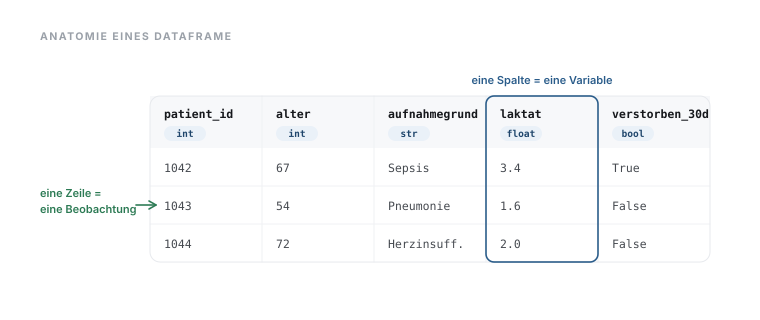

# 03 · Programmiergrundlagen in Python und R

> **Teil 1 – Grundlagen und Setup** · Dauer: ~90 min · Voraussetzung: Modul 02 (Entwicklungsumgebung und Werkzeuge)

## Lernziele
- **Variablen und Datentypen** in Python und R benennen und verwenden können –
  von `int`/`float`/`str`/`bool` über fehlende Werte bis zu Objekten und Klassen.

- **Sammlungen** (Liste, Dictionary, Tupel), **DataFrames** und die **Datenformate
  CSV und JSON** als Grundbausteine tabellarischer und verschachtelter Daten verstehen.

- **Funktionen** schreiben und aufrufen, um Code wiederverwendbar zu machen.
- **Kontrollfluss** (Bedingungen, Schleifen) auf klinische Mini-Beispiele anwenden.
- Erste Schritte mit dem Kohortendatensatz: Spalten auswählen, Zeilen filtern.

## Klinischer Aufhänger

Der Pflegedienst hat dir eine Liste von Körpertemperaturen übergeben:
`[36.8, 37.2, 38.9, 36.5, 39.4, 37.1]`. Welche Patient:innen haben Fieber
(≥ 38,0 °C)? Wie hoch ist der Mittelwert?

In einer Tabellenkalkulation klickst du dich durch. Mit Code schreibst du
die Funktion einmal und wendest sie auf 500 Patient:innen genauso leicht an
wie auf 6.

## 1 Variablen und Datentypen

Eine **Variable** ist ein benannter Speicherplatz. Der **Datentyp** legt fest,
welche Werte möglich und welche Operationen erlaubt sind. Vier Grundtypen
begegnen dir ständig – hier in klinischer Anschauung:

- **Ganzzahl (`int`, von *integer*)** – eine Zahl **ohne** Nachkommastellen, zum
  Zählen: Alter in Jahren (`67`), Anzahl Voroperationen (`2`). Damit rechnet man
  wie mit Zahlen auf Papier.

- **Kommazahl (`float`, von *floating point*)** – eine Zahl **mit**
  Nachkommastellen für Messwerte: Temperatur (`38.9`), Kreatinin (`1.4`).
  Wichtig: In Python und R trennt ein **Punkt** die Dezimalstellen, kein Komma –
  `38.9`, nicht `38,9`.

- **Text (`str`, von *string* = Zeichenkette)** – eine Folge von Zeichen in
  Anführungszeichen: `"Sepsis"`, `"w"`. Sieht eine Zahl wie Text aus (`"38.9"`
  mit Anführungszeichen), kann man damit **nicht** rechnen, bevor man sie
  umwandelt.

- **Wahrheitswert (`bool`, von *boolean*)** – nur **zwei** mögliche Werte, *wahr*
  oder *falsch* (Python `True`/`False`, R `TRUE`/`FALSE`): Diabetes ja/nein,
  verstorben ja/nein. Praktisch zum Filtern und Zählen – die Summe der Ja-Fälle
  ist einfach die Zahl der `True`-Werte.

Zwei weitere Einzelwerte begegnen dir in klinischen Daten laufend:

- **Fehlender Wert** – „nicht erhoben / unbekannt" ist ein *eigener* Wert (Python
  `None`, in Tabellen `NaN`; R `NA`). Fehlend ist **nicht** null: ein nicht
  gemessenes Laktat ist nicht `0`. Rechnungen mit einem fehlenden Wert ergeben
  wieder „fehlend" – deshalb müssen fehlende Werte bewusst behandelt werden (Modul 06 (Datenbereinigung und Datentransformation)).

- **Datum/Zeit** – Aufnahme- und Entlassdatum sind ein eigener Typ (`datetime` bzw.
  `Date`), **kein** Text. Nur als echtes Datum lassen sich Zeiträume berechnen
  (Liegedauer = Entlassung − Aufnahme).

> **Merksatz:** Der Typ entscheidet, was mit einem Wert sinnvoll ist: Temperaturen
> (`float`) darf man mitteln, Diagnosen (`str`) nicht; ein `bool` lässt sich direkt
> aufsummieren, um Fälle zu zählen.

Die Tabelle fasst die vier Typen mit ihren Namen in Python und R zusammen:

| Datentyp | Python | R | Beispiel |
|----------|--------|---|---------|
| Ganzzahl | `int` | `integer` | Patientenalter |
| Kommazahl | `float` | `numeric` | Körpertemperatur |
| Text | `str` | `character` | Aufnahmegrund |
| Wahrheitswert | `bool` | `logical` | Diabetes ja/nein |

```python
age: int           = 67        # integer  — patient age
temperature: float = 38.9      # float    — body temperature
admission_reason: str = "Sepsis"  # str  — diagnosis
has_diabetes: bool = True      # bool     — comorbidity flag

print(type(age))               # <class 'int'>
```

<div class="code-verbalization" markdown="1">
🗣 **Code-Verbalisierung:**

* `age = 67`: Erstelle eine Variable namens `age` (Alter) und weise ihr den ganzzahligen Wert `67` zu.
* `temperature = 38.9`: Erstelle eine Variable `temperature` mit dem Dezimalwert `38.9`.
* `admission_reason = "Sepsis"`: Erstelle eine Variable `admission_reason` mit der Zeichenkette (Text) `"Sepsis"`.
* `has_diabetes = True`: Erstelle eine Variable `has_diabetes` mit dem Wahrheitswert `True` (wahr).
</div>

```r
age             <- 67L         # integer
temperature     <- 38.9        # numeric
admission_reason <- "Sepsis"   # character
has_diabetes    <- TRUE        # logical

class(age)                     # "integer"
```

<div class="code-verbalization" markdown="1">
🗣 **Code-Verbalisierung:**

* `age <- 67L`: Erstelle eine Variable namens `age` und weise ihr mit dem Zuweisungspfeil `<-` den ganzzahligen Wert `67` zu; das `L` markiert die Zahl explizit als Integer (Ganzzahl) in R.
* `temperature <- 38.9`: Erstelle eine Variable `temperature` mit dem Dezimalwert (`numeric`) `38.9`.
* `admission_reason <- "Sepsis"`: Erstelle eine Variable `admission_reason` mit der Zeichenkette (`character`) `"Sepsis"`.
* `has_diabetes <- TRUE`: Erstelle eine Variable `has_diabetes` mit dem Wahrheitswert (`logical`) `TRUE`.
* `class(age)`: Fragt den Datentyp von `age` ab und gibt `"integer"` aus.
</div>

**Stolperstein:** Textzahlen aus CSV-Dateien sind nicht automatisch numerisch.
`"38.9" + 1` wirft in Python einen `TypeError`, Textzahlen müssen zuerst
konvertiert werden (`float("38.9")`). `pandas` erledigt das beim Einlesen
meist automatisch, doch prüfe die Typen nach dem Laden (`df.dtypes`).

**Darüber hinaus:** Verwende Typ-Annotationen in Python-Funktionen
(`def has_fever(temperature: float) -> bool:`). Sie dienen als
maschinenlesbare Dokumentation und speisen in modernen Editoren
Autovervollständigung und Fehlerprüfung.

## 2 Vektoren und Listen

Ein **Vektor** (Python: Liste oder NumPy-Array; R: `vector`) fasst mehrere Werte
desselben Typs zusammen. Vektoren sind die Grundlage jeder Tabellenspalte.

```python
temperatures = [36.8, 37.2, 38.9, 36.5, 39.4, 37.1]

print("Count:", len(temperatures))
print("Maximum:", max(temperatures))
print(f"Mean: {sum(temperatures) / len(temperatures):.2f}")

# Indexing — Python counts from 0.
print("First (index 0):", temperatures[0])    # 36.8
print("Last  (index -1):", temperatures[-1])  # 37.1
```

<div class="code-verbalization" markdown="1">
🗣 **Code-Verbalisierung:**

* `temperatures = [36.8, 37.2, ...]`: Erstellt eine Liste mit sechs Temperaturwerten und speichert sie unter dem Namen `temperatures`.
* `len(temperatures)`: Zählt, wie viele Werte in der Liste stehen (hier 6).
* `max(temperatures)`: Ermittelt den größten Wert in der Liste.
* `sum(temperatures) / len(temperatures)`: Berechnet den Mittelwert — Summe aller Werte geteilt durch ihre Anzahl.
* `temperatures[0]`: Greift auf das **erste** Element der Liste zu — Python zählt Positionen ab `0`.
* `temperatures[-1]`: Greift auf das **letzte** Element zu — ein negativer Index zählt vom Ende der Liste rückwärts.
</div>

```r
temperatures <- c(36.8, 37.2, 38.9, 36.5, 39.4, 37.1)

length(temperatures)                          # 6
max(temperatures)                             # 39.4
sprintf("Mean: %.2f", mean(temperatures))     # "Mean: 37.65"

# Indexing — R counts from 1.
temperatures[1]                               # 36.8
temperatures[length(temperatures)]            # 37.1
```

<div class="code-verbalization" markdown="1">
🗣 **Code-Verbalisierung:**

* `temperatures <- c(36.8, 37.2, ...)`: Baut mit `c()` (*combine*) einen Vektor aus sechs Temperaturwerten und speichert ihn als `temperatures`.
* `length(temperatures)`: Zählt, wie viele Werte der Vektor enthält.
* `max(temperatures)`: Ermittelt den größten Wert im Vektor.
* `mean(temperatures)`: Berechnet den Mittelwert aller Werte direkt über eine eingebaute Funktion.
* `temperatures[1]`: Greift auf das **erste** Element zu — R zählt Positionen ab `1`, nicht ab `0` wie Python.
* `temperatures[length(temperatures)]`: Greift auf das **letzte** Element zu, indem die zuvor berechnete Länge als Index verwendet wird.
</div>

**Stolperstein:** Python zählt Indizes ab **0**, R ab **1**. Das ist einer
der häufigsten Fehler beim Wechsel zwischen den Sprachen. `temperatures[0]`
aus Python unverändert nach R übertragen liefert `NA`, keinen Fehler,
sondern einen stillen falschen Wert.

**Darüber hinaus:** In Python liefert ein NumPy-Array (`np.array(temperatures)`)
dieselben Operationen wie eine Liste, aber ca. 10–100× schneller bei großen
Datensätzen. Ab einigen Tausend Einträgen ist `np.array` die richtige Wahl.

Neben der geordneten Liste brauchst du zwei weitere Sammlungen:

- **Dictionary (`dict` in Python; benannte Liste in R)** – Paare aus
  **Schlüssel → Wert**, wie ein beschrifteter Datensatz. Zugriff über den *Namen*,
  nicht über die Position. So sind die Felder einer Patient:in und eine
  JSON-Antwort aufgebaut (Modul 04 (Datenimport aus Dateien und APIs)).

- **Tupel (`tuple`)** – eine kleine, **feste** Wertegruppe, die sich nicht mehr
  ändert, z. B. die Form einer Tabelle `(500, 16)` (unsere Kohorte, siehe Abschnitt 5).

```python
patient = {"alter": 67, "diagnose": "Sepsis", "sofa": 8}
print(patient["diagnose"])     # "Sepsis"  — Zugriff über den Schlüssel, nicht [0]
print(list(patient.keys()))    # ['alter', 'diagnose', 'sofa']
```

<div class="code-verbalization" markdown="1">
🗣 **Code-Verbalisierung:**

* `patient = {"alter": 67, "diagnose": "Sepsis", "sofa": 8}`: Erstellt ein Dictionary — Paare aus Schlüssel und Wert — und speichert es als `patient`.
* `patient["diagnose"]`: Liest den Wert zum Schlüssel `"diagnose"` aus, also `"Sepsis"` — der Zugriff erfolgt über den Namen, nicht über eine Position wie `[0]`.
* `list(patient.keys())`: Gibt alle Schlüssel des Dictionarys als Liste aus.
</div>

```r
patient <- list(alter = 67, diagnose = "Sepsis", sofa = 8)
patient$diagnose               # "Sepsis"  — Zugriff über den Namen
names(patient)                 # "alter" "diagnose" "sofa"
```

<div class="code-verbalization" markdown="1">
🗣 **Code-Verbalisierung:**

* `patient <- list(alter = 67, diagnose = "Sepsis", sofa = 8)`: Erstellt eine `list()` — R's Sammlung für benannte Werte unterschiedlichen Typs — und speichert sie als `patient`.
* `patient$diagnose`: Liest den Wert zum Namen `diagnose` aus, also `"Sepsis"` — der Zugriff erfolgt über den Namen mit `$`, nicht über eine Position.
* `names(patient)`: Gibt alle Namen (Schlüssel) der Liste aus.
</div>

## 3 Funktionen

Eine **Funktion** fasst wiederverwendbaren Code zusammen. Sie nimmt **Parameter**
entgegen und gibt einen **Rückgabewert** zurück.

```python
FEVER_THRESHOLD = 38.0   # constant — change in one place only

def has_fever(temperature: float, threshold: float = FEVER_THRESHOLD) -> bool:
    """Return True when the temperature meets or exceeds the fever threshold."""
    return temperature >= threshold

print(has_fever(38.9))              # True
print(has_fever(37.2))              # False
print(has_fever(37.5, threshold=37.5))  # True

# Apply to the whole list via list comprehension.
fever_readings = [t for t in temperatures if has_fever(t)]

# A second function, several branches instead of a single threshold.
def bmi_category(bmi: float) -> str:
    """Classify a BMI value according to WHO categories."""
    if bmi >= 30:
        return "adipös"
    elif bmi >= 25:
        return "übergewichtig"
    elif bmi >= 18.5:
        return "normalgewichtig"
    else:
        return "untergewichtig"

print(bmi_category(27.1))           # "übergewichtig"
```

<div class="code-verbalization" markdown="1">
🗣 **Code-Verbalisierung:**

* `def has_fever(temperature, threshold=FEVER_THRESHOLD)`: Definiere eine Funktion namens `has_fever`. Sie nimmt als Eingaben den Messwert `temperature` und einen optionalen Schwellenwert `threshold` entgegen (standardmäßig auf `FEVER_THRESHOLD`, also `38.0`, gesetzt).
* `return temperature >= threshold`: Vergleiche, ob `temperature` größer oder gleich `threshold` ist, und gib das Ergebnis (`True` oder `False`) als Rückgabewert zurück.
</div>

```r
library(dplyr)   # for case_when(), used below and in Section 4

FEVER_THRESHOLD <- 38.0

has_fever <- function(temperature, threshold = FEVER_THRESHOLD) {
  # In R, this function automatically works on vectors.
  temperature >= threshold
}

has_fever(38.9)                     # TRUE
has_fever(c(36.8, 38.9, 37.1))     # FALSE TRUE FALSE

# A second function — several branches via case_when(), R's vectorised
# alternative to a chain of if/else.
bmi_category <- function(bmi) {
  case_when(
    is.na(bmi)  ~ "unbekannt",
    bmi >= 30   ~ "adipös",
    bmi >= 25   ~ "übergewichtig",
    bmi >= 18.5 ~ "normalgewichtig",
    .default    = "untergewichtig"
  )
}

bmi_category(27.1)                  # "übergewichtig"
```

<div class="code-verbalization" markdown="1">
🗣 **Code-Verbalisierung:**

* `library(dplyr)`: Lädt das Paket `dplyr`, das die Funktion `case_when()` bereitstellt, die weiter unten gebraucht wird.
* `has_fever <- function(temperature, threshold = FEVER_THRESHOLD) { temperature >= threshold }`: Definiert eine Funktion namens `has_fever`, die den Messwert `temperature` und einen optionalen Schwellenwert `threshold` (standardmäßig `FEVER_THRESHOLD`) entgegennimmt und als Ergebnis zurückgibt, ob `temperature` größer oder gleich `threshold` ist.
* `has_fever(c(36.8, 38.9, 37.1))`: Da R-Funktionen automatisch vektorisiert sind, liefert der Aufruf mit einem ganzen Vektor von Werten direkt einen Vektor von Wahrheitswerten zurück.
* `case_when(is.na(bmi) ~ "unbekannt", bmi >= 30 ~ "adipös", ...)`: Prüft die Bedingungen der Reihe nach von oben nach unten und gibt beim ersten Zutreffen den zugehörigen Text zurück; `.default` fängt alle übrigen Fälle auf.
</div>

**Stolperstein:** `case_when()` kommt aus dem Paket `dplyr`, nicht aus
Basis-R. Ohne vorheriges `library(dplyr)` bricht es mit
`Error: could not find function "case_when"` ab, deshalb steht `library(dplyr)`
hier bereits am Anfang des Blocks, bevor `case_when()` das erste Mal
verwendet wird.

**Stolperstein:** Keine Magic Numbers im Code, statt `if temp >= 38.0`
überall eine Konstante `FEVER_THRESHOLD = 38.0` definieren. Ändert sich die
Schwelle, passt du nur eine Stelle an, nicht zehn.

**Darüber hinaus:** In R sind Funktionen automatisch **vektorisiert**, sofern sie
Basisoperatoren verwenden, `has_fever(temperatures)` gibt einen logischen
Vektor zurück. In Python erledigt das `pandas` (`df["temp"].apply(has_fever)`
oder `df["temp"] >= 38.0`).

## 4 Kontrollfluss

**Bedingungen** (`if/else`) und **Schleifen** (`for`) steuern, welcher Code
wann ausgeführt wird.

```python
# Clinical fever severity tiers
for temp in [37.2, 38.4, 39.6]:
    if temp >= 39.0:
        level = "Hohes Fieber — ärztliche Beurteilung erforderlich"
    elif temp >= FEVER_THRESHOLD:
        level = "Fieber"
    else:
        level = "Kein Fieber"
    print(f"  {temp} °C -> {level}")
```

<div class="code-verbalization" markdown="1">
🗣 **Code-Verbalisierung:**

* `for temp in [37.2, 38.4, 39.6]`: Nimm nacheinander jede einzelne Temperatur `temp` aus der Liste `[37.2, 38.4, 39.6]` und führe die folgenden eingerückten Schritte aus.
* `if temp >= 39.0`: Falls die aktuelle Temperatur größer oder gleich `39.0` ist, setze `level` auf `"Hohes Fieber..."`.
* `elif temp >= FEVER_THRESHOLD`: Andernfalls (`elif` = else if), falls die Temperatur größer oder gleich `FEVER_THRESHOLD` (`38.0`) ist, setze `level` auf `"Fieber"`.
* `else`: In allen anderen Fällen setze `level` auf `"Kein Fieber"`.
* `print(...)`: Gib die Temperatur und das zugehörige Fieber-Level aus.
</div>

```r
library(dplyr)   # case_when() lives here — repeated so this block is self-contained.

# Vectorised operations are idiomatic in R — case_when replaces for-loops.
temps  <- c(37.2, 38.4, 39.6)
levels <- case_when(
  temps >= 39.0          ~ "Hohes Fieber — ärztliche Beurteilung erforderlich",
  temps >= FEVER_THRESHOLD ~ "Fieber",
  .default               = "Kein Fieber"
)
```

<div class="code-verbalization" markdown="1">
🗣 **Code-Verbalisierung:**

* `library(dplyr)`: Lädt erneut das Paket `dplyr` für `case_when()` — wiederholt, damit dieser Codeblock für sich allein funktioniert.
* `temps <- c(37.2, 38.4, 39.6)`: Baut einen Vektor mit den drei Temperaturwerten.
* `temps >= 39.0 ~ "Hohes Fieber..."`: Prüft für **alle** Werte in `temps` gleichzeitig, ob sie größer oder gleich `39.0` sind, und weist den passenden Text zu — statt wie in Python mit einer Schleife Wert für Wert.
* `temps >= FEVER_THRESHOLD ~ "Fieber"`: Die nächste Bedingung, geprüft für alle Werte, die die erste Bedingung nicht erfüllt haben.
* `.default = "Kein Fieber"`: Der Text für alle übrigen Werte, die keine der Bedingungen erfüllen (entspricht `else`).
</div>

**Stolperstein:** In Python sind `for`-Schleifen über DataFrame-Zeilen
(`for i, row in df.iterrows()`) sehr langsam. Idiomatisch ist stets eine
vektorisierte Operation: `df["level"] = df["temp"].apply(classify)`
oder direkt `np.where(df["temp"] >= 39.0, ...)`.

**Darüber hinaus:** Klinische Schwellenwerte, MAP < 65 mmHg (Sepsis-Leitlinie),
CRP > 50 mg/l (Entzündungsmarker), als benannte Konstanten im Skript
definieren. So bleibt der klinische Bezug auch Monate später lesbar.

## 5 DataFrames, Tabellen im Code

Ein **DataFrame** (`pandas.DataFrame` in Python; `data.frame` / `tibble` in R)
ist eine zweidimensionale Tabelle: Zeilen sind Beobachtungen (Patient:innen),
Spalten sind Variablen (Alter, Diagnose, …).



```python
import pandas as pd

cohort = pd.read_csv("{{DATEN}}kohorte.csv")

print(cohort.shape)                              # (500, 16)
print(cohort.dtypes)                             # types per column
print(cohort[["alter", "sofa_score"]].head(5))   # select columns

# Filter rows — only patients with Sepsis.
septic = cohort[cohort["aufnahmegrund"] == "Sepsis"]
print(f"Septic patients: {len(septic)}")

# Derive a new column — BMI category for the whole cohort, reusing the
# bmi_category() function defined in Section 3.
cohort["bmi_cat"] = cohort["bmi"].apply(
    lambda b: bmi_category(b) if pd.notna(b) else "unbekannt"
)
```

<div class="code-verbalization" markdown="1">
🗣 **Code-Verbalisierung:**

* `cohort = pd.read_csv(...)`: Liest die Kohorten-Tabelle ein und speichert sie als DataFrame `cohort`.
* `cohort.shape`: Gibt die Größe der Tabelle aus, (Zeilen, Spalten).
* `cohort.dtypes`: Gibt den Datentyp jeder einzelnen Spalte aus.
* `cohort[["alter", "sofa_score"]].head(5)`: Wählt nur die zwei genannten Spalten aus und zeigt davon die ersten fünf Zeilen.
* `septic = cohort[cohort["aufnahmegrund"] == "Sepsis"]`: Filtert die Tabelle auf die Zeilen, bei denen die Spalte `aufnahmegrund` den Wert `"Sepsis"` hat, und speichert das Ergebnis als eigene, kleinere Tabelle `septic`.
* `cohort["bmi_cat"] = cohort["bmi"].apply(lambda b: ...)`: Erstellt eine neue Spalte `bmi_cat`, indem die Funktion `bmi_category()` (aus Abschnitt 3) auf jeden Wert der Spalte `bmi` angewendet wird.
</div>

```r
library(dplyr)
library(readr)
cohort <- read_csv("{{DATEN}}kohorte.csv", show_col_types = FALSE)

dim(cohort)                                      # 500 16
glimpse(cohort)
cohort |> select(alter, sofa_score) |> head(5)

septic <- cohort |> filter(aufnahmegrund == "Sepsis")
cat("Septic patients:", nrow(septic), "\n")

# Reuse the bmi_category() function defined in Section 3.
cohort <- cohort |> mutate(bmi_cat = bmi_category(bmi))
```

<div class="code-verbalization" markdown="1">
🗣 **Code-Verbalisierung:**

* `library(dplyr)`, `library(readr)`: Lädt die Pakete für Tabellenmanipulation (`dplyr`) und zum Einlesen von CSV-Dateien (`readr`).
* `cohort <- read_csv(...)`: Liest die Kohorten-Tabelle ein und speichert sie als `cohort`.
* `dim(cohort)`: Gibt die Größe der Tabelle aus, Zeilen und Spalten.
* `cohort |> select(alter, sofa_score) |> head(5)`: Leitet (`|>`, Pipe-Operator) `cohort` zuerst in `select()`, das nur die zwei genannten Spalten behält, und dann in `head(5)`, das die ersten fünf Zeilen davon zeigt.
* `septic <- cohort |> filter(aufnahmegrund == "Sepsis")`: Filtert die Tabelle auf Zeilen mit `aufnahmegrund == "Sepsis"` und speichert das Ergebnis als eigene Tabelle `septic`.
* `cohort <- cohort |> mutate(bmi_cat = bmi_category(bmi))`: Erstellt eine neue Spalte `bmi_cat`, indem die Funktion `bmi_category()` (aus Abschnitt 3) auf die Spalte `bmi` angewendet wird.
</div>

**Stolperstein:** `df["aufnahmegrund"] == "Sepsis"` gibt in pandas einen
booleschen Vektor, nicht die gefilterten Zeilen. Erst `df[mask]` selektiert.
Häufiger Fehler: das Filterergebnis einer neuen Spalte statt einer neuen
Variable zuzuweisen.

**Darüber hinaus:** `df.query("aufnahmegrund == 'Sepsis' and sofa_score >= 6")`
ist oft lesbarer als verschachtelte boolesche Masken, gerade bei komplexen
Filterbedingungen.

## 6 Objekte, Klassen und Datenformate

**Objekt und Klasse.** Ein **Objekt** bündelt Daten *und* die dazu passenden
Funktionen. Eine **Klasse** ist die Bauvorlage, nach der solche Objekte entstehen.
Der `cohort`-DataFrame aus Abschnitt 5 ist ein Objekt: Er trägt Daten (die Tabelle)
und mitgelieferte Funktionen – **Methoden** genannt –, die man mit einem Punkt
aufruft: `cohort.mean()`, `cohort.head()`. Auch `str` und `list` sind Klassen mit
Methoden (`"sepsis".upper()`, `liste.append(x)`). Fürs Erste genügt: **Punkt =
„rufe eine Funktion dieses Objekts auf".** Eigene Klassen wirst du selten schreiben.

**Praxis:** Woran ein Objekt „ist, was es ist", verrät sein Typ: `type(cohort)`
in Python bzw. `class(cohort)` in R. Genau dieser Typ entscheidet, welche Methoden
zur Verfügung stehen.

**Datenformate.** Daten kommen fast immer aus **Dateien** in einem von zwei Formaten:

- **CSV** (*comma-separated values*) – eine **flache Tabelle** als reiner Text,
  eine Zeile pro Beobachtung, Werte durch Komma oder Semikolon getrennt. Öffnet in
  Excel, ist aber ebenso von Code lesbar. Beim Einlesen wird jede Spalte zu einem
  DataFrame-Spaltentyp – **prüfe die Typen danach** (`df.dtypes`).

- **JSON** (*JavaScript Object Notation*) – **verschachtelte** Schlüssel-Wert-Paare,
  also genau die dict-/Listen-Struktur von oben, als Text. Das Format von Web-APIs
  und FHIR. Ein Wert kann selbst ein Objekt oder eine Liste sein – geeignet für
  hierarchische Daten (eine Patient:in mit mehreren Befunden), wo eine flache CSV
  an Grenzen stößt.

```json
{"patient_id": "A17", "alter": 67,
 "diagnosen": ["Sepsis", "Diabetes"],
 "vital": {"hf": 110, "map": 62}}
```

Dieselben Daten als CSV wären flach – eine Zeile, feste Spalten, keine
Verschachtelung:

```text
patient_id,alter,diagnose_1,diagnose_2,hf,map
A17,67,Sepsis,Diabetes,110,62
```

> **Merksatz:** CSV ist eine flache Tabelle (→ DataFrame), JSON eine verschachtelte
> Struktur (→ dict/Liste). Beides ist nur Text, bis der Code es in typisierte Werte
> verwandelt. Wie du CSV und JSON tatsächlich einliest, zeigt Modul 04 (Datenimport aus Dateien und APIs); Datenbanken
> per SQL Modul 05 (Datenbank-Abfragen mit SQL).

## Fallstricke und Merksätze
- **Python zählt ab 0, R ab 1.** Beides ist konsistent, aber nicht
 miteinander. Wer zwischen den Sprachen wechselt, prüft Indizes doppelt.

- **Typen kennen, bevor du rechnest.** Textzahlen aus CSV-Dateien müssen
 zuerst konvertiert werden, pandas erledigt das meist automatisch.

- **Keine Magic Numbers.** Klinische Schwellenwerte als benannte Konstanten
 definieren. Änderungen erfolgen dann nur an einer Stelle.

- **Funktionen früh schreiben.** Kommt ein Code-Block dreimal vor,
 ist es eine Funktion. Wiederholung erzeugt Fehler und erschwert die Wartung.

- In R sind Vektoroperationen idiomatischer und schneller als `for`-Schleifen.
 In Python übernimmt `pandas` diese Rolle.

## Selbstcheck
1. **Warum beginnt Python bei Index 0, und was bedeutet `temperatures[-1]`?**, Python zählt ab Null; negativer Index zählt vom Ende: `[-1]` liefert das letzte Element.
2. **Was ist der Unterschied zwischen einer Python-Liste und einem R-Vektor?**, Beide sind geordnete Sammlungen; R-Vektoren sind strikt typenrein (alle Elemente gleicher Typ), Python-Listen können gemischte Typen enthalten.
3. **Wann schreibt man eine Funktion, statt den Code zu wiederholen?**, Sobald derselbe Code-Block mehr als zweimal vorkommt, Wiederholung erzeugt Fehler und erschwert Korrekturen.
4. **Worin unterscheiden sich CSV und JSON, und wozu passt ein `dict`?**, CSV ist eine flache Tabelle (wird zum DataFrame), JSON eine verschachtelte Schlüssel-Wert-Struktur (entspricht einem `dict` bzw. einer Liste); JSON eignet sich für hierarchische Daten, CSV für rein tabellarische.
5. **Warum ist ein fehlender Wert (`NaN`/`NA`) nicht dasselbe wie `0`?**, `0` ist ein gemessener Wert, „fehlend" heißt „nicht erhoben/unbekannt"; sie zu verwechseln verfälscht Mittelwerte und Zählungen.

