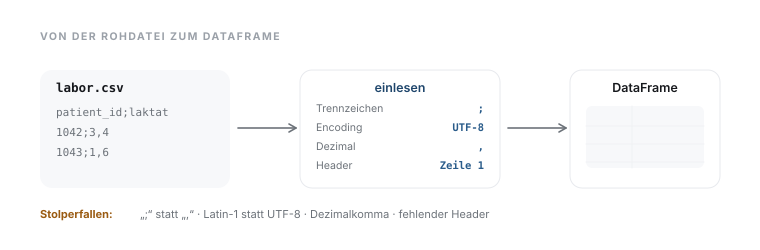

# 04 · Datenimport aus Dateien und APIs

> **Teil 2 – Datenimport, Datenbereinigung und Datenmanagement** · Dauer: ~50 min · Voraussetzung: Module 02–03 (Umgebung und Grundlagen)

## Lernziele
- CSV-Dateien mit unterschiedlichen **Trennzeichen, Encodings und Dezimalkommas** korrekt einlesen.
- **Excel**- und **JSON**-Dateien laden und in einen DataFrame überführen.
- Daten von einer **Web-API** abrufen, mit robustem Offline-Fallback.
- Verstehen, was **FHIR** und **REDCap** sind und welche Datenstrukturen dahinterstecken.
- Dasselbe Ergebnis in **`pandas`** (Python) und **`readr`/`readxl`/`jsonlite`** (R) erzeugen.

## Klinischer Aufhänger
Dein Klinikum exportiert Labordaten als Semikolon-getrennte CSV-Datei mit
Dezimalkomma, ein Kollege liefert Einschlusskriterien als Excel-Tabelle, und
die Radiologie stellt Befunde per REST-API bereit. Vor der Analyse müssen alle
Quellen **zuverlässig und nachvollziehbar** eingelesen werden.

## 1 CSV: Trennzeichen, Encoding, Dezimalkomma



CSV ist das häufigste Exportformat in klinischen IT-Systemen, aber keineswegs
einheitlich. Drei Fußangeln begegnen dir fast täglich:

| Problem | Ursache | Lösung |
|---------|---------|--------|
| Spalten verschmelzen | Trennzeichen `;` statt `,` | `sep=";"` / `read_delim(delim=";")` |
| Umlaute unleserlich | Encoding `latin-1` statt `utf-8` | `encoding="latin-1"` / `locale(encoding="latin-1")` |
| Zahlen nicht erkannt | Dezimalkomma `,` statt `.` | `decimal=","` / `locale(decimal_mark=",")` |

In Deutschland sind Semikolon und Dezimalkomma das Standard-Exportformat
vieler KIS/LIS-Systeme. **Öffne die Rohdatei immer zuerst im Texteditor**,
bevor du sie einliest.

`pandas` liest CSV-Dateien direkt von einer Web-Adresse ein, kein lokaler
Download nötig. `{{DATEN}}` steht für die Basis-Adresse der Kursdaten.

```python
import pandas as pd

# Standard case: comma-separated, UTF-8.
cohort = pd.read_csv("{{DATEN}}kohorte.csv")

# German hospital format: semicolon, latin-1, decimal comma.
cohort_de = pd.read_csv(
    "{{DATEN}}kohorte_de.csv",
    sep=";",
    encoding="latin-1",
    decimal=",",
)

# Load only specific columns (saves memory).
subset = pd.read_csv("{{DATEN}}kohorte.csv",
                     usecols=["patient_id", "alter", "aufnahmegrund"])
```

<div class="code-verbalization" markdown="1">
**Zeile für Zeile:**

* `cohort_de = pd.read_csv(...)`: Lese eine CSV-Datei ein und speichere sie in der Variablen `cohort_de`.
* `"{{DATEN}}kohorte_de.csv"`: Die Web-Adresse der Datei.
* `sep=";"`: Verwende das Semikolon `;` als Trennzeichen zwischen den Spalten.
* `encoding="latin-1"`: Verwende die Latin-1-Zeichenkodierung (oft bei alten Windows-KIS-Systemen nötig für Umlaute).
* `decimal=","`: Erkenne das Komma `,` als Dezimaltrennzeichen für Fließkommazahlen (damit z. B. `1,4` korrekt als Zahl `1.4` eingelesen wird).
</div>

`readr` liest ebenfalls direkt von einer Web-Adresse:

```r
library(readr)

# Standard case.
cohort <- read_csv("{{DATEN}}kohorte.csv", show_col_types = FALSE)

# German hospital format: semicolon + decimal comma.
cohort_de <- read_delim(
  "{{DATEN}}kohorte_de.csv",
  delim = ";",
  locale = locale(encoding = "latin1", decimal_mark = ","),
  show_col_types = FALSE
)

# Shorthand for German format.
cohort_de2 <- read_csv2("{{DATEN}}kohorte_de.csv",
                         locale = locale(encoding = "latin1"),
                         show_col_types = FALSE)
```

**Stolperstein:** Lässt du `encoding="latin-1"` weg, bricht pandas mit einem
`UnicodeDecodeError` ab: Das `ä` in `männlich` ist in Latin-1 ein einzelnes Byte,
das in UTF-8 so nicht vorkommen darf. `readr` bricht nicht ab, sondern liest
still weiter und zeigt das rohe Byte an: `m<e4>nnlich`. Der umgekehrte Fall,
eine UTF-8-Datei als Latin-1 gelesen, erzeugt die bekannten `ä` statt `ä`.

**Stolperstein:** Wenn Zahlen nach dem Einlesen als `object` (Python) oder
`character` (R) erscheinen, ist meist das falsche Dezimalzeichen schuld.
Prüfe direkt nach dem Laden `df.dtypes` (Python) oder `glimpse(df)` (R), das zeigt das Problem sofort.

**Darüber hinaus:** Bei großen Dateien (> 1 GB) lohnt sich `usecols` in
pandas bzw. `col_select` in readr, um nur die benötigten Spalten einzulesen.
Das spart Arbeitsspeicher und Zeit, besonders relevant bei Rohdaten aus
Labor- oder Bildgebungssystemen.

## 2 Excel: Tabellenblätter und Zellbereiche

Excel-Dateien sind in der klinischen Praxis allgegenwärtig: Erhebungsbögen,
Einschlusslisten, manuelle Ergänzungen. `pandas` nutzt im Hintergrund
`openpyxl` (`.xlsx`).

`pandas` liest Excel-Dateien ebenfalls direkt von einer Web-Adresse:

```python
import pandas as pd

# First sheet (default).
table = pd.read_excel("{{DATEN}}einschluss.xlsx")

# Specific sheet, specific columns.
lab_data = pd.read_excel(
    "{{DATEN}}einschluss.xlsx",
    sheet_name="Labor",
    usecols="A:F",
)
```

`readxl` kann keine Web-Adresse direkt öffnen; lade die Datei zuerst in eine
temporäre Datei herunter:

```r
library(readxl)

tmp <- tempfile(fileext = ".xlsx")
download.file("{{DATEN}}einschluss.xlsx", tmp, mode = "wb", quiet = TRUE)

# First sheet.
table <- read_excel(tmp)

# Specific sheet.
lab_data <- read_excel(tmp, sheet = "Labor")
```

**Stolperstein:** `sheet_name=0` (Python) greift per Index auf das erste Blatt
zu. Das funktioniert, ist aber spröde: Fügt ein Kollege vorne ein Blatt ein
oder ändert die Reihenfolge, liest der Code still das falsche Blatt. Gib den
Namen explizit an (`sheet_name="Kohorte"`); fehlt das Blatt, bricht der Code
wenigstens mit einer klaren Fehlermeldung ab.

**Darüber hinaus:** Excel-Dateien enthalten oft versteckte Formatierungen,
Farben oder verbundene Zellen. Mit `pd.ExcelFile("datei.xlsx").sheet_names`
(Python) oder `excel_sheets("datei.xlsx")` (R) siehst du zuerst, was
wirklich in der Datei steckt.

## 3 JSON: API-Antworten und verschachtelte Strukturen

JSON ist das Standardformat von REST-APIs und damit die Sprache moderner
Krankenhaus-IT (FHIR, SMART on FHIR, REDCap-API). Es erlaubt verschachtelte
Strukturen, die beim Einlesen Aufmerksamkeit erfordern.

`pandas` liest flaches JSON direkt von einer Web-Adresse; für verschachteltes
JSON lädst du die Antwort zuerst mit `urllib` (Teil der Standardbibliothek,
keine Zusatzinstallation nötig) und normalisierst sie danach:

```python
import json
import urllib.request
import pandas as pd

# Flat JSON directly into a DataFrame.
df = pd.read_json("{{DATEN}}beispiel.json")

# Nested JSON: fetch with urllib, then json_normalize.
with urllib.request.urlopen("{{DATEN}}fhir_bundle.json") as response:
    bundle = json.load(response)
df_fhir = pd.json_normalize(bundle["entry"], sep="_")
```

```r
library(jsonlite)
library(tibble)

# Flat JSON – fromJSON() reads URLs directly.
df <- fromJSON("{{DATEN}}beispiel.json")

# Nested JSON -> tibble.
bundle  <- fromJSON("{{DATEN}}fhir_bundle.json", flatten = TRUE)
df_fhir <- as_tibble(bundle$entry)
```

**Stolperstein:** Ohne `pd.json_normalize` (Python; ein bloßes
`pd.DataFrame(bundle["entry"])` reicht nicht) oder `flatten=TRUE` (R) landen
ganze Unterstrukturen in einer einzigen Zelle, ein häufiges Rätsel beim ersten
FHIR-Export. `pd.json_normalize` klappt die Hierarchie auf; `sep="_"` sorgt nur
dafür, dass die Spalten `resource_code_text` oder
`resource_valueQuantity_value` heißen statt `resource.code.text` (die vollständige Spaltenliste dieses Bundles:
`resource_resourceType`, `resource_id`, `resource_gender`, `resource_birthDate`,
`resource_status`, `resource_code_text`, `resource_subject_reference`,
`resource_valueQuantity_value`, `resource_valueQuantity_unit`).

**Darüber hinaus:** Für komplexe FHIR-Daten gibt es spezialisierte Pakete:
`fhirpy` (Python) fragt FHIR-Server komfortabel ab, `fhircrackr` (R) lädt
ganze Bundles und überführt sie in flache Tabellen, deutlich robuster als
manuelle JSON-Normalisierung.

## 4 Web-API: Daten aus dem Internet abrufen

Das Prinzip ist immer gleich: HTTP-GET-Anfrage → JSON-Antwort → in DataFrame
überführen. **Wichtig:** API-Code braucht immer einen **Offline-Fallback**,
damit Skripte auch ohne Netzwerkzugang (z. B. im Klinik-Netz, offline auf
Reisen) reproduzierbar laufen.

Dieses Beispiel nutzt bewusst `urllib` aus der Python-Standardbibliothek
(keine Zusatzinstallation nötig) statt des beliebten Pakets `requests`: Für
einfache GET-Anfragen mit Timeout reicht das völlig.

Ein echter Offline-Fallback darf nicht auf eine *zweite* Web-Adresse
ausweichen – im Klinik-Netz ohne externe Verbindung wäre auch die nicht
erreichbar. Das Muster ist daher **Cache-on-Success**: bei Erfolg wird die
Antwort in eine *lokale* Datei geschrieben, und der Fallback liest genau diese
lokale Datei. So läuft jeder Wiederholungslauf ohne Netzwerk.

```python
import json
import urllib.request
from pathlib import Path
import pandas as pd

URL = "https://disease.sh/v3/covid-19/countries?allowNull=false"
CACHE = Path("api_cache.csv")   # truly local file in the current working directory

# Some APIs reject urllib's default User-Agent ("Python-urllib/...") with HTTP 403.
request = urllib.request.Request(URL, headers={"User-Agent": "data-science-course"})

try:
    with urllib.request.urlopen(request, timeout=5) as response:
        df_api = pd.DataFrame(json.load(response))
    df_api.to_csv(CACHE, index=False)         # keep a copy for offline re-runs
    print(f"API call succeeded: {len(df_api)} countries")
except Exception as exc:
    if CACHE.exists():
        df_api = pd.read_csv(CACHE)            # genuine local fallback (no network)
        print(f"API unreachable ({exc}). Using local cache {CACHE}.")
    else:
        raise SystemExit(f"API unreachable and no local cache {CACHE}: {exc}")
```

```r
library(httr2)
library(jsonlite)

url   <- "https://disease.sh/v3/covid-19/countries?allowNull=false"
cache <- "api_cache.csv"   # truly local file in the current working directory

df_api <- tryCatch({
  response <- request(url) |> req_timeout(5) |> req_perform()
  # flatten = TRUE unpacks the nested countryInfo field, so write_csv() can save it.
  df <- fromJSON(resp_body_string(response), flatten = TRUE) |> tibble::as_tibble()
  readr::write_csv(df, cache)                 # keep a copy for offline re-runs
  df
}, error = function(e) {
  if (file.exists(cache)) {
    message("API unreachable: ", e$message, ". Using local cache ", cache, ".")
    readr::read_csv(cache, show_col_types = FALSE)   # genuine local fallback
  } else {
    stop("API unreachable and no local cache ", cache, ": ", e$message)
  }
})
```

**Stolperstein:** Eine HTTP-Anfrage ohne `timeout` hängt unbegrenzt, wenn
der Server nicht antwortet, z. B. durch eine Firewall. Immer `timeout=5`
(Sekunden) setzen, sonst friert das Skript ein.

**Darüber hinaus:** Echte REDCap- oder FHIR-Integrationen benötigen ein
**API-Token**. Speichere es niemals im Code, sondern als
Umgebungsvariable: `token = os.environ["REDCAP_TOKEN"]`. Das schützt vor
versehentlichem Veröffentlichen in Git.

## 5 Exkurs: FHIR und REDCap

### FHIR (Fast Healthcare Interoperability Resources)
FHIR ist der internationale Standard für den Datenaustausch zwischen
Krankenhaus-IT-Systemen. Daten sind als **Ressourcen** strukturiert
(Patient, Observation, Encounter, MedicationRequest …). Eine FHIR-API liefert
JSON. Für Python gibt es `fhirpy`, für R `fhircrackr`.

Typische FHIR-Anfrage (konzeptionell):
```
GET [Server]/Patient?birthdate=ge1950-01-01&_count=100
→ JSON-Bundle mit einer Liste von Patient-Ressourcen
```

### REDCap (Research Electronic Data Capture)
REDCap ist eines der weltweit am weitesten verbreiteten Systeme für klinische
Forschungsdatenbanken.
Seine REST-API exportiert Daten direkt nach Python/R:

```python
import pandas as pd
import requests   # pinned in requirements.txt (otherwise: uv pip install requests)

# REDCap API (conceptual – substitute your own token and URL).
payload = {
    "token": "MY_API_TOKEN",     # never store in code – use environment variable
    "content": "record",
    "format": "json",
    "type": "flat",
}
r = requests.post("https://redcap.example.org/api/", data=payload, timeout=30)
df_redcap = pd.DataFrame(r.json())
```

Der vollständige, lauffähige Code steht in [`code/python.py`](code/python.py) und
[`code/r.R`](code/r.R).

## Fallstricke und Merksätze
- **Erst die Rohdatei öffnen.** Ein Blick in den Texteditor spart Stunden Debugging:
 Welches Trennzeichen? Gibt es eine Kopfzeile? Sind Umlaute korrekt?

- **Encoding explizit angeben.** `latin-1` (auch `ISO-8859-1` genannt, oft
 eigentlich das verwandte Windows-`cp1252`) ist in älteren deutschen klinischen
 Systemen noch verbreitet. Falsches Encoding zeigt sich als Kauderwelsch bei
 Umlauten (UTF-8-Datei als `latin-1` gelesen: ä → ä) oder als
 `UnicodeDecodeError` (`latin-1`-Datei als UTF-8 gelesen).

- **Dezimalkomma** ist in Deutschland der Standard, `pandas` liest `.` als
 Dezimaltrenner. `decimal=","` (Python) bzw. `locale(decimal_mark=",")` (R)
 nicht vergessen.

- **Offline-Fallback** ist kein Nice-to-have: Code, der ohne Netz nicht läuft,
 ist in der Klinik nicht reproduzierbar.

- **JSON-Normalisierung:** verschachtelte Strukturen (`entry.resource.code`)
 müssen mit `pd.json_normalize` / `flatten=TRUE` aufgeklappt werden, sonst
 landen ganze Unterstrukturen in einer Zelle.

- **Excel-Blattname prüfen.** `sheet_name=0` (erstes Blatt) funktioniert immer,
 liest aber still das falsche Blatt, sobald jemand die Reihenfolge ändert;
 besser explizit benennen.

## Selbstcheck
1. **Warum zeigen Umlaute in einer CSV-Datei manchmal „ä“ statt „ä“?** – Die Datei ist UTF-8-codiert, wird aber als `latin-1` (bzw. `cp1252`) gelesen: Das „ä“ besteht in UTF-8 aus zwei Bytes, die dann als zwei Zeichen erscheinen; `encoding="utf-8"` behebt das. Der umgekehrte Fall (`latin-1`-Datei als UTF-8 gelesen) endet in pandas meist mit einem `UnicodeDecodeError`.
2. **Was passiert, wenn man eine Semikolon-CSV ohne `sep=";"` einliest?** – Alle Spalten landen in einer einzigen Spalte, weil pandas `,` als Trennzeichen erwartet.
3. **Warum braucht API-Code immer einen Offline-Fallback?** – Klinik-Netzwerke sperren oft externe Verbindungen; ohne Fallback ist das Skript nicht reproduzierbar.

