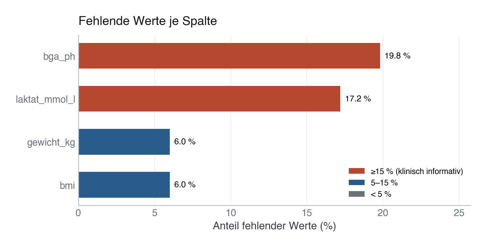
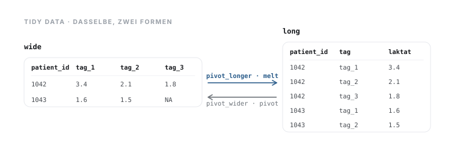

# 06 · Datenbereinigung und Datentransformation

> **Teil 2 – Datenimport, Datenbereinigung und Datenmanagement** · Dauer: ~60 min · Voraussetzung: Module 03–04 (Grundlagen und Daten einlesen)

## Lernziele
- Das **Tidy-Data**-Prinzip verstehen und erkennen, warum es Analysen vereinfacht.
- **Fehlende Werte** sehen, verstehen und begründet behandeln.
- Mit den fünf Kern-Verben **filtern, auswählen, ableiten, gruppiert zusammenfassen, verbinden** arbeiten.
- Zwei Tabellen über einen **Join** verbinden und zwischen **long/wide** umformen.
- Dasselbe Ergebnis in **`pandas`** (Python) und **`dplyr`/`tidyr`** (R) erzeugen.

## Klinischer Aufhänger
Du hast eine Aufnahmekohorte und separat die Laborwerte. Bevor du eine
Frage beantworten kannst – *„Haben septische Patient:innen ein höheres Laktat?“* –
müssen die Daten **sauber** und **zusammengeführt** sein. Genau dieser Schritt
kostet in der Praxis oft den größten Teil der Zeit. Wir machen ihn hier transparent.

## 1 Konzept: Tidy Data

Daten sind „tidy“, wenn

1. **jede Variable eine Spalte** ist,
2. **jede Beobachtung eine Zeile** ist,
3. **jede Beobachtungseinheit eine Tabelle** bildet.

`kohorte.csv` ist bereits tidy (eine Zeile je Patient:in). `vitalwerte.csv` ist
tidy im *long format* (eine Zeile je Messung). Tidy Data ist die Grundlage, auf
der alle folgenden Module aufbauen: sauberer Input, verlässlicher Output.

**Stolperstein:** Viele klinische Exporte kommen im wide-Format (eine Spalte je
Messzeitpunkt). Frage dich vor jeder Berechnung: *Ist das wirklich eine
Variable pro Spalte?* Eine Spalte „Laktat_Tag1“ ist keine Variable, sie vermischt
Merkmal und Zeitpunkt.
**Darüber hinaus:** Im long-Format berechnest du Verläufe aus `vitalwerte.csv`
über alle Tage mit einer einzigen `groupby`-Zeile; im wide-Format müsstest du
jede Tag-Spalte einzeln ansprechen.

## 2 Fehlende Werte zuerst ansehen

Fehlende Werte nie „wegmachen“, bevor du sie verstanden hast. Erst zählen,
dann entscheiden (löschen vs. behalten vs. imputieren). In unseren Daten fehlen
Werte in vier Spalten, aus **drei** verschiedenen Gründen:

| Spalte | fehlend | warum |
|---|---|---|
| `bmi`, `gewicht_kg` | ~6 % | rein zufällig (MCAR) – kostet nur Power |
| `laktat_mmol_l` | ~17 % | hängt vom **`sofa_score`** ab: Schwerkranke bekommen häufiger eine BGA |
| `bga_ph` | ~20 % | hängt vom **Outcome** ab: bei früh Verstorbenen fehlt die Kontroll-BGA |

Die letzten beiden sehen gleich aus („nicht zufällig“) und haben völlig
verschiedene Konsequenzen. Beim Laktat hängt das Fehlen von einer *beobachteten
Kovariate* ab, nicht vom unbeobachteten Laktatwert selbst. Beim pH hängt es am
*Outcome* – und genau das entscheidet, ob `dropna()` unschädlich oder ein
Kunstfehler ist. **Modul 14** rechnet beides vor.



**Stolperstein:** `dropna()` ohne Argument löscht jede Zeile mit *irgendeinem*
fehlenden Wert. Auf unserem zusammengeführten Datensatz sind das **192 von 500
Patient:innen (38,4 %)** – obwohl keine einzelne Spalte mehr als 20 % vermisst.
Die Verluste addieren sich über die Spalten. Gib stets explizit `subset=` an
oder prüfe vorher den Anteil fehlender Werte.

**Darüber hinaus:** Das Muster der fehlenden Werte ist selbst eine klinische
Information. Weil die Laktat-Messwahrscheinlichkeit vom *beobachteten*
SOFA-Score abhängt, ist das **Missing At Random (MAR)**, nicht MCAR (rein
zufällig wie bei `bmi`) und auch nicht MNAR (das würde bedeuten, die
Messwahrscheinlichkeit hinge vom Laktatwert selbst ab, den wir ja gerade nicht
kennen, wenn er fehlt). Beim `bga_ph` ist es ebenfalls MAR – aber abhängig vom
**Outcome** statt von einer Kovariate.

**Stolperstein:** Das Etikett „MAR“ sagt für sich genommen **nicht**, ob eine
Complete-Case-Analyse verzerrt. Entscheidend ist, *wovon* das Fehlen abhängt und
ob diese Variable in deinem Modell steht. Modul 14 rechnet vor, dass Complete
Case beim Laktat korrekte Koeffizienten liefert, beim pH aber ein um 28 % zu
niedriges absolutes Risiko.

## 3 Die fünf Kern-Verben

| Aufgabe | pandas | dplyr |
|---------|--------|-------|
| Zeilen filtern | `df[df.x > 5]` / `.query()` | `filter()` |
| Spalten wählen | `df[["a","b"]]` | `select()` |
| Spalte ableiten | `df.assign(...)` | `mutate()` |
| gruppieren + zusammenfassen | `groupby().agg()` | `group_by() |> summarise()` |
| Tabellen verbinden | `merge()` | `*_join()` |

Der vollständige, lauffähige Code steht in [`code/python.py`](code/python.py) und
[`code/r.R`](code/r.R). Hier die Kernidee:

In Python:

```python
import pandas as pd

cohort = pd.read_csv("{{DATEN}}kohorte.csv")
labs   = pd.read_csv("{{DATEN}}labor.csv")

# 1) Standardise gender encoding ('w' -> 'weiblich')
cohort["geschlecht"] = cohort["geschlecht"].replace({"w": "weiblich"})

# 2) Count missing values – understand before acting
print(cohort.isna().sum())

# 3) Join: cohort + labs via patient_id
df = cohort.merge(labs, on="patient_id", how="left")

# 4) Group: median lactate by admission type
print(
    df.groupby("aufnahmegrund")["laktat_mmol_l"]
      .median()
      .sort_values(ascending=False)
)
```

…und dasselbe Ergebnis in R:

```r
library(tidyverse)

cohort <- read_csv("{{DATEN}}kohorte.csv", show_col_types = FALSE) |>
  mutate(geschlecht = if_else(geschlecht == "w", "weiblich", geschlecht))
labs   <- read_csv("{{DATEN}}labor.csv", show_col_types = FALSE)

df <- left_join(cohort, labs, by = "patient_id")

df |>
  group_by(aufnahmegrund) |>
  summarise(laktat_median = median(laktat_mmol_l, na.rm = TRUE)) |>
  arrange(desc(laktat_median))
```

Und die Antwort auf die Eingangsfrage? Der Median-Laktatwert liegt bei Sepsis
mit 2,0 mmol/l nur knapp unter Herzinsuffizienz (2,1) und über Pneumonie (1,5).
Ein deutlich höheres Laktat bei Sepsis zeigen diese Daten also nicht. Belastbar
ist auch das noch nicht: Laktat fehlt bei rund 17 % der Patient:innen, und zwar
gehäuft bei den weniger Kranken (Abschnitt 2). Ob ein Unterschied statistisch
trägt, klärt Modul 10, wie man mit den Lücken umgeht, Modul 14.

**Stolperstein:** `groupby().agg()` ignoriert `NaN` standardmäßig, meist
gewünscht, aber bei kleinen Gruppen kann es still zu falschen n führen.
Gib `value_counts()` oder `.size()` parallel mit aus, um die tatsächliche
Gruppengröße zu kennen.
**Darüber hinaus:** `df.query("sofa_score >= 6 and aufnahmegrund == 'Sepsis'")` ist
lesbarer als verkettete boolesche Masken, besonders bei vier oder mehr Bedingungen.
Zudem lässt sich `query()` direkt in eine Methodenkette integrieren.

## 4 Long ↔ Wide

`vitalwerte.csv` liegt long vor (eine Zeile je Messung). Manche Auswertungen
brauchen wide (eine Spalte je Tag). In pandas: `pivot_table`; in tidyr:
`pivot_wider`. Der umgekehrte Weg (`melt` / `pivot_longer`) ist genauso wichtig: Die meisten Funktionen für Grafik und Statistik erwarten **long**.



```python
import pandas as pd

vitals = pd.read_csv("{{DATEN}}vitalwerte.csv")

# Long -> Wide: one column per measurement day
map_wide = vitals.pivot_table(
    index="patient_id", columns="tag", values="map_mmhg"
)
print(map_wide.shape)   # rows = patients, cols = days

# Wide -> Long again (e.g. for plotting)
map_long = map_wide.reset_index().melt(
    id_vars="patient_id", var_name="tag", value_name="map_mmhg"
)
```

```r
library(dplyr)
library(tidyr)
library(readr)
vitals <- read_csv("{{DATEN}}vitalwerte.csv", show_col_types = FALSE)

# Long -> Wide
map_wide <- vitals |>
  select(patient_id, tag, map_mmhg) |>
  pivot_wider(names_from = tag, values_from = map_mmhg, names_prefix = "tag")

# Wide -> Long
map_long <- map_wide |>
  pivot_longer(-patient_id, names_to = "tag", values_to = "map_mmhg")
```

**Stolperstein:** `pivot_table` mit `aggfunc="mean"` (Standard) aggregiert
stillschweigend, wenn mehrere Zeilen pro Kombination existieren. Prüfe, ob
tatsächlich nur eine Messung pro Patient:in und Tag vorliegt; sonst wähle
`aggfunc` explizit, damit du weißt, was zusammengefasst wird.
**Darüber hinaus:** Bei mehreren Messvariablen (MAP, Herzfrequenz, Temperatur) lässt
sich `pivot_wider(names_from = variable, values_from = wert)` direkt auf ein
vollständiges long-Format anwenden, das ersetzt drei separate `pivot`-Aufrufe.

## Fallstricke und Merksätze
- **Erst zählen, dann handeln.** Fehlende Werte sind eine Information, kein Müll.
- `na.rm = TRUE` (R) bzw. pandas-`skipna` ändern Ergebnisse still, bewusst setzen.
- Ein `left_join`/`merge(how="left")` darf die Zeilenzahl der linken Tabelle **nicht**
 erhöhen. Immer vorher/nachher die Form prüfen (`df.shape`).

- **Tidy zuerst.** Was beim Aufräumen geklärt und dokumentiert ist, muss keine
 spätere Analyse neu klären.

## Selbstcheck
1. **Was bedeutet „informativ fehlend“ am Beispiel Laktat?** – Laktat wird bei schwerer kranken Patient:innen (höherer SOFA-Score) häufiger gemessen. Ob es fehlt, hängt also vom beobachteten Schweregrad ab, das Fehlen selbst trägt Information. Statistisch ist das MAR nach `sofa_score`, nicht MNAR: Der Mittelwert der vorhandenen Laktatwerte ist verzerrt (die Kränkeren sind überrepräsentiert), eine Regression, die `sofa_score` enthält, bleibt es dagegen nicht (Modul 14).
2. **Warum darf ein `left_join` die Zeilenzahl der linken Tabelle nicht erhöhen, und wann passiert das doch?** – Bei 1:N-Beziehungen (z. B. mehrere Vitalwert-Messungen je Patient:in) multipliziert sich die linke Tabelle; daher `df.shape` vorher und nachher prüfen.
3. **Wann braucht man das long-Format, wann das wide-Format?** – Long (eine Zeile je Messung) für Visualisierungen und Statistikfunktionen; wide (eine Spalte je Zeitpunkt) für matrixbasierte Berechnungen oder bestimmte Modellformate.
