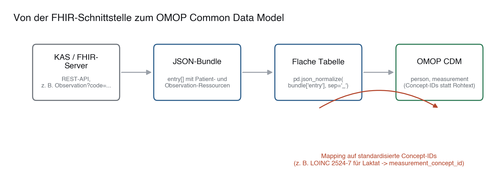

# 07 · Patientendaten-Extraktion via FHIR und OMOP

> **Teil 2 – Datenimport, Datenbereinigung und Datenmanagement** · Dauer: ~60 min · Voraussetzung: Module 04 und 05 (Einlesen und SQL)

## Lernziele
- Das Kernkonzept von **FHIR (Fast Healthcare Interoperability Resources)** und seine wichtigsten Ressourcen (Patient, Observation) erklären.
- FHIR-Ressourcen über eine REST-API abfragen und JSON-Antworten in Python/R parsen.
- Das **OMOP Common Data Model (CDM)** und seine Rolle bei multizentrischen Studien verstehen.
- Einfache SQL-Abfragen auf OMOP-Standardtabellen (person, measurement) schreiben.

## Klinischer Aufhänger

Deine Arbeitsgruppe plant eine retrospektive Studie zu Laktatverläufen. Anstatt Excel-Listen manuell auszufüllen, willst du die Daten direkt aus der Patient:innenakte (KAS) extrahieren. Das KAS deines Klinikums bietet eine FHIR-Schnittstelle und speichert Forschungsdaten im OMOP-Format. Hier lernst du, wie du eine Abfrage schreibst, die Patient:innenstammdaten und Laborwerte automatisiert zusammenführt.

## 1 Das FHIR-Konzept
FHIR strukturiert medizinische Daten in **Ressourcen**. Jede Ressource repräsentiert eine klinische Entität:

- **Patient:** Demografische Daten (Alter, Geschlecht).
- **Observation:** Messwerte (Laborwerte wie Laktat, Vitalparameter wie Blutdruck).
- **Encounter:** Ein Aufenthalt (z. B. Notaufnahme, Intensivstation).

FHIR nutzt das **REST-Prinzip**: Daten werden über URLs abgerufen.

- `GET https://fhir-server.de/fhir/Patient/123` liefert den/die Patient:in mit ID 123 als JSON oder XML.
- `GET https://fhir-server.de/fhir/Observation?code=2524-7` liefert alle Laktat-Messwerte (LOINC-Code `2524-7`).

**Stolperstein:** LOINC-Codes sehen alle ähnlich aus (fünfstellige Zahl, Bindestrich, Prüfziffer) — ein falscher Code liefert keinen Fehler, sondern lautlos die *falschen* Werte. `2571-8` ist zum Beispiel nicht Laktat, sondern Triglyzeride. Prüfe jeden Code, den du in eine echte Abfrage einbaust, gegen [loinc.org](https://loinc.org) oder die OMOP-Vokabeltabelle — verlasse dich nie auf den Namen einer Variablen aus einem Tutorial.

---

## 2 FHIR-Daten abfragen in Python

Ein echter FHIR-Server liefert ein **Bundle**: ein JSON-Objekt mit einer Liste `entry`, in der Patient- und Observation-Ressourcen gemischt vorkommen. Damit dieses Modul offline und reproduzierbar läuft, nutzen wir ein Beispiel-Bundle (`{{DATEN}}fhir_bundle.json`) mit genau dieser Struktur, statt live gegen einen öffentlichen Testserver zu fragen — das Parsing ist identisch zu dem, was ein echter Server zurückgibt.

```python
import json
import urllib.request
import pandas as pd

# 1. Bundle laden (die {{DATEN}}-URL liefert dasselbe JSON, das ein FHIR-Server
#    fuer GET .../Observation?code=... zurueckgeben wuerde). Wir nutzen urllib
#    aus der Standardbibliothek -- 'requests' ist nicht in der Kurs-Grundausstattung.
with urllib.request.urlopen("{{DATEN}}fhir_bundle.json") as response:
    bundle = json.load(response)

# 2. Bundle in eine flache Tabelle entpacken: ein JSON-Objekt pro Ressource
flat = pd.json_normalize(bundle["entry"], sep="_")

# 3. Patient- und Observation-Ressourcen trennen
patients = (
    flat[flat["resource_resourceType"] == "Patient"]
    [["resource_id", "resource_gender", "resource_birthDate"]]
    .rename(columns={"resource_id": "patient_id", "resource_gender": "geschlecht",
                     "resource_birthDate": "geburtsdatum"})
)
print(patients)
```

🗣 **Code-Verbalisierung:**

* `pd.json_normalize(bundle["entry"], sep="_")` entpackt jede verschachtelte Ressource (`resource.code.text`, `resource.valueQuantity.value`, ...) in eine eigene, flache Spalte -- genau der Schritt, der aus tief verschachteltem FHIR-JSON eine Tabelle macht, die sich filtern und mergen lässt.
* Patient- und Observation-Ressourcen liegen in derselben `entry`-Liste, unterschieden nur durch `resourceType` -- deshalb filtern wir zweimal auf denselben DataFrame.
* `code/python.py` führt diesen Schritt vollständig aus und fügt Patient:innen- und Observation-Tabelle zu einer Analysetabelle zusammen (den ganzen Weg bis zum OMOP-Modell zeigt die Abbildung in Abschnitt 4).

---

## 3 FHIR-Daten in R

In R kann das spezialisierte Paket `fhircrackr` komplexe FHIR-Strukturen direkt von einem Live-Server "cracken". Für dieses Beispiel-Bundle reicht das in R vorinstallierte `jsonlite` -- das Prinzip (verschachteltes JSON in eine flache Tabelle entpacken) ist dasselbe.

```r
library(jsonlite)

# 1. Bundle laden (lokale Datei oder URL)
bundle <- fromJSON("{{DATEN}}fhir_bundle.json", simplifyVector = FALSE)

# 2. Patient-Ressourcen in eine Tabelle sammeln
patient_rows <- list()
for (entry in bundle$entry) {
  res <- entry$resource
  if (res$resourceType == "Patient") {
    patient_rows[[length(patient_rows) + 1]] <- data.frame(
      patient_id = res$id, geschlecht = res$gender, geburtsdatum = res$birthDate
    )
  }
}
patients <- do.call(rbind, patient_rows)
print(patients)
```

**Darüber hinaus:** `fhircrackr::fhir_crack()` übernimmt für sehr komplexe, tief verschachtelte Bundles (z. B. mit wiederholten Unter-Ressourcen) automatisch, was hier von Hand mit einer Schleife passiert -- für ein Produktionssystem mit vielen Ressourcentypen ist es die robustere Wahl.

---

## 4 Das OMOP Common Data Model

Während FHIR für den Datenaustausch optimiert ist, dient das **OMOP Common Data Model (CDM)** der standardisierten Analyse. Krankenhäuser transformieren ihre lokalen Datenbanken in das OMOP-Format, damit derselbe Analysecode an Hunderten Kliniken weltweit laufen kann.



Kernelemente des OMOP-Modells:

- **PERSON:** Enthält eindeutige demografische Daten (Geschlecht, Geburtsjahr).
- **MEASUREMENT:** Enthält Messwerte und Laborergebnisse (verknüpft über Concept-IDs mit LOINC/SNOMED).

### OMOP-SQL-Abfrage: Laktatwerte extrahieren
```sql
SELECT 
    p.person_id,
    p.year_of_birth,
    p.gender_concept_id,
    m.measurement_date,
    m.value_as_number,
    m.unit_source_value
FROM person p
JOIN measurement m ON p.person_id = m.person_id
WHERE m.measurement_concept_id = 3004327 -- Concept ID fuer Laktat (Beispiel)
ORDER BY m.measurement_date DESC;
```

**Praxis:** Die konkrete `measurement_concept_id` ist kein feststehender, auswendig lernbarer Wert -- sie hängt vom OMOP-Vokabular-Release deines CDM ab. Schlage die aktuelle Standard-Concept-ID für den gewünschten LOINC-Code immer in der [OHDSI-Athena-Vokabeltabelle](https://athena.ohdsi.org) deiner Instanz nach, statt eine Zahl aus einem Tutorial ungeprüft zu übernehmen — derselbe Fehler wie beim LOINC-Code oben, nur eine Schicht tiefer im Modell.

---

## Fallstricke und Merksätze
- **FHIR-JSONs sind tief verschachtelt.** Listen in Listen machen direktes Einlesen unmöglich. Du musst Daten explizit parsen oder Hilfsbibliotheken nutzen.
- **Concepts statt Rohwerte.** OMOP nutzt standardisierte Concept-IDs. Statt nach `"Laktat"` zu suchen, musst du nach der spezifischen ID (`3004327`) filtern.
- **Datenschutz.** FHIR-REST-APIs können sensible Patient:innendaten unverschlüsselt übertragen. Nutze im Kliniknetzwerk ausschließlich verschlüsselte HTTPS-Verbindungen.

## Selbstcheck
1. **Was ist der Unterschied zwischen FHIR und OMOP CDM?**, FHIR dient dem klinischen Datenaustausch in Echtzeit (Nachrichten- und Ressourcen-basiert); OMOP ist ein normalisiertes Datenmodell für Analysen und multizentrische Vergleiche auf großen Forschungsdatenbanken.
2. **Wie filtere ich in einer OMOP-Datenbank nach einem bestimmten Laborwert?**, Über die Spalte `measurement_concept_id` in der Tabelle `measurement`, unter Verwendung der entsprechenden standardisierten Vokabular-ID (z. B. LOINC/SNOMED).
3. **Ein FHIR-`Bundle` enthält `Patient`- und `Observation`-Ressourcen gemischt in `entry`. Wie wird daraus eine Analysetabelle?**, `pd.json_normalize(bundle["entry"], sep="_")` flacht alle Ressourcen in eine Tabelle ab. Danach trennt man sie über `resource_resourceType` und verknüpft die Observations per `resource_subject_reference` mit der Patient-ID.
4. **Warum liefert ein falscher LOINC- oder Concept-Code keinen Fehler?**, Weil die Abfrage syntaktisch gültig bleibt: der Server findet schlicht andere (oder keine) Messwerte. `2571-8` liefert Triglyzeride statt Laktat — lautlos. Codes gehören gegen loinc.org bzw. die Athena-Vokabeltabelle geprüft, nie aus einem Tutorial übernommen.
