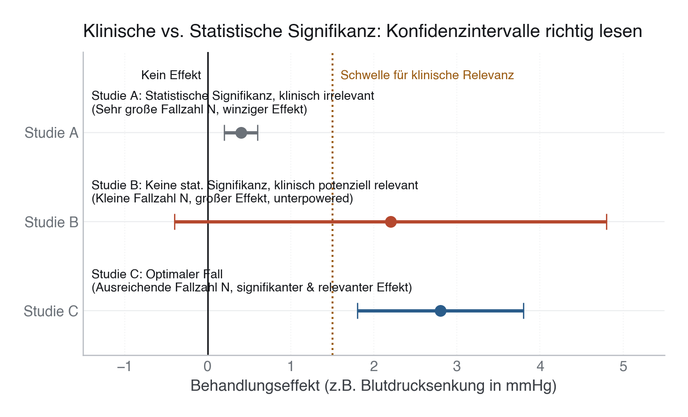
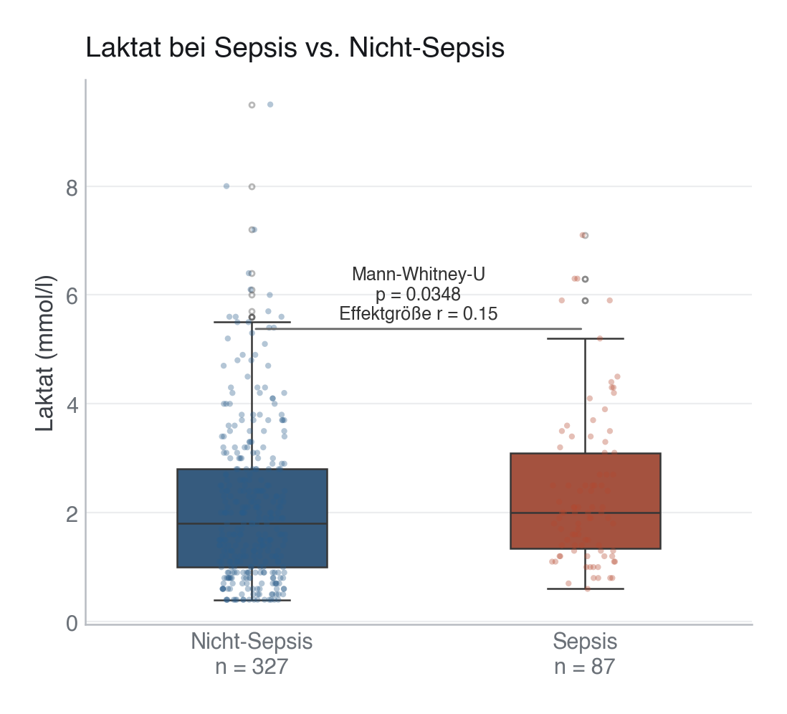

# 10 · Inferenzstatistik und Hypothesentests

> **Teil 4 – Statistische Inferenz und medizinische Statistik** · Dauer: ~70 min · Voraussetzung: Module 08–09 (EDA und Deskriptivstatistik)

## Lernziele
- Den Unterschied zwischen **Stichprobe und Population** erklären und auf klinische Fragen anwenden.
- Den **p-Wert korrekt interpretieren** und häufige Fehldeutungen sicher benennen.
- **Konfidenzintervall und Effektgröße** (Cohen's d, Rang-biserialer r, Cramér's V, Odds Ratio) als primäres Ergebnis berichten — nie den p-Wert allein.
- **Welch-t-Test, Mann-Whitney-U und Chi-Quadrat-Test** begründet einsetzen.
- Das Problem des **multiplen Testens** kennen und mit Bonferroni korrigieren.

## Klinischer Aufhänger

3 Uhr morgens, eine Intensivpflegerin zeigt dir zwei Laktat-Listen: ein paar septische Patient:innen, der Rest mit anderen Aufnahmegründen. Ein Muster? Auf den ersten Blick nicht, die Werte streuen stark. Deine **Stichprobe** umfasst 500 fiktive Patient:innen, doch die Antwort soll für die dahinterliegende **Population** gelten. Dazu eine zweite Frage: Sterben Diabetiker:innen häufiger binnen 30 Tagen?

Beide verlangen mehr als ein Bauchgefühl. Inferenzstatistik beziffert die Unsicherheit, den Abstand zwischen dem, was wir sehen, und dem, was wirklich gilt.

## 1 Stichprobe vs. Population

Jede Studie beobachtet nur einen Ausschnitt der Wirklichkeit. Der Schätzwert aus der Stichprobe, z. B. der mittlere Laktatwert, schwankt von Studie zu Studie. Inferenzstatistik quantifiziert diese Schwankung: Wie weit könnte unsere Schätzung vom wahren Populationsparameter entfernt sein?

Das zentrale Werkzeug dafür ist das **Konfidenzintervall (KI)**. Es entsteht aus der Stichprobenverteilung des Schätzers, nicht aus einer Wahrscheinlichkeitsaussage über einen fixen Wert.

> **Merksatz:** Ein 95-%-KI enthält den wahren Parameter in 95 % aller denkbaren Wiederholungsstudien, *nicht* mit 95-%-Wahrscheinlichkeit den wahren Wert der vorliegenden Stichprobe.

**Stolperstein:** „Das 95-%-KI enthält den wahren Wert mit 95-%-Wahrscheinlichkeit", das klingt intuitiv, ist aber eine frequentistische Fehldeutung. Der wahre Wert ist fix; das KI ist die zufällige Größe. Korrekt: Bei wiederholtem Sampling enthält das so konstruierte Intervall in 95 % der Fälle den Parameter.

**Darüber hinaus:** Bayesianische **Credibility Intervals** geben hingegen tatsächlich eine Wahrscheinlichkeitsaussage über den Parameter, aber unter Voraussetzung eines Prior. Für klinische Publikationen ist das frequentistische KI Standard; verstehe den Unterschied, bevor du einen Reviewer korrigierst.

## 2 Der p-Wert – richtig gelesen

Der p-Wert ist die Wahrscheinlichkeit, ein Ergebnis **so extrem oder extremer** zu beobachten, *wenn* die Nullhypothese wahr wäre. Ausgeschrieben: P(Daten | H₀). Er sagt nichts über P(H₀ | Daten).

**Was der p-Wert NICHT ist:**

- ❌ Die Wahrscheinlichkeit, dass H₀ stimmt.
- ❌ Ein Maß für die klinische Relevanz.
- ❌ Ein Hinweis auf die Effektgröße.
- ❌ Eine Reproduzierbarkeitsgarantie.

**Was er IST:**

- ✅ Ein Test, ob die Daten mit H₀ vereinbar sind, gegeben das Studiendesign.
- ✅ Abhängig von der Stichprobengröße: bei N = 100 000 werden auch winzige, klinisch irrelevante Unterschiede signifikant.

**Praxis:** Berichte immer **p + Effektgröße + KI**. Ein p = 0,03 ohne Effektgröße ist uninformativ; ein p = 0,4 ohne Power-Analyse sagt ebenfalls nichts.

**Stolperstein:** Wer p > 0,05 als „kein Effekt" interpretiert, verwechselt Abwesenheit von Evidenz mit Evidenz für Abwesenheit. Eine zu kleine Studie übersieht echte Effekte, das ist kein statistischer Freispruch, sondern ein Designproblem.

**Darüber hinaus:** Äquivalenz- und Nicht-Unterlegenheitstests drehen die Beweislast um: du musst zeigen, dass der Effekt *klein genug* ist, bei Zulassungsstudien oft relevanter als das klassische Signifikanzparadigma.

## 3 Konfidenzintervalle als Ergebnismaß

KI sind informativer als p-Werte, weil sie Richtung und Größe der Unsicherheit zeigen. Zwei Prinzipien beim Lesen:

1. **Schließt das KI 0 (bzw. OR = 1) ein?** → Dann nicht signifikant auf dem gewählten Niveau.
2. **Wie breit ist das KI?** → Schmal = präzise Schätzung (großes N oder geringe Streuung). Breit = viel Unsicherheit.

Überlappende KI zweier Gruppen schließen Signifikanz **nicht automatisch aus**, das Überlappungs-Kriterium ist konservativ. Für einen formalen Vergleich brauchst du das KI der *Differenz*, nicht beider Einzelwerte.

> [!IMPORTANT]
> **Klinische vs. Statistische Signifikanz**  
> Verlass dich nicht nur auf den p-Wert. Konfidenzintervalle (KI) zeigen dir, ob ein Effekt klinisch relevant ist:
> - **Studie A:** Hochgradig statistisch signifikant (`p < 0,05`, da das Intervall 0 nicht einschließt), aber klinisch völlig irrelevant (das gesamte Intervall liegt unter der Relevanzschwelle). Oft das Ergebnis extrem großer Fallzahlen.
> - **Studie B:** Statistisch nicht signifikant (`p > 0,05`, da das Intervall 0 einschließt), aber klinisch hochgradig relevant (großer Effekt, aber unterpowered wegen kleiner Fallzahl).
> - **Studie C:** Statistisch signifikant und klinisch voll relevant.
>
> 

**Stolperstein:** KI aus Bootstrap und aus der t-Verteilung stimmen bei kleinen, schiefen Stichproben nicht überein. Bei Laktat (rechtsschief, Ausreißer) ist ein Bootstrap-KI oft ehrlicher.

**Darüber hinaus:** Profile-Likelihood-KI für logistische Regressionskoeffizienten sind bei kleinen Ereignisraten genauer als Wald-KI, in R mit `confint()` statt `confint.default()`.

## 4 Testauswahl

Die Wahl des Tests hängt vom Messniveau und der Verteilung der Daten ab:

| Frage | Daten | Test | Effektgröße |
|-------|-------|------|-------------|
| Zwei Mittelwerte (normalverteilt) | stetig, zwei Gruppen | Welch-t-Test | Cohen's d |
| Zwei Gruppen (schief / Ausreißer) | stetig, zwei Gruppen | Mann-Whitney-U | Rang-biserialer r |
| Häufigkeiten in Kreuztabelle | kategorial | Chi-Quadrat | Cramér's V |
| Assoziation zweier stetiger Variablen | beide stetig | Pearson / Spearman r | r² |

**Wie wählt man? Nicht per Normalitätstest-Autopilot.** Der Shapiro-Wilk-Test (`scipy.stats.shapiro` / `shapiro.test`) ist ein *deskriptives* Hilfsmittel, keine Entscheidungsregel: Bei großem N wird er schon durch klinisch harmlose Abweichungen signifikant, bei kleinem N übersieht er relevante. Wähle den Test stattdessen nach drei Kriterien: (1) der **Schätzgröße** (interessiert ein Mittelwertunterschied oder eine stochastische Überlegenheit?), (2) der im **Plot** (Histogramm, Boxplot) sichtbaren Form und (3) der **Robustheit** – bei N > 30 ist der Welch-t-Test dank zentralem Grenzwertsatz gegenüber moderater Schiefe robust. Für stark rechtsschiefe Marker wie Laktat oder CRP ist Mann-Whitney-U oft die ehrlichere Wahl, weil er die klinisch sinnvolle Frage (stochastische Überlegenheit) ohne Normalverteilungsannahme beantwortet – nicht, weil ein Test die Normalität „ablehnt". Modul 21 vertieft diese Entscheidungslogik und führt den „Normalitätstest-Autopilot" ausdrücklich als Fehlentscheidung auf.

**Stolperstein:** Den Student-t statt des Welch-t wählen und damit Varianzhomogenität voraussetzen, die in klinischen Daten selten gilt. Welch-t ist immer mindestens so gut und meist besser.

**Darüber hinaus:** Beim Mann-Whitney-U-Test den Unterschied zwischen dem Test auf *gleiche Verteilung* und dem Test auf *gleichen Median* kennen: Letzteres gilt nur bei gleicher Form beider Verteilungen. Bei unterschiedlichen Formen testet er präziser auf stochastische Überlegenheit.

## 5 In Python

```python
import numpy as np
import pandas as pd
from scipy import stats

cohort = pd.read_csv("{{DATEN}}kohorte.csv")
labs   = pd.read_csv("{{DATEN}}labor.csv")
df     = cohort.merge(labs, on="patient_id", how="left")

# --- Shapiro-Wilk: Normalverteilung prüfen ---
laktat = df["laktat_mmol_l"].dropna()
w_stat, p_sw = stats.shapiro(laktat)
print(f"Shapiro-Wilk: W={w_stat:.4f}, p={p_sw:.4f}  (Normalverteilung: {p_sw >= 0.05})")

# --- Mann-Whitney-U: Laktat – Sepsis vs. Nicht-Sepsis ---
sepsis   = df.loc[df["aufnahmegrund"] == "Sepsis",  "laktat_mmol_l"].dropna()
no_sepsis = df.loc[df["aufnahmegrund"] != "Sepsis", "laktat_mmol_l"].dropna()

u_stat, p_mw = stats.mannwhitneyu(sepsis, no_sepsis, alternative="two-sided")
r_rb = 2 * u_stat / (len(sepsis) * len(no_sepsis)) - 1   # rank-biserial r
print(f"U={u_stat:.0f}, p={p_mw:.4f}, Rang-biserialer r={r_rb:.3f}")

# --- Chi-Quadrat: Diabetes × Mortalität ---
ct = pd.crosstab(df["diabetes"], df["verstorben_30d"])
chi2, p_chi2, dof, _ = stats.chi2_contingency(ct, correction=False)
cramers_v = np.sqrt(chi2 / (ct.values.sum() * (min(ct.shape) - 1)))
print(f"χ²={chi2:.3f}, df={dof}, p={p_chi2:.4f}, Cramér's V={cramers_v:.3f}")

# --- Odds Ratio mit 95-%-KI ---
a, b = ct.iloc[1, 1], ct.iloc[1, 0]   # Diabetes=1
c, d = ct.iloc[0, 1], ct.iloc[0, 0]   # Diabetes=0
or_val   = (a * d) / (b * c)
log_se   = np.sqrt(1/a + 1/b + 1/c + 1/d)
or_lo, or_hi = np.exp(np.log(or_val) - 1.96*log_se), np.exp(np.log(or_val) + 1.96*log_se)
print(f"OR={or_val:.2f}, 95%-KI [{or_lo:.2f}, {or_hi:.2f}]")

# --- Bonferroni: 5 Labormarker ---
lab_markers = ["leukozyten_g_l", "haemoglobin_g_dl", "kreatinin_mg_dl",
               "laktat_mmol_l", "natrium_mmol_l"]
alpha_bonf = 0.05 / len(lab_markers)
print(f"Bonferroni-korrigiertes α = {alpha_bonf:.4f}")
```

Das vollständige, ausführbare Skript mit Hilfsfunktionen liegt unter [`code/python.py`](code/python.py).

**Stolperstein:** `stats.mannwhitneyu` hat den Parameter `alternative="two-sided"`, ohne ihn rechnet SciPy (vor Version 1.7) einseitig. Prüfe die SciPy-Version, wenn Ergebnisse unerwartet klein wirken.

**Darüber hinaus:** `scipy.stats.permutation_test` liefert exakte p-Werte ohne Verteilungsannahmen, bei kleinen Stichproben oder ungewöhnlichen Teststatistiken robuster als asymptotische Approximationen.

## 6 In R

```r
SEED <- 42
suppressPackageStartupMessages(library(tidyverse))
set.seed(SEED)

cohort <- read_csv("{{DATEN}}kohorte.csv", show_col_types = FALSE)
labs   <- read_csv("{{DATEN}}labor.csv", show_col_types = FALSE)
df     <- left_join(cohort, labs, by = "patient_id")

# --- Shapiro-Wilk ---
shapiro.test(df$laktat_mmol_l |> na.omit())

# --- Mann-Whitney-U: Laktat – Sepsis vs. Nicht-Sepsis ---
sepsis   <- df |> filter(aufnahmegrund == "Sepsis") |> pull(laktat_mmol_l) |> na.omit()
no_sepsis <- df |> filter(aufnahmegrund != "Sepsis") |> pull(laktat_mmol_l) |> na.omit()

mw_res <- wilcox.test(sepsis, no_sepsis, alternative = "two.sided", correct = TRUE)
r_rb   <- 2 * mw_res$statistic / (length(sepsis) * length(no_sepsis)) - 1
cat(sprintf("W=%.0f, p=%.4f, Rang-biserialer r=%.3f\n", mw_res$statistic, mw_res$p.value, r_rb))

# --- Chi-Quadrat + Cramér's V ---
ct <- table(Diabetes = df$diabetes, Verstorben_30d = df$verstorben_30d)
chi_res  <- chisq.test(ct, correct = FALSE)
cramers  <- sqrt(chi_res$statistic / (sum(ct) * (min(dim(ct)) - 1)))
cat(sprintf("χ²=%.3f, p=%.4f, Cramér's V=%.3f\n", chi_res$statistic, chi_res$p.value, cramers))

# --- Bonferroni + Benjamini-Hochberg ---
lab_markers <- c("leukozyten_g_l", "haemoglobin_g_dl", "kreatinin_mg_dl",
                 "laktat_mmol_l", "natrium_mmol_l")
p_raw <- sapply(lab_markers, function(m) {
  a <- df |> filter(verstorben_30d == 1) |> pull(!!sym(m)) |> na.omit()
  b <- df |> filter(verstorben_30d == 0) |> pull(!!sym(m)) |> na.omit()
  t.test(a, b, var.equal = FALSE)$p.value
})
p.adjust(p_raw, method = "bonferroni")
p.adjust(p_raw, method = "BH")   # Benjamini-Hochberg (weniger konservativ)
```

Das vollständige Skript liegt unter [`code/r.R`](code/r.R).

---

**Stolperstein:** Stetigkeitskorrektur. Beide Werkzeuge korrigieren **standardmäßig**: `scipy.stats.mannwhitneyu` hat `use_continuity=True`, `wilcox.test` hat `correct = TRUE`. Deshalb liefern beide Skripte hier denselben p-Wert (p = 0,0348). Schaltet man die Korrektur in *beiden* ab (`use_continuity=False` bzw. `correct = FALSE`), sinkt p minimal (0,034767 statt 0,034810). Der eigentliche Fehler ist, in einer Sprache zu korrigieren und in der anderen nicht – dann weichen die p-Werte ohne inhaltlichen Grund voneinander ab. Wähle in beiden Sprachen dieselbe Einstellung; die gemeinsame Voreinstellung (Korrektur an) ist der einfachste Weg.

**Darüber hinaus:** Das Paket `rstatix` bietet `wilcox_test()` mit effekt_größe direkt als Attribut, bequemer für tidyverse-Workflows und Reporting in Tabellen.

## 7 Multiples Testen

Bei k unabhängigen Tests mit α = 0,05 steigt die **familienweise Fehlerrate** auf 1 − (1 − 0,05)^k, bei k = 5 rund 23 %, bei k = 20 schon 64 %. Irgendetwas wird garantiert „signifikant", nur ist es Zufall.

**Bonferroni:** α_korr = α / k. Einfach, konservativ, geeignet für wenige Tests oder wenn jeder einzelne Test entscheidungsrelevant ist (z. B. klinische Subgruppen).

**Benjamini-Hochberg (FDR):** Kontrolliert die *False Discovery Rate*, den Anteil falsch-positiver unter allen positiven Befunden. Bei vielen Tests (Genomik, Multi-Omics) deutlich mächtiger als Bonferroni.

**Stolperstein:** Bonferroni auf explorative Analysen anzuwenden, die nie hypothesengetrieben waren, überkorrigiert die p-Werte. Trenne konfirmatorische Tests (strenge Korrektur) von explorativen Analysen (Transparenz über die Zahl geprüfter Hypothesen, FDR).

**Darüber hinaus:** Bei abhängigen Tests (wiederholte Messungen, korrelierte Biomarker) ist Bonferroni zu konservativ, dann eignen sich permutationsbasierte Verfahren oder die Westfall-Young-Methode.



> **Wann du Hilfe holst.** Sobald du viele Endpunkte oder Subgruppen gleichzeitig testest, die Beobachtungen nicht unabhängig sind (Cluster, wiederholte Messungen), oder ein grenzwertiges Ergebnis eine klinische Entscheidung trägt, reicht eine Bonferroni-Korrektur nicht mehr — dann gehört die Teststrategie vorab mit einer Biostatistikerin festgelegt.

## Fallstricke und Merksätze

- **p < 0,05 ≠ klinisch relevant.** Bei großen Stichproben wird praktisch jede Differenz signifikant. Entscheidend ist die Effektgröße.
- **p > 0,05 ≠ kein Effekt.** Es könnte an mangelnder Power liegen (zu kleines N oder zu kleiner wahrer Effekt).
- **Einseitiger vs. zweiseitiger Test:** Nur einseitig testen, wenn die Richtung *a priori* begründet ist, nie post hoc anpassen.
- **Informative fehlende Werte:** Laktat wird häufiger bei schwer kranken Patient:innen gemessen. Für **deskriptive** Kennzahlen (Mittelwert, Median, Table 1) verzerrt das systematisch — die beobachteten Werte überrepräsentieren die Schwerkranken. Ob es auch einen *Gruppenvergleich* oder einen *Regressionskoeffizienten* verzerrt, hängt davon ab, ob die Variable, von der das Fehlen abhängt (hier `sofa_score`), im Modell steht (→ Modul 14).
- **Assoziation ≠ Kausalität.** Alle Tests hier sind rein assoziativ. Konfounder können jede Assoziation erklären oder umkehren (→ Modul 12 und 15).
- **Multiples Testen:** Bei k Tests liegt die familienweise Fehlerrate bei 1 − (1−α)^k. Bonferroni ist einfach und konservativ; Benjamini-Hochberg (FDR) ein häufig genutzter Kompromiss.
- **OR ≠ RR:** Das Odds Ratio überschätzt das relative Risiko bei häufigen Ereignissen (>10 %). Für Prävalenzstudien den Unterschied explizit benennen.

## Selbstcheck

1. **Was sagt ein 95-%-Konfidenzintervall, und was NICHT?**, Es bedeutet: Bei 95 % aller denkbaren Wiederholungsstudien enthält das so konstruierte Intervall den wahren Parameter. Es bedeutet NICHT: Der wahre Wert liegt mit 95-%-Wahrscheinlichkeit in diesem spezifischen Intervall, der wahre Wert ist fix, das Intervall ist die zufällige Größe.
2. **Warum kann p < 0,05 klinisch irrelevant sein?**, Bei großem N werden auch minimale Unterschiede signifikant. Ob ein Unterschied klinisch bedeutsam ist, entscheidet die Effektgröße (Cohen's d, OR mit KI), nicht der p-Wert allein.
3. **Wann wählt man Mann-Whitney-U statt Welch-t-Test?**, Wenn die klinische Frage nach stochastischer Überlegenheit statt nach einem Mittelwertunterschied verlangt und die im Plot sichtbare Verteilung stark rechtsschief ist oder Ausreißer hat (z. B. Laktat, CRP). Die Entscheidung fällt nach Fragestellung, Verteilungsbild und Robustheit – nicht nach einem Normalitätstest (Welch-t ist bei N > 30 ohnehin robust; siehe Modul 21).
