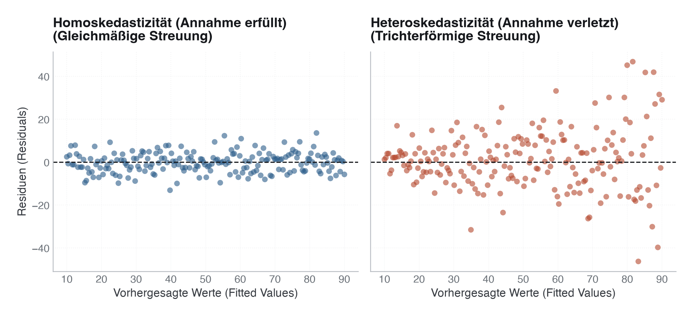

# 12 · Regressionsmodelle: Lineare, logistische und Cox-Regression

> **Teil 4 – Statistische Inferenz und medizinische Statistik** · Dauer: ~90 min (Grundpfad ~70 min, Vertiefung ~20 min) · Voraussetzung: Module 09–10 (Deskriptivstatistik und Inferenz)

> **Wegweiser.** Dieses Modul führt vom Modell zum korrekt interpretierten Effekt.
>
> **Grundpfad (§1–§4, §6–§7).** Die drei Modelltypen (linear, logistisch, Cox),
> wie man Koeffizienten liest, warum man für Confounder adjustiert – und die
> wichtigste Falle: einen **Mediator** nicht mitadjustieren (Overadjustment).
> Danach kannst du eine Regression rechnen und ihr Ergebnis sauber berichten.
>
> **Vertiefung (§5, ~20 min).** Der Wahrheitsvergleich: warum eine Odds Ratio
> keine Hazard Ratio ist, wie wir aus dem Datengenerierungsprozess die *wahren*
> Effekte kennen, und woran man Stichprobenvarianz von echter Verzerrung
> unterscheidet. Lehrreich, aber zum Rechnen einer Regression nicht nötig.

## Lernziele
- Die Grundideen **linearer**, **logistischer** und **Cox-Regression** erklären und abgrenzen.
- Odds Ratios und Hazard Ratios korrekt interpretieren, und ihre Grenzen kennen.
- **Confounder** erkennen und durch Adjustierung kontrollieren.
- Modellgüte prüfen: Residuen, Kalibrierung, EPV.
- Den entscheidenden Unterschied zwischen **Assoziation und Kausalität** benennen.

## Klinischer Aufhänger

Welche Faktoren sind unabhängig mit der 30-Tage-Mortalität unserer Intensivkohorte
assoziiert? Alter, SOFA-Score, CRP, Diabetes und Aufnahmegrund liegen vor, und
hängen alle untereinander zusammen. Eine Kreuztabelle reicht nicht: Die
Regressionsanalyse betrachtet jeden Faktor **unter Konstanthaltung der übrigen**.
Da der Datensatz synthetisch ist, kennen wir die wahren Koeffizienten und können
unsere Schätzungen direkt dagegen prüfen.

## 1 Lineare Regression

Die lineare Regression modelliert einen **stetigen Outcome** als gewichtete Summe
der Prädiktoren:

```
y = β₀ + β₁·x₁ + β₂·x₂ + … + ε
```

- **β₀** (Intercept): erwarteter Wert, wenn alle Prädiktoren null sind.
- **βⱼ**: Änderung von y pro Einheit xⱼ, *ceteris paribus*, d. h. alle
 anderen Prädiktoren bleiben konstant.

- **ε**: Residuum, soll normalverteilt, unabhängig und mit konstanter Varianz
 (Homoskedastizität) sein.

**Klinisches Beispiel:** `verweildauer_tage ~ sofa_score + alter`. Jeder
zusätzliche SOFA-Punkt ist mit βˢᵒᶠᵃ weiteren Tagen assoziiert, adjustiert für
das Alter.

**Voraussetzungen prüfen:** Residuenplot (Residuen gegen Fitted Values) deckt
Heteroskedastizität und Nichtlinearitäten auf; QQ-Plot prüft Normalverteilung
der Residuen; VIF-Werte (> 10: Warnsignal) messen Multikollinearität.

> [!TIP]
> **Residuendiagnostik: Homoskedastizität vs. Heteroskedastizität**  
> Ein Kern-Check bei linearen Regressionsmodellen ist das Zeichnen der Residuen gegen die vorhergesagten Werte (Fitted Values):
> - **Homoskedastizität:** Die Residuen streuen als gleichmäßige Wolke um die Nulllinie. Die Modellannahme ist erfüllt.
> - **Heteroskedastizität:** Die Residuen bilden einen Trichter (die Varianz nimmt mit größeren vorhergesagten Werten zu). Das führt zu ungenauen Standardfehlern und verfälschten p-Werten.
>
> 

**Stolperstein:** Verweildauer ist rechtsschief, wenige Patient:innen liegen
extrem lange. Die OLS-Koeffizienten bleiben dabei unverzerrt, solange das Mittelwertmodell stimmt (Schiefe allein verzerrt sie nicht), aber die Residuen
sind schief und meist heteroskedastisch; KI und p-Werte werden unzuverlässig, und
der Mittelwert beschreibt die typische Verweildauer schlecht. Abhilfe: log-transformierter Outcome oder ein Gamma-GLM, das die Schiefe explizit
modelliert.

**Darüber hinaus:** Bei zählwertartigen Outcomes (z. B. Anzahl Komplikationen)
ist Poisson-Regression die natürliche Erweiterung; bei starker Overdispersion
ein negatives Binomialmodell. Beide sind in `statsmodels.formula.api.glm` mit
einem Zeilenunterschied umsetzbar.

## 2 Logistische Regression

Wenn der Outcome **binär** ist (verstorben: ja/nein), modelliert die logistische
Regression die **Log-Odds** (Logit) des Ereignisses:

```
logit(p) = ln(p / (1−p)) = β₀ + β₁·x₁ + … + βₖ·xₖ
```

Die **Odds Ratio (OR)** für Prädiktor xⱼ ist `exp(βⱼ)`:

| OR | Interpretation |
|----|----------------|
| 1,0 | kein Unterschied zur Referenz |
| 2,0 | doppelt so hohe Chance auf das Ereignis |
| 0,5 | halb so hohe Chance (protektiv) |

Ein 95-%-Konfidenzintervall für die OR, das die 1,0 nicht einschließt, zeigt
statistische Signifikanz an. Die Breite des KI zeigt die Präzision, schmale KI
entstehen durch große Stichproben und häufige Ereignisse.

**OR ≠ relatives Risiko (RR).** Bei seltenen Ereignissen (< 10 %) sind OR und
RR annähernd gleich. Bei häufigeren Ereignissen überschätzt die OR das RR
erheblich. In unserer Kohorte liegt die 30-Tage-Mortalität bei ~15,6 %, also
bereits über der 10-%-Schwelle: OR und RR laufen hier spürbar auseinander, und
die OR überschätzt das tatsächliche relative Risiko. Genau deshalb in
Publikationen immer explizit „Odds Ratio“ schreiben, nie „Risiko“ oder
„Wahrscheinlichkeit“.

**Was `verstorben_30d` genau zählt.** Das Label heißt „30-Tage-Mortalität“, ist
aber ein **beobachteter** Todesfall innerhalb der Nachbeobachtung. 41
Patient:innen wurden nicht bis Tag 30 nachverfolgt (z. B. Verlegung ohne
Rückmeldung) und stehen mit `0` im Datensatz, obwohl ein späterer Tod
unbemerkt geblieben wäre. Die Spalte `fu_vollstaendig_30d` markiert, bei wem
der 30-Tage-Status tatsächlich bekannt ist. Das Skript rechnet das Modell zur
Sensitivität noch einmal nur mit diesen 459 Patient:innen. Die ORs verschieben
sich kaum (SOFA 1,496 → 1,476, Sepsis 1,980 → 1,921), die Null-Kodierung trägt
das Ergebnis hier also nicht. Auch der Ausschluss ist keine saubere Lösung, denn
er wirft Menschen hinaus, die bis zum Kontaktverlust nachweislich gelebt haben.
Die Methode, die unvollständige Nachbeobachtung korrekt verarbeitet, ist die
Survival-Analyse (Abschnitt 3, Modul 17, Modul 28).

### Kalibrierung

Ein Modell, das für 100 Patient:innen eine 30-%-Mortalität vorhersagt, sollte
auch ~30 tatsächlich Sterbende zeigen. Kalibrierung prüft diese Übereinstimmung
zwischen vorhergesagten Wahrscheinlichkeiten und beobachteter Ereignisrate:
Hosmer-Lemeshow-Test oder, besser, eine Kalibrierungskurve (Observed vs.
Predicted). Ohne Kalibrierung ist ein klinisches Prognosemodell unvollständig.

**Stolperstein:** Ein Modell kann eine hohe AUC haben (gute Diskriminierung) und
trotzdem schlecht kalibriert sein, die beiden Gütemaße messen verschiedene
Dinge. AUC allein reicht für einen klinischen Einsatz nicht.

**Darüber hinaus:** Die Kalibrierung verschlechtert sich regelmäßig, wenn ein in
einer Kohorte entwickeltes Modell auf eine andere übertragen wird (externe
Validierung, Modul 25). Rekalibrierung durch Anpassung des Intercepts ist ein
etablierter erster Schritt.

## 3 Cox-Regression

Zählt nicht nur, *ob*, sondern auch *wann* ein Ereignis eintritt, ist die
Überlebenszeitanalyse das Mittel der Wahl. Die Kaplan-Meier-Kurve zeigt den
Überlebensverlauf zweier Gruppen:


Die Cox-Regression modelliert die **Hazard-Funktion**, das momentane
Ereignisrisiko zum Zeitpunkt t, unter der Bedingung, bis dahin überlebt zu haben:

```
h(t) = h₀(t) · exp(β₁·x₁ + … + βₖ·xₖ)
```

- **h₀(t)**: Baseline-Hazard, wird nicht parametrisch spezifiziert (daher
 „semiparametrisches“ Modell).

- **Hazard Ratio (HR)**: `exp(βⱼ)`, interpretiert wie die OR, aber bezogen
 auf das momentane Ereignisrisiko zu *jedem* Zeitpunkt.

- **Zensierung:** Patient:innen ohne Ereignis bis Studienende gehen zensiert
 ein. Das ist kein Datenverlust, sondern Information: „mindestens so lange
 überlebt“. Ignorieren führt zu verzerrten Schätzungen. Voraussetzung: Die
 Zensierung hängt nicht mit dem Sterberisiko zusammen (nicht-informative Zensierung).

**Proportionale Hazards-Annahme:** Die HR zwischen zwei Gruppen bleibt über die
gesamte Beobachtungszeit konstant. Prüfung: Schoenfeld-Residuen (`cox.zph()` in
R, `check_assumptions()` in lifelines) oder grafisch mit dem log-log-Plot.

**Stolperstein:** Wenn sich Überlebenskurven kreuzen, ist die PH-Annahme
verletzt, eine einzige HR ist dann irreführend. Abhilfe: zeitabhängige
Koeffizienten oder stratifiziertes Cox-Modell (nach der verletzenden Variable
stratifizieren).

**Darüber hinaus:** Für sehr kurze Beobachtungsfenster (< 30 Tage, kaum
Zensierung) liefert logistische Regression ähnliche Aussagen bei einfacherer
Interpretation. Cox-Regression punktet, sobald die Beobachtungszeit variiert oder
Zensierung relevant ist, also in fast allen echten klinischen Datensätzen.

**Stolperstein:** Unser Datensatz enthält zwei ähnlich klingende Zeitspalten,
nur eine davon ist eine echte Ereigniszeit. `verweildauer_tage`
(Krankenhaus-Verweildauer) ist rein **deskriptiv** und unabhängig vom
Überlebensprozess generiert, sie eignet sich *nicht* als Cox-/KM-Zeitvariable.
`fu_zeit_tage` (Nachbeobachtungszeit, gekappt bei 30 Tagen) zusammen mit
`status` (1 = verstorben, 0 = zensiert) ist die korrekte Kombination für jede
Überlebenszeitanalyse, siehe `data/README.md`.

## 4 Confounder und Adjustierung

Ein **Confounder** ist eine Variable, die sowohl mit dem Prädiktor als auch mit
dem Outcome assoziiert ist, und so eine scheinbare Assoziation erzeugt oder
eine echte verdeckt.

**Beispiel:** Ältere Patient:innen haben häufiger Diabetes *und* eine höhere
Mortalität. Wer den Diabetes-Effekt ohne Altersjustierung schätzt, überschätzt
ihn. In unserem synthetischen Datensatz kennen wir den wahren Effekt: `β = 0,45`
auf der **Log-Hazard**-Skala, also eine wahre direkte HR von 1,55 und eine wahre
adjustierte **OR von 1,71** (§5), beide bei festem SOFA-Score. Der rohe,
unadjustierte Schätzer liegt systematisch höher (wahre rohe OR 2,90, nur für das
Alter adjustiert 2,12; `code/python.py`, Abschnitt 2b): Er enthält das
Confounding durch das Alter *und* den über SOFA vermittelten Anteil (siehe unten).

Die Strategie: alle bekannten und gemessenen Confounder ins Modell aufnehmen. Was
nicht gemessen wurde, bleibt unkontrolliert, die fundamentale Grenze jeder
Beobachtungsstudie, die kein Regressionsmodell überwindet.

**Stolperstein:** Nicht alles, was mit dem Outcome korreliert, ist ein
Confounder. Ein **Mediator** liegt auf dem kausalen Pfad zwischen Prädiktor und
Outcome (z. B. Sepsis → Organversagen → Mortalität): ihn zu adjustieren würde
den interessierenden Effekt teilweise herausrechnen. Ein **Kollider** öffnet durch
Adjustierung erst einen Scheinzusammenhang. Ob eine Variable Confounder,
Mediator oder Kollider ist, folgt aus einem kausalen Modell (DAG), nicht aus der
Korrelationsmatrix.

**Stolperstein:** In unserem Datensatz ist `sofa_score` bewusst ein
**Mediator** auf dem Pfad `diabetes`/`sepsis` → `sofa_score` → Tod (siehe DAG
in `data/README.md`). Willst du den **totalen** Effekt von Diabetes oder
Sepsis schätzen, darfst du `sofa_score` *nicht* zusätzlich adjustieren, sonst
kontrollierst du einen Teil des interessierenden Effekts fälschlich weg
(Overadjustment-Bias).

Direkter und totaler Effekt sind **zwei verschiedene Zahlen** – verwechsle sie
nicht. Für Sepsis (wahre Hazard Ratios, aus der Datengenerierung berechnet):

| | wahre HR | was das Modell dafür enthalten muss |
|---|---|---|
| **direkter** Effekt (bei festem SOFA) | 1,84 | `sepsis + alter + sofa_score` |
| **totaler** Effekt (inkl. Weg über SOFA) | **3,93** | `sepsis + alter`, **ohne** `sofa_score` |

Sepsis erhöht den SOFA-Score um ~3 Punkte, und jeder Punkt erhöht die Hazard.
Deshalb ist der totale Effekt gut doppelt so groß wie der direkte. Wer bei der
Frage „Wie viel gefährlicher ist eine Sepsis?“ für den SOFA-Score adjustiert,
berichtet 1,84 statt 3,93.

Am Beispiel der Verweildauer druckt [`code/python.py`](code/python.py) beides
nebeneinander: Sepsis verlängert den Aufenthalt um **+1,21 Tage** (p = 0,002) –
adjustiert man für den SOFA-Score, bleiben **+0,38 Tage** (p = 0,42) übrig, und
der Effekt sieht aus, als gäbe es ihn nicht.

**Stolperstein:** Beim **Diabetes** ist derselbe Kontrast in dieser Kohorte
statistisch *nicht* auflösbar: die geschätzte OR hat ein 95-%-KI von
[0,57; 2,10]. Man kann Overadjustment-Bias hier zwar herleiten, aber nicht an
78 Ereignissen *zeigen*. Nutze Sepsis für die Demonstration – und misstraue
jeder Lehrbuchgrafik, deren Effekt kleiner ist als ihr Konfidenzintervall.

**Darüber hinaus:** Propensity-Score-Methoden (Matching, Gewichtung) sind eine
Alternative zur direkten Adjustierung bei vielen Confoundern und ungleichen
Gruppengrößen. Sie erfordern jedoch dieselbe Datengrundlage, ungemessene
Confounder bleiben auch hier unkontrolliert.

<!-- vertiefung: Vertiefung §5 – Wahrheitsvergleich: OR ≠ HR, die wahren Effekte, Varianz vs. Verzerrung (~20 min) -->

## 5 Wahrheitsvergleich

Die Kohorte wird von einem **Weibull-Hazard-Modell** erzeugt
(`data/generate_data.py`). Dessen Koeffizienten (0,045 Alter; 0,28 SOFA; 0,45
Diabetes; 0,60 Sepsis; 0,40 aktives Rauchen) liegen damit auf der
**Log-Hazard-Skala**. `exp(β)` ist eine wahre **Hazard Ratio** – keine Odds
Ratio.

> **Merksatz:** OR ≠ HR. Bei seltenen Ereignissen liegen sie nahe beieinander,
> bei 15,6 % Mortalität nicht mehr. Eine geschätzte OR gegen eine wahre HR zu
> halten, lässt einen **unverzerrten** Schätzer verzerrt aussehen.

`lib/ground_truth.py` spielt deshalb denselben Datengenerierungsprozess bei
N = 2 000 000 nach und schätzt dort dasselbe logistische Modell. Das liefert die
wahren Odds Ratios (relativer Monte-Carlo-Fehler < 0,5 %):

| Prädiktor | HR im erzeugenden Prozess (Cox, Monte-Carlo) | **wahre OR** |
|-----------|-------------------:|-------------:|
| alter (pro Jahr, zentriert auf 64) | 1,046 | 1,053 |
| sofa_score | 1,320 | 1,387 |
| crp_mg_l | 1,004 | 1,004 |
| diabetes | 1,549 | 1,710 |
| sepsis (Aufnahmegrund) | 1,835 | 2,046 |
| aktiv_raucher | 1,506 | 1,601 |

Die HR-Spalte stammt aus einem Cox-Fit auf denselben nachgespielten Daten. Sie
liegt etwas neben `exp(β)` des Generators (Sepsis 1,835 statt exp(0,6) = 1,822),
weil die Überlebenszeiten auf ganze Tage gerundet sind und viele Ereignisse am
selben Tag zusammenfallen. Die wahren ORs liegen durchweg **weiter von 1 entfernt** als die HRs. Wer die
HR-Spalte als „wahre OR“ in einen Forest Plot zeichnet, verschiebt jede rote
Raute in dieselbe Richtung.

Der Forest Plot zeigt geschätzte Odds Ratios (blaue Punkte mit 95-%-KI) und die
wahren Odds Ratios (rote Rauten) nebeneinander:


`code/python.py` druckt für jeden Lauf, ob das 95-%-KI die wahre OR überdeckt
(nicht raten, nachrechnen!). Abweichungen sind **Stichprobenvarianz**, nicht
Verzerrung: bei N = 500 und 78 Ereignissen ist das KI von `diabetes` breiter als
der gesamte plausible Effektbereich. Zwei stabile Muster: `crp_mg_l` hat den
kleinsten *absoluten* wahren Effekt, seine *relative* Abweichung wirkt deshalb
oft groß. `diabetes` und `sofa_score` hängen strukturell zusammen (SOFA ist
Mediator von Diabetes, siehe §4), das macht ihre Koeffizienten instabiler als
den von `alter`. Bei N → ∞ konvergieren Maximum-Likelihood-Schätzer gegen die
wahren Werte (Konsistenz des MLE).

**Stolperstein:** Stichprobenvarianz und Verzerrung sind verschiedene Dinge.
Eine Stichprobe kann zufällig weit vom wahren Wert liegen (hohe Varianz) oder
systematisch zu hoch/niedrig schätzen (Bias). Letzteres entsteht etwa durch fehlende
Confounder-Adjustierung und verschwindet nicht mit wachsender Stichprobe.

**Darüber hinaus:** Bootstrap-Resampling illustriert die Variabilität von
OR-Schätzungen empirisch: 1 000 Stichproben aus denselben Daten zeigen, wie breit
die Verteilung der OR-Schätzer ist, eine intuitive Ergänzung zur analytischen
95-%-KI.

**Stolperstein:** Python und R rechnen die Koeffizienten-KI mit **verschiedenen
Methoden** und drucken deshalb leicht abweichende Grenzen. `result.conf_int()`
(statsmodels) liefert **Wald-Intervalle** (aus dem Standardfehler, symmetrisch auf
der Log-Odds-Skala); `confint(fit)` in R liefert **Profile-Likelihood-Intervalle**.
Bei seltenen Ereignissen ist die Profile-Likelihood-Variante vorzuziehen, weil sie
die Asymmetrie der Likelihood berücksichtigt und nicht auf der Normalapproximation
beruht. Die Punktschätzer (`exp(β)`) sind identisch; nur die Intervallränder
unterscheiden sich.

<!-- /vertiefung -->

## 6 In Python

Das vollständige Skript steht in [`code/python.py`](code/python.py). Kernidee:

```python
import pandas as pd
import numpy as np
import statsmodels.formula.api as smf
from lifelines import CoxPHFitter

df = pd.read_csv("{{DATEN}}kohorte.csv")
df["aktiv_raucher"] = (df["raucherstatus"] == "aktiv").astype(int)
df["sepsis"]        = (df["aufnahmegrund"] == "Sepsis").astype(int)
df["alter_z"]       = df["alter"] - 64        # centring as in the generator

# Logistic regression – odds ratios with 95% CI
formula = ("verstorben_30d ~ alter_z + sofa_score + crp_mg_l "
           "+ diabetes + sepsis + aktiv_raucher")
result = smf.logit(formula, data=df).fit(disp=False)
ci = result.conf_int()
print(np.exp(result.params))          # OR
print(np.exp(ci))                     # 95% CI

# Cox regression – fu_zeit_tage/status are the true event time,
# NOT verweildauer_tage (that is only the descriptive length of stay).
cox_df = df[["fu_zeit_tage", "status",
             "sofa_score", "alter_z", "sepsis", "aktiv_raucher"]].copy()
cph = CoxPHFitter()
cph.fit(cox_df, duration_col="fu_zeit_tage", event_col="status")
print(cph.summary[["exp(coef)", "exp(coef) lower 95%", "exp(coef) upper 95%"]])
```

## 7 In R

```r
suppressPackageStartupMessages(library(tidyverse))
suppressPackageStartupMessages(library(survival))

df <- read_csv("{{DATEN}}kohorte.csv", show_col_types = FALSE) |>
  mutate(aktiv_raucher = as.integer(raucherstatus == "aktiv"),
         sepsis        = as.integer(aufnahmegrund == "Sepsis"),
         alter_z       = alter - 64)

# Logistic regression – odds ratios with 95% CI
fit <- glm(verstorben_30d ~ alter_z + sofa_score + crp_mg_l +
             diabetes + sepsis + aktiv_raucher,
           data = df, family = binomial)
exp(coef(fit))
exp(suppressMessages(confint(fit)))

# Cox regression – fu_zeit_tage/status are the true event time,
# NOT verweildauer_tage (that is only the descriptive length of stay).
cox_fit <- coxph(Surv(fu_zeit_tage, status) ~
                   sofa_score + alter_z + sepsis + aktiv_raucher,
                 data = df)
summary(cox_fit)$conf.int
```

> **Wann du Hilfe holst.** Sobald dein Modell mehr Prädiktoren aufnehmen soll, als du Ereignisse pro Variable hast (EPV < 10), du Interaktionen oder nicht-lineare Terme brauchst, oder unklar ist, ob eine Variable Confounder oder Mediator ist, zieh eine Statistikerin hinzu – über das Ergebnis entscheidet die Modellspezifikation, nicht der Code.

## Fallstricke und Merksätze

- **Assoziation ≠ Kausalität.** Kein Regressionsmodell auf Beobachtungsdaten
 beweist Kausalität, egal wie viele Confounder adjustiert wurden.

- **EPV ≥ 10.** Faustregel: mindestens 10 Ereignisse pro Prädiktor im Modell.
 Mit 78 Ereignissen und 6 Prädiktoren in unserer Kohorte ergibt das EPV ≈ 13,
 solide über der Faustregel.

- **Multikollinearität** bläht Standardfehler auf und macht Koeffizienten
 instabil. VIF > 10 ist ein Warnsignal; VIF 5–10 ist zu beobachten.

- **Complete Separation:** Wenn ein Prädiktor das Outcome perfekt trennt,
 konvergiert die logistische Regression nicht, Koeffizienten laufen gegen ±∞.
 Lösung: Firth-Regression oder regularisierte Regression.

- **OR bei häufigen Ereignissen überschätzt das RR.** Immer explizit „Odds
 Ratio“ formulieren, nie „Risiko“ oder „Wahrscheinlichkeit“.

- **Kalibrierung nicht vergessen.** Hohe AUC und gute Kalibrierung sind
 unabhängige Qualitätsmerkmale, beide sind klinisch relevant.

## Selbstcheck
1. **Was bedeutet die geschätzte Odds Ratio von 1,98 für den Prädiktor „Sepsis“?** – Septische Patient:innen haben, adjustiert für alle anderen Variablen im Modell, eine rund 98 % höhere Chance (Odds) auf 30-Tage-Mortalität als Patient:innen ohne Sepsis als Aufnahmegrund. (Achtung: das ist die **Odds** Ratio des logistischen Modells; die wahre **Hazard** Ratio aus dem generierenden Prozess liegt mit 1,84 tiefer – genau der OR≠HR-Unterschied aus §5.)
2. **Warum überschätzt die OR das relative Risiko bei häufigen Ereignissen?** – OR und RR sind nur bei seltenen Ereignissen (< ~10 %) annähernd gleich; bei höherer Ereignisrate steigt die OR schneller als das RR, weil Odds und Wahrscheinlichkeit dann stark auseinanderlaufen.
3. **Was ist ein Confounder, und warum ist ein Mediator kein Confounder?** – Ein Confounder ist mit Prädiktor und Outcome assoziiert, liegt aber nicht auf dem kausalen Pfad zwischen beiden; ein Mediator liegt auf diesem Pfad und würde bei Adjustierung den interessierenden Effekt fälschlicherweise abschwächen.
