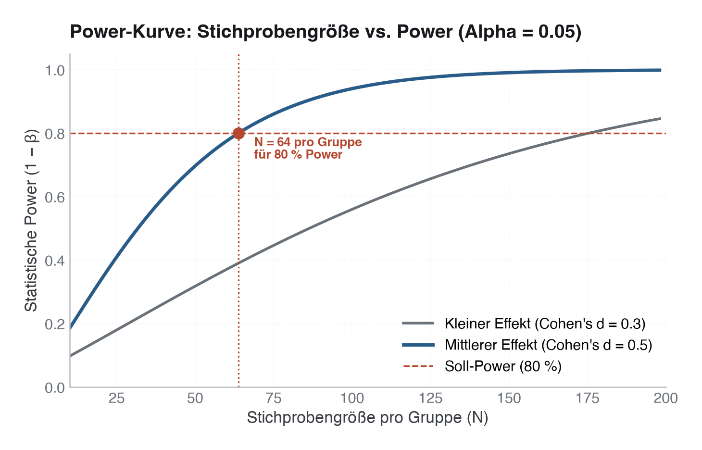

# 13 · Studiendesign und Fallzahlplanung

> **Teil 4 – Statistische Inferenz und medizinische Statistik** · Dauer: ~90 min · Voraussetzung: Module 10, 12 (Inferenz und Regression)

## Lernziele
- Eine klinische Frage in PICO/PECO, Endpunkt und Analyseplan übersetzen.
- Power, Alpha, Effektgröße und Fallzahl praktisch berechnen.
- Zwischen Power und Präzision unterscheiden.
- Ereignisse pro Parameter bei Regressionsmodellen einschätzen.
- Einen kurzen statistischen Analyseplan schreiben.

## Klinischer Aufhänger

„Wir schauen mal, was signifikant ist“ ist kein Analyseplan. Eine gute Studie
legt vorher fest: primäre Frage, Endpunkt, kleinster relevanter Unterschied,
Hauptanalyse, Sensitivitätsanalysen und Umgang mit fehlenden Werten.

Dieses Modul zeigt, wie du vor der Analyse erkennst, ob deine Daten überhaupt
eine realistische Antwort liefern können.



## 1 Von Frage zu Analyseplan

Eine gute PICO/PECO-Frage hat:

| Baustein | Beispiel |
|---|---|
| Population | stationäre Patient:innen mit Pneumonie |
| Exposure/Intervention | erhöhte Laktatwerte bei Aufnahme |
| Comparator | normale Laktatwerte |
| Outcome | 30-Tage-Mortalität oder Verweildauer |

Danach folgt der Analyseplan:

1. Primärer Endpunkt.
2. Primäre Methode.
3. Effektmaß mit Konfidenzintervall.
4. Vorab definierte Confounder.
5. Fehlende-Werte-Strategie.
6. Sensitivitätsanalysen.

**Praxis:** Ein Analyseplan darf kurz sein. Entscheidend ist, dass er vor dem
Ergebnis steht.

## 2 Power ist kein Qualitätsstempel

Power ist die Wahrscheinlichkeit, einen Effekt zu entdecken, wenn er wirklich
existiert. Häufiger Standard: 80 % Power bei α = 0,05.

Power hängt ab von:

- Stichprobengröße.
- Streuung.
- Effektgröße.
- Alpha.
- Testart und Design.

> **Merksatz:** Eine unterpowerte Studie kann einen echten Effekt übersehen. Eine übergroße Studie kann klinisch irrelevante Mini-Effekte signifikant machen.

## 3 Präzision statt nur Signifikanz

Oft ist die bessere Frage: Wie breit wird mein 95-%-KI sein? Für klinische
Entscheidungen ist ein enger, interpretierbarer Bereich oft hilfreicher als
ein p-Wert.

Beispiel: Die 30-Tage-Mortalität in der Kurskohorte liegt bei 15,6 % (78
Todesfälle bei 500 Patient:innen); das 95-%-Wilson-Intervall reicht von 12,7 % bis 19,0 %,
eine Spanne von über sechs Prozentpunkten, obwohl N = 500 nicht klein wirkt.
Für seltene Ereignisse braucht man viele Patient:innen oder längere
Beobachtung, um enger zu werden.

## 4 Ereignisse pro Parameter

Für logistische Regression ist nicht nur N relevant, sondern die Zahl der
Ereignisse. Faustregel: 10–20 Ereignisse pro frei geschätztem Parameter.

Die Kurskohorte hat 500 Patient:innen und 78 Todesfälle (15,6 %). Mit 6
Parametern ergibt das EPV = 78 / 6 = 13, im akzeptablen Bereich. Ein Modell
mit 12 Parametern läge bei EPV = 6,5, für kausale Interpretation schon dünn.

**Stolperstein:** One-hot-Encoding erzeugt zusätzliche Parameter. Eine Variable
mit fünf Kategorien kostet vier Freiheitsgrade.

**Darüber hinaus:** Penalisierte Modelle (Shrinkage, z. B. Ridge oder Lasso)
bleiben mit weniger Ereignissen stabiler, machen eine zu kleine Studie aber
nicht wett.

**Darüber hinaus:** EPV ≥ 10 ist eine grobe Screening-Faustregel, keine
Fallzahlmethode. Riley, van Smeden et al. (2019) ersetzen sie durch eine
kriterienbasierte Fallzahlberechnung: Statt einer festen Ereignisse-pro-Parameter-Zahl
braucht man neben der Zahl der Kandidatenparameter und der erwarteten
Ereignisrate drei Vorgaben, einen angestrebten Shrinkage-Faktor (wie stark die
Modellkoeffizienten zur Vermeidung von Overfitting geschrumpft werden dürfen),
ein anzunehmendes Modell-R² und eine Obergrenze für den Optimismus in der
scheinbaren (apparent) Modellgüte gegenüber der wahren, externen Performance.
Aus diesen Größen ergibt sich die nötige Fallzahl, nicht aus einer festen
EPV-Zahl.

## 5 In Python

```python
import pandas as pd
from statsmodels.stats.power import TTestIndPower
from statsmodels.stats.proportion import proportion_confint

df = pd.read_csv("{{DATEN}}kohorte.csv")

# Sample size per group for a medium effect d=0.5
analysis = TTestIndPower()
n_per_group = analysis.solve_power(effect_size=0.5, alpha=0.05, power=0.8)
print(n_per_group)

# Precision of a mortality rate
events = int(df["verstorben_30d"].sum())
n = len(df)
print(proportion_confint(events, n, alpha=0.05, method="wilson"))

# Events per variable
candidate_parameters = 6
print(events / candidate_parameters)
```

Das vollständige Skript liegt unter [`code/python.py`](code/python.py).

## 6 In R

```r
library(tidyverse)

df <- read_csv("{{DATEN}}kohorte.csv", show_col_types = FALSE)
power.t.test(delta = 0.5, sd = 1, sig.level = 0.05, power = 0.8,
             type = "two.sample", alternative = "two.sided")

events <- sum(df$verstorben_30d)
n <- nrow(df)
# correct = FALSE -> plain Wilson score interval (as in Python)
prop.test(events, n, correct = FALSE)$conf.int
events / 6
```

---

**Stolperstein:** „Wilson-KI“ ist nicht gleich `prop.test()`-Standard. Pythons
`proportion_confint(method="wilson")` liefert das **reine** Wilson-Score-Intervall
(hier [0,127; 0,190]). R rechnet mit `prop.test(...)` **standardmäßig**
`correct = TRUE`, also ein *stetigkeitskorrigiertes* Score-Intervall
([0,126; 0,191]) – ein anderes, etwas breiteres Intervall. Für dasselbe Wilson-KI
wie Python `correct = FALSE` setzen. Dann stimmen beide Sprachen überein.

## 7 Minimaler Analyseplan

Ein guter Kurzplan:

> Primärer Endpunkt ist 30-Tage-Mortalität. Primäre Analyse ist eine logistische
> Regression mit Laktat als kontinuierlichem Prädiktor, adjustiert für Alter,
> SOFA und Aufnahmegrund. Effektmaß ist die Odds Ratio pro 1 mmol/l Laktat mit
> 95-%-KI. Fehlende Laktatwerte werden in der Hauptanalyse multipel imputiert;
> Complete Case dient als Sensitivitätsanalyse.

> **Wann du Hilfe holst.** Fallzahlplanung und die Festlegung des primären Endpunkts gehören vor Einschluss der ersten Patientin mit einer Biostatistikerin abgestimmt – eine unterpowert gelaufene Studie lässt sich nachträglich nicht mehr reparieren.

## Fallstricke und Merksätze

- **Power nach dem Ergebnis ist meist wertlos.** Nutze beobachtete Effekte nicht als nachträgliche Rechtfertigung.
- **Minimal relevante Differenz vorher festlegen.** Sonst wird Signifikanz mit Relevanz verwechselt.
- **Für Regression zählen Ereignisse.** N=500 klingt groß, 78 Ereignisse (EPV je nach Modellgröße) sind das eigentliche Limit.
- **Präzision lesen.** Ein breites KI kann klinisch unbrauchbar sein, auch wenn p knapp signifikant ist.

## Selbstcheck

1. **Was bedeutet 80 % Power?** – Wenn der geplante Effekt wirklich existiert, entdeckt die Studie ihn in 80 % gleich geplanter Wiederholungen.
2. **Warum reichen 500 Patient:innen nicht automatisch für logistische Regression?** – Weil bei binären Outcomes die Zahl der Ereignisse den Informationsgehalt begrenzt.
3. **Was gehört in einen kurzen Analyseplan?** – Endpunkt, Methode, Effektmaß, Confounder, fehlende Werte und Sensitivitätsanalyse.
