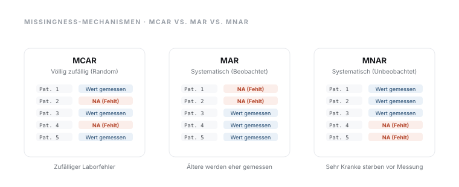
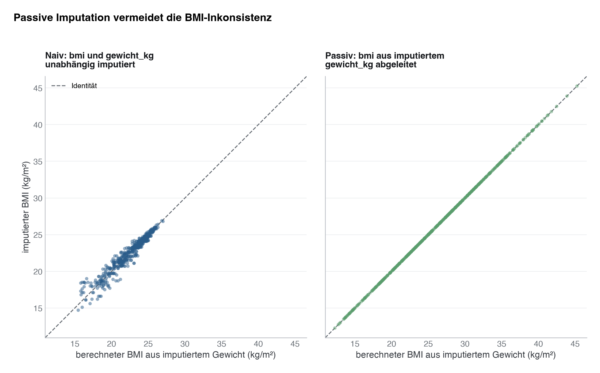
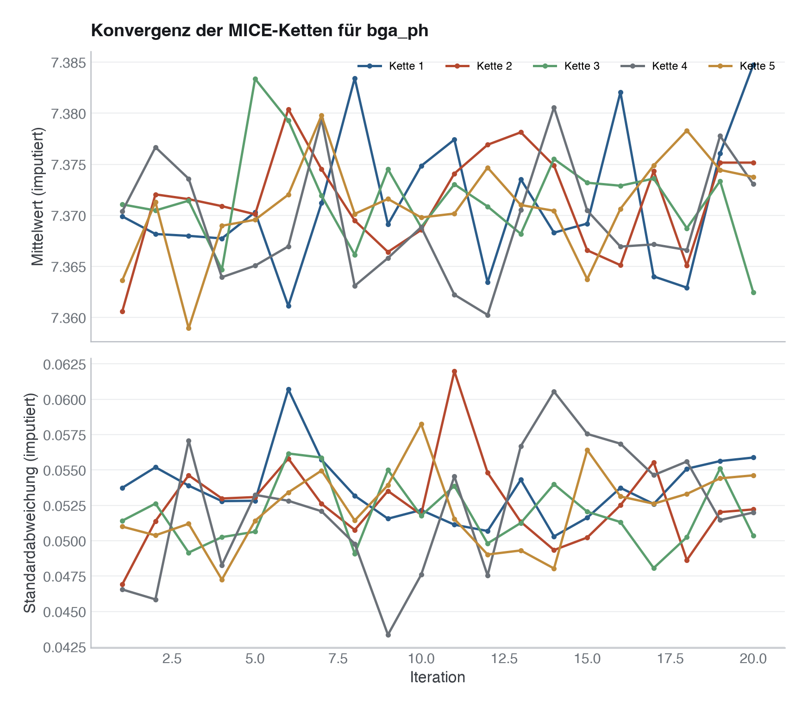
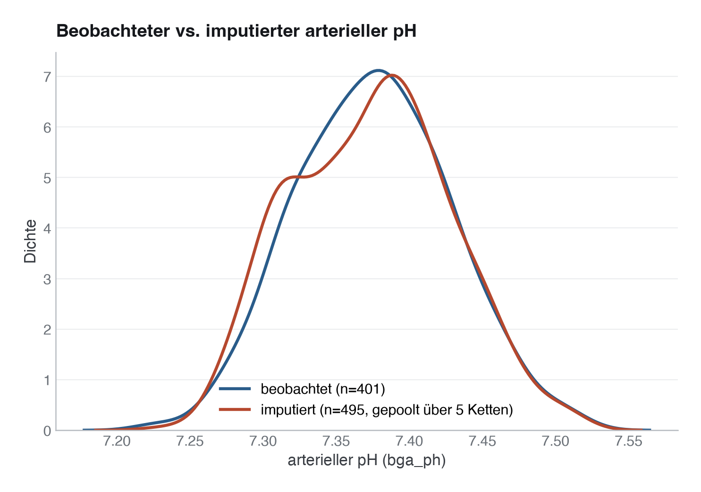
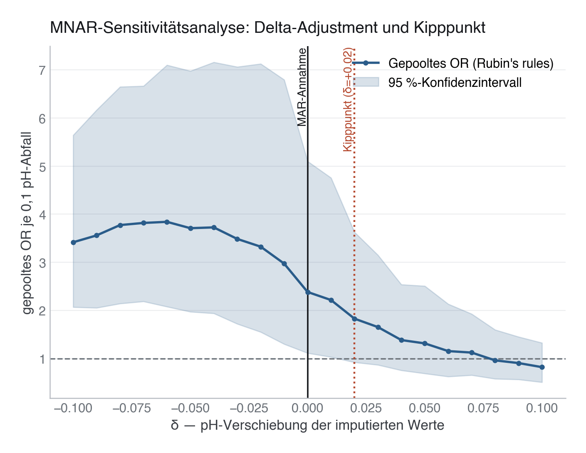

# 14 · Fehlende Werte und Imputation

> **Teil 4 – Statistische Inferenz und medizinische Statistik** · Dauer: ~150 min (Grundpfad ~60 min, Vertiefung ~90 min) · Voraussetzung: Module 06, 10, 12 (Transformation, Inferenz, Regression)

> **Wegweiser.** Dieses Modul ist das längste des Kurses, und das aus gutem
> Grund: fehlende Werte sind der häufigste stille Fehler in klinischen
> Auswertungen. Es zerfällt in zwei Teile.
>
> **Grundpfad (§1–§6, ~60 min).** Was fehlt, warum es fehlt, wann `dropna()`
> harmlos ist und wann nicht, und wie eine multiple Imputation aussieht. Danach
> kannst du das Thema in einer Publikation sauber behandeln. Übungen 1–6.
>
> **Vertiefung (§7–§11, ~90 min).** Rubin's rules von Hand, die Wahl von `m`,
> ein Monte-Carlo-Vergleich der Verfahren, MICE-Praxis und MNAR-Sensitivität.
> Für alle, die Imputation nicht nur anwenden, sondern verantworten müssen —
> Gutachter:innen fragen genau danach. Übungen 7–11.
>
> Wer es eilig hat, liest §1–§6 und kehrt vor der ersten eigenen Imputation
> zurück.

## Lernziele
- MCAR, MAR und MNAR klinisch unterscheiden und Missingness-Profile sichtbar machen.
- Beurteilen, **welche** Schätzer eine Complete-Case-Analyse verzerrt — und welche nicht.
- **Rubin's rules** von Hand rechnen (`Ū`, `B`, `T`, λ, Barnard–Rubin-df) und `m` begründet wählen.
- Imputationsverfahren an **Bias, Standardfehler-Ehrlichkeit und Überdeckung** messen statt nach Gefühl wählen.
- Ein Imputationsmodell bauen (Outcome, Hilfsvariablen, passive Imputation, Konvergenz) und MNAR per **Delta-Adjustment** prüfen.

## Klinischer Aufhänger

Zwei Werte fehlen in unserer Kohorte, aus zwei völlig verschiedenen Gründen.

**Laktat** fehlt bei den *weniger kranken* Patient:innen — eine Blutgasanalyse
wird gezogen, wenn jemand schlecht aussieht. **Der arterielle pH** fehlt bei
denen, die *gestorben sind* — die Kontroll-BGA am Folgetag wurde nie
abgenommen.

Beides heißt „MAR". Trotzdem ist `dropna()` im einen Fall die richtige Analyse
und im anderen ein Kunstfehler. Dieses Modul erklärt, warum.



## 1 Drei Mechanismen

| Mechanismus | Bedeutung | Beispiel in dieser Kohorte |
|---|---|---|
| MCAR | Fehlen unabhängig von allen Werten | `bmi` (~6 %): Röhrchen verloren |
| MAR | Fehlen erklärbar durch **beobachtete** Variablen | `laktat_mmol_l` (~17 %): hängt vom SOFA-Score ab · `bga_ph` (~20 %): hängt vom Outcome ab |
| MNAR | Fehlen hängt vom **unbeobachteten Wert selbst** ab | sehr hohe Werte werden extern gemessen und nicht übertragen |

**Praxis:** MCAR ist selten. MAR ist meist die Arbeitsannahme. MNAR verlangt
Sensitivitätsanalysen und klinische Transparenz.

> **Merksatz:** „MAR“ ist kein Etikett für einen Datensatz, sondern eine Aussage
> über eine Variable **relativ zu deinem Modell**. Dieselbe Spalte kann für die
> eine Analyse unproblematisch und für die nächste fatal sein.

## 2 Erst Missingness modellieren

Bevor du Werte ersetzt, frage: *Wer* fehlt? Erzeuge Indikatoren wie
`laktat_fehlend` und regressiere sie auf Schweregrad und Outcome.

Für unsere Kohorte liefert das ein eindeutiges Bild:

| fehlende Variable | β(sofa_score) | β(verstorben_30d) |
|---|---|---|
| `laktat_mmol_l` | **−0,268** (p = 0,0001) | −0,065 (p = 0,87) |
| `bga_ph` | −0,071 (p = 0,22) | **+1,455** (p < 0,0001) |

Laktat fehlt nach **Schweregrad**. Der pH fehlt nach **Outcome**.

> **Merksatz:** Fehlende Werte sind selbst Daten. Der Missingness-Prozess ist Teil der klinischen Geschichte.

## 3 Complete Case: was überlebt, was bricht

Hier steht der meistwiederholte Satz der Lehrbücher — und er ist zu grob:
*„Bei MAR verzerrt Complete Case."* Das stimmt so nicht. Entscheidend ist,
**wovon** das Fehlen abhängt, gemessen an dem Modell, das du rechnest.

Für eine Regression `Outcome ~ Prädiktor + Kovariaten` mit fehlendem Prädiktor:

| Das Fehlen hängt ab von … | Steigungen (OR) | Intercept / absolutes Risiko | Marginale Kennzahlen (Table 1) |
|---|---|---|---|
| nichts (MCAR) | unverzerrt | unverzerrt | unverzerrt |
| **Kovariaten, die im Modell stehen** | **unverzerrt** | unverzerrt | **verzerrt** |
| **dem Outcome** | **unverzerrt** | **verzerrt** | **verzerrt** |
| Outcome **und** Kovariaten gemeinsam | verzerrt | verzerrt | verzerrt |
| dem fehlenden Wert selbst (MNAR) | siehe Stolperstein | verzerrt | verzerrt |

**Stolperstein:** Dass Selektion *auf das Outcome* die Odds Ratios **nicht**
verzerrt, ist kein Zufall, sondern derselbe Grund, aus dem Fall-Kontroll-Studien
überhaupt funktionieren (Prentice & Pyke 1979): Selektion nach `Y` verschiebt
den Intercept eines logistischen Modells, nicht seine Steigungen. Das ist eine
Eigenschaft der **logistischen** Regression — in einer linearen Regression
verzerrt dieselbe Selektion sehr wohl die Steigung.

### Was das konkret kostet

`bga_ph` fehlt bei 41 % der Verstorbenen, aber nur bei 16 % der Überlebenden.
`dropna()` wirft damit vor allem Tote weg:

```text
full cohort           N=500   30-Tage-Mortalität 15,6 %
complete cases (pH)   N=401   30-Tage-Mortalität 11,5 %
```

Und im Modell `verstorben_30d ~ bga_ph + alter + sofa_score`:

| | Intercept | OR je −0,1 pH | vorhergesagtes Risiko (Referenzpatient:in) |
|---|---|---|---|
| volle Daten (Wahrheit) | 68,05 | **2,76** | **0,106** |
| Complete Case | 65,72 | 2,67 | 0,076 |

Das Odds Ratio ist praktisch unverzerrt. Das **absolute Risiko ist um 28 % zu
niedrig**. Ein Modell, das so kalibriert ist, unterschätzt jede Prognose, die du
einer Patientin nennst — obwohl der „Effekt“ stimmt.

**Stolperstein:** „Nur 20 % fehlen“ klingt harmlos. Wenn genau die Verstorbenen
fehlen, ist es nicht harmlos.

### Der Gegenfall: Laktat

Beim Laktat hängt das Fehlen am `sofa_score` — und der **steht im Modell**.
Also ist die Complete-Case-Schätzung des Laktat-Koeffizienten unverzerrt:

```text
complete-case β(laktat) = +0,084   (95 % KI −0,113 bis +0,281)
```

Hier ist `dropna()` die *richtige* Analyse. Was hier trotzdem verzerrt: der
**marginale Mittelwert**. Weil kränkere Patient:innen häufiger eine BGA
bekommen, überrepräsentieren die beobachteten Laktatwerte die schweren Fälle —
der Mittelwert in deiner Table 1 ist zu hoch.

## 4 Imputation

**Einfache Imputation** (Median/Mittelwert) ersetzt fehlende Werte durch eine
Konstante. Zwei Schäden auf einmal: sie **schrumpft den Effekt gegen Null**
(regression dilution), und sie **tut sicherer, als sie ist**, weil die
erfundenen Werte wie gemessene zählen.

**Multiple Imputation** erzeugt *m* plausible Datensätze, analysiert jeden und
kombiniert die Ergebnisse mit **Rubin's rules**: der Punktschätzer ist das
Mittel, die Varianz ist die Within-Varianz **plus** die Between-Varianz über die
Imputationen. Genau diese Between-Varianz ist die Unsicherheit, die die einfache
Imputation unterschlägt.

Für unser Beispiel (m = 20):

| | β(bga_ph) | SE | OR je −0,1 pH | Risiko (Referenz) |
|---|---|---|---|---|
| volle Daten (Wahrheit) | −10,14 | 3,00 | **2,76** | **0,106** |
| Complete Case | −9,82 | 3,77 | 2,67 | 0,076 (**−28 %**) |
| Median-Imputation | **−5,76** | **3,21** | **1,78** | 0,115 |
| Multiple Imputation | −9,50 | 3,64 | 2,59 | 0,107 (+1 %) |

Die Median-Imputation **halbiert den Effekt** (OR 2,76 → 1,78) und meldet dafür
einen *kleineren* Standardfehler als die Complete-Case-Analyse. Sie ist die
schlechteste der drei Optionen — und die verbreitetste.

**Stolperstein:** Multiple Imputation ist ein **stochastisches** Verfahren. Die
Tabelle zeigt die Python-Zahlen (`statsmodels`, Regressions-Imputation); das
R-Skript nutzt `mice` mit *predictive mean matching* und landet bei β ≈ −10,04
und OR ≈ 2,73. Beide treffen die Wahrheit, beide sind korrekt — die dritte
Nachkommastelle einer MI-Schätzung ist kein Ergebnis, sondern Rauschen. Wer
exakt reproduzierbare Zahlen braucht, dokumentiert Seed, `m` und die
Imputationsmethode.

**Darüber hinaus:** Multiple Imputation funktioniert hier nur, weil das
**Imputationsmodell das Outcome enthält**. Das ist der wichtigste und am
häufigsten übersehene Punkt: Das Imputationsmodell darf — und muss oft —
Variablen enthalten, die im Analysemodell gar nicht vorkommen. Wer `bga_ph` ohne
`verstorben_30d` imputiert, erzeugt genau die Verzerrung, die er beheben wollte.

**Darüber hinaus:** Multiple Imputation löst MNAR nicht magisch. Sie ist so gut
wie die Variablen, die den Missingness-Prozess erklären. Hängt das Fehlen am
unbeobachteten Wert selbst, hilft nur eine Sensitivitätsanalyse unter explizit
angenommenen Szenarien (z. B. Delta-Adjustment).

## 5 In Python

```python
import numpy as np
import pandas as pd
import statsmodels.api as sm
import statsmodels.formula.api as smf
from statsmodels.imputation import mice

df = pd.read_csv("{{DATEN}}kohorte.csv").merge(
    pd.read_csv("{{DATEN}}labor.csv"), on="patient_id", how="left")

# 1) Wer fehlt? Missingness ist selbst ein Modell.
df["bga_fehlt"] = df["bga_ph"].isna().astype(int)
print(smf.logit("bga_fehlt ~ sofa_score + verstorben_30d", data=df).fit(disp=0).summary())

# 2) Complete Case — als Sensitivitätsanalyse, nicht als Hauptanalyse.
modell = "verstorben_30d ~ bga_ph + alter + sofa_score"
cc = smf.logit(modell, data=df.dropna(subset=["bga_ph"])).fit(disp=0)

# 3) Multiple Imputation, m = 20, Rubin's rules.
#    Das Imputationsmodell enthält das Outcome — sonst bleibt die Verzerrung.
np.random.seed(42)
work = df[["verstorben_30d", "bga_ph", "alter", "sofa_score"]].copy()
imputer = mice.MICEData(work)
imputer.set_imputer("bga_ph", "alter + sofa_score + verstorben_30d")
mi = mice.MICE(modell, sm.Logit, imputer).fit(n_imputations=20, n_burnin=10)
print(mi.summary())
```

Das vollständige Skript liegt unter [`code/python.py`](code/python.py). Es
vergleicht Complete Case, Median-Imputation und multiple Imputation gegen die
**bekannte Wahrheit** (`data/bga_ph_wahrheit.csv` — nur weil die Kohorte
synthetisch ist).

## 6 In R

```r
library(tidyverse)
library(mice)

df <- read_csv("{{DATEN}}kohorte.csv") |>
  left_join(read_csv("{{DATEN}}labor.csv"), by = "patient_id")

# 1) Wer fehlt?
df |>
  mutate(bga_fehlt = as.integer(is.na(bga_ph))) |>
  glm(bga_fehlt ~ sofa_score + verstorben_30d, data = _, family = binomial) |>
  summary()

# 2) Multiple Imputation, m = 20, Rubin's rules via pool().
#    Das Outcome steht im Imputationsmodell.
work <- df |> select(verstorben_30d, bga_ph, alter, sofa_score)
imp  <- mice(work, m = 20, method = "pmm", seed = 42, printFlag = FALSE)
fit  <- with(imp, glm(verstorben_30d ~ bga_ph + alter + sofa_score, family = binomial))
summary(pool(fit))
```

Das vollständige Skript liegt unter [`code/r.R`](code/r.R).

---

> **Ende des Grundpfads.** Alles ab hier ist Vertiefung (~90 min). Du kannst
> jetzt eine Missingness-Analyse korrekt durchführen und berichten. Die
> folgenden Abschnitte erklären, *warum* die Verfahren funktionieren — und
> welches Verfahren unter welcher Frage bricht.

<!-- vertiefung: Vertiefung §7–§11 — Rubin's rules, Methodenvergleich, MNAR (~90 min) -->

## 7 Rubin's rules, von Hand

Bis hier war `pool()` eine Blackbox. Sie ist keine. Aus *m* Analysen mit
Schätzern `Q̂ₗ` und deren Varianzen `Uₗ` folgt alles mit vier Zeilen Arithmetik:

```text
Q̄ = (1/m) · Σ Q̂ₗ                    gepoolter Punktschätzer
Ū = (1/m) · Σ Uₗ                    Within-Imputation-Varianz
B = 1/(m−1) · Σ (Q̂ₗ − Q̄)²           Between-Imputation-Varianz
T = Ū + (1 + 1/m) · B               Gesamtvarianz,  SE = √T
```

`Ū` ist die Unsicherheit, die du *auch bei vollständigen Daten* hättest. `B` ist
die Unsicherheit, die **allein daraus entsteht, dass du geraten hast**. Die
einfache Imputation setzt `B = 0`. Das ist ihr ganzer Fehler.

Der Term `(1 + 1/m)` korrigiert dafür, dass `Q̄` nur *m* Monte-Carlo-Ziehungen
mittelt. Er verschwindet mit wachsendem `m`:

| m | SE ohne Korrektur | SE mit Korrektur | Aufschlag |
|---|---|---|---|
| 2 | 3,297 | 3,422 | 3,80 % |
| 5 | 3,297 | 3,347 | 1,54 % |
| 20 | 3,297 | 3,309 | 0,39 % |
| 100 | 3,297 | 3,299 | 0,08 % |

Aus `Ū` und `B` folgen die drei Kennzahlen, die jeder MI-Bericht enthalten sollte:

| Größe | Formel | unser Wert | Bedeutung |
|---|---|---|---|
| `r` | `(1+1/m)·B / Ū` | 0,192 | relativer Varianzzuwachs durch die Missingness |
| **λ** | `(1+1/m)·B / T` | **0,161** | Anteil der Varianz, der auf das Fehlen zurückgeht |
| `RE` | `1 / (1 + λ/m)` | 0,992 | Effizienz von `m = 20` gegenüber `m = ∞` |

**Freiheitsgrade.** Rubin (1987) schlug `ν_alt = (m−1)/λ²` vor — hier **730,6**,
mehr als die 496 Freiheitsgrade, die man mit *vollständigen* Daten hätte. Das ist
offensichtlich unsinnig. **Barnard & Rubin (1999)** korrigieren das nach unten:

```text
ν_com = n − k = 500 − 4 = 496
ν_obs = ((ν_com+1)/(ν_com+3)) · ν_com · (1 − λ)   = 414,3
ν_BR  = (ν_alt · ν_obs) / (ν_alt + ν_obs)          = 264,4
```

Ergebnis: `Q̄ = −9,958`, `SE = 3,309`, `t = −3,009` bei `ν_BR = 264,4` →
**p = 0,0029**, 95-%-KI `[−16,47; −3,44]`.

**Stolperstein:** λ und `fmi` sind **nicht** dasselbe. `mice::pool()` druckt
`fmi = (r + 2/(ν+3))/(r+1)` — hier 0,168 statt λ = 0,161. `statsmodels` wiederum
nennt sein Attribut `frac_miss_info`, gibt aber λ zurück, nicht `fmi`. Wer die
beiden Zahlen aus zwei Sprachen vergleicht, vergleicht zwei verschiedene Größen.

**Stolperstein:** `statsmodels` kennt für MI **überhaupt keine Freiheitsgrade**.
`mice.MICE(...).fit()` rechnet einen Wald-**z**-Test (df = ∞) und liefert deshalb
systematisch etwas zu kleine p-Werte. `mice::pool()` in R implementiert
Barnard–Rubin korrekt. [`code/rubin.py`](code/rubin.py) und
[`code/rubin.R`](code/rubin.R) rechnen beides von Hand nach, vergleichen es mit
der jeweiligen Bibliothek und **drucken die Abweichung aus, statt sie zu glätten**.

## 8 Wie viele Imputationen? (`m`)

Die alte Faustregel „m = 5 genügt" stammt aus einer Zeit, in der Rechenzeit knapp
war. Sie zielt auf die **Effizienz des Punktschätzers** (`RE` oben ist schon bei
m = 5 über 0,96) — nicht auf die Stabilität des **Standardfehlers**.

**White, Royston & Wood (2011):** `m ≳ 100 · λ`. Bei λ = 0,161 heißt das
`m ≳ 16`; unser `m = 20` genügt gerade.

Der Grund ist empirisch nachprüfbar. `code/rubin.py` wiederholt die gesamte
Pipeline über 10 Seeds je `m` und misst, wie stark der **gepoolte SE selbst**
schwankt:

| m | mittlerer SE | Streuung des SE | Variationskoeffizient |
|---|---|---|---|
| 2 | 3,44 | 0,687 | 20,0 % |
| 5 | 3,62 | 0,267 | 7,4 % |
| 10 | 3,68 | 0,282 | 7,7 % |
| 20 | 3,50 | 0,145 | 4,1 % |
| 50 | 3,67 | 0,115 | 3,1 % |

> **Merksatz:** Bei m = 5 hängt der Standardfehler, den du berichtest, zu ~7 %
> vom Zufallsseed ab. `m` ist heute kostenlos. Nimm 20–50.

## 9 Welche Methode? Nicht raten — messen

Weil wir die wahren pH-Werte kennen, lässt sich jede Methode **prüfen** statt
bewerten. [`code/benchmark.py`](code/benchmark.py) zieht 500-mal eine frische
Kohorte aus dem Datengenerierungsprozess, wendet die Missingness an und fragt für
jede Methode: Trifft sie den wahren Wert? Und ist ihr eigener Standardfehler
**ehrlich**?

Zwei Diagnosen, die man nicht verwechseln darf:

- **Bias** — liegt der Punktschätzer systematisch daneben?
- **SE-Ratio** = *berichteter SE / tatsächliche Streuung*. Unter 1 heißt: die
  Methode **behauptet mehr Präzision, als sie hat**.
- **Überdeckung** — wie oft enthält das nominale 95-%-KI die Wahrheit? Soll 95 %.

| Methode | Bias | SE-Ratio | Überdeckung |
|---|---|---|---|
| Orakel (volle Daten) | −0,28 | 0,97 | **95,2 %** |
| Complete Case | −0,41 | 0,93 | 93,4 % |
| Mittelwert-Imputation | **+3,08** | 1,06 | 83,8 % |
| Median-Imputation | **+3,10** | 1,06 | 84,0 % |
| Regressions-Imputation (deterministisch) | −3,37 | **0,66** | **73,2 %** |
| Regressions-Imputation (stochastisch) | −0,41 | 0,70 | 83,4 % |
| PMM (einfach, k = 5) | −0,44 | 0,67 | 82,6 % |
| **MICE (m = 20, Rubin's rules)** | **−0,01** | 0,90 | **93,0 %** |
| Missing-Indikator | −0,25 | 0,94 | 94,2 % |

Die Orakel-Zeile ist die Selbstkontrolle des Verfahrens: 95,2 % Überdeckung, also
funktioniert der Prüfstand. Alles darunter ist ein echtes Ergebnis.


Drei Lehren, die man einzeln so nicht sieht:

1. **Zwei verschiedene Wege, ein KI zu ruinieren.** Mittelwert- und
   Median-Imputation scheitern über den **Bias** (+3,1) bei ehrlichem SE
   (Ratio 1,06). Die deterministische Regressions-Imputation scheitert über die
   **Varianz**: sie meldet nur 66 % der Streuung, die sie tatsächlich hat, und
   überdeckt in 73 % der Fälle — die schlechteste Zeile der Tabelle, obwohl sie
   von allen Einfachimputationen den **kleinsten RMSE** hat (0,0501).

2. **Guter RMSE ≠ gute Inferenz.** Die stochastische Regressions-Imputation hat
   den *schlechtesten* RMSE (0,0709 — sie addiert ja Rauschen) und trotzdem
   deutlich weniger Bias als der Median. Wer Imputationen danach auswählt, wie
   nah die eingesetzten Werte an der Wahrheit liegen, optimiert die falsche Größe.

3. **Complete Case ist hier nicht das Problem.** Für die Steigung überdeckt es
   93,4 %. Der Schaden liegt woanders — siehe die nächste Tabelle.

### Derselbe Datensatz, drei Schätzgrößen

| Schätzgröße | Complete Case | Missing-Indikator | MICE |
|---|---|---|---|
| Steigung β(bga_ph) | 93,4 % | 94,2 % | 93,0 % |
| Intercept | 93,2 % | 95,0 % | 92,8 % |
| **absolutes Risiko** | **57,0 %** | **53,8 %** | **93,6 %** |

> **Merksatz:** Ein nominal 95-prozentiges Konfidenzintervall für das absolute
> Risiko, das nur in 57 % der Fälle die Wahrheit enthält, ist kein
> Konfidenzintervall. Complete Case und Missing-Indikator liefern beide korrekte
> Odds Ratios und beide unbrauchbare Prognosen.

**Darüber hinaus:** Der **Missing-Indikator** (fehlenden Wert auffüllen, plus
Dummy „war fehlend") verhält sich für den Koeffizienten wie Complete Case. Für
**Vorhersagemodelle** ist er trotzdem attraktiv, weil die Information „wurde nicht
gemessen" bei Anwendung verfügbar bleibt und selbst prädiktiv ist. Für **kausale
Effektschätzung** ist er ungeeignet: der Indikator ist ein Kollider, sobald das
Fehlen vom Outcome abhängt.

**Darüber hinaus:** Das Orakel hat selbst einen Bias von −0,28. Das ist kein
Fehler des Prüfstands, sondern der bekannte **Kleine-Stichproben-Bias des
logistischen ML-Schätzers** (Firth 1993): bei n = 500 und 78 Ereignissen zieht die
Maximum-Likelihood-Schätzung Koeffizienten systematisch von der Null weg. Eine
Firth-Korrektur behebt das; MI behebt es nicht, weil es gar nichts mit fehlenden
Werten zu tun hat.

## 10 MICE in der Praxis

`code/mice_praxis.py` und `code/mice_praxis.R` demonstrieren die vier Griffe, die
in echten Analysen den Unterschied machen.

### Passive Imputation: abgeleitete Variablen

Unsere Kohorte enthält `groesse_cm`, `gewicht_kg` und `bmi`, wobei per Definition
`bmi = gewicht_kg / (groesse_cm/100)²`. `gewicht_kg` und `bmi` fehlen bei
denselben 30 Patient:innen.

Imputiert man beide **als unabhängige Variablen**, erfindet MICE Patient:innen,
deren BMI ihrem eigenen Gewicht widerspricht:

```text
naiv    |bmi_imputiert − gewicht_imputiert/(h/100)²| :  Mittel 0,418   max 2,592
passiv  |bmi_imputiert − gewicht_imputiert/(h/100)²| :  Mittel 0,000   max 0,000
```

Richtig ist die **passive Imputation**: imputiere `gewicht_kg`, *leite* `bmi`
daraus ab. In R kann `mice` das nativ:

```r
meth["bmi"] <- "~ I(gewicht_kg / (groesse_cm/100)^2)"
pred["gewicht_kg", "bmi"] <- 0   # sonst sagt bmi sein eigenes Gewicht voraus
```

Die Null in der Prädiktormatrix ist Pflicht: ohne sie speist sich `bmi` — eine
deterministische Funktion von `gewicht_kg` — in die Imputation von `gewicht_kg`
zurück, und der Gibbs-Sampler dreht sich im Kreis.



**Stolperstein:** `statsmodels` kennt keine passive Imputation. In Python muss man
`gewicht_kg` imputieren und `bmi` anschließend selbst neu berechnen — eine echte
Funktionslücke.

### Grenzen: imputierte Werte müssen möglich sein

`bga_ph` liegt konstruktionsbedingt in `[6,90; 7,60]`. Ein unbeschränkter
`norm`-Imputer *darf* darüber hinausschießen; **PMM** kann es nicht, weil er nur
tatsächlich beobachtete Werte als Spender verwendet.

Ehrliches Messergebnis in unserem Fall: der `norm`-Imputer erzeugt über m = 20
**0 von 1980** unmöglichen Werten. Die pH-Verteilung (SD ≈ 0,05) liegt schlicht zu
weit von den Grenzen entfernt; die erwartete Anzahl Verletzungen ist ≈ 0,013.
PMM bleibt garantiert im Bereich `[7,225; 7,517]` der beobachteten Werte.

> **Merksatz:** PMM respektiert den Wertebereich und die Randverteilung; ein
> normaler Imputer nicht. Der Preis: PMM kann nicht über die beobachteten Werte
> hinaus extrapolieren. Bei stark schiefen oder begrenzten Variablen (Laktat,
> CRP, Skalen mit Boden/Decke) ist PMM die sichere Wahl.

### Hilfsvariablen und Kongenialität

Das **Imputationsmodell** darf reicher sein als das **Analysemodell** — und muss
es oft. Meng (1994) nennt den Gegensatz *uncongeniality*.

| Imputationsmodell | β(bga_ph) | λ |
|---|---|---|
| (a) `alter + sofa_score` | **−5,95** | 0,338 |
| (b) `+ verstorben_30d` | −9,25 | 0,461 |
| (c) `+ laktat, crp, leukozyten` | −8,99 | 0,345 |
| *Wahrheit* | *−10,14* | — |

(a) verfehlt die Wahrheit um mehr als das Vierfache des Fehlers von (b) — weil das
Outcome, von dem das Fehlen abhängt, gar nicht im Imputationsmodell steht.
(c) fügt Hilfsvariablen hinzu, die im Analysemodell nicht vorkommen, und senkt die
Fraktion fehlender Information von 0,461 auf 0,345.

**Stolperstein:** `laktat_mmol_l` hat selbst ~17 % fehlende Werte. Sobald man es
als Hilfsvariable aufnimmt, ist die Imputation echt multivariat — genau dafür ist
MICE (*chained equations*) gebaut.

### Konvergenz: MICE ist ein Gibbs-Sampler

MICE zieht abwechselnd aus bedingten Verteilungen. Das **muss** man ansehen, nicht
annehmen. Wir tracken Mittelwert und SD der imputierten pH-Werte über 20
Iterationen und 5 Ketten:



Gelman-Rubin `R̂ = 0,983` (< 1,1): die Ketten durchmischen sich, kein Trend, kein
Drift. Gesund.



**Stolperstein:** Bei der Dichteprüfung erwarten viele, dass sich beobachtete und
imputierte Verteilung *decken*. Hier wäre das ein **Alarmzeichen**. Die nicht
gemessenen Patient:innen sind häufiger verstorben und damit azidotischer — ihre
imputierte Dichte *muss* tiefer liegen. Eine perfekte Überlappung hieße: das
Imputationsmodell hat das Outcome ignoriert.

## 11 MNAR: was, wenn MAR nicht stimmt?

MAR lässt sich aus den Daten **nicht prüfen**. Man kann nur zeigen, wie weit die
Annahme verletzt sein müsste, damit die Schlussfolgerung kippt. Das leistet die
**Delta-Adjustment-Sensitivitätsanalyse** (Pattern-Mixture-Form):

```text
bga_ph_imputiert(δ) = bga_ph_imputiert(MAR) + δ
```

Nur die **imputierten** Werte werden verschoben, nie die beobachteten. `δ` ist die
angenommene systematische pH-Differenz zwischen nicht gemessenen und sonst
identischen gemessenen Patient:innen. `δ = 0` ist die MAR-Analyse.



| δ | OR je −0,1 pH | 95-%-KI | Schluss hält? |
|---|---|---|---|
| −0,02 | 3,33 | (1,55; 7,13) | ja |
| 0,00 (**MAR**) | **2,38** | (1,11; 5,10) | ja |
| +0,01 | 2,22 | (1,03; 4,76) | ja (knapp) |
| **+0,02** | 1,83 | (0,92; 3,63) | **nein — Kipppunkt** |
| +0,05 | 1,32 | (0,69; 2,51) | nein |

**Welche Richtung ist konservativ?** Nicht raten — rechnen. `δ < 0` unterstellt,
die nicht gemessenen Patient:innen seien *azidotischer* als das MAR-Modell
vorhersagt. Das passt zu ihrer höheren Sterblichkeit und **verstärkt** den Effekt.
`δ > 0` unterstellt sie als *unauffälliger* — dann bleibt ihre Übersterblichkeit
durch den pH unerklärt, und der Effekt schrumpft. **`δ > 0` ist die Richtung, nach
der eine Gutachterin fragen wird.**

**Wie groß ist +0,02 eigentlich?** Der Vergleich mit der Messungenauigkeit eines
Blutgasanalysators wäre ein Kategorienfehler: Analysenrauschen ist *zufällig*, `δ`
ist ein *systematischer* Gruppenunterschied. Das richtige Maß ist die
**bedingte Streuung** des pH nach Adjustierung, hier 0,050. Der Kipppunkt liegt
also bei **0,40 bedingten Standardabweichungen**.

> **Merksatz:** Die Schlussfolgerung hält, solange die nicht gemessenen
> Patient:innen um weniger als ~0,4 Standardabweichungen von dem abweichen, was
> das Imputationsmodell über sie annimmt — **und zwar in der Richtung, die ihrer
> höheren Sterblichkeit widerspricht.** Das ist eine benennbare, diskutierbare
> Annahme. Genau das ist der Zweck einer Sensitivitätsanalyse: nicht Sicherheit,
> sondern eine ehrlich formulierte Bedingung.

**Darüber hinaus:** Delta-Adjustment ist das einfachste MNAR-Werkzeug. Weitere:
**Pattern-Mixture-Modelle** (eigenes Modell je Missingness-Muster),
**Selektionsmodelle** (Heckman: Outcome- und Missingness-Modell gemeinsam
geschätzt) und **Tipping-Point-Analysen** über mehrere Variablen gleichzeitig.
Alle teilen dieselbe Eigenschaft: sie testen MNAR nicht, sie machen die Annahme
explizit.

<!-- /vertiefung -->

## 12 Bericht

Ein guter Missingness-Abschnitt sagt:

- wie viele Werte pro Variable fehlen,
- **womit** das Fehlen zusammenhängt (Zahl, nicht Vermutung),
- welche Hauptstrategie gewählt wurde, mit **welchem Imputationsmodell**, welchem `m` und welchem Seed,
- die **Fraktion fehlender Information** (λ oder `fmi`) für die zentralen Schätzer,
- welche Sensitivitätsanalyse durchgeführt wurde — und bei MNAR-Verdacht: bis zu welchem `δ` die Schlussfolgerung hält,
- ob die Schlussfolgerungen stabil bleiben.

## Skripte dieses Moduls

**Reihenfolge:** Beginne mit `python.py` / `r.R`. Die übrigen Skripte sind
eigenständig und laufen in beliebiger Folge.

| Datei | Was sie zeigt | Laufzeit |
|---|---|---|
| [`code/python.py`](code/python.py) · [`code/r.R`](code/r.R) | Der Hauptbogen: Mechanismen, Complete Case, Median, MI | ~2 s |
| [`code/rubin.py`](code/rubin.py) · [`code/rubin.R`](code/rubin.R) | Rubin's rules von Hand, gegen die Bibliothek geprüft; Wahl von `m` | ~10 s |
| [`code/mice_praxis.py`](code/mice_praxis.py) · [`code/mice_praxis.R`](code/mice_praxis.R) | Passive Imputation, Grenzen, Hilfsvariablen, Konvergenz | ~7 s |
| [`code/mnar_delta.py`](code/mnar_delta.py) · [`code/mnar_delta.R`](code/mnar_delta.R) | Delta-Adjustment und Kipppunkt | ~13 s |
| [`code/benchmark.py`](code/benchmark.py) | 500 Monte-Carlo-Kohorten: Bias, SE-Ehrlichkeit, Überdeckung | **~5 min** |

**Stolperstein:** `benchmark.py` rechnet rund **fünf Minuten** und gibt erst am
Ende Ergebnisse aus. Das Skript sagt das beim Start selbst — nicht abbrechen.

> **Wann du Hilfe holst.** Wenn der Anteil fehlender Werte hoch ist (> 30–40 %), das Fehlen plausibel vom unbeobachteten Wert selbst abhängt (MNAR), oder das Imputationsmodell über wenige Standardvariablen hinauswächst, ist eine methodische Beratung Pflicht — Gutachter:innen fragen genau hier nach.

## Fallstricke und Merksätze

- **`dropna()` ist eine Analyseentscheidung.** Sie gehört begründet, nicht nebenbei getippt.
- **„MAR“ allein sagt dir nichts.** Frage, wovon das Fehlen abhängt — und ob diese Variable in deinem Modell steht.
- **Complete Case kann korrekte Odds Ratios und falsche Risiken liefern.** Wer nur ORs berichtet, merkt es nie.
- **Median-Imputation ist selten die sichere Wahl.** Sie verzerrt zur Null und meldet zu kleine Standardfehler.
- **Ein guter RMSE der imputierten Werte bedeutet nichts.** Die deterministische Regressions-Imputation trifft die Wahrheit am besten und überdeckt am schlechtesten.
- **`B` ist der ganze Punkt von Rubin's rules.** Einfache Imputation setzt sie auf null und lügt damit über ihre eigene Präzision.
- **Das Imputationsmodell ist reicher als das Analysemodell.** Das Outcome gehört hinein, Hilfsvariablen oft auch.
- **MNAR wird nicht getestet, sondern beziffert.** Ein Kipppunkt in Einheiten der bedingten Streuung ist eine ehrliche Aussage; „wir nehmen MAR an" ist keine.
- **Stabilität zählt.** Wenn Complete Case und Imputation Gegenteiliges zeigen, ist das der Befund.

## Selbstcheck

1. **Der pH fehlt vor allem bei Verstorbenen. Welche Schätzer verzerrt eine Complete-Case-Analyse, welche nicht?**, Die Odds Ratios bleiben unverzerrt (Selektion nach dem Outcome verschiebt nur den Intercept); der Intercept und damit jedes vorhergesagte absolute Risiko sind verzerrt — hier um −28 %, mit einer Überdeckung von nur 57 % statt 95 %.
2. **Wofür stehen `Ū` und `B` in Rubin's rules, und welche der beiden setzt eine Median-Imputation auf null?**, `Ū` ist die Unsicherheit, die auch bei vollständigen Daten bestünde; `B` ist die Unsicherheit, die allein daraus entsteht, dass Werte geraten wurden. Die Median-Imputation setzt `B = 0` und meldet deshalb einen zu kleinen Standardfehler.
3. **Eine Methode trifft die wahren pH-Werte am genauesten (kleinster RMSE) und hat trotzdem die schlechteste Überdeckung. Wie geht das?**, Die deterministische Regressions-Imputation setzt jeden fehlenden Wert auf seinen bedingten Erwartungswert. Das minimiert den RMSE, entfernt aber die Streuung aus den Daten: der berichtete SE beträgt nur 66 % der wahren, und das nominale 95-%-KI überdeckt in 73 % der Fälle.
4. **Warum muss das Outcome im Imputationsmodell stehen, obwohl es im Analysemodell die abhängige Variable ist?**, Weil das Fehlen vom Outcome abhängt. Ohne das Outcome erklären die Imputationsvariablen die Missingness nicht mehr, die Imputation reproduziert die Verzerrung, und das Odds Ratio bricht (−5,95 statt −10,14).
5. **Der Kipppunkt der Delta-Adjustment-Analyse liegt bei δ = +0,02 pH. Ist die Schlussfolgerung damit robust?**, Bezogen auf die bedingte Streuung des pH (0,050) sind das 0,4 Standardabweichungen, und zwar in der Richtung, die der höheren Sterblichkeit der nicht gemessenen Patient:innen widerspricht. Das ist eine benennbare, eher unplausible Annahme — die Schlussfolgerung ist also moderat robust, aber nicht unangreifbar. An der Messungenauigkeit des Analysators darf man δ nicht messen: die ist zufällig, δ ist systematisch.
