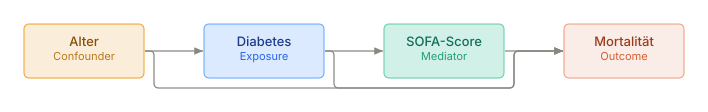
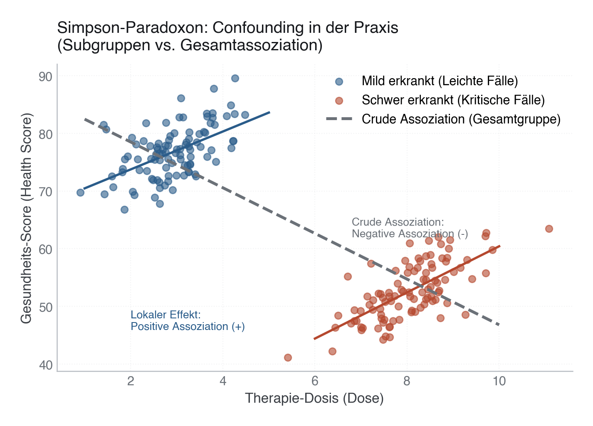

# 15 · Kausale Inferenz und Directed Acyclic Graphs

> **Teil 4 – Statistische Inferenz und medizinische Statistik** · Dauer: ~100 min · Voraussetzung: Module 12–14 (Regression, Studiendesign, fehlende Werte)

## Lernziele
- Assoziation, Prädiktion und kausale Effektfrage trennen.
- Confounder, Mediator und Kollider in einem DAG unterscheiden.
- Crude und adjustierte Effekte vergleichen.
- Propensity Scores und Standardized Mean Differences anwenden.
- Grenzen von Beobachtungsdaten klar berichten.

## Klinischer Aufhänger

Diabetes ist mit höherer Mortalität assoziiert. Aber verursacht Diabetes in
dieser Akutsituation die 30-Tage-Mortalität, oder sind Patient:innen mit Diabetes
älter und kränker? Genau hier beginnt kausale Inferenz.


## 1 Drei verschiedene Fragen

| Frage | Ziel | Methode |
|---|---|---|
| Assoziation | Gibt es einen Zusammenhang? | Test, Regression |
| Prädiktion | Wer hat hohes Risiko? | validiertes Modell |
| Kausalität | Was wäre passiert, wenn Exposure anders gewesen wäre? | Design, DAG, Adjustierung, Sensitivität |

> **Merksatz:** Kausalität ist keine Eigenschaft des p-Werts. Sie entsteht aus Design, Annahmen und passender Adjustierung.

## 2 DAG-Denken

Ein DAG ist ein gerichtetes azyklisches Diagramm: Pfeile stehen für angenommene
kausale Beziehungen.

Beispiel:



- **Confounder:** Ursache von Exposure und Outcome; adjustieren.
- **Mediator:** liegt auf dem kausalen Pfad; nicht adjustieren, wenn der totale Effekt interessiert.
- **Kollider:** gemeinsame Folge zweier Ursachen; Adjustierung kann Bias erzeugen.

**Stolperstein:** „Im Modell signifikant“ macht eine Variable nicht zum Confounder.
Confounder werden aus klinischem Wissen und DAG ausgewählt.

## 3 Crude vs. adjustiert

Ein rohes Odds Ratio für Diabetes kann höher aussehen als das adjustierte OR,
wenn Alter einen Teil der Assoziation erklärt. Das ist kein Fehler, sondern
der Punkt der Adjustierung, **solange nur für Confounder adjustiert wird.**

In dieser Kohorte: crude OR für Diabetes ≈ 2,07 (95%-KI [1,19; 3,58]); nach
Adjustierung für den Confounder `alter` sinkt es auf ≈ 1,59 (95%-KI [0,90;
2,82]), Alter erklärt also einen Teil der rohen Assoziation.

**Stolperstein:** Adjustiert man zusätzlich für `sofa_score`, obwohl der DAG
oben `Diabetes → SOFA → Mortalität` zeigt (SOFA ist hier **Mediator**, nicht
Confounder), fällt die OR auf ≈ 0,99, praktisch keine Assoziation mehr. Das
ist kein „genauerer" Effekt, sondern eine andere Frage: Man hat den Pfad
blockiert, über den Diabetes tatsächlich wirkt, und schätzt nur noch den
direkten, nicht den totalen Effekt. Für die Frage „Wie stark beeinflusst
Diabetes insgesamt die Mortalität?" ist die SOFA-adjustierte Zahl **falsch**.

> [!TIP]
> **Das Simpson-Paradoxon als Extremfall des Confoundings**  
> Wenn ein Confounder nicht berücksichtigt wird, kann sich die Richtung des scheinbaren Effekts sogar komplett umkehren (Simpson-Paradoxon).  
> Beispielsweise kann eine höhere Medikamentendosis insgesamt mit einer *schlechteren* Gesundheit assoziiert sein (weil schwere Fälle höhere Dosen erhalten und unabhängig davon kränker sind). Nach Adjustierung für die Krankheitsschwere (Schichtung) zeigt sich jedoch in jeder Gruppe separat der wahre, positive Effekt der Therapie.
>
> 

**Praxis:** Berichte beide, wenn es didaktisch oder klinisch hilft: crude zeigt
die beobachtete Assoziation, adjustiert nähert sich der Effektfrage unter
Annahmen.

## 4 Propensity Score

Der Propensity Score ist die Wahrscheinlichkeit, exponiert zu sein, gegeben
beobachtete Confounder. Er wird genutzt für Matching, Gewichtung oder
Stratifizierung. **Wichtig:** Ins Propensity-Score-Modell gehören nur
Confounder, keine Mediatoren, in dieser Kohorte also `alter`, nicht
`sofa_score`. Ein Mediator ist eine Folge der Exposition; ihn ins PS-Modell
aufzunehmen kann Bias einführen statt ihn zu entfernen.

Hier verwenden wir IPTW:

```text
Gewicht exponiert     = 1 / PS
Gewicht nicht exponiert = 1 / (1 - PS)
```

Danach prüfen wir Balance mit **Standardized Mean Difference (SMD)**. Ziel:
SMD < 0,1 für wichtige Confounder. In dieser Kohorte sinkt die SMD für
`alter` durch die Gewichtung von ≈ 0,58 auf ≈ 0,13, deutlich näher an
Balance. `sofa_score` bleibt bewusst unbalanciert (rohe SMD ≈ 0,54): Da es
ein Mediator ist, wird es nicht als PS-Balance-Ziel behandelt, ein
Ungleichgewicht dort ist erwartbar und kein Hinweis auf ein fehlerhaftes
PS-Modell.

**Darüber hinaus:** Propensity Scores balancieren nur gemessene Confounder.
Unbekannte oder ungemessene Confounder bleiben das zentrale Risiko.

**Stolperstein:** Wenn du das gewichtete Outcome-Modell rechnest (IPTW → ATE, siehe
`code/`), brauchst du einen **robusten (Sandwich-)Standardfehler**. IPW-Gewichte sind
*keine* Häufigkeiten; behandelt man sie als solche (`freq_weights` in Python bzw.
`weights` mit `quasibinomial` in R), wird das Konfidenzintervall künstlich zu schmal.
Korrekt ist `var_weights` + `cov_type="HC0"` (Python) bzw.
`lmtest::coeftest(fit, vcov = sandwich::vcovHC(fit, "HC0"))` (R). Auf den Kursdaten ergibt
das robuste CI `OR ≈ 1,76 [0,99; 3,15]` – es schließt die 1 knapp *ein*, der naive
freq-weight-SE hätte fälschlich `[1,27; 2,44]` gemeldet. Der Goldstandard ist ein
Bootstrap, der den PS mitschätzt (hier praktisch deckungsgleich mit dem Sandwich).

## 5 In Python

```python
import pandas as pd
import numpy as np
import statsmodels.formula.api as smf
from sklearn.linear_model import LogisticRegression

df = pd.read_csv("{{DATEN}}kohorte.csv")
df["diabetes"] = df["diabetes"].astype(int)

# alter = Confounder -> adjustieren. sofa_score = Mediator auf dem
# Diabetes-Pfad -> NICHT adjustieren, wenn der totale Effekt interessiert.
crude = smf.logit("verstorben_30d ~ diabetes", data=df).fit(disp=False)
adj = smf.logit("verstorben_30d ~ diabetes + alter", data=df).fit(disp=False)

X = df[["alter"]]   # nur Confounder, keine Mediatoren im PS-Modell
ps_model = LogisticRegression(max_iter=1000).fit(X, df["diabetes"])
df["ps"] = ps_model.predict_proba(X)[:, 1]
df["iptw"] = np.where(df["diabetes"].eq(1), 1 / df["ps"], 1 / (1 - df["ps"]))
```

Das vollständige Skript liegt unter [`code/python.py`](code/python.py).

## 6 In R

```r
library(tidyverse)

df <- read_csv("{{DATEN}}kohorte.csv", show_col_types = FALSE)
# alter = Confounder -> adjustieren. sofa_score = Mediator auf dem
# Diabetes-Pfad -> NICHT adjustieren, wenn der totale Effekt interessiert.
summary(glm(verstorben_30d ~ diabetes, data = df, family = binomial))
summary(glm(verstorben_30d ~ diabetes + alter, data = df, family = binomial))

ps_fit <- glm(diabetes ~ alter, data = df, family = binomial)  # nur Confounder
df <- df |>
  mutate(ps = predict(ps_fit, type = "response"),
         iptw = if_else(diabetes == 1, 1 / ps, 1 / (1 - ps)))
```

## 7 Bericht

Ein ehrlicher Satz:

> In Beobachtungsdaten war Diabetes mit 30-Tage-Mortalität assoziiert (crude OR
> ≈ 2,07). Nach Adjustierung für den Confounder Alter war die OR kleiner (≈
> 1,59). SOFA wurde bewusst *nicht* mitadjustiert, da es laut DAG ein Mediator
> auf dem Diabetes-Pfad ist; eine SOFA-adjustierte Zahl würde den totalen
> Effekt unterschätzen. Diese Analyse kontrolliert gemessene Confounder, kann
> aber ungemessene Confounding-Strukturen nicht ausschließen.

> **Wann du Hilfe holst.** Sobald plausibel ungemessene Confounder bestehen, der Adjustierungs-Satz aus dem DAG strittig ist, oder eine Variable zugleich Mediator und Confounder sein könnte, hol methodische Beratung — kein Adjustierungsverfahren rettet ein Kausalstatement, dessen Annahmen nicht haltbar sind.

## Fallstricke und Merksätze

- **Nicht für Mediatoren adjustieren**, wenn der totale Effekt interessiert.
- **Nicht blind alles ins Modell werfen.** Das kann Kollider-Bias erzeugen.
- **Balance prüfen.** Ein Propensity Score ohne Balance-Diagnostik ist unfertig.
- **Kausalität bleibt annahmenabhängig.** Schreibe die Annahmen sichtbar auf.

## Selbstcheck

1. **Was unterscheidet Confounder und Mediator?**, Ein Confounder verursacht Exposure und Outcome; ein Mediator liegt auf dem Pfad von Exposure zu Outcome.
2. **Warum kann Adjustierung Bias erzeugen?**, Wenn man für einen Kollider oder Mediator adjustiert, kann man falsche Pfade öffnen oder den interessierenden Effekt blockieren.
3. **Was zeigt SMD?**, Ob Kovariaten zwischen Expositionsgruppen balanciert sind, unabhängig von Stichprobengröße.

