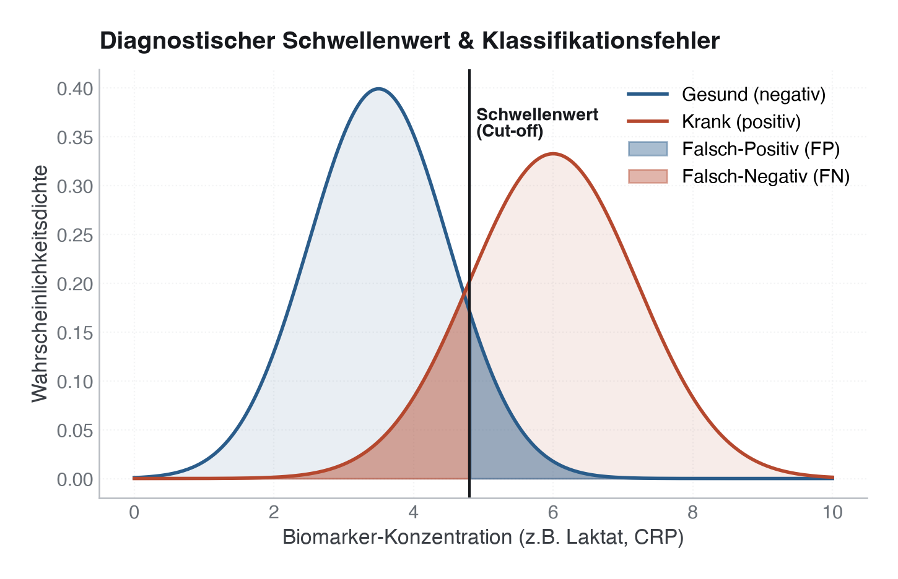

# 16 · Diagnostische Genauigkeit und Schwellenwerte

> **Teil 4 – Statistische Inferenz und medizinische Statistik** · Dauer: ~90 min · Voraussetzung: Module 10, 12 (Inferenz und Regression)

## Lernziele
- Sensitivität, Spezifität, PPV, NPV und Likelihood Ratios berechnen.
- Prävalenzeffekte auf PPV/NPV erklären.
- ROC, AUC und Youden-Schwelle sinnvoll nutzen.
- Klinische Schwellen nach Konsequenz wählen und mit Net Benefit (Decision-Curve-Analyse) bewerten.
- Diagnostische Ergebnisse publikationstauglich berichten.

## Klinischer Aufhänger

Ein Test mit 90 % Sensitivität klingt gut. Aber wenn die Erkrankung selten ist,
kann der positive Vorhersagewert trotzdem niedrig sein. Diagnostik ist
Wahrscheinlichkeit plus Kontext plus Konsequenz.

Wir nutzen Laktat als einfachen Marker für 30-Tage-Mortalität. Es ist kein
perfekter Test, aber ideal, um Schwellen zu lernen.



## 1 Die 2x2-Tabelle

|  | Ereignis ja | Ereignis nein |
|---|---:|---:|
| Test positiv | TP | FP |
| Test negativ | FN | TN |

Aus dieser Tabelle:

- Sensitivität = TP / (TP + FN)
- Spezifität = TN / (TN + FP)
- PPV = TP / (TP + FP)
- NPV = TN / (TN + FN)
- LR+ = Sensitivität / (1 - Spezifität)
- LR- = (1 - Sensitivität) / Spezifität

> **Merksatz:** Sensitivität und Spezifität gehören zum Test. PPV und NPV hängen stark von der Prävalenz ab.

## 2 Schwellenwahl

Eine Schwelle ist eine Entscheidung. Niedrige Schwelle:

- hohe Sensitivität,
- mehr falsch Positive,
- gut zum Ausschluss gefährlicher Ereignisse.

Hohe Schwelle:

- hohe Spezifität,
- weniger falsch Positive,
- mehr falsch Negative,
- gut, wenn Intervention riskant oder teuer ist.

**Stolperstein:** Youden maximiert Sensitivität + Spezifität - 1. Das ist
statistisch sauber, aber nicht automatisch klinisch richtig: Youden gewichtet
falsch Positive und falsch Negative gleich und ignoriert die Prävalenz. Wenn
Kosten und Prävalenz zählen, ist die Decision-Curve-Analyse (§4) die bessere
Grundlage.

## 3 ROC und AUC

Die ROC-Kurve zeigt Sensitivität gegen 1 - Spezifität über alle Schwellen. AUC
misst Diskrimination: Wie oft erhält ein zufällig gewählter Fall mit Ereignis
einen höheren Score als ein Fall ohne Ereignis?

**Praxis:** AUC beantwortet nicht, welche Schwelle klinisch sinnvoll ist. Dafür
brauchst du Konsequenzen, Prävalenz, PPV/NPV und die Decision-Curve-Analyse (§4).

## 4 Net Benefit und Decision-Curve-Analyse

Youden liefert **eine** Schwelle auf dem Rohscore und maximiert
Sensitivität + Spezifität − 1. Dabei ignoriert Youden zwei Dinge, die klinisch
entscheiden: die **Prävalenz** und das **relative Gewicht** von falsch Positiven
gegenüber falsch Negativen. Eine unnötige Intervention (FP) und eine übersehene
Erkrankung (FN) sind selten gleich schlimm.

Der **Net Benefit** (Vickers & Elkin 2006) macht genau diesen Kompromiss
explizit. Man wählt eine **Schwellenwahrscheinlichkeit** $p_t$: „behandeln, wenn
das vorhergesagte Risiko ≥ $p_t$“. Damit legt man implizit fest, wie viele falsch
Positive ein vermiedener falsch Negativer wert ist, nämlich $(1-p_t)/p_t$. Der
Net Benefit ist

$$\text{NB} = \frac{TP}{N} - \frac{FP}{N}\cdot\frac{p_t}{1-p_t}.$$

Die **Decision-Curve** trägt NB über $p_t$ auf und vergleicht das Modell mit zwei
Referenzstrategien: **alle behandeln** und **niemanden behandeln** (NB = 0). Ein
Modell ist nur dort nützlich, wo seine Kurve **über beiden** Referenzlinien liegt.

> **Merksatz:** Youden ignoriert Prävalenz und Kostenverhältnis; die
> Schwellenwahrscheinlichkeit $p_t$ kodiert beide. Deshalb ist die
> Decision-Curve die ehrlichere Grundlage für eine klinische Schwelle.


Auf den Kursdaten liegt die Laktat-Kurve nur in einem schmalen Bereich knapp über
den Referenzlinien, ein schwacher Marker bringt wenig zusätzlichen Nutzen. Modul
25 vertieft Decision Curves und Kalibrierung.

## 5 In Python

```python
import pandas as pd
import numpy as np
import statsmodels.formula.api as smf
from sklearn.metrics import roc_auc_score, roc_curve, confusion_matrix

labs   = pd.read_csv("{{DATEN}}labor.csv")

df = pd.read_csv("{{DATEN}}kohorte.csv").merge(labs, on="patient_id").dropna(subset=["laktat_mmol_l"])
y = df["verstorben_30d"]
score = df["laktat_mmol_l"]

# ROC / AUC / Youden
auc = roc_auc_score(y, score)
fpr, tpr, thr = roc_curve(y, score)
youden_threshold = thr[(tpr - fpr).argmax()]

pred = score >= youden_threshold
tn, fp, fn, tp = confusion_matrix(y, pred).ravel()

# Net benefit: predicted probabilities from a logistic model
model = smf.logit("verstorben_30d ~ laktat_mmol_l", data=df).fit(disp=False)
prob = model.predict(df).to_numpy()
y_arr = y.to_numpy()
N = len(y_arr)
prev = y_arr.mean()

def net_benefit(pt):
    p = prob >= pt
    return (np.sum(p & (y_arr == 1)) - np.sum(p & (y_arr == 0)) * pt / (1 - pt)) / N

def net_benefit_all(pt):
    return prev - (1 - prev) * pt / (1 - pt)

for pt in [0.10, 0.15, 0.20, 0.25]:
    print(pt, round(net_benefit(pt), 4), round(net_benefit_all(pt), 4))
```

Das vollständige Skript (inklusive der gespeicherten Decision-Curve) liegt unter
[`code/python.py`](code/python.py).

## 6 In R

```r
library(tidyverse)
library(pROC)

cohort <- read_csv("{{DATEN}}kohorte.csv", show_col_types = FALSE)
labs   <- read_csv("{{DATEN}}labor.csv", show_col_types = FALSE)

df <- left_join(cohort, labs, by = "patient_id") |> drop_na(laktat_mmol_l)
y <- df$verstorben_30d
score <- df$laktat_mmol_l

# ROC / AUC
roc_obj <- roc(y, score, quiet = TRUE, direction = "<")
auc(roc_obj)

# Youden at the observed cutoffs (same convention as scikit-learn)
cutoffs <- sort(unique(score))
j <- vapply(cutoffs, function(t) {
  pred <- score >= t
  sum(pred & y == 1) / sum(y == 1) + sum(!pred & y == 0) / sum(y == 0) - 1
}, numeric(1))
youden <- cutoffs[which.max(j)]

# Net benefit: predicted probabilities from a logistic model
model <- glm(verstorben_30d ~ laktat_mmol_l, data = df, family = binomial)
prob  <- predict(model, type = "response")
prev  <- mean(y); N <- length(y)
net_benefit <- function(pt) {
  p <- prob >= pt
  (sum(p & y == 1) - sum(p & y == 0) * pt / (1 - pt)) / N
}
net_benefit_all <- function(pt) prev - (1 - prev) * pt / (1 - pt)
for (pt in c(0.10, 0.15, 0.20, 0.25)) cat(pt, net_benefit(pt), net_benefit_all(pt), "\n")
```

Das vollständige Skript liegt unter [`code/r.R`](code/r.R). Python und R liefern
dieselbe AUC (0,580), dieselbe Youden-Schwelle (1,70 mmol/l) und denselben Net
Benefit.

## 7 Bericht

Beispiel:

> Für Laktat als Marker der 30-Tage-Mortalität betrug die AUC X. Bei einer
> Schwelle von Y mmol/l ergaben sich Sensitivität A, Spezifität B, PPV C und NPV
> D. Da PPV/NPV prävalenzabhängig sind, gelten diese Werte für eine Kohorte mit
> der beobachteten Ereignisrate.

> **Wann du Hilfe holst.** Sobald ein Cut-off reale Behandlungsentscheidungen steuern soll, hängt die richtige Schwelle von Prävalenz und dem Schaden-Nutzen-Verhältnis falsch-positiver zu falsch-negativer Befunde ab – diese Abwägung (Decision-Curve, Zielprävalenz) trifft man gemeinsam mit Methodik und Fachdisziplin, nicht allein durch Ablesen der Youden-Schwelle.

## Fallstricke und Merksätze

- **AUC ist schwellenfrei, Klinik ist schwellengebunden.**
- **PPV sinkt bei niedriger Prävalenz.** Auch gute Tests produzieren dann viele falsch Positive.
- **Screening bevorzugt Sensitivität**, Bestätigung oft Spezifität.
- **Likelihood Ratios sind transportabler** als PPV/NPV, weil sie weniger direkt von Prävalenz abhängen.

## Selbstcheck

1. **Warum kann PPV niedrig sein, obwohl Sensitivität und Spezifität gut sind?** – Weil PPV stark von der Prävalenz abhängt.
2. **Was optimiert Youden, und was ignoriert es?** – Youden maximiert Sensitivität + Spezifität − 1, ignoriert aber die Prävalenz und das relative Gewicht von falsch Positiven gegenüber falsch Negativen.
3. **Wann wählst du eine niedrige Schwelle?** – Wenn falsch Negative gefährlich sind und du möglichst wenige Fälle verpassen willst.
4. **Was macht der Net Benefit besser als Youden?** – Über die Schwellenwahrscheinlichkeit $p_t$ kodiert er Prävalenz und Kostenverhältnis (ein vermiedener falsch Negativer ist $(1-p_t)/p_t$ falsch Positive wert) und vergleicht das Modell mit „alle behandeln“ und „niemanden behandeln“.
5. **Warum ist eine an denselben Daten gewählte und bewertete Youden-Schwelle optimistisch?** – Weil Schwelle und Bewertung in-sample stammen; auf neuen Daten fallen Sensitivität/Spezifität meist schlechter aus. Erst eine Validierung an unabhängigen Daten (Module 24/25) zeigt die realistische Leistung.

