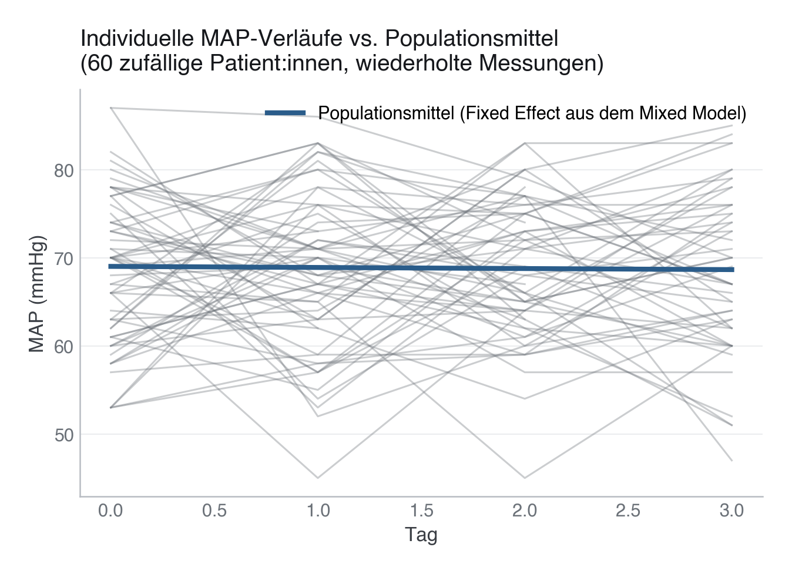
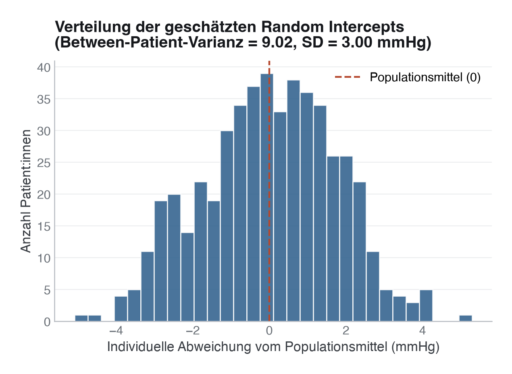

# 18 · Mixed-Effects-Modelle für Longitudinaldaten

> **Teil 4 – Statistische Inferenz und medizinische Statistik** · Dauer: ~75 min · Voraussetzung: Modul 12 (Regression)

## Lernziele
- Den Unterschied zwischen **unabhängigen** und **gruppierten/longitudinalen** Daten erklären.
- Das Konzept von **Fixed Effects** und **Random Effects** (z. B. Random Intercept) verstehen.
- Ein **Linear Mixed Model (LMM)** in Python (`statsmodels`) und R (`lme4`) formulieren und interpretieren.
- Erklären, warum eine gewöhnliche Regression (OLS) bei wiederholten Messungen die **Standardfehler**
  verzerrt – nicht zwingend die Punktschätzer.
- **Generalized Estimating Equations (GEE)** als populationsgemittelten Ansatz abgrenzen und
  **Truncation by Death** von gewöhnlicher MCAR/MAR-Fehlmessung unterscheiden.

## Klinischer Aufhänger

Im geteilten Kohortendatensatz wird der mittlere arterielle Druck (MAP) nicht nur einmal, sondern an
bis zu vier aufeinanderfolgenden Tagen pro Patient:in gemessen (`vitalwerte.csv`). 92 von 500
Patient:innen haben weniger als vier Messungen, die Daten sind also **unbalanciert**, wie in der echten
Intensivmedizin üblich. Alle 92 Lücken entstehen hier durch eine kurze Verweildauer. Ob eine Messreihe
endet, weil jemand entlassen wurde oder weil jemand gestorben ist, ist statistisch aber nicht dasselbe,
mehr dazu im Stolperstein am Ende dieses Moduls. Eine
gewöhnliche lineare Regression (OLS) ignoriert außerdem, dass mehrere Messungen derselben Person nicht
unabhängig voneinander sind. Ein Mixed Model erlaubt es, die individuelle Baseline jeder Person als
„Random Effect“ zu modellieren.

**Stolperstein:** Ein verbreiteter Irrglaube ist, dass man den Unterschied zwischen OLS und Mixed Model
immer an unterschiedlichen Koeffizienten erkennt. Das stimmt nicht zuverlässig – oft sind die *Punktschätzer*
fast identisch. Der eigentliche Unterschied steckt in den **Standardfehlern** (und damit in Konfidenzintervallen
und p-Werten). Weiter unten siehst du das an echten Zahlen aus der Kohorte.

## 1 Hierarchische Daten und Fixed vs. Random Effects

Wenn Datenpunkte miteinander korreliert sind (wiederholte Messungen pro Patient:in, Patient:innen in
verschiedenen Krankenhäusern), verletzen sie die OLS-Annahme unabhängiger Fehler.

- **Fixed Effects (Feste Effekte):** Die Prädiktoren, die uns primär interessieren (z. B. Tag der Messung,
  Diabetes-Status). Wir nehmen an, dass diese Effekte für die gesamte Population feststehen.
- **Random Effects (Zufällige Effekte):** Faktoren, deren Ausprägungen als Zufallsstichprobe aus einer
  größeren Population verstanden werden (z. B. die Patient:innen-ID). Sie modellieren die Variabilität
  zwischen den Gruppen.

### Random Intercept vs. Random Slope
- **Random Intercept:** Jede:r Patient:in erhält eine eigene, individuelle Baseline (Verschiebung der
  Regressionsgeraden auf der y-Achse). Die Steigung (der Effekt über die Zeit) bleibt für alle gleich.
- **Random Slope:** Jede:r Patient:in darf zusätzlich einen eigenen Trend über die Zeit haben (die
  Regressionsgeraden haben unterschiedliche Steigungen).

**Grundlage:** Stell dir 500 Patient:innen als 500 kleine, eigene Regressionsgeraden vor. Ein Random
Intercept erlaubt jeder Gerade einen eigenen Startpunkt; ein Random Slope erlaubt zusätzlich eine eigene
Steigung. Ein Mixed Model schätzt, wie stark diese Geraden um einen gemeinsamen Populationsdurchschnitt
streuen.



---

## 2 Mixed Models in Python

Mit `statsmodels` nutzen wir die R-ähnliche Formelsyntax über `mixedlm`. Der Random Intercept wird über
die Variable `groups` definiert. Der geteilte Kohortendatensatz liefert die Daten direkt – kein manuelles
Simulieren nötig:

```python
import pandas as pd
import statsmodels.formula.api as smf

# 1. Join repeated MAP measurements with baseline data
vitalwerte = pd.read_csv("{{DATEN}}vitalwerte.csv")   # patient_id, tag, map_mmhg, ...
kohorte = pd.read_csv("{{DATEN}}kohorte.csv")[["patient_id", "diabetes"]]
df_long = vitalwerte.merge(kohorte, on="patient_id", how="left")

# 2. Fit a random-intercept model
# Random intercept per patient via groups="patient_id"
model = smf.mixedlm("map_mmhg ~ tag + diabetes", df_long, groups=df_long["patient_id"])
result = model.fit(reml=True)

print(result.summary())
```

**Zeile für Zeile:**

* `smf.mixedlm("map_mmhg ~ tag + diabetes", ...)` spezifiziert das Modell: MAP wird durch Tag und
  Diabetes-Status vorhergesagt (Fixed Effects).
* `groups=df_long["patient_id"]` sorgt dafür, dass jede:r Patient:in einen eigenen Random Intercept erhält.
* `result.summary()` zeigt die geschätzten festen Koeffizienten **inklusive Standardfehler** sowie die
  Varianz des Random Intercepts (Group Var) – genau die Zahlen, um OLS und Mixed Model ehrlich zu vergleichen.

---

## 3 Mixed Models in R

In R ist `lme4` der Goldstandard für gemischte Modelle. Die Notation `(1 | patient_id)` definiert den
Random Intercept.

```r
library(lme4)
library(readr)

vitalwerte <- read_csv("{{DATEN}}vitalwerte.csv")
kohorte <- read_csv("{{DATEN}}kohorte.csv")[, c("patient_id", "diabetes")]
df_long <- merge(vitalwerte, kohorte, by = "patient_id")

# (1 | patient_id) means one random intercept per ID
model <- lmer(map_mmhg ~ tag + diabetes + (1 | patient_id), data = df_long)
summary(model)
```

Soll zusätzlich ein Random Slope für den Effekt der Zeit geschätzt werden, lautet die Notation:
`(tag | patient_id)`.

---

## 4 Was der Vergleich in den echten Daten zeigt

`code/python.py` (und die äquivalente `code/r.R`) fitten OLS und das Random-Intercept-Modell auf
denselben 1 873 Messungen von 500 Patient:innen und drucken beide **Koeffizienten und Standardfehler**
nebeneinander:

| Prädiktor | Art | OLS-Koeffizient (SE) | Mixed-Model-Koeffizient (SE) | SE-Verhältnis (Mixed/OLS) |
|---|---|---|---|---|
| `tag` | zeitvariant (ändert sich pro Messung) | −0,158 (0,181) | −0,121 (0,171) | 0,94× |
| `diabetes` | patientenkonstant (gleicher Wert in allen 1–4 Zeilen) | −1,207 (0,507) | −1,223 (0,587) | 1,16× |

Die Punktschätzer liegen nah beieinander – das ist normal und **kein Zeichen, dass Mixed Models
überflüssig sind**. Entscheidend ist der Unterschied bei den Standardfehlern:

> **Merksatz:** Für einen **patientenkonstanten** Prädiktor (z. B. Diabetes, der sich über die Messtage
> einer Person nicht ändert) behandelt OLS jede der 1–4 wiederholten Zeilen als unabhängige neue Evidenz –
> das ist Pseudo-Replikation und macht den Standardfehler zu klein. Das Mixed Model korrigiert das.

Die Intraklassen-Korrelation (ICC) beträgt in dieser Kohorte **0,12** – etwa 12 % der Gesamtvarianz im
MAP-Wert liegt zwischen Patient:innen statt innerhalb einer Person über die Zeit. Ein moderater, aber
realer Effekt, deutlich kleiner als in stark korrelierten Verlaufsdaten (z. B. wiederholte Messungen
innerhalb einer OP), aber genug, um die Standardfehler sichtbar zu verschieben.

**Darüber hinaus:** Für den zeitvarianten Prädiktor `tag` ist der naive OLS-Standardfehler *nicht*
automatisch zu klein – hier war er in unseren Daten sogar geringfügig größer als beim Mixed Model
(Verhältnis 0,94×). Ob OLS über- oder unterschätzt, hängt bei zeitvarianten Prädiktoren von der
Korrelationsstruktur der Kovariate selbst ab. Die generelle Faustregel „OLS-SE ist bei Clusterdaten immer
zu klein“ gilt zuverlässig nur für **gruppenkonstante** Prädiktoren – bei zeitvarianten Prädiktoren lohnt
sich der explizite Vergleich.



Die Random-Intercept-Verteilung zeigt, wie viel individuelle Variabilität das Modell zusätzlich zum
Populationsmittel einfängt: eine SD von rund 3 mmHg um den gemeinsamen Achsenabschnitt.

---

## 5 Generalized Estimating Equations (GEE)

Mixed Models schätzen **subjektspezifische Effekte** (z. B. „Wie verändert sich der Blutdruck *einer
bestimmten* Person über die Zeit?“).

Wenn dich stattdessen der **durchschnittliche Populationseffekt** interessiert (z. B. „Wie unterscheidet
sich der mittlere Blutdruck aller Diabetiker:innen im Vergleich zu Nicht-Diabetiker:innen über die Zeit?“),
sind **Generalized Estimating Equations (GEE)** oft die bessere Wahl.

**Stolperstein:** Bei einem linearen Modell mit stetigem Outcome wie dem MAP fallen beide Lesarten
zusammen: Der feste Koeffizient des Mixed Models ist zugleich der Populationseffekt. Auseinander laufen
sie erst bei binären oder Zähl-Outcomes (logistisches Mixed Model gegen GEE); dort ist das subjektspezifische
Odds Ratio betragsmäßig größer als das populationsgemittelte.

**Praxis:** GEE braucht eine Arbeitskorrelationsmatrix (z. B. *austauschbar*
oder *autoregressiv*); die robusten Standardfehler bleiben bei genügend vielen Patient:innen (Clustern) gültig, auch wenn diese Wahl nicht genau stimmt. Fehlende Messungen darf Standard-GEE dabei nur als MCAR verkraften, bei MAR verzerrt es die Schätzer – in Python über `statsmodels.genmod.generalized_estimating_equations.GEE`,
in R über das Paket `geepack`. Für Fragestellungen zur Ätiologie/Mechanismus („Wie reagiert eine einzelne
Person?“) bleibt das Mixed Model die richtige Wahl.

---

> **Wann du Hilfe holst.** Sobald der Dropout nicht ignorierbar ist (z. B. Truncation by Death), die Random-Effects-Struktur unklar bleibt, oder du zwischen LMM und GEE entscheiden musst, hol methodische Beratung – die falsche Korrelationsstruktur verzerrt genau die Standardfehler, wegen derer du das Mixed Model überhaupt rechnest.

## Fallstricke und Merksätze

**Stolperstein:** Wenn die Varianz des Random Effects extrem nahe an Null liegt, wirft `lme4`
(bzw. `statsmodels`) eine „Singular Fit“-Warnung aus. Genau das passiert, wenn du im Beispiel oben
zusätzlich einen Random Slope für `tag` schätzt: Mit maximal vier Messungen pro Patient:in reicht die
Information nicht aus, um pro Person eine eigene Zeit-Steigung von der Baseline zu trennen – das Modell
ist überparametrisiert, und das einfachere Random-Intercept-Modell ist die richtige Wahl.

**Stolperstein: Fehlende Messung ≠ kein Patient mehr am Leben.** LMMs sind robust gegenüber echten
fehlenden Messzeitpunkten (MCAR/MAR – die Messung existiert im Prinzip, wurde aber aus Gründen nicht
erhoben, die mit dem unbeobachteten Wert selbst nichts zu tun haben), solange die Patient:innen
mindestens eine Messung aufweisen. Eine Lücke durch planmäßige frühe Entlassung ist so ein Fall. Du musst
diese Patient:innen nicht ausschließen, nur weil ein Messtag fehlt.

Endet die Messreihe dagegen, **weil** die Person gestorben ist, gilt das **nicht**. Der MAP-Wert an Tag 3
einer Person, die an Tag 2 gestorben ist, fehlt nicht zufällig, er **existiert nicht**. Das ist
**Truncation by Death** (Verkürzung durch Tod), kein Missing-Data-Problem, und keine MCAR/MAR-Annahme
repariert das. Ein LMM, das nur auf den beobachteten Daten fittet, schätzt in Wahrheit die mittlere
MAP-Verlaufskurve **unter den noch lebenden, noch hospitalisierten** Patient:innen, nicht unter allen
aufgenommenen. Das Estimand selbst hat sich verschoben, nicht nur die Präzision der Schätzung. In echten
Intensivdaten ist das häufig, gerade weil kränkere Patient:innen sowohl eher sterben als auch eher aus
der Messreihe fallen.

**Unsere Kohorte zeigt dieses Problem nicht, und das Skript prüft das nach.** Die Vitalwerte sind ein
vereinfachter Spielzeugprozess: Wie viele Messungen jemand hat, hängt nur von `verweildauer_tage` ab, und
die Verweildauer wird unabhängig vom Sterbezeitpunkt simuliert. Der Abgleich mit dem Todestag
(`fu_zeit_tage` bei `status == 1`) ergibt:

- Von den 92 unvollständigen Serien gehören 6 zu Patient:innen, die innerhalb von 30 Tagen verstorben
  sind. Nur eine davon (Patient:in 404) stirbt im Messfenster der Tage 0–3, die anderen fünf erst an den
  Tagen 13 bis 30, lange nach der Entlassung. Diese Serien sind also **kein** Beleg für Truncation by
  Death.
- **Plausibilitätsprüfung:** 8 Messungen bei 6 Patient:innen tragen einen Messtag **nach** dem
  dokumentierten Todestag (z. B. Patient:in 139: verstorben an Tag 1, Messungen an Tag 2 und 3).

Solche Widersprüche gibt es auch in echten Routinedaten: ein falsch erfasstes Sterbedatum, ein
nachträglich dokumentierter Wert, ein vertauschter Zeitstempel. Die richtige Reaktion ist, sie zu finden,
zu zählen und an der Quelle zu klären. Stilles Löschen oder Abschneiden der Zeilen versteckt das
Problem nur. Hier ist die Ursache bekannt (der Generator kennt den Todeszeitpunkt beim Simulieren der
Vitalwerte nicht), deshalb rechnet das Modul mit allen Zeilen weiter und nutzt den Datensatz nur für
die Frage, für die er taugt: korrelierte Messungen innerhalb einer Person.

**Standard-Abhilfen:** Joint Models für longitudinale und Survival-Daten (gemeinsame Modellierung von
MAP-Verlauf und Sterbezeit), Principal Stratification / Survivor-Average Causal Effects (Schätzung
innerhalb der Teilpopulation, die unter beiden Bedingungen überlebt hätte), oder das Estimand explizit
einschränken und das auch so benennen („mittlerer Verlauf unter den Überlebenden“ statt „mittlerer
Verlauf in der Population“).

**Darüber hinaus:** Auch bei Mixed Models gilt: Ohne Randomisierung bleiben beobachtete Effekte anfällig
für zeitvariante Störfaktoren. Ein Mixed Model löst das Problem der korrelierten Standardfehler, nicht
das Problem des Confoundings (siehe Modul 15 und Modul 19 zur kausalen Inferenz).

## Selbstcheck
1. **Wann nutzt man ein Random-Slope-Modell?** – Wenn man davon ausgeht, dass sich der Effekt eines
   Prädiktors (z. B. der Krankheitsverlauf über die Zeit) zwischen den Clustern/Patient:innen systematisch
   unterscheidet (unterschiedliche Steigungen der individuellen Regressionsgeraden) – und genügend
   Messungen pro Person vorliegen, um das zu schätzen.
2. **Was bedeutet die Angabe Group Var (Varianz der Random Effects) in der Zusammenfassung?** – Sie
   quantifiziert die Variabilität zwischen den Gruppen (z. B. wie stark die individuellen MAP-Baselines der
   einzelnen Patient:innen um den Populationsmittelwert streuen; die Schwankung von Tag zu Tag steckt in
   der Residualvarianz).
3. **Warum können OLS und Mixed Model fast identische Koeffizienten, aber unterschiedliche Standardfehler
   liefern?** – Weil beide Modelle bei balancierten oder annähernd balancierten Designs oft dieselben
   gewichteten Mittelwerte als Punktschätzer liefern – der Unterschied liegt in der Varianzschätzung: OLS
   ignoriert die Korrelation wiederholter Messungen derselben Person, das Mixed Model berücksichtigt sie.
4. **Warum ist eine unvollständige Messreihe bei einer verstorbenen Patientin kein MCAR/MAR-Problem?**,
   Weil die fehlende Messung nicht einfach nicht erhoben wurde, sie existiert nicht: eine tote Person kann
   am Folgetag keinen MAP-Wert mehr haben. Ein LMM, das nur die beobachteten Daten nutzt, schätzt dann den
   Verlauf unter den Überlebenden, nicht in der Gesamtpopulation, das ist ein Truncation-by-Death-Problem,
   keine Frage der Fehlmessungs-Annahme.
