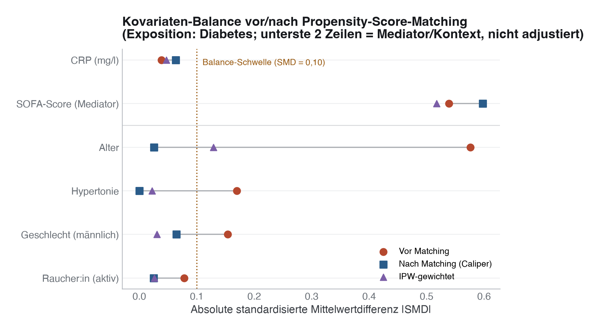
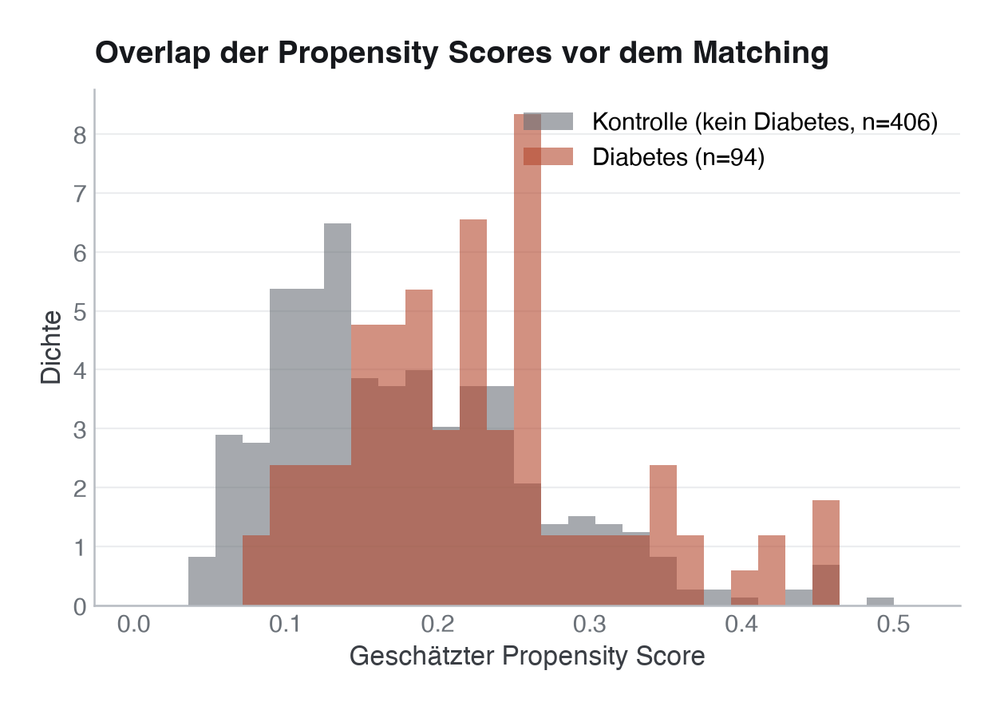

# 19 · Propensity Score Matching und Weighting

> **Teil 4 – Statistische Inferenz und medizinische Statistik** · Dauer: ~75 min · Voraussetzung: Modul 12 (Regression) und Modul 15 (Kausale Inferenz und Directed Acyclic Graphs)

## Lernziele
- Das Prinzip des **Propensity Scores (Neigungsscore)** zur Confounder-Kontrolle in Beobachtungsstudien erklären.
- Einen Propensity Score mittels logistischer Regression berechnen.
- **1:1 Nearest-Neighbor-Matching mit Caliper** und **Inverse Probability Weighting (IPW)** vergleichen.
- Die Balance-Prüfung über die **Standardized Mean Difference (SMD)** interpretieren – und wissen, wann
  ein Matching *nicht* gut genug ist und nachgebessert werden muss.
- Erklären, warum man einen **Mediator nicht adjustiert**, wenn der Gesamteffekt einer Exposition
  interessiert.

## Klinischer Aufhänger

Im geteilten Kohortendatensatz interessiert uns die Frage: Wie stark erhöht **Diabetes** das 30-Tage-Mortalitätsrisiko
insgesamt? Ärzt:innen können diese Frage nicht direkt aus einem rohen Gruppenvergleich beantworten, weil
Diabetiker:innen in unserer Kohorte im Schnitt älter sind, häufiger hypertensiv und seltener männlich –
Merkmale, die klinisch plausibel auch das Sterberisiko beeinflussen (Confounding). Mittels
Propensity Score Matching erstellen wir eine synthetische Kontrollgruppe, in der Diabetiker:innen und
Nicht-Diabetiker:innen bezüglich dieser Confounder nahezu identisch sind.

**Stolperstein:** Nicht jede mit dem Outcome assoziierte Variable gehört in das Propensity-Score-Modell.
In dieser Kohorte gilt (siehe Modul 15, DAG): `alter` ist ein echter **Confounder** von Diabetes und
Sterblichkeit – adjustieren. `sofa_score` dagegen ist ein **Mediator**: Diabetes selbst erhöht den
SOFA-Score bei Aufnahme (schwererer Verlauf), und der SOFA-Score wirkt dann auf die Mortalität. Würden wir
nach `sofa_score` matchen oder adjustieren, würden wir einen Teil des tatsächlichen Diabetes-Effekts
wegrechnen und nur noch einen *direkten* Effekt schätzen – nicht den *totalen Effekt* (Gesamteffekt), nach
dem wir hier fragen. Selbst der direkte Effekt wäre nur dann sauber geschätzt, wenn auch alle Confounder
zwischen SOFA-Score und Mortalität adjustiert sind (Modul 15).

## 1 Was ist ein Propensity Score?

Der **Propensity Score (PS)** ist die bedingte Wahrscheinlichkeit, dass ein:e Patient:in exponiert ist
(hier: Diabetes hat), gegeben die beobachteten Confounder:

```
PS = P(Diabetes = 1 | Alter, Geschlecht, Hypertonie, Raucherstatus)
```

Zur Einordnung: In einer hypothetischen randomisierten Studie, in der die Exposition per Münzwurf
zugeteilt würde, wäre der PS für alle Patient:innen 0,5. In Beobachtungsstudien schätzen wir den PS über
eine **logistische Regression**, bei der die Exposition der binäre Outcome ist.

**Stolperstein – ist Diabetes überhaupt eine „Behandlung“?** Propensity-Score-Methoden imitieren ein
randomisiertes Experiment. Das setzt eine **wohldefinierte Intervention** voraus: einen Eingriff, den man
einer Person zuweisen *könnte* (Consistency-Annahme). Diabetes ist **nicht manipulierbar** – man kann
niemandem „Diabetes“ zuteilen. „Der kausale Effekt von Diabetes“ ist ohne spezifizierte Intervention
mehrdeutig: gemeint sein könnte eine Blutzuckersenkung, eine Diagnose, eine Krankheitsdauer – lauter
verschiedene Kontraste (Hernáns Frage *„does water kill?“* – ertrinken oder verdursten?). Wir behalten das
Beispiel hier als **Illustration der Mechanik** (PS, Matching, IPW, Balance) auf vertrauten Daten – die
geschätzte Zahl ist aber kein sauber definierter Kausaleffekt. Ein verteidigbares **Target Trial** würde
stattdessen eine konkrete Intervention emulieren, z. B. „intensive vs. Standard-Blutzuckerkontrolle ab
Aufnahme“, mit klaren Ein-/Ausschlusskriterien und einem definierten Zeitnullpunkt.

**Stolperstein – Positivity.** Kausale Kontraste brauchen zusätzlich, dass in jeder Confounder-Kombination
sowohl exponierte als auch nicht-exponierte Personen vorkommen können (`0 < PS < 1`). Fehlt in einer
Subgruppe eine der beiden Gruppen (Positivity-Verletzung), extrapoliert das Modell blind, und IPW erzeugt
extreme Gewichte. Der Overlap-/Common-Support-Check (unten) prüft genau das.

---

## 2 Propensity Score Matching (PSM) in Python

Wir berechnen den PS über eine logistische Regression und matchen 1:1 auf den Logit des PS – mit einem
**Caliper**, der zu weit entfernte Matches ablehnt, statt sie zu erzwingen.

```python
import pandas as pd
import numpy as np
from sklearn.linear_model import LogisticRegression
from scipy.spatial.distance import cdist

# 1. Load the cohort; exposure = diabetes, confounders = age/sex/hypertension/smoking status
df = pd.read_csv("{{DATEN}}kohorte.csv")
df["geschlecht_m"] = (df["geschlecht"] == "maennlich").astype(int)
df["raucher_aktiv"] = (df["raucherstatus"] == "aktiv").astype(int)
covariates = ["alter", "geschlecht_m", "hypertonie", "raucher_aktiv"]  # NOT sofa_score (mediator!)

# 2. Estimate the propensity score (unregularised logistic regression)
lr = LogisticRegression(max_iter=2000, C=np.inf)
lr.fit(df[covariates], df["diabetes"])
df["ps"] = lr.predict_proba(df[covariates])[:, 1]
df["logit_ps"] = np.log(df["ps"] / (1 - df["ps"]))

# 3. 1:1 matching with a caliper (0.2 x SD of the logit PS - rule of thumb after Austin 2011)
caliper = 0.2 * df["logit_ps"].std()
treated = df[df["diabetes"] == 1]
control = df[df["diabetes"] == 0]
dists = cdist(treated[["logit_ps"]], control[["logit_ps"]])

matched_pairs, available = [], np.ones(len(control), dtype=bool)
for i in np.argsort(dists.min(axis=1)):  # assign the best matches first
    d = dists[i].copy(); d[~available] = np.inf
    j = int(np.argmin(d))
    if d[j] <= caliper:
        matched_pairs.append((treated.index[i], control.index[j]))
        available[j] = False

df_matched = pd.concat([df.loc[[t for t, _ in matched_pairs]],
                        df.loc[[c for _, c in matched_pairs]]])
print(f"Gematchte Paare: {len(matched_pairs)} von {len(treated)} Diabetiker:innen")
```

**Zeile für Zeile:**

* `LogisticRegression(C=np.inf)` trainiert eine *unregularisierte* logistische Regression (wie
  `glm()` in R) für die Behandlungszuweisung (`diabetes`) basierend auf den vier Confoundern.
* `cdist` berechnet die absoluten Differenzen der Logit-Propensity-Scores zwischen allen Diabetiker:innen
  und allen Nicht-Diabetiker:innen.
* Der **Caliper** (hier `0,2 × SD(logit PS)`, eine gängige Faustregel) verwirft Matches, die zu weit
  auseinanderliegen, statt schlechte Paare zu erzwingen – das kostet ein paar Patient:innen (Support-Verlust),
  verbessert aber die Balance.
* `np.argsort(dists.min(axis=1))` vergibt zuerst die eindeutigsten Matches, damit knappe Caliper-Fälle
  nicht durch Zufall den falschen Partner verlieren.

---

## 3 Propensity Score Matching in R

In R ist `MatchIt` der Standard für Matching-Analysen; die Caliper-Option ist eingebaut.

```r
library(MatchIt)
library(readr)

df <- read_csv("{{DATEN}}kohorte.csv")
df$geschlecht_m <- as.integer(df$geschlecht == "maennlich")
df$raucher_aktiv <- as.integer(df$raucherstatus == "aktiv")

# Matching with a caliper (0.2 x SD of the logit PS), NOT on sofa_score (mediator)
# link = "linear.logit": caliper on the logit scale (the default would be the PS scale)
m_out <- matchit(diabetes ~ alter + geschlecht_m + hypertonie + raucher_aktiv,
                  data = df, method = "nearest", distance = "glm",
                  link = "linear.logit", caliper = 0.2)
summary(m_out)
df_matched <- match.data(m_out)
```

---

## 4 Balance-Check: Standardized Mean Difference (SMD)

Nach dem Matching musst du prüfen, ob die Confounder zwischen den Gruppen ausgeglichen sind. Der p-Wert
ist hierfür ungeeignet (da er von der Stichprobengröße abhängt). Stattdessen nutzen wir die
**Standardized Mean Difference (SMD)**:

```
SMD = (Mean_exponiert - Mean_kontrolle) / Pooled_SD
```

- **|SMD| < 0,10:** gilt als gute Balance – die Gruppen sind bezüglich dieses Merkmals weitgehend
  vergleichbar.
- **|SMD| > 0,10:** Hinweis auf verbleibendes Confounding. Das Matching sollte verfeinert werden (z. B.
  durch einen *Caliper*, der maximale Score-Unterschiede begrenzt).

**Stolperstein:** Die Schwelle `0,10` ist eine **Konvention**, kein Testergebnis. Sie stammt aus der
Simulationsliteratur (Austin 2011, dieselbe Quelle wie der Caliper `0,2 × SD`) und beschreibt eine als
praktisch akzeptabel geltende Restimbalance – sie ist **kein statistischer Test** und kein Beweis für
Unverzerrtheit. Eine SMD knapp unter `0,10` in einer kleinen Kohorte schließt relevantes
Restconfounding nicht aus. Berichte die SMD als stetige Größe, nicht als bestanden/durchgefallen.

### Was der Caliper in unseren Daten tatsächlich bringt

`code/python.py` (und `code/r.R`) rechnen das komplett durch – erst **ohne**, dann **mit** Caliper, und
zusätzlich mit **IPW** als drittem Ansatz:

| Confounder | SMD vor Matching | SMD nach Caliper-Matching | SMD IPW-gewichtet |
|---|---|---|---|
| Alter | 0,58 | **−0,03** ✓ | 0,13 ✗ |
| Geschlecht (männl.) | −0,15 | **−0,06** ✓ | 0,03 ✓ |
| Hypertonie | 0,17 | **0,00** ✓ | 0,02 ✓ |
| Raucher:in (aktiv) | 0,08 | **0,03** ✓ | 0,03 ✓ |

Mit Caliper (93 von 94 Diabetiker:innen matchbar – eine Person hat keinen ausreichend ähnlichen Partner
und fällt heraus) erreichen **alle vier Confounder** die 0,10-Schwelle. Ohne Caliper (alle 94 gematcht)
bleibt „Geschlecht“ mit SMD ≈ −0,09 nur knapp darunter; der Caliper drückt sie auf −0,06. IPW balanciert
Geschlecht, Hypertonie und Raucherstatus gut, lässt aber **Alter** bei SMD ≈ 0,13 – ein Hinweis, dass das
PS-Modell den Alterseinfluss nicht gut genug abbildet (linearer Term im Logit). Abhilfe: das PS-Modell
nachbessern (z. B. Spline für Alter) oder Alter zusätzlich ins Outcome-Modell nehmen. Stabilisieren hilft
hier nicht: Es multipliziert die Gewichte innerhalb jeder Gruppe nur mit einer Konstanten, die gewichtete
SMD bleibt identisch.



> **Merksatz:** Der SOFA-Score bleibt in allen drei Ansätzen deutlich unbalanciert (SMD 0,52–0,60) – das
> ist **kein Fehler**, sondern folgt direkt aus der DAG-Logik: Diabetes verursacht ursächlich höhere
> SOFA-Werte bei Aufnahme. Balance auf einem Mediator zu erzwingen würde einen Teil des wahren
> Diabetes-Effekts eliminieren.



---

## 5 Der Effekt von Diabetes auf die 30-Tage-Mortalität: zwei Schätzer, zwei Estimands

| Methode | Estimand | Odds Ratio | 95 %-CI |
|---|---|---|---|
| Roh (unadjustiert) | – (nur Assoziation) | 2,07 | [1,19; 3,58] |
| Gematcht (Caliper), 93 Paare | **ATT** (Effekt bei den Behandelten) | 1,39 | [0,73; 2,64] |
| IPW-gewichtet | **ATE** (Effekt in der Gesamtkohorte) | 1,86 | [1,03; 3,36] |

Die Zahlen stammen aus `code/python.py`. `code/r.R` vergibt beim gierigen Matching wegen numerisch
knapper Gleichstände der Logit-PS einige Partner anders, findet so für alle 94 Diabetiker:innen einen
Partner innerhalb des Calipers und kommt auf OR 1,37 [0,69; 2,72] – dieselbe Aussage, andere Nachkommastelle.

**Stolperstein – zwei verschiedene Zielgrößen, nicht nur zwei Genauigkeiten.** Matching 1:1 auf die
Behandelten schätzt den **ATT** (*Average Treatment effect on the Treated*) – den Diabetes-Effekt in der
Population der 93 gematchten Diabetiker:innen. IPW mit `1/PS` bzw. `1/(1−PS)` gewichtet die *gesamte*
Kohorte auf und schätzt den **ATE** (*Average Treatment Effect*) – den Effekt, als hätte man die ganze
Kohorte exponiert bzw. nicht exponiert. ATT und ATE stimmen nur überein, wenn der Effekt in allen
Subgruppen gleich groß ist; unterscheiden sich Behandelte und Gesamtkohorte in effektmodifizierenden
Merkmalen, dürfen die Zahlen **echt** auseinanderlaufen – die Lücke zwischen 1,39 und 1,86 ist also nicht
allein „Zufall/Präzision“.

Beide lassen den Mediator SOFA-Score bewusst aus und schätzen daher jeweils einen **Gesamteffekt** – nur
auf unterschiedlichen Zielpopulationen. Der rohe Vergleich überschätzt das Risiko am stärksten; nach
Confounder-Kontrolle sinkt die Punktschätzung.

**Stolperstein – die richtige Varianz.** Die Konfidenzintervalle oben stammen aus den *korrekten*
Fehlerschätzern, nicht aus den Voreinstellungen:

- **Gematcht (ATT):** Die beiden Personen eines Matched Pairs sind **nicht unabhängig**. Der Standard-SE
  eines gewöhnlichen Logit-Modells behandelt sie fälschlich als unabhängig. Korrekt ist ein
  **cluster-robuster SE auf der Paar-ID** (`cov_type="cluster"` in Python bzw. `sandwich::vcovCL()` in R).
  Das breite CI liegt hier tatsächlich an der kleinen Fallzahl (nur 2 × 93 Personen) – aber das entlässt
  einen nicht aus der Pflicht, die Paarung im SE zu berücksichtigen.
- **IPW (ATE):** Nicht-ganzzahlige IPW-Gewichte sind **keine Häufigkeiten**. Behandelt man sie als
  `freq_weights` (Python) oder mit `family = quasibinomial` und Modell-SE (R), bläht das die Pseudo-Fallzahl
  auf ≈ 2 × N auf bzw. schätzt einen Dispersionsparameter – beides ergibt ein **zu schmales, antikonservatives**
  CI (`[1,35; 2,57]` schließt die 1 dann fälschlich sicher aus). IPW braucht einen **robusten
  (Sandwich-)Schätzer**: `var_weights` + `cov_type="HC0"` in Python, `lmtest::coeftest(fit, vcov = sandwich::vcovHC(fit, "HC0"))`
  in R. Das breitere CI `[1,03; 3,36]` schließt die 1 nur noch knapp aus.

**Darüber hinaus – Sandwich vs. Bootstrap.** Der Sandwich-SE ignoriert, dass der Propensity Score selbst
*geschätzt* wurde; für den ATE ist er dadurch in der Theorie meist leicht **konservativ**, hier liegt er
sogar minimal darunter. Der Goldstandard ist ein
nichtparametrischer **Bootstrap**, der in jeder Wiederholung PS- *und* Outcome-Modell neu schätzt. Auf
diesen Daten liegen beide praktisch gleichauf (Sandwich-SE des log-OR ≈ 0,302 vs. Bootstrap ≈ 0,305 über
2000 Resamples) – deshalb ist der Sandwich hier vertretbar. Bei starken Gewichten oder komplexeren
PS-Modellen sollte man den Bootstrap bevorzugen.

**Extreme Gewichte, Stabilisierung, Trimming.** Die unstabilisierten Gewichte reichen von 1,04 bis 13,08 –
ein paar wenige Patient:innen dominieren die Schätzung. **Stabilisierte Gewichte** (`P(A=a)/P(A=a|X)`)
schätzen denselben ATE, schrumpfen den Bereich aber auf 0,41–2,46; Punktschätzung und CI bleiben
unverändert (`1,86 [1,03; 3,36]`) – bei einem Outcome-Modell, das nur die Exposition enthält, ist das
zwangsläufig so. Auch **Trimming** beim 99. Perzentil (Kappung bei 9,78) ändert kaum etwas
(`1,83 [1,02; 3,29]`) – ein beruhigendes Zeichen, dass das Ergebnis nicht von einzelnen Extremgewichten
getragen wird.

---

> **Wann du Hilfe holst.** Sobald die Überlappung (Positivität) fraglich ist, unklar bleibt, ob du ATT oder ATE schätzen willst, oder plausibel ungemessene Confounder bestehen, hol methodische Beratung – kein Propensity-Score repariert ein schwaches Design allein.

## Fallstricke und Merksätze

**Stolperstein:** Ungemessene Confounder. Propensity Scores balancieren nur *gemessene* Kovariaten aus.
Wenn ein wichtiger Faktor (z. B. Ernährungsstatus oder klinischer Gesamteindruck) nicht dokumentiert ist,
bleibt die Assoziation verzerrt. Nur ein RCT schützt zuverlässig vor ungemessenem Confounding.

**Stolperstein:** Support-Verlust (Overlap). Wenn exponierte und Kontroll-Patient:innen völlig
unterschiedliche Scores haben (kein Overlap), können viele Patient:innen nicht gematcht werden – in
unserem Beispiel verliert der Caliper eine von 94 Diabetiker:innen. Das reduziert die Stichprobengröße und
schränkt die Generalisierbarkeit auf den Bereich mit „Common Support“ ein.

**Darüber hinaus:** Selbst mit Caliper balanciert 1:1-PS-Matching nicht automatisch *jede* einzelne
Kovariate – es matcht auf den (skalaren) Score, nicht auf jede Variable einzeln. Prüfe deshalb immer die
SMD pro Kovariate, nicht nur die des Gesamtscores. Bei einer hartnäckig unbalancierten Variable helfen
exaktes Matching auf genau diese Variable (z. B. `exact = "geschlecht_m"` in `MatchIt`) oder
Mahalanobis-Distanz-Matching als Ergänzung.

**Praxis:** Berichte in Publikationen immer die SMD vor und nach dem Matching in einer standardisierten
Tabelle (Love Plot, wie oben) – das ist mittlerweile Standard in Zeitschriften mit Beobachtungsstudien.

## Selbstcheck
1. **Warum vergleichen wir Gruppen nach dem Matching mit SMD und nicht mit p-Werten?** – Weil p-Werte durch
   die künstliche Reduktion der Fallzahl nach dem Matching größer (nicht signifikant) werden können, obwohl
   die absolute Asymmetrie unverändert ist. Die SMD ist unabhängig von der Fallzahl und misst die reine
   Effektgröße des Ungleichgewichts.
2. **Was versteht man unter dem Caliper-Wert beim Matching?** – Eine Toleranzgrenze (maximal erlaubte
   Differenz der Propensity Scores/Logit-PS), innerhalb derer ein Match stattfinden darf. Matches außerhalb
   des Calipers werden verworfen, was die Qualität der Balance verbessert, aber Patient:innen kosten kann.
3. **Warum wird `sofa_score` in diesem Modul nicht in das Propensity-Score-Modell aufgenommen, obwohl er
   stark mit der Mortalität assoziiert ist?** – Weil er ein Mediator auf dem Pfad Diabetes → Mortalität ist
   (Diabetes erhöht den SOFA-Score kausal). Würde man danach adjustieren, würde man einen Teil des
   Gesamteffekts von Diabetes wegrechnen und stattdessen nur den direkten, nicht-SOFA-vermittelten Effekt
   schätzen.
