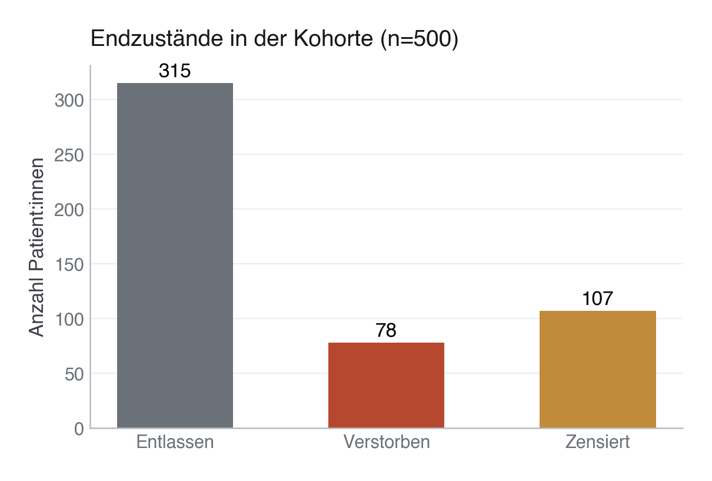

# 20 · Konkurrierende Risiken und zeitabhängige Cox-Modelle

> **Teil 4 – Statistische Inferenz und medizinische Statistik** · Dauer: ~75 min · Voraussetzung: Modul 17 (Survival-Analyse)

## Lernziele
- Verstehen, warum die **Kaplan-Meier-Methode** bei konkurrierenden Risiken das tatsächliche Risiko überschätzt.
- Den Unterschied zwischen **Cumulative Incidence Function (CIF)** und Kaplan-Meier erklären – und beide
  an echten Kohortendaten berechnen.
- Das **Fine-Gray-Modell** von **ursachenspezifischen Hazard-Modellen (Cause-Specific Hazards)** abgrenzen
  und beide fitten.
- Ein **zeitabhängiges Cox-Modell** formulieren, um den *Immortal Time Bias* zu verhindern – mit einem
  Modell, das tatsächlich konvergiert.

## Klinischer Aufhänger

Du untersuchst die 30-Tage-Mortalität auf der Intensivstation. Ein Problem tritt auf: Patient:innen, die
lebend nach Hause entlassen werden, können im Krankenhaus nicht mehr versterben. Die Entlassung konkurriert
direkt mit dem Endpunkt Tod. Wenn du Entlassene einfach als „zensiert" behandelst, tust du so, als könnten
sie nach der Entlassung im Krankenhausbett versterben – Kaplan-Meier überschätzt dann die Sterblichkeit
merklich (siehe Abschnitt 2). Zudem erhalten manche Patient:innen eine Intervention erst im
Verlauf des Aufenthalts. Wenn du diese ab Tag 0 als „behandelt" klassifizierst, erzeugst du einen
künstlichen Überlebensvorteil (Immortal Time Bias). Hier lernst du die korrekten Gegenmittel kennen.

## 1 Konkurrierende Risiken (Competing Risks)

Ein **konkurrierendes Risiko (Competing Risk)** ist ein Ereignis, dessen Eintreffen das Auftreten des
primär interessierenden Ereignisses verhindert oder fundamental verändert (z. B. Entlassung vs. Tod im
Krankenhaus, oder Tod durch Herzinfarkt vs. Tod durch Krebs).

### Warum Kaplan-Meier versagt
Kaplan-Meier nimmt an, dass zensierte Patient:innen dasselbe Risiko haben wie diejenigen, die in der
Studie verbleiben. Bei Entlassung ist das Risiko, im Krankenhausbett zu versterben, jedoch sofort Null. KM
überschätzt daher die kumulative Inzidenz des Zielereignisses.
* **Die Lösung:** Die **Cumulative Incidence Function (CIF)** schätzt die tatsächliche Wahrscheinlichkeit
  des Auftretens eines Ereignisses bis zum Zeitpunkt t unter korrekter Berücksichtigung aller
  konkurrierenden Ereignisse.

**Grundlage:** Denk an drei Türen, durch die eine Patientin die Beobachtung verlassen kann: **Tod**,
**Entlassung**, oder **Studienende (Zensierung)**. Kaplan-Meier für „Tod" behandelt Tür 2 (Entlassung) so,
als könnte die Person jederzeit durch Tür 1 zurückkommen. Die CIF verschließt Tür 2 endgültig, sobald sie
durchschritten wurde.

### Der Datensatz: eine kohärent erzeugte 3-Zustands-Variable

Für dieses Modul liegt ein eigener Datensatz bereit,
`konkurrenz_risiken.csv` (erzeugt von `data/generate_data.py` mit einem eigenen
Zufallsstrom, siehe `data/README.md`). Er enthält pro Patient:in:

<!-- excerpt-note -->
> **Hinweis — die Codeblöcke unten sind Auszüge.** Sie zeigen die entscheidenden Schritte, nicht jede Import-Zeile. Das vollständige, am Stück lauffähige Skript ist [`code/python.py`](code/python.py) (im Browser über den **Python**-Reiter oben). In Colab führst du das ganze Modul mit einer Zeile aus: `!python module/20-competing-risks-timevariant/code/python.py` — siehe das [in Colab öffnen](https://colab.research.google.com/github/schradern/data-science-coach/blob/main/notebooks/start.ipynb).

```python
import pandas as pd

df = pd.read_csv("{{DATEN}}konkurrenz_risiken.csv")
# Spalten: patient_id, event_time, event_state, vasopressor_start_tag
```

| Zustand | Bedeutung | Ereigniszeit |
|---|---|---|
| 1 = Tod (Zielereignis) | Versterben im Krankenhaus | `event_time` (Todestag ≤ 30) |
| 2 = Entlassen (Konkurrenzereignis) | lebend nach Hause entlassen | `event_time` (Entlassungstag) |
| 0 = Zensiert (kein Ereignis) | am Tag 30 noch im Krankenhaus | `event_time` = 30 |

Die **Entlassung ist ein echtes Konkurrenzereignis** auf derselben Zeitachse wie
der Tod: Ihre Hazard ist so erzeugt, dass sie **mit steigendem Schweregrad
fällt** (mittlere Zeit bis Entlassung = `15 + 1,4 · sofa_score` Tage) – Kränkere
werden also später oder gar nicht entlassen. Die im Krankenhaus Verstorbenen sind
exakt die Ereignisse aus der Kohorte (`status == 1`), sodass die *wahre* CIF des
Todes exakt der 30-Tage-Mortalität der Kohorte entspricht (≈ 15,6 %) und die
ursachenspezifischen Cox-Hazards mit Modul 17 übereinstimmen. Die administrative
Zensierung bei Tag 30 bleibt erhalten; das Risikoset an Tag 30 ist **nicht
entartet** (≈ 90 Patient:innen).

**In unserer Kohorte:** 78 verstorben, 315 entlassen, 107 an Tag 30 zensiert.
(Kovariaten für die Modelle – `alter`, `sofa_score`, `diabetes` – kommen aus
`kohorte.csv` und werden über `patient_id` angejoint.)



---

## 2 CIF vs. naive 1-KM: der Unterschied an echten Daten

```python
from lifelines import AalenJohansenFitter, KaplanMeierFitter

# event_state: 0 = zensiert, 1 = Tod, 2 = Entlassung
ajf = AalenJohansenFitter(seed=42)   # seed: gebundene Ereigniszeiten werden gejittert
ajf.fit(df["event_time"], df["event_state"], event_of_interest=1)   # korrekte CIF
cif_30 = ajf.cumulative_density_.loc[:30].iloc[-1, 0]

kmf = KaplanMeierFitter()
kmf.fit(df["event_time"], event_observed=(df["event_state"] == 1))  # Entlassung = "zensiert"
naive_risk = 1 - kmf.survival_function_                              # klassischer Fehler
```

An Tag 30 unserer Kohorte:

| Schätzer | Sterberisiko an Tag 30 |
|---|---|
| CIF (korrekt, Aalen-Johansen) | **15,6 %** |
| 1 − Kaplan-Meier (Entlassung als Zensierung) | **27,7 %** |

Das naive 1-KM **überschätzt** das wahre Risiko deutlich (27,7 % statt 15,6 %,
etwa das 1,8-Fache), weil Entlassene aus dem Risikoset herausfallen: Der Nenner
schrumpft, und die verbleibenden Todesfälle werden von Kaplan-Meier auf die
gesamte Population hochgerechnet. Die Überschätzung ist hier **sichtbar, aber
begrenzt** – das Risikoset an Tag 30 umfasst noch ≈ 90 Patient:innen, sodass 1-KM
*nicht* auf 100 % hochschießt. Genau so verhält sich der Fehler in echten
Daten: bounded und tückisch, weil er plausibel aussieht. (Ein 1-KM nahe 100 %
wäre kein Lehrbuchverhalten, sondern das Artefakt eines kollabierten Risikosets.)


---

## 3 Fine-Gray-Modell vs. Cause-Specific Hazards

Für Multivariaten-Analysen bei konkurrierenden Risiken gibt es zwei etablierte Ansätze:

1. **Cause-Specific Hazard Ratio (CSHR):** Behandelt konkurrierende Ereignisse als Zensierung.
    * *Interpretation:* Wie beeinflussen die Kovariaten die momentane Rate des Zielereignisses unter
     denjenigen, die *bisher überlebt haben* und noch im Krankenhaus sind. Gut zur Erforschung
     ätiologischer Zusammenhänge.

2. **Subdistribution Hazard Ratio (Fine-Gray-Modell, SHR):** Behält Personen, die das Konkurrenzereignis
   erlitten haben, im Risikoset (mit abnehmendem Gewicht).
   * *Interpretation:* Wie beeinflussen die Kovariaten das tatsächliche Auftreten des Zielereignisses in
     der Population über die Zeit. Gut für klinische Prognosefragen und ökonomische Evaluationen.

### Cause-Specific Cox (Python und R)

```python
from lifelines import CoxPHFitter

cs_df = df[["event_time", "event_state", "alter", "sofa_score", "diabetes"]].copy()
cs_df["death"] = (cs_df["event_state"] == 1).astype(int)   # Entlassung wird zensiert
cs_cox = CoxPHFitter()
cs_cox.fit(cs_df[["event_time", "death", "alter", "sofa_score", "diabetes"]],
          duration_col="event_time", event_col="death")
print(cs_cox.summary[["coef", "exp(coef)", "se(coef)", "p"]])
```

| Kovariate | Cause-specific HR | p |
|---|---|---|
| Alter (pro Jahr) | 1,04 | < 0,001 |
| SOFA-Score (pro Punkt) | 1,40 | < 0,001 |
| Diabetes | 0,99 | 0,955 |

### Fine-Gray (R, `survival::finegray()`)

**Darüber hinaus:** Für Python gibt es aktuell **kein gepflegtes Paket** für das Fine-Gray-Modell
(`lifelines` und `scikit-survival` implementieren es nicht; `cmprsk`/`tidycmprsk` sind R-Pakete). Statt
eine eigene, ungeprüfte Implementierung zu riskieren, nutzt dieses Modul für Fine-Gray gezielt R – konkret
`survival::finegray()` (Teil des Standardpakets `survival`), das den Datensatz per **IPCW-Gewichtung** so
umbaut, dass ein normales `coxph()` direkt die Subdistribution Hazard Ratio liefert:

```r
library(survival)

fg_data <- finegray(Surv(event_time, event_state_f) ~ alter + sofa_score + diabetes,
                     data = df, etype = "death")
fg_fit <- coxph(Surv(fgstart, fgstop, fgstatus) ~ alter + sofa_score + diabetes,
                weight = fgwt, data = fg_data)
summary(fg_fit)
```

| Kovariate | Fine-Gray SHR | p |
|---|---|---|
| Alter (pro Jahr) | 1,04 | < 0,001 |
| SOFA-Score (pro Punkt) | 1,51 | < 0,001 |
| Diabetes | 0,94 | 0,801 |

`code/r.R` fittet Fine-Gray **doppelt** – einmal per `survival::finegray()` und einmal per
`cmprsk::crr()` (der kanonischen Fine-Gray-Implementierung) – als Kreuzprobe; beide liefern
denselben SHR (SOFA 1,51 vs. 1,50).

> **Merksatz:** Der SOFA-Effekt ist im Fine-Gray-Modell (SHR 1,51) größer als im
> Cause-Specific-Modell (HR 1,40). Grund: Im Datengenerator sinkt die Entlassungs-Hazard mit dem
> Schweregrad (mittlere Zeit bis Entlassung = `15 + 1,4 · sofa_score` Tage). Höhere SOFA-Werte senken
> also *zusätzlich* die Chance auf eine (frühe) Entlassung – das Konkurrenzereignis – und lassen die
> Patient:innen länger im Risikoset für den Tod. Fine-Gray schließt genau diesen Kanal mit ein,
> Cause-Specific-Hazards ignorieren ihn per Definition. Beide Zahlen sind „richtig" – sie beantworten
> nur unterschiedliche Fragen.

**Ehrlichkeit zur Power:** Insgesamt gibt es nur **78 Todesfälle**. Splittet man die Ereignisse auf zwei
konkurrierende Ursachen auf, bleiben pro Ursache wenige Ereignisse; die Einzelkoeffizienten oben sind
interpretierbar, ein reich adjustiertes Konkurrenzrisiko-Modell wäre jedoch unterpowert.

---

## 4 Zeitabhängige Kovariaten und Immortal Time Bias

Wenn eine Exposition (z. B. eine Operation, eine Infektion oder eine neue Medikation) erst im *Verlauf*
der Nachbeobachtung auftritt, darf sie nicht rückwirkend ab Tag 0 als vorhanden gewertet werden. Die Phase
zwischen Eintritt in die Kohorte und Erhalt der Exposition ist „unsterblich" (Immortal Time) – wer in
dieser Zeit stirbt, wird automatisch der Kontrollgruppe zugeordnet.

* **Die Lösung:** Umstrukturierung der Daten in das **Start-Stop-Format** (Long-Format), bei dem ein:e
  Patient:in mehrere Zeilen hat und der Behandlungsstatus als zeitvariante Kovariate ein- und
  ausgeschaltet wird.

### Datenstruktur im Start-Stop-Format (Beispiel)
| patient_id | start_tag | stop_tag | vasopressor | death |
|------------|-----------|----------|-------------|-------|
| 1          | 0         | 3        | 0           | 0     | (Tag 0 bis 3: unbehandelt)
| 1          | 3         | 10       | 1           | 1     | (Tag 3 bis 10: behandelt, Event an Tag 10)

### Naiv (verzerrt) vs. zeitabhängig (korrekt)

Die Vasopressor-Exposition ist im Datensatz `konkurrenz_risiken.csv` als `vasopressor_start_tag`
hinterlegt (der Tag, an dem die Exposition beginnt, sonst leer). Sie ist **wahrscheinlichkeitsbasiert**
anhand des `sofa_score` erzeugt (Kränkere werden früher/häufiger behandelt, aber nicht deterministisch)
und hängt **nicht** vom Outcome ab – so tritt Tod in beiden Gruppen auf. Weil Python und R **dieselbe**
Spalte lesen, berechnen beide Sprachen identische Hazard Ratios.

Klassifiziert man die Exposition **naiv als Baseline-Kovariate** (an Tag 0 fixiert), entsteht der
Immortal Time Bias:

```python
from lifelines import CoxPHFitter, CoxTimeVaryingFitter

# df: event_time, death, ever_vasopressor, sofa_score
naiv = CoxPHFitter().fit(df[["event_time", "death", "ever_vasopressor", "sofa_score"]],
                         duration_col="event_time", event_col="death")   # FALSCH

# tv: Start-Stop-Format aus vasopressor_start_tag (siehe code/python.py, build_time_varying_data())
ctv = CoxTimeVaryingFitter()
ctv.fit(tv, id_col="patient_id", start_col="start", stop_col="stop", event_col="death")  # KORREKT
```

| Modell | HR Vasopressor | p | Konvergenz |
|---|---|---|---|
| **Naiv** (zeitfix, Baseline) | **0,73** | 0,210 | – (Immortal Time Bias) |
| **Korrekt** (zeitvariant) | **0,95** | 0,853 | ✓ ohne Warnung |
| SOFA-Score (baseline, korrektes Modell) | 1,42 | < 0,001 | ✓ ohne Warnung |

Das naive Modell erzeugt einen **scheinbaren Schutzeffekt** (HR 0,73): Behandelte mussten lange genug
überleben, um überhaupt behandelt zu werden, sodass ihre frühen Todesfälle fälschlich der
Kontrollgruppe zugeschlagen werden. Im korrekten zeitabhängigen Modell **kollabiert** dieser Effekt
Richtung 1 (HR 0,95, nicht signifikant) – die richtige Antwort, denn der Datengenerator gibt dem
Vasopressor **keinen** kausalen Effekt auf den Tod (er ist nur ein Schweregrad-Marker). Der
SOFA-Wert (1,42) liegt zudem nahe am Cox-Modell aus Modul 17 (1,42) trotz komplett anderer
Datenstruktur – ein gutes Zeichen für Konsistenz.

**Stolperstein:** Ein zweiter häufiger Fehler in Lehrbeispielen ist eine winzige, künstliche Kohorte, in
der jede behandelte Person auch verstirbt (oder umgekehrt). Das erzeugt **komplette Separation** – das
Modell findet keinen stabilen Koeffizienten und liefert absurde Hazard Ratios (z. B. `exp(coef) ≈ 10¹⁴`)
mit einer leicht übersehenen Konvergenzwarnung. Über alle 500 Patient:innen mit probabilistischer
Exposition tritt das hier nicht auf.

---

> **Wann du Hilfe holst.** Ob du ursachenspezifisch (Cause-Specific Hazards) oder prognostisch (Fine-Gray/CIF) fragst, entscheidet über das richtige Modell, und zeitabhängige Expositionen bergen leicht Immortal Time Bias — bei realen Daten sollte eine Biostatistikerin die Wahl des Estimands und die Start-Stop-Datenstruktur prüfen.

## Fallstricke und Merksätze

**Stolperstein:** Zensierung ist kein Konkurrenzereignis. Zensierung bedeutet Informationsverlust (z. B.
Studienende). Ein konkurrierendes Risiko verhindert das Eintreten des Zielereignisses endgültig.

**Stolperstein:** Rückwirkendes Klassifizieren vermeiden. Wenn du im Methodenteil liest: „Patient:innen,
die während des 30-tägigen Aufenthalts beatmet wurden, verglichen mit Nicht-Beatmeten...", suche sofort
nach dem *Immortal Time Bias*.

**Darüber hinaus:** „Nutze bei konkurrierenden Risiken niemals 1-KM-Kurven, sondern zeichne direkt die
kumulativen Inzidenzkurven (CIF) für beide Events" – siehe Abbildung oben, in der genau dieser Unterschied
an echten Daten sichtbar wird. Der Abstand zwischen den beiden Kurven wächst mit der Zeit, weil das
Risikoset unter 1-KM zunehmend unrepräsentativ wird.

**Praxis:** Wähle Cause-Specific vs. Fine-Gray nach deiner Fragestellung, nicht nach Softwareverfügbarkeit:
Ätiologie/Mechanismus → Cause-Specific; Prognose/absolutes Risiko für eine Entscheidung am Patientenbett →
Fine-Gray.

## Selbstcheck
1. **Warum überschätzt Kaplan-Meier das Risiko, wenn es konkurrierende Ereignisse gibt?**, Weil
   Kaplan-Meier die Patient:innen, die das Konkurrenzereignis (z. B. Entlassung) erlitten haben, als
   zensiert behandelt. Dadurch wird angenommen, dass sie weiterhin dem Risiko ausgesetzt sind, das
   Primärereignis (z. B. Tod im Krankenhaus) zu erleiden, was faktisch unmöglich ist. In unserer Kohorte
   führt das zu einer Überschätzung von 15,6 % (CIF) auf 27,7 % (naives 1-KM) – sichtbar, aber begrenzt.
2. **Was ist der Unterschied in der Interpretation zwischen Fine-Gray (SHR) und CSHR?**, Das
   Fine-Gray-Modell (SHR) schätzt den Effekt einer Kovariaten auf das absolute Auftreten des Ereignisses in
   der Population (ideal für Prognosen). Das cause-specific Modell (CSHR) schätzt den Effekt auf die
   biologische Rate unter denjenigen, die bisher verschont geblieben sind (ideal für Ätiologie-Forschung).
3. **Warum konvergiert ein zeitabhängiges Cox-Modell manchmal nicht?**, Häufigste Ursache: komplette
   Separation, meist bei kleinen Kohorten, in denen eine Kovariate (fast) perfekt mit dem Outcome
   übereinstimmt. Abhilfe: größere Stichprobe, weniger deterministische Exposition, oder Penalisierung
   (Ridge-Cox).
