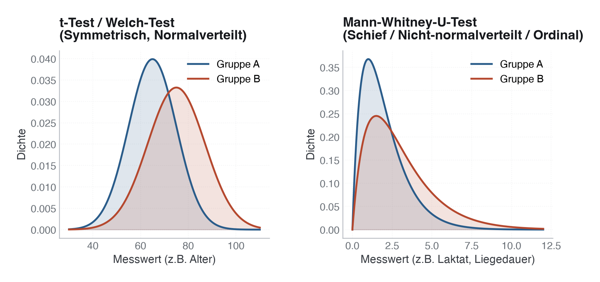
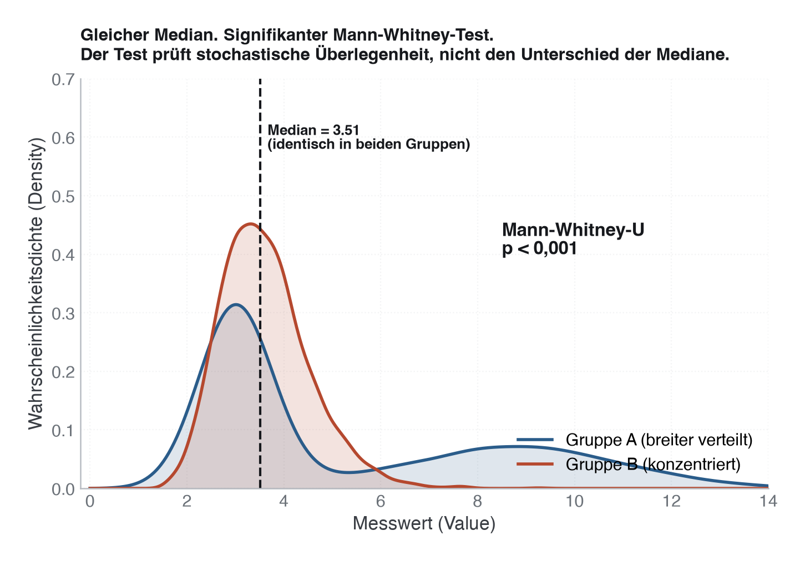
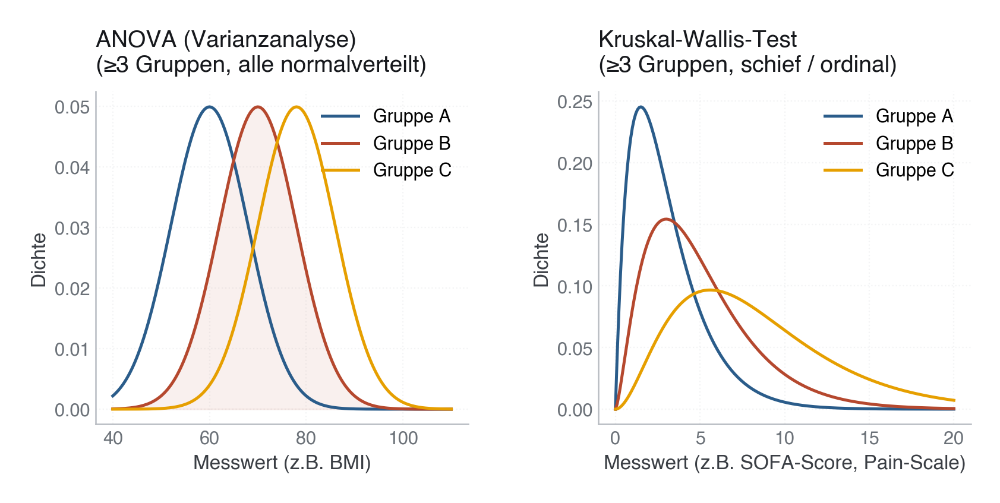
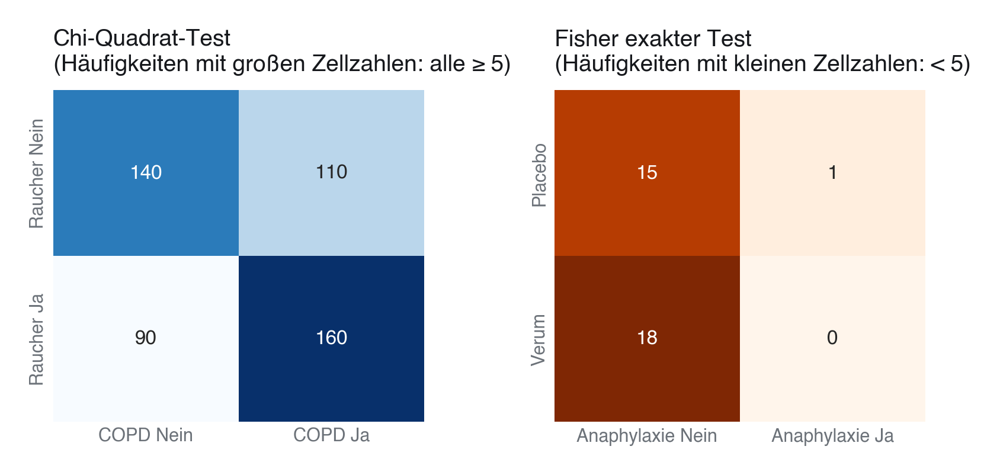
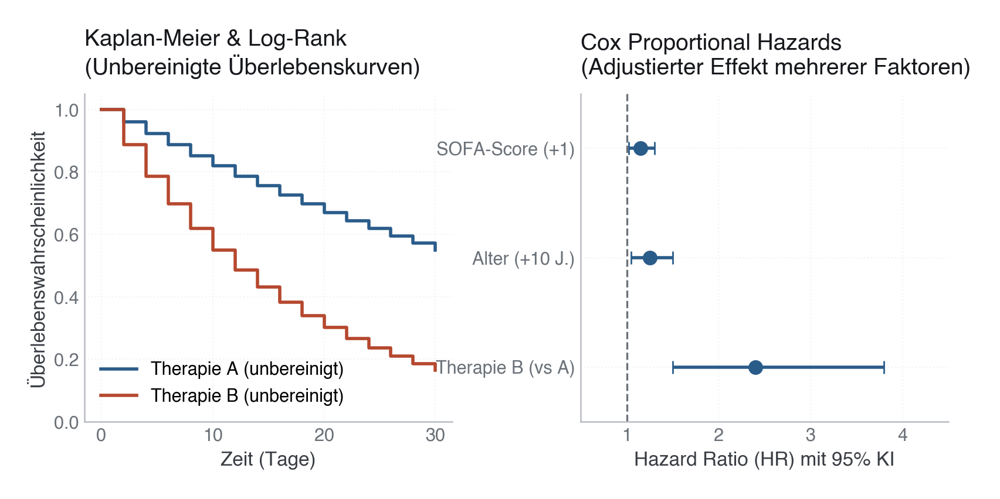

# 21 · Auswahl der passenden statistischen Methode

> **Teil 4 – Statistische Inferenz und medizinische Statistik** · Dauer: ~85 min · Voraussetzung: Module 09–10, 12 (Deskriptiv, Inferenz, Regression)

## Lernziele
- Aus klinischer Frage, Outcome, Gruppendesign und Messniveau die passende Methode ableiten.
- Zwischen unabhängigen, gepaarten und wiederholten Messungen unterscheiden.
- Parametrische Tests, robuste Alternativen und Regressionsmodelle sinnvoll wählen.
- Effektgrößen und Konfidenzintervalle passend zum Test berichten.
- Häufige Fehlentscheidungen vermeiden: Normalitätstest-Autopilot, Median-Mythos, p-Wert-Monokultur.

## Klinischer Aufhänger

Eine Kollegin fragt: „Welchen Test nehme ich?“ Die bessere Rückfrage lautet:
„Was ist die klinische Frage, wie wurde gemessen, und welches Ergebnis wäre
medizinisch relevant?“ Statistik beginnt nicht beim Test, sondern beim Design.

Dieses Modul ist die Entscheidungszentrale des Kurses. Es verbindet Table 1,
Inferenz, Regression und klinische Berichterstattung.

## 1 Die vier Fragen vor jedem Test

1. **Was ist der Outcome?** stetig, binär, ordinal, kategorial, Zeit bis Ereignis.
2. **Wie viele Gruppen?** eine, zwei, mehr als zwei.
3. **Sind Beobachtungen unabhängig?** unterschiedliche Patient:innen oder dieselben Patient:innen vor/nach Intervention?
4. **Ist die Fragestellung beschreibend, vergleichend, prädiktiv oder kausal?**

> **Merksatz:** Der Test folgt aus Frage und Design. Nicht aus dem p-Wert, den man gern hätte.

## 2 Wann welcher Test? Visualisierung der Verteilungen

Die Wahl des statistischen Tests hängt entscheidend von der Form und Struktur der Daten ab. Die folgenden Visualisierungen zeigen typische Datenkonstellationen und den jeweils passenden Test.

### 1. Unabhängiger Vergleich: Welch-t-Test vs. Mann-Whitney-U-Test
- **Welch-t-Test:** Geeignet für symmetrische, glockenförmige (normalverteilte) Daten. Er vergleicht die Mittelwerte.
- **Mann-Whitney-U-Test:** Geeignet für schiefe Verteilungen (z. B. Laktatwerte, Liegedauer) oder ordinale Skalen. Er vergleicht Rangsummen (stochastische Überlegenheit).



> [!IMPORTANT]
> **Der Median-Mythos des Mann-Whitney-U-Tests**  
> Oft wird gelehrt, der Mann-Whitney-U-Test sei ein reiner „Median-Vergleich“. Das stimmt nur unter der extrem starken (und klinisch seltenen) Annahme, dass die Verteilungen beider Gruppen exakt dieselbe Form haben (gleiche Varianz und Schiefe).  
> Haben die Gruppen unterschiedliche Formen, vergleicht der Test die **stochastische Überlegenheit** (die Wahrscheinlichkeit, dass ein zufälliger Wert aus Gruppe B größer ist als einer aus Gruppe A). Das führt dazu, dass der Test hochsignifikant (`p < 0,001`) ausfallen kann, obwohl die Mediane beider Gruppen **exakt identisch** sind.
>
> 

### 2. Gepaarter Vergleich (Vorher/Nachher): erst das Estimand, dann der Test
Entscheide zuerst, **welche Größe** der *Differenzen* (Wert B − Wert A) du berichten willst. Daraus folgt der Test:

- **Mittlere Differenz → gepaarter t-Test.** Er braucht annähernd normalverteilte Differenzen oder genug Paare; ab einigen Dutzend Paaren trägt der zentrale Grenzwertsatz auch bei mäßiger Schiefe. Bei wenigen Paaren und deutlicher Schiefe: Bootstrap-KI für die mittlere Differenz.
- **Pseudomedian / Lageverschiebung bei symmetrischen Differenzen → Wilcoxon-Vorzeichen-Rang-Test.** Sinnvoll, wenn die Differenzen symmetrisch, aber mit schweren Rändern oder einzelnen Ausreißern verteilt sind. Dann sind Median und Pseudomedian (Hodges-Lehmann-Schätzer) dasselbe, und der Test ist eine robuste Alternative zum t-Test.
- **Median der Differenzen bei schiefen Differenzen → Vorzeichentest** (Binomialtest auf den Anteil positiver Differenzen) mit Konfidenzintervall für den Median, oder ein Bootstrap-KI für den Median. Alternative: auf einer Skala rechnen, auf der die Differenzen symmetrisch werden, etwa der log-Quotient nachher/vorher bei CRP, und das Ergebnis als Verhältnis berichten.

**Stolperstein:** Der Wilcoxon-Vorzeichen-Rang-Test ist **keine** Lösung für schiefe Differenzen. Ohne Symmetrie testet er nicht mehr die Lage, sondern eine Mischung aus Lage und Form. Das Skript zeigt einen Stresstest: 50 negative Differenzen von −1 und 50 positive von 1 bis 50, Median der Differenzen exakt 0. Der Vorzeichentest findet nichts (p = 1,0), der Vorzeichen-Rang-Test verwirft hochsignifikant (p ≈ 0,00002), nur weil die positiven Differenzen größer sind.


### 3. Mehrgruppeneffekt (≥ 3 Gruppen): ANOVA vs. Kruskal-Wallis-Test
- **ANOVA:** Vergleicht die Mittelwerte von drei oder mehr unabhängigen Gruppen. Voraussetzung: annähernd normalverteilte Werte je Gruppe und ähnliche Varianzen; bei ungleichen Varianzen die Welch-ANOVA (analog zum Welch-t-Test).
- **Kruskal-Wallis-Test:** Die nicht-parametrische Alternative bei schiefen Gruppenverteilungen oder ordinalen Scores (z. B. SOFA-Score in 3 Patientengruppen).



### 4. Kategorialer Vergleich (Häufigkeiten): Chi-Quadrat vs. exakter Fisher-Test
- **Chi-Quadrat-Test:** Geeignet für den Vergleich von Häufigkeiten (2x2-Tabellen) bei großen Fallzahlen. Faustregel: Jede Zelle der Kreuztabelle enthält mindestens 5 erwartete Fälle.
- **Exakter Fisher-Test:** Exakte Berechnung der Wahrscheinlichkeiten bei kleinen Fallzahlen oder sehr seltenen Ereignissen (z. B. anaphylaktischer Schock in einer kleinen Studie).



### 5. Zeit-bis-Ereignis (Überleben): Kaplan-Meier vs. Cox-Regression
- **Kaplan-Meier-Schätzer / Log-Rank-Test:** Reine unadjustierte Beschreibung der Überlebenszeit zweier Gruppen.
- **Cox-Regression (Proportional Hazards):** Erlaubt die Adjustierung für mehrere Einflussfaktoren (z. B. Alter, SOFA-Score) zur Berechnung einer bereinigten Hazard Ratio (HR).



---

## 3 Entscheidungstabelle

| Frage | Typische Daten | Standard | Robuste Alternative | Berichten |
|---|---|---|---|---|
| Mittelwert zweier unabhängiger Gruppen | stetig, zwei Gruppen | Welch-t-Test | Mann-Whitney-U | Differenz, 95-%-KI, Cohens d oder Rang-r |
| Vorher/Nachher bei denselben Patient:innen | gepaart stetig | gepaarter t-Test | Wilcoxon-Vorzeichen-Rang (nur bei symmetrischen Differenzen), sonst Vorzeichentest oder Bootstrap | mittlere/mediane Differenz, 95-%-KI |
| Mehr als zwei Gruppen | stetig, >2 Gruppen | ANOVA | Kruskal-Wallis | Gruppenmittel, η² oder ε², Post-hoc geplant |
| Zwei kategoriale Variablen | 2x2 oder RxC | Chi-Quadrat | Fisher exakt bei kleinen Zellen | OR/RR, Cramérs V, 95-%-KI |
| Stetiger Outcome mit Adjustierung | stetig | lineare Regression | robuste SE / Transformation | β, 95-%-KI, Residuencheck |
| Binärer Outcome mit Adjustierung | ja/nein | logistische Regression | penalisiert bei seltenen Events | OR, 95-%-KI, Kalibrierung |
| Zeit bis Ereignis | Tage + Ereignisindikator | Kaplan-Meier, Cox | stratifiziert / zeitabhängig | HR, absolute Risiken, PH-Prüfung |

**Praxis:** Bei klinischen Daten ist Welch-t meist die bessere t-Test-Voreinstellung als Student-t, weil gleiche Varianzen selten garantiert sind.

**Stolperstein:** Mann-Whitney ist nicht automatisch ein „Median-Test“. Er testet stochastische Überlegenheit. Nur bei ähnlich geformten Verteilungen lässt er sich grob als Medianvergleich lesen.

**Post-hoc nach dem Mehrgruppenvergleich:** Ein signifikanter Gesamttest sagt nur, dass sich *irgendwelche* Gruppen unterscheiden, nicht welche. Nach signifikanter **ANOVA** ist **Tukey HSD** der Standard-Post-hoc-Test für paarweise Gruppenvergleiche. Nach signifikantem **Kruskal-Wallis** ist der **Dunn-Test mit Bonferroni- oder Holm-Korrektur** die robuste Alternative. Paarweise Tests ohne Korrektur für multiples Testen inflationieren die familienweise Fehlerrate (Modul 10 zeigt Bonferroni und Benjamini-Hochberg im Detail).

## 4 Annahmen pragmatisch prüfen

Normalität wird oft überschätzt. Für den Welch-t-Test ist Normalität der Rohdaten
weniger wichtig als viele denken; bei moderatem N ist er robust. Entscheidend
sind starke Schiefe, Ausreißer, kleine Gruppen und die klinische Skala.

Prüfe:

- Histogramm oder Boxplot.
- Gruppengrößen und Ausreißer.
- Ob Mittelwert oder Median die klinisch bessere Zusammenfassung ist.
- Ob Adjustierung nötig ist. Dann ist ein Regressionsmodell ehrlicher als ein isolierter Test.

**Darüber hinaus:** Bei kleinen Stichproben und unklarer Verteilung ist ein Permutationstest oft eine saubere Brücke: wenige Annahmen, gleiche klinische Frage, transparente Teststatistik.

## 5 In Python

```python
from scipy import stats
import numpy as np
import pandas as pd

cohort = pd.read_csv("{{DATEN}}kohorte.csv")
labs = pd.read_csv("{{DATEN}}labor.csv")
vitals = pd.read_csv("{{DATEN}}vitalwerte.csv")
df = cohort.merge(labs, on="patient_id", how="left")

# Independent groups: lactate in Sepsis vs. non-Sepsis
sepsis = df.loc[df["aufnahmegrund"] == "Sepsis", "laktat_mmol_l"].dropna()
other = df.loc[df["aufnahmegrund"] != "Sepsis", "laktat_mmol_l"].dropna()
print(stats.ttest_ind(sepsis, other, equal_var=False))
print(stats.mannwhitneyu(sepsis, other, alternative="two-sided"))

# Paired measurement: MAP on day 0 vs. day 3 in the same patients
wide = vitals.pivot(index="patient_id", columns="tag", values="map_mmhg").dropna(subset=[0, 3])
print(stats.ttest_rel(wide[3], wide[0]))
print(stats.wilcoxon(wide[3], wide[0]))

# Categorical: active smoking and 30-day mortality
tab = pd.crosstab(df["raucherstatus"].eq("aktiv"), df["verstorben_30d"])
print(stats.chi2_contingency(tab, correction=False))
print(stats.fisher_exact(tab))
```

Das vollständige Skript liegt unter [`code/python.py`](code/python.py).

## 6 In R

```r
library(tidyverse)

cohort <- read_csv("{{DATEN}}kohorte.csv", show_col_types = FALSE)
labs <- read_csv("{{DATEN}}labor.csv", show_col_types = FALSE)
vitals <- read_csv("{{DATEN}}vitalwerte.csv", show_col_types = FALSE)
df <- left_join(cohort, labs, by = "patient_id")

sepsis <- df |> filter(aufnahmegrund == "Sepsis") |> pull(laktat_mmol_l) |> na.omit()
other <- df |> filter(aufnahmegrund != "Sepsis") |> pull(laktat_mmol_l) |> na.omit()
t.test(sepsis, other, var.equal = FALSE)
wilcox.test(sepsis, other, exact = FALSE)

wide <- vitals |> select(patient_id, tag, map_mmhg) |> pivot_wider(names_from = tag, values_from = map_mmhg)
t.test(wide$`3`, wide$`0`, paired = TRUE)
wilcox.test(wide$`3`, wide$`0`, paired = TRUE, exact = FALSE)

tab <- table(aktiv = df$raucherstatus == "aktiv", tod = df$verstorben_30d)
chisq.test(tab, correct = FALSE)
fisher.test(tab)
```

## 7 Reportingsätze

Schreibe kurz, testbar und klinisch lesbar:

- „Das Laktat war bei Sepsis höher; wegen Rechtsschiefe berichten wir Median/IQR und Mann-Whitney-U mit Rang-biserialem r.“
- „Die MAP-Veränderung von Tag 0 zu Tag 3 wurde gepaart analysiert, da dieselben Patient:innen zweimal gemessen wurden.“
- „Für Mortalität nutzen wir logistische Regression, weil Adjustierung für Confounder wie Alter klinisch zwingend ist (Mediatoren wie SOFA nur adjustieren, wenn der direkte statt der totale Effekt interessiert, siehe Modul 15).“

> **Wann du Hilfe holst.** Wenn dein Design aus der Entscheidungstabelle herausfällt – etwa mehrfach genestete oder wiederholte Messungen, mehrere korrelierte Endpunkte oder ein gemischtes Outcome – dann ist die Tabelle am Ende und eine Statistikerin am Anfang: kläre die Methode, bevor du die Analyse rechnest.

## Fallstricke und Merksätze

- **Nicht jeder Gruppenvergleich braucht sofort Regression.** Aber jeder potenziell konfundierte Vergleich braucht zumindest die Frage danach.
- **Gepaarte Daten nie wie unabhängige Daten testen.** Sonst verschwendest du Information und bekommst falsche Unsicherheit.
- **Normalitätstests ersetzen keine Grafik.** Bei großem N werden harmlose Abweichungen signifikant.
- **Effekt zuerst, p danach.** Ein statistisch signifikanter Mini-Effekt kann klinisch egal sein.

## Selbstcheck

1. **Welcher Test passt für Laktat bei Sepsis vs. Nicht-Sepsis, wenn Laktat stark schief ist?** – Mann-Whitney-U ist robust; Welch-t kann zusätzlich als Sensitivität dienen, wenn Mittelwertunterschiede klinisch interessieren.
2. **Warum ist Tag 0 vs. Tag 3 MAP ein gepaarter Vergleich?** – Weil dieselben Patient:innen wiederholt gemessen wurden; die Messungen sind nicht unabhängig.
3. **Wann ist Regression besser als ein einzelner Test?** – Wenn der klinische Vergleich durch Alter, Schweregrad oder andere Confounder verzerrt sein kann.
