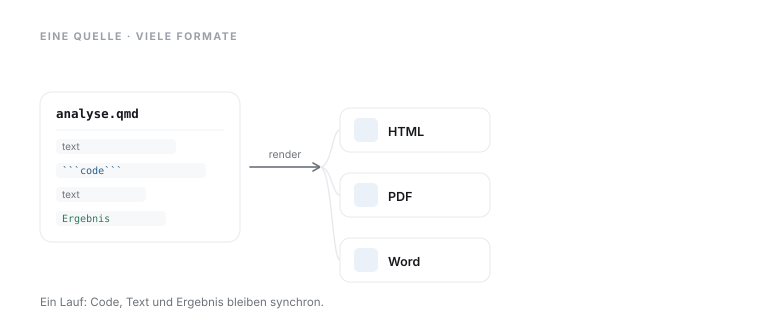

# 22 · Reproduzierbare Berichte mit Quarto

> **Teil 4 – Statistische Inferenz und medizinische Statistik** · Dauer: ~60 min · Voraussetzung: Modul 02 (Git & Projektordner), 06, 08–10, 12 (Aufbereitung bis Regression)

## Lernziele
- Verstehen, warum **Reproduzierbarkeit** in der klinischen Forschung keine Kür, sondern eine wissenschaftliche Pflicht ist.
- Ein **Analyseprojekt** als Git-Repository anlegen und nachvollziehbar strukturieren.
- **Datenschutz-Hygiene** im Versionskontrollsystem einhalten: was nie in ein Repository darf.
- Den **Analyse-Code** reproduzierbar schreiben: Seed, relative Pfade, Paketversionen.
- Analyse und Bericht **aus einer einzigen Quelle** erzeugen (Quarto).

## Klinischer Aufhänger

Deine Analyse ist fertig, und sechs Monate später fragt ein Gutachter: *„Kannst du zeigen, wie genau Tabelle 2 entstanden ist?“* Ohne reproduzierbaren Workflow lautet die ehrliche Antwort oft: *„Nicht mehr genau.“* Nicht nachvollziehbare Ergebnisse gefährden Folgepublikationen, Peer-Review-Entscheidungen und letztlich klinische Schlussfolgerungen, die auf deiner Arbeit beruhen.

Dieses Modul baut **ein** reproduzierbares Projekt von Grund auf: erst die Struktur und das Repository, dann die Datenschutz-Regeln, dann der Analyse-Code und zuletzt der Bericht, der alles zusammenführt.

## 1 Reproduzierbarkeit: was & warum

**Was** bedeutet reproduzierbar? Dieselbe Analyse, von einer anderen Person oder von dir selbst in zwei Jahren, auf demselben Datensatz, liefert **dasselbe Ergebnis.**

**Darüber hinaus:** Dieses Ideal hat eine Grenze, die man kennen sollte. Iterative numerische Verfahren – etwa multiple Imputation oder eine IPW-Gewichtung – können je nach Betriebssystem und mathematischer Bibliothek (macOS/Accelerate vs. Linux/OpenBLAS) in den letzten Nachkommastellen abweichen. „Reproduzierbar“ meint deshalb: **gleiche Methode, gleiche Daten, gleiche Schlussfolgerung** – nicht zwingend dasselbe letzte Bit auf jedem Rechner. Genau darum dokumentierst du Seed, Pfade und Versionen: Sie sichern die Aussage, nicht die 15. Nachkommastelle.

**Warum** scheitert das so häufig?

| Ursache | Konsequenz |
|---------|------------|
| Zufallszahlen ohne Seed | Ergebnisse ändern sich bei jedem Lauf |
| Absolute Pfade (`C:\Users\…`) | Skript läuft nur auf einem Rechner |
| Paketversionen nicht dokumentiert | Update bricht die Analyse still |
| Manuelle Zwischenschritte (Excel-Kopieren) | Nicht rekonstruierbar |
| PHI im Repository | Datenschutzverletzung, rechtliche Konsequenzen |

**Wie** lösen wir es? Mit drei Prinzipien, die sich durch dieses Modul ziehen:

1. **Alles Code**: kein Klicken, kein Kopieren.
2. **Seed setzen**: Zufall muss deterministisch sein.
3. **Umgebung dokumentieren**: welche Pakete in welcher Version.

**Stolperstein:** Der häufigste Fehler ist nicht das vergessene Seed, sondern der *selektive* Workflow: Daten erst in Excel bereinigt, dann in Python geladen. Dieser Excel-Schritt ist unsichtbar und nicht reproduzierbar, er bricht die gesamte Kette. Sobald eine manuelle Editierung existiert, ist die Analyse nicht mehr vollständig nachvollziehbar.

**Darüber hinaus:** Containerisierung (Docker, Singularity) sichert die gesamte Softwareumgebung inklusive Betriebssystem-Bibliotheken. Manche Journals und Förderer verlangen das zunehmend; für die meisten klinischen Projekte reicht eine virtuelle Python-Umgebung mit dokumentierten Versionen.

## 2 Das Projekt: Struktur und Repository

Ein **Repository** ist ein mit Git versioniertes Projektverzeichnis: Git speichert bei jedem `git commit` einen Snapshot, sodass jeder Stand später abrufbar bleibt. [Modul 02](../02-werkzeuge/README.md) hat das eingerichtet (`git init`, `git add`, `git commit`) – hier geht es darum, **was** in dieses Repository gehört und **wie** es geordnet ist. Reproduzierbarkeit beginnt damit, dass alles zur Analyse Gehörende in einer klaren Struktur an einem Ort liegt.

Eine bewährte Struktur für ein klinisches Analyseprojekt:

```
mein-projekt/
├── README.md              # Kurzbeschreibung, Ansprechpersonen, Laufanleitung
├── .gitignore             # was Git ignorieren soll (s. Abschnitt 3)
├── _quarto.yml            # Quarto-Projektkonfiguration (s. Abschnitt 6)
├── data/
│   ├── roh/               # unveränderliche Rohdaten – nie committen!
│   └── aufbereitet/       # durch Skripte erzeugt, ggf. committen
├── code/
│   ├── 01_bereinigung.py
│   ├── 02_analyse.py
│   └── 03_modell.py
├── berichte/
│   └── bericht.qmd        # Quarto-Dokument (Text + Code)
└── ausgaben/
    ├── tabellen/
    └── figures/
```

Die nummerierten Skripte in `code/` machen die Ausführungsreihenfolge sofort erkennbar; der Bericht in `berichte/` fügt ihre Ergebnisse zu einem Dokument zusammen. Wer vier Monate nach Abgabe zurückkommt, weiß sofort, wo er anfangen muss.

**Stolperstein:** Versionierung durch Dateinamen (`analyse_FINAL_v3_neu.py`) ist kein Ersatz für Git. Sobald zwei Personen am Projekt arbeiten, sind Namenskollisionen und verlorene Änderungen unvermeidlich. Git ist kein Luxus, sondern Grundlage kollaborativer Reproduzierbarkeit.

**Darüber hinaus:** Für komplexere Projekte lohnt ein `Makefile` oder `dvc` (Data Version Control), das die Abhängigkeiten zwischen Skripten explizit macht und nur die tatsächlich veränderten Schritte neu ausführt, besonders nützlich bei langen Preprocessing-Läufen.

## 3 Datenschutz-Hygiene: was nie ins Repository darf

Die wichtigste Regel: **Keine Patientendaten in Git.**

Erstelle eine `.gitignore`-Datei im Projektstamm, **vor dem ersten Commit**:

```gitignore
# Rohdaten und Dateien mit potenziellen PHI (Protected Health Information) -
# nur der Rohdaten-Ordner, NICHT alle CSVs im Projekt (data/aufbereitet/
# darf laut Projektstruktur oben committet werden)
data/roh/**
data/roh/*.csv
data/roh/*.xlsx
data/roh/*.xls
data/roh/*.sas7bdat
data/roh/*.dta

# Jupyter-Notebook-Ausgaben können Datenfragmente enthalten
.ipynb_checkpoints/

# Betriebssystem-Metadaten
.DS_Store
Thumbs.db
```

**Stolperstein:** Eine pauschale Regel wie `*.csv` (statt `data/roh/*.csv`) würde **jede** CSV im Projekt ignorieren, auch die aufbereiteten Ergebnisse in `data/aufbereitet/`, die laut Projektstruktur oben bewusst committet werden sollen. Ein späteres `!data/aufbereitet/*.csv` repariert das zwar, aber solche Ausnahmeketten werden schnell unübersichtlich, und sobald ein übergeordneter Ordner selbst ignoriert ist (etwa `data/`), greifen Negationen in `.gitignore` gar nicht mehr. Am robustesten: von Anfang an gezielt nur `data/roh/` ausschließen, nicht pauschal nach Dateityp.

Zusätzliche Schutzmaßnahmen:

- Rohdaten nur auf genehmigten Servern oder verschlüsselten Laufwerken speichern.
- Pseudonymisierung vor jeder Weitergabe, auch intern.
- Aggregierte Ergebnisse (Tabellen, Grafiken ohne Einzelfälle) können in der Regel geteilt werden; prüfe aber deine Einrichtungsregeln und das Ethikvotum.

**Stolperstein:** Git verfolgt die *gesamte Geschichte* aller Dateien. Eine einmal committete Datei lässt sich aus dem aktuellen Stand löschen, bleibt aber in `git log --all` sichtbar. Vollständiges Entfernen erfordert `git filter-repo` und ein erzwungenes Re-Push auf allen Klonen, erheblicher Aufwand mit Risiken für alle Mitarbeitenden. Besser: von Anfang an konsequent mit `.gitignore` arbeiten.

**Darüber hinaus:** Automatisierte Pre-Commit-Hooks (z. B. `detect-secrets` oder `git-secrets`) scannen jeden Commit nach Mustern, die wie PHI oder API-Schlüssel aussehen, und blockieren ihn, bevor der Schaden entsteht. In Teams sind solche Hooks eine sinnvolle Pflicht.

## 4 Der Analyse-Code in Python

Der eigentliche Analyse-Code lebt als Skript in `code/`. Damit seine Zahlen morgen und auf einem anderen Rechner identisch sind, muss er die drei Prinzipien aus Abschnitt 1 einlösen: **fester Seed**, **relative Pfade** (nie `C:\Users\…`) und **dokumentierte Paketversionen**. [`code/python.py`](code/python.py) zeigt alle drei an der Kurs-Kohorte.

```python
SEED = 42
import numpy as np
import pandas as pd
np.random.seed(SEED)                       # required before any random operation

cohort = pd.read_csv("{{DATEN}}kohorte.csv")
sample = cohort.sample(n=50, random_state=SEED)   # its own seed, independent of numpy
print("Mittleres Alter:", sample["alter"].mean().round(1))

import importlib.metadata                   # package versions for the manifest
for pkg in ["numpy", "pandas", "scikit-learn"]:
    print(pkg, importlib.metadata.version(pkg))
```

Ein explizites `random_state=SEED` in pandas und scikit-learn ist **unabhängig** von `np.random.seed()`. Fehlt `random_state`, ziehen beide aus dem globalen NumPy-Generator, und das Ergebnis hängt von allen vorherigen Zufallsaufrufen im Skript ab. Setze `random_state` deshalb bei jedem Aufruf explizit. Das vollständige [`code/python.py`](code/python.py) lädt die Daten über `lib.helpers` (relative Pfade, läuft vom Projektstamm aus) und schreibt die Versionsliste in ein **Manifest** (`manifest.md`), das du neben der Analyse committest – so ist die Umgebung dokumentiert, ohne dass jemand sie aus dem Gedächtnis rekonstruieren muss.

**Stolperstein:** `np.random.seed()` beeinflusst nur den globalen NumPy-Zufallsgenerator. Bei parallelen Ausführungen oder verschachtelten Zufallsgeneratoren kann das zu unerwarteten Interaktionen führen. Robuster ist der neuere Ansatz: `rng = np.random.default_rng(SEED)` erzeugen und explizit weitergeben.

**Darüber hinaus:** `pip freeze > anforderungen.txt` oder `pip-compile` (pip-tools) erzeugt eine vollständige, nachvollziehbare Liste aller installierten Versionen. Zusammen mit einer virtuellen Umgebung ist das die einfachste Form von Environments-as-Code, der erste Schritt zu vollständiger Reproduzierbarkeit.

## 5 Der Analyse-Code in R

Dieselben drei Garantien in R: `set.seed()` statt `np.random.seed()`, relative Pfade über die `lib/`-Helfer und `sessionInfo()` bzw. `packageVersion()` für die Versionsdokumentation. [`code/r.R`](code/r.R) zeigt sie an derselben Kohorte.

```r
SEED <- 42
library(tidyverse)
set.seed(SEED)                             # before any random operation

cohort <- read_csv("{{DATEN}}kohorte.csv", show_col_types = FALSE)
sample <- cohort |> slice_sample(n = 50)
cat("Mittleres Alter:", mean(sample$alter), "\n")

si <- sessionInfo()                        # versions for the report
cat("R:", si$R.version$version.string, "\n")
cat("tidyverse:", as.character(packageVersion("tidyverse")), "\n")
```

Das vollständige [`code/r.R`](code/r.R) lädt die Daten über `lib/helpers.R` (relative Pfade) und listet die Versionen der zentralen Pakete auf, das R-Gegenstück zum Python-Manifest.

**Stolperstein:** `set.seed()` setzt den Zufallsgenerator global. Ein späterer `set.seed()`-Aufruf innerhalb einer Funktion kann den äußeren State überschreiben, das passiert leicht, wenn Hilfsfunktionen aus Paketen intern Seeds setzen. Robuster: `withr::with_seed(SEED, expr)` für lokal kontrollierte Reproduzierbarkeit.

**Darüber hinaus:** `renv` ist das R-Äquivalent zu Pythons venv mit pip-tools: Es hält alle Paketversionen in einer `renv.lock`-Datei fest, die committet wird. Wer das Projekt klont, ruft `renv::restore()` auf und erhält exakt dieselbe Paketumgebung, ohne manuelle Installation.

## 6 Der Bericht: Quarto – aus einer Quelle

Skript und Bericht getrennt zu pflegen heißt: die Zahlen aus dem Skript per Copy-Paste in ein Word-Dokument übertragen – genau die manuelle Kette, die Reproduzierbarkeit bricht. **Quarto** (`.qmd`) legt Fließtext (Markdown) und Analyse-Code in **eine** Datei. `quarto render` führt jeden Code-Chunk aus und bettet Tabelle, Abbildung und Zahl direkt an Ort und Stelle ein.



Warum das besser ist als „Kopieren aus dem Skript“:

- Tabelle und der Code, der sie erzeugt, stehen **am selben Ort**.
- Datensatz geändert? Einfach neu rendern, die Tabelle aktualisiert sich automatisch.
- Gutachter erhalten den Bericht inklusive Code; manuelle Übertragungsfehler entfallen.

### Ein Quarto-Projekt anlegen

`quarto create project default mein-bericht` legt ein Projektverzeichnis mit einer **`_quarto.yml`** an. Diese Datei bündelt die Einstellungen, die für **alle** `.qmd`-Dateien des Projekts gelten – Ausgabeformat, Inhaltsverzeichnis, Ausgabeverzeichnis –, sodass einzelne Berichte nur noch ihren Titel und Inhalt tragen:

```yaml
# _quarto.yml – gemeinsame Einstellungen fuer alle .qmd im Projekt
project:
  type: default
format:
  html:
    toc: true
    code-fold: true       # Code vorhanden, aber standardmaessig eingeklappt
```

In der Projektstruktur aus Abschnitt 2 liegt der Bericht dann unter `berichte/`. Ein einzelnes `.qmd` funktioniert aber auch ohne Projekt und ohne `_quarto.yml` – dann stehen alle Einstellungen im Kopf des Dokuments selbst.

### Aufbau einer `.qmd`-Datei

Jedes Dokument beginnt mit einem **YAML-Header** zwischen zwei `---`-Zeilen; er steuert Titel, Format und Ausführung:

```yaml
---
title: "Intensivkohorte – Kurzauswertung"
author: "Dr. med. Muster"
date: today
format: html
execute:
  echo: true              # Code im Bericht sichtbar (Transparenz!)
---
```

Darunter folgt der Bericht: normaler Markdown-Text, unterbrochen von **Code-Chunks** – Codeblöcken, deren Sprache in geschweiften Klammern hinter dem Code-Zaun steht (`{python}` oder `{r}`). Beim Rendern ersetzt Quarto jeden Chunk durch seine Ausgabe (Tabelle, Zahl, Abbildung). Ein vollständiges, lauffähiges Beispiel steht in [`code/bericht_beispiel.qmd`](code/bericht_beispiel.qmd) – es lädt die Kohorte, rechnet eine Table 1 und rendert sie zu HTML. (Im Kurs liegt das Beispiel unter `code/`, weil jedes Modul seinen Code dort bündelt; in einem eigenen Projekt gehört der Bericht nach `berichte/`.)

### Einrichten (einmalig)

1. **Quarto-CLI installieren** über [quarto.org/docs/get-started](https://quarto.org/docs/get-started/) – macOS: `brew install quarto`, Windows: `winget install --id Posit.Quarto` oder der Installer. Prüfen mit `quarto --version`.
2. **Python-Kernel bereitstellen:** `pip install jupyter` in der Kursumgebung aus Modul 02. Quarto führt die `{python}`-Chunks über Jupyter aus (für `{r}`-Chunks stattdessen das R-Paket `rmarkdown`).
3. **Nur für PDF:** eine LaTeX-Distribution, am einfachsten `quarto install tinytex`.

### Rendern

Aus der Projektwurzel erzeugt `quarto render module/22-reproduzierbare-berichte/code/bericht_beispiel.qmd` HTML (das im YAML-Header gesetzte `format`). Mit `--to pdf` oder `--to docx` entstehen die anderen Formate aus **derselben** Quelle. `quarto preview` mit demselben Pfad rendert bei jedem Speichern neu und zeigt den Bericht live im Browser – praktisch beim Schreiben.

**Stolperstein:** Enthält der YAML-Header `echo: false`, bleibt der Code im gerenderten Bericht unsichtbar, Gutachter können die Analyse nicht nachvollziehen. Für Publikationen immer `echo: true` setzen. `code-fold: true` ist ein guter Kompromiss: Der Code ist vorhanden, aber standardmäßig eingeklappt.

**Darüber hinaus:** In einem Quarto-Projekt (mit `_quarto.yml`) speichert `freeze: true` die Chunk-Ausgaben und führt den Code bei späteren Projekt-Renders nicht mehr aus; `freeze: auto` rechnet nur neu, wenn sich der Quelltext des Dokuments ändert. Das spart Zeit bei langen Berechnungen, ist aber gefährlich: Eine geänderte Datendatei bemerkt keine der beiden Varianten. Im Zweifel: `freeze: false` und den Render sauber von vorne starten.

## Fallstricke und Merksätze
- **Seed vergessen** ist der häufigste Fehler. Setze ihn ganz oben, bevor irgendein Zufallsgenerator aufgerufen wird.
- **`random_state` in scikit-learn** immer explizit setzen. Ohne ihn hängt das Ergebnis vom globalen `np.random`-Zustand und damit von allen vorherigen Zufallsaufrufen ab.
- **Relative Pfade** über die `lib/`-Helfer statt absoluter Pfade sind Grundvoraussetzung, dass Analysen auf anderen Rechnern laufen.
- **Paketversionen ändern sich still.** Dokumentiere sie mit `pip freeze` oder `sessionInfo()`; noch besser: virtuelle Umgebungen mit gesperrten Versionen.
- **Manuelle Schritte sind reproduzierbarer Tod.** Jede Excel-Editierung, die nicht im Code steht, kann nicht nachvollzogen werden.
- **`echo: true` im Quarto-YAML**: so sieht der Leser den Code. Für Publikationsanhänge ist das Gold wert.

## Selbstcheck
1. **Warum muss der Seed ganz oben im Skript stehen, vor allen Zufallsoperationen?** – Jede Zufallsoperation zieht aus dem laufenden Generator; ein nachträglich gesetzter Seed beeinflusst nur spätere, nicht frühere Aufrufe. Das Ergebnis hängt dann von der Reihenfolge der Aufrufe ab und ist nicht mehr reproduzierbar.
2. **Was passiert, wenn Patientendaten versehentlich in Git committet wurden?** – Git behält die Datei dauerhaft in der gesamten Historie; vollständiges Entfernen erfordert `git filter-repo` und ein erzwungenes Re-Push auf alle Klone, aufwändig, fehleranfällig und nicht garantiert vollständig bei bereits weitergezogenen Klonen.
3. **Warum laufen relative Pfade (über die `lib/`-Helfer) reproduzierbarer als absolute wie `C:\Users\…`?** – Absolute Pfade existieren nur auf einem Rechner; auf jedem anderen bricht das Skript. Relative Pfade vom Projektstamm aus funktionieren überall, wo das Repository geklont wird.
4. **Warum erzeugt ein Quarto-Dokument reproduzierbarere Berichte als Copy-Paste aus dem Skript?** – Code und Text sind in derselben Datei; `quarto render` führt alle Chunks aus und bettet Ergebnisse direkt ein, manuelle Übertragungsfehler zwischen Skript und Bericht entfallen vollständig.
