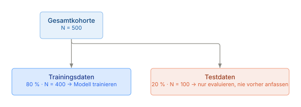

# 23 · Einführung in das maschinelle Lernen

> **Teil 5 – Machine Learning und KI in der Medizin** · Dauer: ~90 min · Voraussetzung: Module 10, 12 (Inferenz und Regression)

## Lernziele
- Den Unterschied zwischen **Erklären** und **Vorhersagen** präzise benennen, und warum er für die Modellwahl entscheidend ist.
- Einen **stratifizierten Train/Test-Split** und **Kreuzvalidierung** (StratifiedKFold) korrekt einsetzen und begründen.
- Eine **logistische Regression als transparente Baseline** in einer Pipeline trainieren.
- Modellgüte richtig lesen: **ROC-AUC** bei unbalancierten Outcomes, **Kalibrierung** und das **Genauigkeitsparadox**.
- Die **ehrlichen Grenzen** des eigenen Modells benennen: kleiner Testdatensatz, keine externe Validierung, Assoziation ≠ Kausalität.

## Klinischer Aufhänger
Kann ein Algorithmus vorhersagen, welche Patient:innen innerhalb von 30 Tagen
sterben werden? Die Frage ist berechtigt, und die ehrliche Antwort ist
komplizierter, als ein AUC von 0,85 vermuten lässt. In diesem Modul bauen wir
einen ersten Klassifikator, messen ihn sorgfältig und halten fest, was er
nicht kann. Das legt das Fundament für Modul 24, wo Vorhersage zum
eigentlichen Ziel wird.

## 1 Warum maschinelles Lernen? Erklären vs. Vorhersagen

Klassische Regressionsmodelle (Modul 12) dienen primär der **Erklärung**: Wir
schätzen Effekte (OR, HR) unter Adjustierung für Confounder, um kausale
Hypothesen zu testen. Die Koeffizienten sind das Ergebnis.

Maschinelles Lernen zielt primär auf **Vorhersage**: Wir optimieren eine
Verlustfunktion, damit das Modell bei *neuen* Patient:innen möglichst genau
prognostiziert. Die Koeffizienten sind Mittel zum Zweck, nicht das Ergebnis.

| | Klassische Statistik | Maschinelles Lernen |
|---|---|---|
| Ziel | Erklärung, Hypothesentest | Vorhersage auf neuen Daten |
| Gütekriterium | p-Wert, KI, AIC | AUC, Kalibrierung |
| Stärke | Kausalinterpretation (mit Vorsicht) | Komplexe Muster |
| Gefahr | Confounder, zu schmale Modelle | Overfitting, Blackbox |

Auch ein ML-Modell mit hervorragender Vorhersagegüte beweist keine Kausalität, und ein erklärendes Regressionsmodell kann schlechte Vorhersagen liefern. Modul 24
vertieft den Prädiktions-Workflow; dieses Modul legt das handwerkliche Fundament.

**Stolperstein:** Erklärungsmodelle und Prädiktionsmodelle auf denselben
Gütekriterien vergleichen (z. B. AIC vs. AUC). Die Frameworks bedienen
unterschiedliche Fragen, das Gütemaß muss zur Frage passen.

**Darüber hinaus:** Manchmal sind beide Ziele gleichzeitig relevant (z. B.
Kausal-ML mit `DoWhy` oder doppelt-robuste Schätzer). Für den klinischen Alltag
bleibt die klarste Frage aber die erste: Was will ich mit diesem Modell tun, verstehen oder handeln?

## 2 Train/Test-Split und Stratifizierung

Das Grundproblem: Ein Modell, das auf denselben Daten evaluiert wird, mit denen
es trainiert wurde, wirkt immer gut, es hat die Antworten schon gesehen.

**Lösung:** Daten aufteilen, *bevor* du irgendetwas am Modell tust.



Bei einem Mortalitäts-Outcome von ~16 % kann ein zufälliger Split dazu führen,
dass das Testset kaum Ereignisse enthält. Deshalb **stratifizieren** wir: Der
Split erhält die Ereignisrate in beiden Mengen.

<!-- excerpt-note -->
> **Hinweis – die Codeblöcke unten sind Auszüge.** Sie zeigen die entscheidenden Schritte, nicht jede Import-Zeile. Das vollständige, am Stück lauffähige Skript ist [`code/python.py`](code/python.py) (im Browser über den **Python**-Reiter oben). In Colab führst du das ganze Modul mit einer Zeile aus: `!python module/23-machine-learning/code/python.py` – siehe das [in Colab öffnen](https://colab.research.google.com/github/schradern/data-science-coach/blob/main/notebooks/start.ipynb).

```python
# Excerpt from code/python.py: runs inside the full script, not on its own.
X_train, X_test, y_train, y_test = train_test_split(
    X, y, test_size=0.2, stratify=y, random_state=SEED)
```


**Stolperstein:** Stratifizierung vergessen bei seltenen Outcomes. Ohne
`stratify=y` kann das Testset in einem ungünstigen Split 0 Ereignisse enthalten, dann ist kein AUC berechenbar und alle Metriken sind wertlos.

**Darüber hinaus:** Bei wiederholten Messungen pro Patient:in dürfen Zeilen
desselben Menschen nicht über Train und Test verstreut werden, sonst lernt das
Modell die Person, nicht das Muster. Dann nach Patient:in gruppieren
(`StratifiedGroupKFold`). Bei zeitlichem Bezug ist ein zeitlich getrennter Split
informativer als ein zufälliger.

## 3 Das Modell: Logistische Regression als transparente Baseline

Für einen ersten Klassifikator ist die logistische Regression ideal: Sie ist
linear, ihre Koeffizienten sind interpretierbar, und **ohne Klassengewichtung**
liefert sie kalibrierte Wahrscheinlichkeiten, ohne Blackbox-Charakter. Sobald wir
gleich `class_weight="balanced"` einschalten, gilt der Kalibrierungsteil nicht
mehr automatisch, siehe Abschnitt 5.

Um Data Leakage zu verhindern, kapseln wir Skalierung und Modell in einer
**Pipeline**. Der `StandardScaler` wird dann nur auf den Trainingsdaten gefittet
und anschließend auf die Testdaten angewendet, nie umgekehrt. Modul 24 macht
Leakage zum zentralen Thema; hier führen wir das Prinzip ein.

```python
# Excerpt from code/python.py: runs inside the full script, not on its own.
pipeline = Pipeline([
    ("scale", StandardScaler()),
    ("model", LogisticRegression(max_iter=1000, class_weight="balanced",
                                  random_state=SEED)),
])
pipeline.fit(X_train, y_train)
auc = roc_auc_score(y_test, pipeline.predict_proba(X_test)[:, 1])
```

`class_weight="balanced"` gewichtet die Minderheitsklasse (Verstorbene) höher,
damit das Modell sie nicht systematisch ignoriert, wichtig bei ~16 % Basisrate.

**Stolperstein:** `class_weight="balanced"` verschiebt vor allem die
Schwelle: Bei 0,5 erkennt das Modell mehr Verstorbene. An der Rangordnung ändert
es kaum etwas (Test-AUC 0,880 mit, 0,878 ohne Gewichtung). Dafür verzerrt es
`predict_proba()` als absolute Wahrscheinlichkeit: Das Modell rechnet effektiv so, als wären Tod und Überleben
gleich häufig. Auf unseren Daten sagt das Modell im Testset im Mittel **46 %**
Mortalität vorher, obwohl nur **16 %** tatsächlich sterben (Abschnitt 5). Für
Rangordnung/AUC ist das fast unerheblich (die Gewichtung verschiebt vor allem den
Achsenabschnitt, und eine solche Verschiebung ändert die Reihenfolge nicht), für Kalibrierung, Brier Score und Decision-Curve-Analyse
(Modul 25) ist es entscheidend, dort wird zuerst rekalibriert.

**Stolperstein:** Den `StandardScaler` *vor* dem Split auf allen Daten fitten.
Das ist klassisches Leakage: Die Kennwerte (Mittelwert, Standardabweichung) der
Testdaten fließen ins Training, und die Güte wirkt besser, als sie ist. Immer
Pipeline verwenden, immer erst nach dem Split fitten.

**Darüber hinaus:** Komplexere Modelle (Random Forest, XGBoost) können höhere
AUC-Werte erzielen, sind aber schwerer interpretierbar. Im regulierten klinischen
Umfeld (EU AI Act) ist Erklärbarkeit oft eine formale Anforderung. Die logistische
Regression ist deshalb nicht nur ein Lernbeispiel, sondern manchmal auch die
klinisch richtige Wahl.

## 4 Kreuzvalidierung

Ein einzelner Train/Test-Split ist zufallsabhängig. Bei ~16 Ereignissen im Testset
(16 % von 100) kann der AUC zwischen zwei Splits um 0,05–0,10 schwanken, rein
durch Zufall. **Kreuzvalidierung** teilt die Trainingsdaten in k Blöcke, trainiert
k-mal auf k–1 Blöcken, prüft auf dem übrigen und mittelt die Ergebnisse.

```python
# Excerpt from code/python.py: runs inside the full script, not on its own.
cv = StratifiedKFold(n_splits=5, shuffle=True, random_state=SEED)
auc_scores = cross_val_score(pipeline, X_train, y_train, cv=cv, scoring="roc_auc")
print(f"CV-AUC: {auc_scores.mean():.3f} ± {auc_scores.std():.3f}")
```

Kreuzvalidierung berührt das Testset *nicht*, es bleibt der unabhängige,
abschließende Prüfstein. Auf unseren Daten liefert die CV einen AUC von
0,728 ± 0,060, deutlich weniger als die 0,880 des einzelnen Testsets. Das Testset
mit seinen 16 Ereignissen ist hier offenbar günstig ausgefallen; die CV-Zahl ist
die realistischere Erwartung.

**Stolperstein:** Das Testset in die Kreuzvalidierung einbeziehen (z. B. `cv` auf
`X` statt `X_train` aufrufen). Dann ist das „Testset“ kein echtes Testset mehr, die CV-Güte wird zu optimistisch berichtet.

**Darüber hinaus:** `RepeatedStratifiedKFold` mit mehreren Wiederholungen liefert
stabilere Schätzer, weil die zufällige Faltungsvarianz gemittelt wird. Bei sehr
kleinen Kohorten (<200) ist das besonders wertvoll.

## 5 Kalibrierung

Ein Modell mit hoher AUC kann trotzdem schlecht kalibriert sein: Sagt es für eine
Gruppe 40 % Mortalität vorher, sollten tatsächlich ~40 % sterben. Ist das nicht
der Fall, sind absolute Risikoschätzungen irreführend, und klinisch gefährlich.

Die **Kalibrierungskurve** trägt vorhergesagte Wahrscheinlichkeiten (x-Achse)
gegen beobachtete Ereignisraten (y-Achse) auf. Eine perfekt kalibrierte Kurve
liegt auf der Diagonale.

```python
# Excerpt from code/python.py: runs inside the full script, not on its own.
from sklearn.calibration import calibration_curve
frac_pos, mean_probs = calibration_curve(y_test, probs, n_bins=5, strategy="quantile")
```

Rufst du das auf unserem `pipeline` (mit `class_weight="balanced"`) auf, zeigt
sich die Verzerrung aus Abschnitt 3 direkt: die Kurve liegt weit unterhalb der
Diagonale (Überschätzung), weil die vorhergesagten Wahrscheinlichkeiten
systematisch zu hoch sind. Rekalibrierung mit `CalibratedClassifierCV` bringt
sie zurück in die Nähe der Diagonale:

```python
# Excerpt from code/python.py: runs inside the full script, not on its own.
from sklearn.calibration import CalibratedClassifierCV

calibrated = CalibratedClassifierCV(pipeline, method="sigmoid", cv=5)
calibrated.fit(X_train, y_train)
probs_cal = calibrated.predict_proba(X_test)[:, 1]
```


**Stolperstein:** Kalibrierung nur auf wenigen Testevents berechnen. Mit ~16
Ereignissen im Testset sind die Bin-Schätzungen sehr unsicher, die Kurve kann
eine gute Kalibrierung vortäuschen oder eine echte überzeichnen. Immer den
Vorbehalt kommunizieren.

**Darüber hinaus:** Schlechte Kalibrierung lässt sich post-hoc korrigieren:
`CalibratedClassifierCV` in scikit-learn bietet Platt Scaling (sigmoid) und
Isotonic Regression. Vor dem klinischen Einsatz ist die Kalibrierungsprüfung
auf einem *externen* Validierungsdatensatz obligatorisch. Modul 25 baut das zu
einem vollständigen Kalibrierungs-Workflow aus (Brier Score, Calibration-in-
the-large, Slope, Decision-Curve-Analyse).

## 6 Klassenungleichgewicht und Gütekriterien

Unsere Kohorte hat ~16 % Mortalität. Ein Modell, das immer „lebt“ vorhersagt,
erreicht **84 % Accuracy**, und ist klinisch wertlos. Das ist das
**Genauigkeitsparadox**: Accuracy täuscht, wenn die Klassen stark unbalanciert sind.

Deshalb verwenden wir als Hauptgütemaß den **ROC-AUC**: Er misst, ob das Modell
Sterbende höher einstuft als Überlebende, schwellenunabhängig.

| Maß | Definition | Klinische Bedeutung |
|-----|-----------|---------------------|
| Sensitivität | TP / (TP + FN) | Werden alle Sterbenden erkannt? |
| Spezifität | TN / (TN + FP) | Werden Überlebende korrekt klassifiziert? |
| ROC-AUC | Fläche unter der ROC-Kurve (0,5–1,0) | Gesamte Trennschärfe, schwellenunabhängig |
| PPV | TP / (TP + FP) | Wie viele „Alarm“-Patient:innen sterben wirklich? |

`class_weight="balanced"` legt mehr Gewicht auf die Minderheitsklasse und verschiebt damit die Standardschwelle 0,5 zugunsten der Sensitivität. Gegen das Genauigkeitsparadox helfen aber vor allem das passende Gütemaß und eine bewusst gewählte Schwelle; die Gewichtung selbst kostet Kalibrierung (Abschnitt 5).

**Stolperstein:** AUC > 0,9 unkritisch als Erfolg werten. Bei kleinen Testsets
mit seltenen Ereignissen deutet eine sehr hohe AUC eher auf Overfitting oder
Leakage hin. Ziehe keine Schlüsse ohne externe Validierung.

**Darüber hinaus:** Neben AUC ist die **Average Precision** (Fläche unter der
Precision-Recall-Kurve) bei sehr seltenen Ereignissen informativer, weil sie
die Minderheitsklasse stärker gewichtet. `sklearn.metrics.average_precision_score`
liefert diesen Wert ohne zusätzliche Pakete.

## 7 In Python

Das vollständige Skript steht in [`code/python.py`](code/python.py). Kernidee:

```python
SEED = 42
import pandas as pd
from sklearn.calibration import calibration_curve
from sklearn.linear_model import LogisticRegression
from sklearn.metrics import roc_auc_score, classification_report
from sklearn.model_selection import StratifiedKFold, cross_val_score, train_test_split
from sklearn.pipeline import Pipeline
from sklearn.preprocessing import StandardScaler

df = pd.read_csv("{{DATEN}}kohorte.csv")
df["is_sepsis"] = (df["aufnahmegrund"] == "Sepsis").astype(int)
df["is_smoker"] = (df["raucherstatus"] == "aktiv").astype(int)
X = df[["alter", "sofa_score", "crp_mg_l", "diabetes", "is_sepsis", "is_smoker"]]
y = df["verstorben_30d"]

X_train, X_test, y_train, y_test = train_test_split(
    X, y, test_size=0.2, stratify=y, random_state=SEED)

pipeline = Pipeline([
    ("scale", StandardScaler()),
    ("model", LogisticRegression(max_iter=1000, class_weight="balanced",
                                  random_state=SEED)),
])
pipeline.fit(X_train, y_train)
auc = roc_auc_score(y_test, pipeline.predict_proba(X_test)[:, 1])
print(f"ROC-AUC (Test): {auc:.3f}")
```

## 8 In R

```r
SEED <- 42
suppressPackageStartupMessages(library(tidyverse))
set.seed(SEED)

cohort <- read_csv("{{DATEN}}kohorte.csv", show_col_types = FALSE) |>
  mutate(
    is_sepsis = as.integer(aufnahmegrund == "Sepsis"),
    is_smoker = as.integer(raucherstatus == "aktiv")
  )

# Stratified split
idx_pos   <- which(cohort$verstorben_30d == 1)
idx_neg   <- which(cohort$verstorben_30d == 0)
train_idx <- c(sample(idx_pos, floor(0.8 * length(idx_pos))),
               sample(idx_neg, floor(0.8 * length(idx_neg))))
train_df  <- cohort[train_idx, ]
test_df   <- cohort[-train_idx, ]

# Case weights == scikit-learn's class_weight="balanced" (base R glm() has no
# built-in class_weight argument). Without this, glm() silently reproduces
# the accuracy paradox – see code/r.R for the unweighted-vs-weighted comparison.
n_tr  <- nrow(train_df)
w_pos <- n_tr / (2 * sum(train_df$verstorben_30d == 1))
w_neg <- n_tr / (2 * sum(train_df$verstorben_30d == 0))
case_wts <- ifelse(train_df$verstorben_30d == 1, w_pos, w_neg)

fit <- glm(
  verstorben_30d ~ alter + sofa_score + crp_mg_l + diabetes + is_sepsis + is_smoker,
  data = train_df, weights = case_wts, family = binomial
)
probs <- predict(fit, newdata = test_df, type = "response")

# AUC via the Wilcoxon statistic (no pROC required)
u_stat <- wilcox.test(probs[test_df$verstorben_30d == 1],
                       probs[test_df$verstorben_30d == 0])$statistic
n1 <- sum(test_df$verstorben_30d == 1)
n0 <- sum(test_df$verstorben_30d == 0)
auc <- as.numeric(u_stat) / (n1 * n0)
cat("ROC-AUC (Test):", round(auc, 3), "\n")
```

`sample()` in R zieht einen anderen Split (399/101) als `train_test_split()` in
Python. `code/r.R` kommt deshalb auf einen Test-AUC von 0,793 statt 0,880 und
einen CV-AUC von 0,775: dieselbe Split-Abhängigkeit wie in Abschnitt 4, diesmal
zwischen zwei Sprachen.

> **Wann du Hilfe holst.** Sobald aus dem Übungsmodell ein Modell für echte Patient:innen werden soll, brauchst du externe Validierung, genügend Ereignisse und eine ehrliche Kalibrierungs- und Fairnessprüfung – spätestens dann gehören ein:e Methodiker:in und, bei Einsatz am Bett, die Regulatorik mit an den Tisch.

## Fallstricke und Merksätze
- **Erst splitten, dann alles andere.** Kein Preprocessing auf den Gesamtdaten vor dem Split.
- **Stratifizieren** bei seltenen Outcomes, ohne Stratifizierung kann ein Fold keine Ereignisse enthalten.
- **AUC statt Accuracy** bei unbalancierten Klassen: 84 % Accuracy für ein Modell, das immer „lebt“ sagt, ist kein Erfolg.
- **Pipeline = Schutz vor Leakage.** Der Scaler kennt nur die Trainingsdaten, nie die Testdaten.
- **`class_weight="balanced"` verschiebt die Schwelle, nicht die Rangordnung, und verzerrt die Wahrscheinlichkeiten.** Für Kalibrierung immer vorher rekalibrieren (`CalibratedClassifierCV`, Modul 25).
- **AUC > 0,9 ist ein Warnsignal,** kein Erfolgsbeweis. Externe Validierung ist Pflicht vor jedem klinischen Einsatz.
- **Assoziation ≠ Kausalität.** Das gilt auch für ML-Modelle, drei Mal, weil es das Wichtigste ist.

## Selbstcheck
1. **Warum stratifizieren wir beim Train/Test-Split?** – Bei ~16 % Mortalität kann ein zufälliger Split dazu führen, dass das Testset kaum oder gar keine Ereignisse enthält; Stratifizierung erhält die Ereignisrate in beiden Mengen und macht den AUC berechenbar.
2. **Was verhindert die Pipeline bei der Skalierung?** – Dass der StandardScaler auf den Gesamtdaten (inkl. Testset) gefittet wird; in der Pipeline geschieht das erst nach dem Split auf den Trainingsdaten, kein Leakage.
3. **Warum ist ein AUC von 0,88 bei einem Mortalitätsmodell mit kleinem Testset ein Ergebnis, das man nicht unkritisch feiern sollte?** – Bei nur ~16 Ereignissen im Testset (N = 100) ist das 95-%-KI des AUC breit; eine sehr hohe AUC kann auch auf Overfitting oder Leakage hindeuten und erfordert externe Validierung, bevor man ihr traut.
4. **Warum sagt unser Modell im Mittel 46 % Mortalität vorher, obwohl nur 16 % der Testpatient:innen sterben?** – Weil `class_weight="balanced"` die Verlustfunktion so umgewichtet, als wären beide Klassen gleich häufig; das verschiebt die Standardschwelle zugunsten der Sensitivität und ändert die Rangordnung (AUC) nur wenig, weil der Neufit ein etwas anderes Modell ergibt, verzerrt aber `predict_proba()` als absolute Wahrscheinlichkeit. Vor jeder Kalibrierungsaussage muss zuerst mit `CalibratedClassifierCV` rekalibriert werden.
