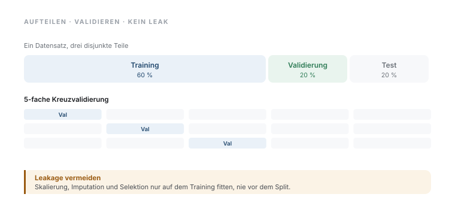

# 24 · Workflow für Prädiktionsmodelle und Data Leakage

> **Teil 5 – Machine Learning und KI in der Medizin** · Dauer: ~75 min · Voraussetzung: Module 12 und 23 (Regression und ML-Einführung)

## Lernziele
- Den **Lebenszyklus** eines Prädiktionsmodells in der richtigen Reihenfolge durchlaufen.
- Daten korrekt in **Training, Validierung und Test** teilen und **kreuzvalidieren**.
- **Data Leakage** erkennen, erklären und durch eine **Pipeline** verhindern.
- Hyperparameter mit **Grid Search** sauber abstimmen (innere vs. äußere Schleife).
- Eine **Entscheidungsschwelle** klinisch begründet wählen statt 0,5 zu übernehmen.

## Klinischer Aufhänger
Du willst bei Aufnahme abschätzen, wer in den nächsten 30 Tagen ein hohes
Sterberisiko trägt. In Modul 12 hast du *erklärt*, welche Faktoren mit dem
Outcome zusammenhängen. Jetzt wechselst du das Ziel: **vorhersagen**, wie gut das
Modell bei *neuen* Patient:innen abschneidet. Genau dort entstehen die teuersten
Fehler, ein Modell, das im Paper glänzt und am Bett versagt.

## 1 Erklären ist nicht vorhersagen
Ein erklärendes Modell fragt: *Welcher Faktor hängt mit dem Outcome zusammen?*
Ein Prädiktionsmodell fragt: *Wie genau trifft es bei Patient:innen, die es nie
gesehen hat?* Entscheidend ist daher nicht der p-Wert eines Koeffizienten,
sondern die **Güte auf unabhängigen Daten**. Alles in diesem Modul dient diesem
einen Maßstab.

## 2 Der Workflow, in dieser Reihenfolge
1. Frage und Outcome festlegen (hier: `verstorben_30d`).
2. Daten **aufteilen**, bevor du irgendetwas am Modell tust.
3. Vorverarbeitung **in eine Pipeline** stecken.
4. Modelle per **Kreuzvalidierung** vergleichen und Hyperparameter abstimmen.
5. Genau **einmal** am Ende auf dem Testset prüfen.
6. **Schwelle** und Nutzen klinisch festlegen.

Die Reihenfolge ist kein Stil, sondern Schutz: Jeder Schritt, der das Testset zu
früh „sieht", macht das Ergebnis wertlos.

## 3 Aufteilen und Kreuzvalidieren
Ein einzelner Train/Test-Split ist zufallsabhängig. **k-fache Kreuzvalidierung**
teilt die Trainingsdaten in k Blöcke, trainiert auf k–1 und prüft auf dem
übrigen, k-mal. Bei seltenen Ereignissen (hier ~16 % Mortalität) immer
**stratifiziert**, damit jeder Block genug Ereignisse enthält.




<!-- excerpt-note -->
> **Hinweis — die Codeblöcke unten sind Auszüge.** Sie zeigen die entscheidenden Schritte, nicht jede Import-Zeile. Das vollständige, am Stück lauffähige Skript ist [`code/python.py`](code/python.py) (im Browser über den **Python**-Reiter oben). In Colab führst du das ganze Modul mit einer Zeile aus: `!python module/24-praediktion-workflow/code/python.py` — siehe das [in Colab öffnen](https://colab.research.google.com/github/schradern/data-science-coach/blob/main/notebooks/start.ipynb).

```python
from sklearn.model_selection import StratifiedKFold, train_test_split
cv = StratifiedKFold(n_splits=5, shuffle=True, random_state=42)
X_train, X_test, y_train, y_test = train_test_split(
    X, y, test_size=0.25, stratify=y, random_state=42)
```

**Stolperstein:** Bei wiederholten Messungen pro Patient:in dürfen Zeilen
desselben Menschen nicht über Train und Test verstreut werden, sonst lernt das
Modell die Person, nicht das Muster. Dann nach Patient:in gruppieren
(`StratifiedGroupKFold`).
**Darüber hinaus:** Für stabile Schätzer **wiederholte** Kreuzvalidierung
(`RepeatedStratifiedKFold`) oder, bei zeitlichem Bezug, ein zeitlich getrennter
Split statt zufälliger Aufteilung.

## 4 Data Leakage, der teuerste Fehler
**Leakage** heißt: Information aus den Validierungs-/Testdaten fließt ins Training.
Das Modell wirkt brillant und bricht in der Praxis ein. Klassische Quellen:
Skalierung/Imputation auf dem *Gesamtdatensatz*, **Merkmalsauswahl** vor der
Kreuzvalidierung oder Variablen, die das Outcome verraten (z. B. „Entlassungsart").

Der Test im Code fügt 300 reine Rausch-Merkmale hinzu und wählt die „besten" aus.
Sieht die Auswahl alle Daten, gerät Zufall als vermeintliches Signal ins Modell:


Die Gegenmaßnahme ist immer dieselbe: **alle** datenabhängigen Schritte in eine
`Pipeline`, die nur auf den Trainingsfalten neu angepasst wird.

```python
from sklearn.pipeline import Pipeline
from sklearn.compose import ColumnTransformer
from sklearn.impute import SimpleImputer
from sklearn.preprocessing import StandardScaler, OneHotEncoder
from sklearn.linear_model import LogisticRegression

pre = ColumnTransformer([
    ("num", Pipeline([("impute", SimpleImputer(strategy="median")),
                      ("scale", StandardScaler())]), numeric),
    ("cat", OneHotEncoder(handle_unknown="ignore"), categorical),
])
model = Pipeline([("pre", pre),
                  ("model", LogisticRegression(max_iter=1000, class_weight="balanced"))])
```

In R erledigt das ein `recipe` innerhalb eines `workflow()` (siehe
[`code/r.R`](code/r.R)), dieselbe Idee, dieselbe Schutzwirkung.

## 5 Hyperparameter abstimmen
Parameter wie die Regularisierung `C` lernst du nicht aus den Daten, du *wählst*
sie. `GridSearchCV` probiert Werte per Kreuzvalidierung **innerhalb** der
Trainingsdaten. Wichtig: Die Abstimmung gehört in die innere Schleife; das
Testset bleibt unberührt, sonst optimierst du auf den eigenen Prüfstein.

```python
from sklearn.model_selection import GridSearchCV
grid = GridSearchCV(model, {"model__C": [0.01, 0.1, 1, 10]}, cv=cv, scoring="roc_auc")
grid.fit(X_train, y_train)              # nur Trainingsdaten
auc = roc_auc_score(y_test, grid.predict_proba(X_test)[:, 1])   # genau einmal
```

**Stolperstein:** Wer Hyperparameter abstimmt *und* dasselbe CV-Ergebnis als
Gütemaß berichtet, schönt das Ergebnis. Sauber ist **nested CV** (äußere
Schleife schätzt die Güte, innere stimmt ab), oder eben ein separates Testset.
**Darüber hinaus:** Bei vielen Hyperparametern ist `RandomizedSearchCV` oder
Bayes'sche Optimierung effizienter als ein vollständiges Gitter; `scoring`
bewusst wählen (z. B. `average_precision` bei starker Klassenungleichheit).

## 6 Die Entscheidungsschwelle ist klinisch
Ein Modell liefert Wahrscheinlichkeiten; die **Schwelle** macht daraus eine
Entscheidung. 0,5 ist selten richtig: Bei seltenen, gefährlichen Ereignissen
zählt Sensitivität, andernorts Spezifität. Die Wahl wägt Nutzen und Schaden ab, sie ist keine statistische Standardeinstellung.


**Stolperstein:** Der Youden-Index gewichtet falsch-positiv und falsch-negativ
gleich, klinisch fast nie zutreffend. Ein übersehener Hochrisiko-Fall wiegt
schwerer als ein falscher Alarm.
**Darüber hinaus:** Die Schwelle besser am **klinischen Nutzen** ausrichten
(Decision-Curve-Analyse, Modul 25) und nur auf Trainings-/Validierungsdaten
bestimmen, nie auf dem Testset.

> **Wann du Hilfe holst.** Sobald Daten eine Zeit- oder Gruppenstruktur haben (mehrere Aufenthalte pro Person, mehrere Zentren), verstecktes Leakage droht, oder eine Entscheidungsschwelle reale Konsequenzen trägt, lohnt ein methodischer Review des gesamten Workflows — Leakage merkt man am Ergebnis oft erst, wenn das Modell am Bett versagt.

## Fallstricke und Merksätze
- **Erst splitten, dann alles andere.** Das Testset wird genau einmal angefasst.
- **Jeder datenabhängige Schritt gehört in die Pipeline**, sonst droht Leakage.
- **Stratifizieren** bei seltenen Ereignissen, sonst sind Falten unbrauchbar.
- **0,5 ist keine heilige Zahl.** Die Schwelle folgt dem klinischen Nutzen.

## Selbstcheck
1. **Warum darf Skalierung/Imputation nicht vor der Kreuzvalidierung auf allen Daten geschehen?**, Dann fließen Kennwerte der Validierungsdaten ins Training (Leakage); die Güte wird zu optimistisch.
2. **Wozu dient die innere CV bei `GridSearchCV`, und warum bleibt das Testset außen vor?**, Die innere CV wählt Hyperparameter nur auf Trainingsdaten; das Testset bleibt unberührter, ehrlicher Prüfstein.
3. **Warum ist 0,5 selten die richtige Schwelle?**, Sie ignoriert Ereignishäufigkeit und die unterschiedlichen Kosten von falsch-positiv vs. falsch-negativ.
