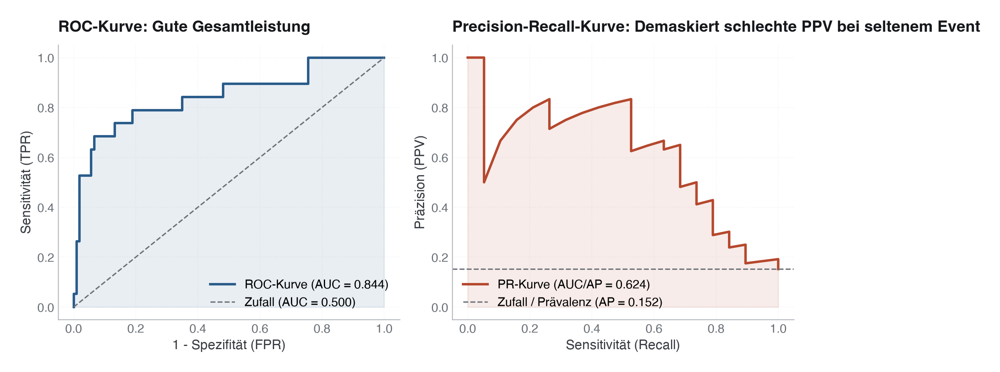

# 25 · Bewertung der Modellgüte und klinische Validierung

> **Teil 5 – Machine Learning und KI in der Medizin** · Dauer: ~80 min · Voraussetzung: Modul 24 (Prädiktions-Workflow)

## Lernziele
- **ROC-AUC und PR-AUC** interpretieren und wissen, wann welche Metrik aussagekräftiger ist.
- **Kalibrierung** eines Modells prüfen (Kalibrierungskurve, Brier Score, Slope und Intercept).
- **Net Benefit** und Decision-Curve-Analyse (DCA) manuell berechnen und klinisch einordnen.
- Optimismus durch **Bootstrap-Korrektur** sichtbar machen (interne Validierung).
- Das **TRIPOD-Checklist**-Konzept für transparente Modellberichte kennen.

## Klinischer Aufhänger
Dein Prädiktionsmodell für 30-Tage-Mortalität zeigt im Testset eine AUC von 0,84, beeindruckend. Doch zwei Fragen bleiben offen: *Stimmen die
Wahrscheinlichkeiten?* (Calibration) und *Sollte die Ärztin oder der Arzt dem Modell überhaupt
folgen?* (Net Benefit). Ein Modell mit scharfen Scores, das aber systematisch
zu hoch kalibriert ist, kann mehr schaden als nützen. Dieses Modul gibt dir die
Werkzeuge, um beide Fragen ehrlich zu beantworten.

**Stolperstein:** Die Modelle aus Modul 23/24 verwenden `class_weight="balanced"`,
damit seltene Todesfälle beim Rangordnen (AUC, Schwellenwahl) nicht ignoriert
werden. Das Umgewichten verzerrt aber `predict_proba()`: Unser Modell sagt im
Mittel **41 % Mortalität** vorher, obwohl im Testset nur **15 %** tatsächlich
sterben, das Ranking (AUC) bleibt davon fast unberührt, die absoluten
Wahrscheinlichkeiten sind aber Fiktion. Kalibrierung, Brier Score und DCA
brauchen echte Wahrscheinlichkeiten. Deshalb rekalibrieren wir in diesem Modul
zuerst mit `CalibratedClassifierCV`, bevor wir irgendeine dieser Kennzahlen
berechnen, siehe Abschnitt 2.

## 1 Diskriminierung: ROC-AUC und PR-AUC

Die **ROC-AUC** (Area Under the Receiver Operating Characteristic) misst, wie
gut das Modell Ereignis von Nicht-Ereignis trennt, unabhängig von der
Entscheidungsschwelle. Der Wert ist die Wahrscheinlichkeit, dass das Modell einem
zufälligen Ereignisfall einen höheren Score gibt als einem zufälligen Nicht-Ereignis.

<!-- excerpt-note -->
> **Hinweis – die Codeblöcke unten sind Auszüge.** Sie zeigen die entscheidenden Schritte, nicht jede Import-Zeile. Das vollständige, am Stück lauffähige Skript ist [`code/python.py`](code/python.py) (im Browser über den **Python**-Reiter oben). In Colab führst du das ganze Modul mit einer Zeile aus: `!python module/25-modellguete-validierung/code/python.py` – siehe das [in Colab öffnen](https://colab.research.google.com/github/schradern/data-science-coach/blob/main/notebooks/start.ipynb).

```python
# Excerpt from code/python.py: runs inside the full script, not on its own.
import numpy as np
from sklearn.metrics import roc_auc_score, average_precision_score

def bootstrap_metric_ci(y, proba, metric_fn, n_boot=2000, seed=42):
    rng = np.random.default_rng(seed)
    y, proba = np.asarray(y), np.asarray(proba)
    vals = []
    for _ in range(n_boot):
        idx = rng.integers(0, len(y), len(y))
        if len(np.unique(y[idx])) < 2:
            continue
        vals.append(metric_fn(y[idx], proba[idx]))
    return np.percentile(vals, [2.5, 97.5])

auc_roc = roc_auc_score(y_test, proba)
auc_pr  = average_precision_score(y_test, proba)
auc_lo, auc_hi = bootstrap_metric_ci(y_test, proba, roc_auc_score)
pr_lo,  pr_hi  = bootstrap_metric_ci(y_test, proba, average_precision_score)
print(f"ROC-AUC: {auc_roc:.3f} (95%-KI {auc_lo:.3f}–{auc_hi:.3f})")
print(f"PR-AUC:  {auc_pr:.3f} (95%-KI {pr_lo:.3f}–{pr_hi:.3f})")
# ROC-AUC: 0.844 (95%-KI 0.707–0.946)   PR-AUC: 0.624 (95%-KI 0.398–0.847)
# Test set: n = 125, 19 of them events; event rate 15.2 %
```

**Eine Zahl ohne Intervall täuscht Präzision vor.** Bei nur 19 Ereignissen im
Testset reicht das 95 %-Bootstrap-KI der ROC-AUC von 0,71 bis 0,95 – ein Modell
mit „AUC 0,84“ ist mit diesen Daten von einem mit AUC 0,72 kaum zu unterscheiden.
Berichte darum jeden Gütewert mit Konfidenzintervall (Bootstrap oder DeLong);
das gilt auch für den Subgruppenvergleich in Modul 32.

Diese Rangordnungs-Metriken hängen nur von der Reihenfolge der Scores ab.
Halte zwei Vorgänge auseinander: Eine **monotone Neuskalierung fester Scores**
(etwa die Rekalibrierung in Abschnitt 2) ändert die Reihenfolge nicht, also auch
nicht AUC/PR-AUC. Ein **Neufit mit `class_weight="balanced"`** ist dagegen ein
anderes Modell mit anderen Koeffizienten, und das kann die Reihenfolge der
Patient:innen ändern. Auf diesem Split liegt die ROC-AUC mit Gewichtung bei
0,8436, ohne bei 0,8515. Der Unterschied ist klein gegen das Bootstrap-KI, aber
er ist nicht null. Absolute Wahrscheinlichkeiten verzerrt die Gewichtung in
jedem Fall, das behandelt Abschnitt 2.

**PR-AUC** (Precision-Recall) blendet die vielen wahren Negativen aus und bewertet
nur die Qualität der Alarmierungen, klinisch oft relevanter.

> [!TIP]
> **ROC- vs. Precision-Recall-Kurve bei seltenen Ereignissen**  
> Bei unbalancierten Datensätzen (z. B. geringer Sterberate) demaskiert die PR-Kurve oft Schwachstellen, die in der ROC-Kurve verborgen bleiben:
> - **ROC-Kurve:** Wirkt oft hervorragend (z. B. AUC = 0,85), weil der Nenner der Falsch-Positiv-Rate (Spezifität) durch die riesige Anzahl an gesunden/überlebenden Fällen dominiert wird.
> - **Precision-Recall-Kurve:** Zeigt oft ein viel ernüchternderes Bild (z. B. AUC/AP = 0,32). Die Präzision (PPV) wird durch Falsch-Positive hart bestraft. Ein Alarm in der Praxis wäre hier meist ein Fehlalarm.
>
> 

In R:
```r
library(pROC)
library(PRROC)
roc_obj <- roc(y_test, proba)
auc(roc_obj)
pr_obj <- pr.curve(scores.class0 = proba[y_test == 1],
                   scores.class1 = proba[y_test == 0])
pr_obj$auc.integral
```

**Stolperstein:** Ein Modell kann ROC-AUC ≈ 0,80 zeigen und trotzdem bei
Hochrisikopatient:innen systematisch falsche Wahrscheinlichkeiten ausgeben, nämlich dann, wenn es zwar korrekt
rangordnet, aber schlecht kalibriert ist. Die AUC allein sagt nichts über die
absolute Güte der Wahrscheinlichkeiten.

**Darüber hinaus:** Bei zeitabhängigen Outcomes (z. B. 30-Tage- vs. 90-Tage-
Mortalität) ergibt sich die zeitabhängige AUC aus Survival-Analysen
(`lifelines`, `sksurv`) und berücksichtigt Zensierung korrekt.

## 2 Kalibrierung: Stimmen die Wahrscheinlichkeiten?

Diskriminierung beantwortet: *Wer hat das höhere Risiko?* Kalibrierung
beantwortet: *Ist ein Score von 0,20 wirklich ~20 % Sterberisiko?* Beides kann
unabhängig voneinander gut oder schlecht sein.

### 2.0 Erst rekalibrieren

Unser Modell nutzt `class_weight="balanced"` (Modul 23/24). Das ist gut fürs
Ranking, macht `predict_proba()` aber unbrauchbar für alles, was absolute
Wahrscheinlichkeiten braucht:

```python
# Excerpt from code/python.py: runs inside the full script, not on its own.
from sklearn.calibration import CalibratedClassifierCV

print(f"Mittlere vorhergesagte Mortalität (unkalibriert): {proba.mean():.1%}")
# 40.9 %  --  observed mortality in the test set: 15.2 %

calibrated = CalibratedClassifierCV(build_pipeline(), method="sigmoid", cv=5)
calibrated.fit(X_train, y_train)
proba_cal = calibrated.predict_proba(X_test)[:, 1]
print(f"Mittlere vorhergesagte Mortalität (rekalibriert): {proba_cal.mean():.1%}")
# 16.2 %  --  close to the observed 15.2 %; ROC-AUC stays at 0.843
```

`CalibratedClassifierCV` fittet die Neuskalierung per interner Kreuzvalidierung
**nur auf den Trainingsdaten** und wendet sie danach auf `X_test` an, kein
Leakage. Ab hier arbeitet dieses Modul mit `proba_cal`.

> **Merksatz:** `class_weight="balanced"` löst das Ranking-Problem bei seltenen
> Ereignissen, aber es zerstört die Wahrscheinlichkeits-Semantik von
> `predict_proba()`. Für Kalibrierung, Brier Score, CITL/Slope und DCA immer
> zuerst rekalibrieren (oder die Klassengewichtung ganz weglassen und die
> Schwelle stattdessen anpassen, Modul 24 Abschnitt 6).

### 2.1 Kalibrierungskurve und Brier Score

```python
# Excerpt from code/python.py: runs inside the full script, not on its own.
from sklearn.calibration import calibration_curve
from sklearn.metrics import brier_score_loss

frac_pos, mean_pred = calibration_curve(y_test, proba_cal, n_bins=10)
brier = brier_score_loss(y_test, proba_cal)
print(f"Brier Score: {brier:.4f}")
# uncalibrated: 0.1679   recalibrated: 0.0955  (null model at 15.2 % base rate: 0.129)
```

Die **Kalibrierungskurve** trägt den beobachteten Anteil (y-Achse) gegen den
vorhergesagten Anteil (x-Achse) auf, die perfekte Kurve ist die Diagonale. Der
**Brier Score** fasst die Abweichung als mittlere quadratische Abweichung zusammen
(0 = perfekt; ein Nullmodell, das immer die Basisrate vorhersagt, erreicht
`p·(1-p)`, hier ≈0,129).

Zwei erweiterte Kennzahlen aus logistischer Rekalibrierung:

- **Calibration-in-the-large**: Intercept eines GLM, in dem `logit(proba)` als
 **Offset** eingeht (Steigung fest = 1); 0 = im Mittel richtig, negativ =
 Modell überschätzt systematisch, positiv = unterschätzt.

- **Calibration slope**: Steigung einer logistischen Regression des Outcomes auf
 `logit(proba)` als freiem Prädiktor; <1 = Modell überstreckt Scores (zu
 extrem), >1 = zu konservativ (Scores zu vorsichtig).

```python
# Excerpt from code/python.py: runs inside the full script, not on its own.
import numpy as np
from scipy.special import logit
import statsmodels.api as sm

log_odds = logit(np.clip(proba_cal, 1e-6, 1 - 1e-6))

# Calibration-in-the-large: log_odds as OFFSET, only the intercept is estimated
citl_model = sm.GLM(y_test, np.ones(len(y_test)),
                    family=sm.families.Binomial(), offset=log_odds).fit()
citl = citl_model.params[0]

# Calibration slope: log_odds as a free predictor
slope_model = sm.Logit(y_test, sm.add_constant(log_odds)).fit(disp=False)
slope = slope_model.params[1]
print(f"CITL: {citl:+.3f}   Slope: {slope:.3f}")
# CITL: -0.085   Slope: 1.871
```

**Stolperstein:** `sm.Logit(y_test, np.ones(len(y_test)))`
sieht nach einem Intercept-Modell aus, ignoriert `proba` aber komplett und
liefert *immer* `logit(mean(y_test))`, egal wie gut oder schlecht das Modell
ist. Ein perfekt kalibriertes und ein katastrophal überschätzendes Modell mit
derselben mittleren Ereignisrate bekämen exakt denselben Wert. `logit(proba)`
muss als **Offset** eingehen (Code oben), nicht weggelassen werden.

In R:
```r
library(rms)
val.prob(proba, y_test)   # reports Brier, intercept and slope, among others
# Caution: this intercept comes from the model with a freely estimated slope,
# it is not the offset-based CITL from above.
```

![Kalibrierungskurve: beobachteter gegen vorhergesagten Anteil, auf rekalibrierten Wahrscheinlichkeiten (CalibratedClassifierCV). Eine perfekte Kalibrierung entspricht der Diagonalen. Bei nur 19 Ereignissen im Testset schwankt die Kurve zwischen den Bins deutlich. Der CITL (−0,085) liegt nahe null (kein systematischer Über-/Unterschätzungs-Offset), aber der Slope (1,87) liegt klar außerhalb des akzeptierten Bereichs von etwa 0,8–1,2: ein Slope deutlich über 1 bedeutet zu wenig extreme, überschrumpfte Vorhersagen (hohe Risiken werden zu niedrig, niedrige zu hoch geschätzt). Bei nur 19 Ereignissen ist dieser Slope zudem extrem unsicher – was gerade dafür spricht, Unsicherheit auszuweisen, statt den Wert als „nahe ideal“ zu verkaufen.](assets/kalibrierung.png)

**Stolperstein:** Kalibrierungskurven mit wenigen Fällen je Bin schwanken stark.
Bei ~19 Testevents auf 10 Bins ist das im obigen Chart sichtbar. Weniger Bins
(z. B. 5 statt 10) sind stabiler, aber grober. Isotonische Regression oder Platt-Scaling
können die Kalibrierung nachträglich verbessern, aber stets auf
einem getrennten Datensatz.

**Darüber hinaus:** Überprüfe die Kalibrierung **in Subgruppen** (z. B. nach
Aufnahmegrund): ein Modell kann insgesamt gut kalibriert sein, aber bei Sepsis
systematisch überschätzen. Das ist die Schwachstelle, die in der Klinik zuerst
auffällt.

## 3 Decision-Curve-Analyse: Ist das Modell klinisch nützlich?

ROC-AUC und Brier Score sagen, wie gut das Modell ist, die **Decision-Curve-
Analyse (DCA)** beantwortet, ob es *nützlicher* ist, als alle oder keine Patient:innen
zu behandeln.

Der **Net Benefit (NB)** bei Schwelle p_t:
```
NB(p_t) = (TP / N) - (p_t / (1 - p_t)) * (FP / N)
```
Die Schwelle p_t kodiert das Verhältnis, zu dem du einen Fehlalarm gegen einen
übersehenen Fall eintauschst. p_t = 0,10 bedeutet: du akzeptierst bis zu
9 Fehlalarme, um 1 echten Fall nicht zu verpassen.

**Stolperstein:** p_t wird als **echte Risikoschwelle** interpretiert
(„behandle, wenn Risiko ≥ p_t“). Das ist nur sinnvoll, wenn `proba` kalibriert
ist, deshalb verwenden wir hier weiterhin `proba_cal` aus Abschnitt 2.0, nicht
die rohen, mit `class_weight="balanced"` aufgeblähten Scores.

```python
# Excerpt from code/python.py: runs inside the full script, not on its own.
import numpy as np

def net_benefit(y_true, proba, threshold):
    """Net benefit for a single probability threshold."""
    n = len(y_true)
    predicted_pos = proba >= threshold
    tp = ((predicted_pos == 1) & (y_true == 1)).sum()
    fp = ((predicted_pos == 1) & (y_true == 0)).sum()
    return tp / n - (threshold / (1 - threshold)) * fp / n

thresholds = np.linspace(0.01, 0.50, 200)
nb_model   = [net_benefit(y_test, proba_cal, t) for t in thresholds]
nb_all     = [y_test.mean() - (t / (1 - t)) * (1 - y_test.mean()) for t in thresholds]
nb_none    = [0.0] * len(thresholds)   # never treat = NB always 0
```

Trägt man NB gegen die Schwelle auf, entsteht die **Decision Curve**. Das Modell
ist nützlich, wenn seine Kurve sowohl die „Alle behandeln“- als auch die
„Niemanden behandeln“-Linie übersteigt. Auf unseren Daten ist das über fast den
gesamten gezeigten Schwellenbereich (0,01–0,50) der Fall. Nur unterhalb von etwa
0,02 fällt die Modellkurve mit „alle behandeln“ zusammen, weil dort jede
vorhergesagte Wahrscheinlichkeit über der Schwelle liegt.

In R:
```r
library(dcurves)
dca(verstorben_30d ~ proba, data = test_df,
    thresholds = seq(0.01, 0.5, 0.01)) |> plot()
```


**Stolperstein:** Der Net Benefit reagiert empfindlich auf den beobachteten
Ereignisanteil. Bei einem anderen Datensatz (andere Klinik, andere Periode) kann
die Kurve des Modells unter „Alle behandeln“ fallen, selbst bei identischer AUC.
Das ist der Kernunterschied zwischen statistischer und klinischer Validierung.

**Darüber hinaus:** Erweitere die DCA um **interventions avoided** (Anzahl
vermiedener Behandlungen gegenüber „Alle behandeln“ pro 100 Patient:innen), das lässt
sich gegenüber klinischem Personal leichter kommunizieren.

## 4 Interne Validierung: Bootstrap-Optimismus-Korrektur

Jede Gütemessung auf den Trainingsdaten selbst ist optimistisch.
**Bootstrap Optimism Correction** (nach Harrell) schätzt den Optimismus ehrlich:

1. Trainiere auf vollständigen Daten → Güte auf denselben Daten = `G_orig`.
2. Ziehe B Bootstrap-Stichproben; trainiere je ein Modell, messe Güte auf Bootstrap
 (`G_boot`) und auf den Originaldaten (`G_orig_b`).

3. Optimismus = mittlere Differenz `G_boot - G_orig_b`.
4. Korrigierter Schätzer = `G_orig - Optimismus`.

```python
def bootstrap_optimism(X, y, pipeline, n_boot=200, seed=42):
    """Estimate AUC optimism via bootstrap resampling."""
    rng = np.random.default_rng(seed)
    pipeline.fit(X, y)
    auc_orig = roc_auc_score(y, pipeline.predict_proba(X)[:, 1])

    optimisms = []
    for _ in range(n_boot):
        idx = rng.integers(0, len(y), size=len(y))
        X_b, y_b = X.iloc[idx], y.iloc[idx]
        try:
            pipeline.fit(X_b, y_b)
            auc_boot  = roc_auc_score(y_b, pipeline.predict_proba(X_b)[:, 1])
            auc_orig_b = roc_auc_score(y,   pipeline.predict_proba(X)[:, 1])
            optimisms.append(auc_boot - auc_orig_b)
        except Exception:
            continue
    optimism = np.mean(optimisms)
    return auc_orig, optimism, auc_orig - optimism
```

Auf den Trainingsdaten (n_boot=100): apparente AUC 0,814, mittlerer Optimismus
0,051, korrigierte AUC 0,762. Die echte Test-AUC (0,844) liegt sogar darüber –
aber der Testsplit enthält nur 19 Ereignisse, sodass beide Schätzer breite
Konfidenzintervalle tragen und „bestätigt“ zu viel gesagt wäre. Entscheidend
ist, dass die Optimismus-Korrektur die apparente AUC überhaupt nach unten zieht,
weg vom geschönten Trainingswert. Diese Rechnung verwendet weiterhin
`class_weight="balanced"`, weil sie nur die AUC (Ranking) betrifft, keine
absoluten Wahrscheinlichkeiten.

**Stolperstein:** Bootstrap-Optimismus unterschätzt den echten Optimismus, wenn
nicht jeder datengetriebene Schritt (Variablenauswahl, Hyperparameter-Tuning,
Imputation) in jeder Bootstrap-Stichprobe wiederholt wird; bei sehr kleinen
Stichproben ist zudem die Schätzung selbst unsicher. Ein scheinbar
kleiner Optimismus ist kein Freifahrtschein für externe Validität.

**Darüber hinaus:** Alternativ liefert **wiederholte k-fache Kreuzvalidierung**
(statt Bootstrap) einen vergleichbaren Schätzer der Güte; die Wiederholung senkt
die Varianz gegenüber einer einzelnen CV. Beides ist ein Weg der internen
Validierung, wenn keine echte externe Kohorte verfügbar ist.

## 5 Externe Validierung und TRIPOD-Checkliste

**Interne Validierung** (Bootstrap, CV) schätzt Güte auf der eigenen Kohorte.
**Externe Validierung** prüft das Modell auf einer wirklich unabhängigen Population, anderes Krankenhaus, anderer Zeitraum, anderes Land. Nur externe Validierung
beantwortet, ob das Modell generalisiert.

TRIPOD (Transparent Reporting of a multivariable prediction model for Individual
Prognosis Or Diagnosis) ist der Berichtsstandard für Prädiktionsmodelle in der
klinischen Forschung; für ML-Modelle gilt seit 2024 die erweiterte Fassung
**TRIPOD+AI** (mit eigener Nummerierung). Die wichtigsten Punkte aus der
ursprünglichen Checkliste (TRIPOD 2015):

| TRIPOD-Punkt | Was gehört rein |
|---|---|
| 4–8 | Datenquelle, Teilnehmende, Outcome, Prädiktoren, Fallzahl |
| 9 | Fehlende Werte: Umgang und Ausmaß |
| 10a, 10b | Umgang mit Prädiktoren, Modelltyp, Modellbildung, Methode der internen Validierung |
| 10d, 16 | Gütemaße (Kalibrierung, Diskriminierung) und ihre Ergebnisse mit Konfidenzintervall |
| 15 | Vollständige Modellspezifikation |
| 10c, 12, 13c | Externe Validierung, falls vorhanden |

Für diesen Kurs gilt: Ein Modell ohne Kalibrierungsabschnitt und ohne
DCA ist klinisch unvollständig dokumentiert, unabhängig von der AUC.

> **Wann du Hilfe holst.** Für die externe Validierung, belastbare Kalibrierungsaussagen bei wenigen Ereignissen und eine TRIPOD-konforme Berichterstattung vor Publikation oder Einsatz solltest du Biostatistik und Methodik einbeziehen – interne Optimismus-Korrektur ersetzt keine unabhängige Kohorte.

## Fallstricke und Merksätze
- **`class_weight="balanced"` zerstört Kalibrierung.** Die Rangordnung (AUC)
 ändert sich nur wenig (hier 0,8436 statt 0,8515), absolute Wahrscheinlichkeiten
 sind dagegen grob verzerrt. Vor Brier/Kalibrierung/DCA
 immer mit `CalibratedClassifierCV` rekalibrieren.

- **AUC ≠ klinischer Nutzen.** Ein gut diskriminierendes Modell kann schlecht
 kalibriert sein und trotzdem falsch entscheiden.

- **Kalibrierung ist populationsabhängig.** Ein kalibriertes Modell in Klinik A
 kann in Klinik B systematisch über- oder unterschätzen.

- **Net Benefit hängt von der Schwelle ab.** Die DCA zeigt, für welchen
 Schwellenbereich das Modell überhaupt nützlich ist.

- **Bootstrap-Optimismus ≠ externe Validität.** Der Optimismus sagt, wie sehr man
 sich auf *diesen* Daten selbst belügt, nicht, ob das Modell in der Praxis standhält.

- **TRIPOD immer.** Kein Prädiktionsmodell ohne transparente Dokumentation.

## Selbstcheck
1. **Warum kann PR-AUC bei seltenen Ereignissen informativer sein als ROC-AUC?** – Weil die ROC-AUC von der Ereignisrate unabhängig ist: Eine kleine Falsch-Positiv-Rate kann bei sehr vielen Negativen trotzdem viele Fehlalarme bedeuten. Die PR-AUC
 bewertet die Präzision (PPV) der positiven Vorhersagen und macht das bei starker
 Klassenungleichheit sichtbar.

2. **Was bedeutet Calibration Slope < 1?** – Das Modell überstreckt seine Scores:
 Hochrisikopatienten werden noch höher bewertet, Niedrigrisikopatienten noch
 niedriger als sie sein sollten. Ein Slope von genau 1 (mit Intercept 0) signalisiert
 perfekte Kalibrierung.

3. **In welchem Schwellenbereich ist ein Modell laut DCA nützlich?** – Dort, wo der
 Net Benefit des Modells *über* beiden Referenzlinien (alle behandeln, niemanden
 behandeln) liegt. Außerhalb dieses Bereichs bringt das Modell keinen Mehrwert.

4. **Warum berechnen wir in diesem Modul zuerst `CalibratedClassifierCV`, bevor wir Brier Score, Kalibrierungskurve oder DCA anschauen?** – Weil das Modell mit `class_weight="balanced"` trainiert wurde: Das verbessert das Ranking bei seltenen Ereignissen, bläht aber `predict_proba()` systematisch auf (hier im Mittel 41 % statt der beobachteten 15 %). Die AUC verschiebt sich dadurch nur wenig, aber Brier Score, Kalibrierungskurve, CITL/Slope und DCA werten die Wahrscheinlichkeiten absolut, ohne Rekalibrierung wären sie irreführend.
