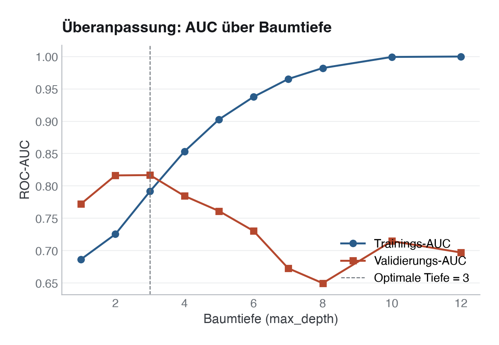

# 26 · Baum-Ensembles und Gradient Boosting

> **Teil 5 – Machine Learning und KI in der Medizin** · Dauer: ~85 min · Voraussetzung: Modul 24 (Prädiktions-Workflow)

## Lernziele
- Einen **Entscheidungsbaum** aufbauen und das Overfitting durch Tiefe verstehen.
- **Bagging** und **Random Forest** als Varianzreduktion durch Ensemble-Mittelung erklären.
- Die **Boosting-Intuition**, iterative Fehlerkorrektur, nachvollziehen.
- `HistGradientBoostingClassifier`, `RandomForestClassifier` und (falls verfügbar)
 `xgboost`/`lightgbm` auf klinischen Daten anwenden und vergleichen.

- **Regularisierungsparameter** bewusst wählen: Tiefe, Lernrate, Iterationen.

## Klinischer Aufhänger
Ein einzelner Entscheidungsbaum fragt: *Ist SOFA > 7? Ist Alter > 72? Dann hohes
Risiko.* Transparent, und fragil: Schon kleine Datenvariationen kippen den
Baum. Ensembles stimmen Hunderte solcher Bäume ab und mitteln ihre Fehler weg.
Gradient Boosting, das Prinzip hinter XGBoost und LightGBM, geht weiter: Jeder
neue Baum korrigiert gezielt die verbleibenden Fehler des bisherigen Ensembles.
Diese Modellklasse gilt seit Jahren als besonders stark auf tabellarischen
Daten; in klinischen Vergleichsstudien ist ihr Vorsprung vor einer gut
spezifizierten logistischen Regression aber oft klein.

## 1 Der einzelne Entscheidungsbaum: transparent, aber instabil

Ein Baum teilt den Merkmalsraum rekursiv durch Schwellenwertschnitte. Er ist
interpretierbar und braucht keine Normalisierung. Bei unbegrenzter Tiefe
lernt er jedoch das Trainingsrauschen auswendig.

**Praxis:** Unsere Kohorte hat ~500 Zeilen und 78 Ereignisse (15,6 %) auf 11
Rohmerkmale, EPV (Events per Variable) ≈ 7. Die klassische EPV≈10-Faustregel
stammt aus der Regressionswelt; Baum-Ensembles können faktisch noch mehr
effektive Parameter aus denselben Daten ziehen. Bei so wenig Daten zählt
Regularisierung (Tiefe, Lernrate, `n_estimators`, `class_weight`) also noch
mehr als sonst, siehe die Überanpassungskurve unten.

Wie in Modul 24 gehört jeder datenabhängige Vorverarbeitungsschritt
(Imputation, One-Hot-Encoding) in eine `Pipeline`, die `cross_val_score()` pro
Fold neu anpasst, sonst leakt Information aus den Validierungszeilen ins
Training:

<!-- excerpt-note -->
> **Hinweis – die Codeblöcke unten sind Auszüge.** Sie zeigen die entscheidenden Schritte, nicht jede Import-Zeile. Das vollständige, am Stück lauffähige Skript ist [`code/python.py`](code/python.py) (im Browser über den **Python**-Reiter oben). In Colab führst du das ganze Modul mit einer Zeile aus: `!python module/26-ensembles-boosting/code/python.py` – siehe das [in Colab öffnen](https://colab.research.google.com/github/schradern/data-science-coach/blob/main/notebooks/start.ipynb).

```python
from sklearn.compose import ColumnTransformer
from sklearn.impute import SimpleImputer
from sklearn.pipeline import Pipeline
from sklearn.preprocessing import OneHotEncoder
from sklearn.tree import DecisionTreeClassifier
from sklearn.model_selection import cross_val_score, StratifiedKFold

pre = ColumnTransformer([
    ("num", SimpleImputer(strategy="median"), NUMERIC),
    ("cat", OneHotEncoder(handle_unknown="ignore", sparse_output=False), CATEGORICAL),
    ("bin", "passthrough", BINARY),
])
pipe = Pipeline([("pre", pre), ("model", DecisionTreeClassifier(max_depth=4, random_state=42))])

cv = StratifiedKFold(n_splits=5, shuffle=True, random_state=42)
auc_tree = cross_val_score(pipe, X, y, cv=cv, scoring="roc_auc").mean()
```

**Stolperstein:** `pre.fit_transform(X)` einmal auf dem gesamten `X` aufrufen
und dann erst kreuzvalidieren ist dieselbe Leakage-Falle wie in Modul 24: Der
Imputer „sieht“ beim Median-Berechnen bereits die Validierungszeilen jedes
Folds. Bei reiner Median-Imputation ist der Effekt oft klein, aber die
Gewohnheit zählt, dieselbe Pipeline-Disziplin verhindert bei komplexeren
Vorverarbeitungsschritten (Skalierung, Feature-Auswahl) einen echten Bias.

Die Overfitting-Kurve (Abbildung unten) zeigt: Die Trainings-AUC steigt monoton,
während die Validierungs-AUC ab einer gewissen Tiefe wieder fällt.



**Stolperstein:** `max_depth=None` (Standard) erzeugt praktisch immer Trainings-AUC 1,00, ein sicheres Zeichen für Überanpassung, das Anfänger oft als Erfolg interpretieren.

**Darüber hinaus:** `min_samples_leaf` und `min_samples_split` regularisieren
stärker als `max_depth` allein: Sie steuern, wie viele Fälle mindestens in einem
Blatt landen müssen, und sind robuster gegenüber der Klassenungleichheit.

## 2 Bagging und Random Forest: Varianz durch Mittelung senken

**Bagging** (Bootstrap Aggregating): Trainiere B Bäume auf je einer Bootstrap-
Stichprobe der Daten und mittle die Vorhersagen. Die Varianz sinkt um Faktor B
(bei unkorrelierten Bäumen), der Bias bleibt.

**Random Forest** ergänzt: Jeder Baumknoten wählt nur eine zufällige Teilmenge
der Merkmale, das entkoppelt die Bäume und senkt Korrelation und damit Varianz.

```python
from sklearn.ensemble import RandomForestClassifier

rf = RandomForestClassifier(
    n_estimators=300,
    max_depth=None,          # trees grow fully; the ensemble controls variance
    max_features="sqrt",     # sqrt(p) features per node – standard rule
    class_weight="balanced",
    random_state=42,
    n_jobs=-1,
)
# Imputation/encoding in the pipeline as above, refitted per fold
auc_rf = cross_val_score(Pipeline([("pre", pre), ("model", rf)]), X, y,
                         cv=cv, scoring="roc_auc").mean()
```

In R:
```r
library(ranger)
# Balanced weights from the data (like sklearn's class_weight="balanced":
# weight_c = n / (n_classes * n_c)) instead of a hard-coded 10:1 that
# matches neither the ~84/16 base rate nor the Python side. table() is in
# factor-level order; ranger reads class.weights in that same order.
class_counts  <- table(train_df$verstorben_30d)
class_weights <- as.numeric(nrow(train_df) / (2 * class_counts))
model_rf <- ranger(verstorben_30d ~ ., data = train_df,
                   num.trees = 300, probability = TRUE,
                   class.weights = class_weights)
```

**Stolperstein:** Bei starker Klassenungleichheit (hier ~16 % Ereignisse) ohne
`class_weight="balanced"` sagt der Random Forest an der Standardschwelle 0,5
überwiegend „0“ vorher: hohe Accuracy, aber niedriger Recall (auf unserem
Testsplit 0,32 statt 0,58 mit Gewichtung). Die AUC leidet dagegen kaum
(CV-AUC 0,771 ohne vs. 0,791 mit Gewichtung), weil sie nur die Rangfolge
bewertet. Gewichtung oder eine niedrigere Schwelle heben den Recall; die
Gewichtung verzerrt aber die Wahrscheinlichkeiten (Modul 25).

**Darüber hinaus:** Die impurity-basierte Feature Importance des Random Forest
wird auf den Trainingsdaten berechnet und bevorzugt kontinuierliche Merkmale mit
vielen möglichen Schnittpunkten. Permutations-Importance
(`permutation_importance`) auf Testdaten ist robuster, aber teurer; bei
korrelierten Merkmalen (hier z. B. SOFA-Score und Leukozyten) sind beide
Verfahren mit Vorsicht zu lesen (Modul 27).

## 3 Boosting-Intuition: iterative Fehlerkorrektur

Boosting trainiert Bäume **sequenziell**, nicht parallel. Jeder neue Baum
konzentriert sich auf die Fälle, die das bisherige Ensemble schlecht vorhersagt.
Formal minimiert **Gradient Boosting** eine differenzierbare Verlustfunktion
durch gradientenbasierte Schritte im Funktionsraum.

Die wichtigsten Regularisierungsparameter:

| Parameter | Bedeutung | Typischer Bereich |
|---|---|---|
| `max_depth` (oder `max_leaf_nodes`) | Komplexität je Baum | 3–8 |
| `learning_rate` | Schrittgröße pro Baum | 0,01–0,3 |
| `n_estimators` | Anzahl Bäume | 100–2 000 |
| `subsample` | Anteil Zeilen je Baum | 0,5–1,0 |

Eine niedrige Lernrate braucht mehr Bäume, wird aber stabiler. Grob gilt:
Halbiert man die Lernrate, braucht man etwa doppelt so viele Bäume. Die passende
Baumzahl bestimmt man am saubersten per Early Stopping (siehe unten).

## 4 HistGradientBoosting, XGBoost und LightGBM

Scikit-learns `HistGradientBoostingClassifier` binnt numerische Merkmale in
Histogramme, dadurch ist er deutlich schneller als klassisches GBM und verarbeitet
fehlende Werte **nativ** (kein Imputer nötig). XGBoost und LightGBM gehen denselben
Weg und ergänzen weitere Regularisierung.

```python
from sklearn.ensemble import HistGradientBoostingClassifier

hgb = HistGradientBoostingClassifier(
    max_iter=300,
    max_depth=5,
    learning_rate=0.05,
    class_weight="balanced",
    random_state=42,
)
# pre_native: like pre, but without an imputer (NaN values are kept); only
# the categories are encoded in the pipeline
auc_hgb = cross_val_score(Pipeline([("pre", pre_native), ("model", hgb)]), X, y,
                          cv=cv, scoring="roc_auc").mean()
```

**Praxis – xgboost/lightgbm installieren:** Beide sind optional, `code/python.py`
läuft auch ohne sie (Fallback: `HistGradientBoostingClassifier`). Installation:
`uv pip install xgboost lightgbm`. Auf macOS brauchen beide zusätzlich die
OpenMP-Laufzeitbibliothek: `brew install libomp`. Scheitert der Import danach
noch mit einem Ladefehler, Python mit
`DYLD_LIBRARY_PATH=/opt/homebrew/opt/libomp/lib python module/26-ensembles-boosting/code/python.py`
starten.

XGBoost- und LightGBM-Fallback:
```python
try:
    import xgboost as xgb
    xgb_model = xgb.XGBClassifier(
        n_estimators=300, max_depth=5, learning_rate=0.05,
        scale_pos_weight=(y == 0).sum() / (y == 1).sum(),
        eval_metric="auc", random_state=42, verbosity=0,
    )
    auc_xgb = cross_val_score(Pipeline([("pre", pre), ("model", xgb_model)]), X, y,
                              cv=cv, scoring="roc_auc").mean()
except Exception:  # not installed or failed to load (e.g. missing libomp)
    print("xgboost nicht verfügbar – HistGradientBoosting als Ersatz.")
    auc_xgb = None
```

In R:
```r
library(xgboost)
dtrain <- xgb.DMatrix(data = as.matrix(X_train), label = y_train)
params <- list(objective = "binary:logistic", eval_metric = "auc",
               max_depth = 5, eta = 0.05,
               scale_pos_weight = sum(y_train == 0) / sum(y_train == 1))
model_xgb <- xgb.train(params, dtrain, nrounds = 300, verbose = 0)
```

**Stolperstein:** Zu große `n_estimators` / `max_iter` kombiniert mit zu großer
Lernrate führt auch beim Boosting zu Overfitting. Early Stopping (auf einem
Validierungsset) ist die sauberste Lösung: Das Training stoppt, sobald die
Validierungsgüte stagniert.

**Darüber hinaus:** LightGBM wächst blattweise (`num_leaves` statt `max_depth`),
was bei großen Datensätzen schneller und oft genauer ist. Für klinische Datensätze
(<5 000 Fälle) ist der Unterschied zu HistGBM marginal; bei größeren Kohorten
spielen LightGBM/XGBoost ihre Geschwindigkeit und zusätzlichen Stellschrauben
eher aus.

## 5 Modellvergleich: kreuzvalidierte AUC

Der finale Vergleich läuft auf denselben Kreuzvalidierungs-Folds, so beruhen die
Unterschiede nicht auf zufällig verschiedenen Splits.

```python
models = {
    "Entscheidungsbaum (Tiefe 4)": Pipeline([("pre", pre), ("model", tree)]),
    "Random Forest":               Pipeline([("pre", pre), ("model", rf)]),
    "HistGradBoost (sklearn)":     Pipeline([("pre", pre_native), ("model", hgb)]),
}
for name, pipe in models.items():
    scores = cross_val_score(pipe, X, y, cv=cv, scoring="roc_auc")
    print(f"{name}: {scores.mean():.3f} ± {scores.std():.3f}")
```

Auf unserer Kohorte: Entscheidungsbaum 0,655 ± 0,043, Random Forest 0,791 ±
0,028, HistGradBoost 0,711 ± 0,064, XGBoost 0,739 ± 0,030, LightGBM 0,755 ±
0,047. Random Forest gewinnt hier klar (+0,135 AUC vs. Einzelbaum) – aber das
ist ein *Ergebnis dieses Laufs*, keine allgemeine Wahrheit. Führe den
Vergleich immer neu aus und lies die tatsächlichen Zahlen ab, `code/python.py`
leitet die Schlussfolgerung am Ende genauso her (nie hartkodiert), und wenn
die Modelle bei dir gleichauf liegen oder der Baum vorn liegt, ist das ein
genauso gültiges, berichtenswertes Ergebnis.


**Stolperstein:** Die Standardabweichung der CV-Scores (±) zeigt die Instabilität
des Schätzers. Ein Modell mit AUC 0,82 ± 0,08 ist nicht nachweislich besser als 0,80 ± 0,02, der Unterschied liegt im Rauschen.

**Darüber hinaus:** Für den formalen Modellvergleich gibt es den **DeLong-Test** für
AUC-Unterschiede (`pROC::roc.test()` in R). In Python approximierst du ihn mit
Bootstrap-Konfidenzintervallen über `scipy.stats.bootstrap`.

> **Wann du Hilfe holst.** Baum-Ensembles überfitten auf kleinen klinischen Kohorten leicht (hier EPV ≈ 7), und ihre scheinbare Güte hält externer Validierung oft nicht stand – bevor ein solches Modell klinisch genutzt wird, gehören Tuning-Strategie und Validierung methodisch abgesichert.

## Fallstricke und Merksätze
- **Einzelner Baum tief = Overfit.** Ensembles regeln Varianz, aber Bias bleibt.
- **Vorverarbeitung gehört in die Pipeline**, auch bei Baum-Ensembles, sonst
 dieselbe Leakage-Falle wie in Modul 24.
- **`class_weight="balanced"` bewusst einsetzen** bei seltenen klinischen Ereignissen:
 Es hebt den Recall an der Standardschwelle, verzerrt aber die Wahrscheinlichkeiten
 (vor Kalibrierung und DCA rekalibrieren, Modul 25).
- **Lernrate und Iterationen hängen zusammen.** Kleine Lernrate → mehr Bäume.
- **HistGBM braucht keinen Imputer.** Fehlende Werte werden nativ gelernt.
- **CV-Streuung ist Information.** Ein stabiler schlechterer Schätzer kann besser
 sein als ein instabiler besserer.
- **Kein Modell gewinnt per Dekret.** Miss immer, und berichte ehrlich, wenn
 Modelle gleichauf liegen oder ein einfacheres Modell vorn liegt.

## Selbstcheck
1. **Warum senkt Bagging die Varianz, aber nicht den Bias?** – Weil gemittelte
 Schätzer (bei gleichem Erwartungswert) weniger streuen, der systematische Fehler
 (Bias) aber vom mittleren Modell bestimmt wird und nicht verschwindet.

2. **Was bewirkt eine sehr kleine Lernrate beim Gradient Boosting?** – Das Modell
 macht kleine Schritte; es braucht viele Bäume (hohes `n_estimators`), generalisiert
 aber besser und reagiert robuster auf Rauschen.

3. **Warum verarbeitet HistGradientBoosting fehlende Werte nativ?** – Weil es bei
 jedem Split lernt, auf welche Seite fehlende Werte geschickt werden (die
 Richtung, die den Verlust am meisten senkt), statt auf Imputation angewiesen zu sein.

4. **Warum muss die Imputation (z. B. Median) für den Entscheidungsbaum-Vergleich in einer Pipeline stecken statt einmal vorab auf dem Gesamtdatensatz zu laufen?** – Weil der Median sonst auch aus den Validierungs-/Testzeilen jedes Folds berechnet wird, Information aus Daten, die das Modell offiziell noch nicht gesehen haben soll, fließt ins Training (Leakage), genau das Prinzip, das Modul 24 einführt und das auch für Baum-Ensembles gilt.
