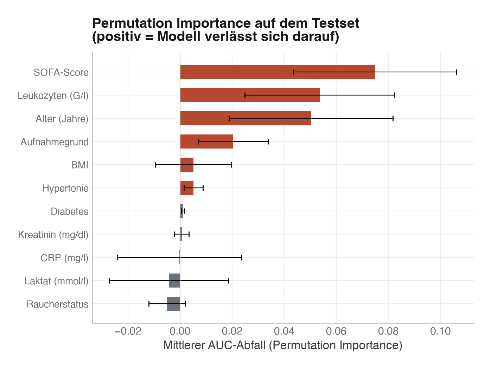
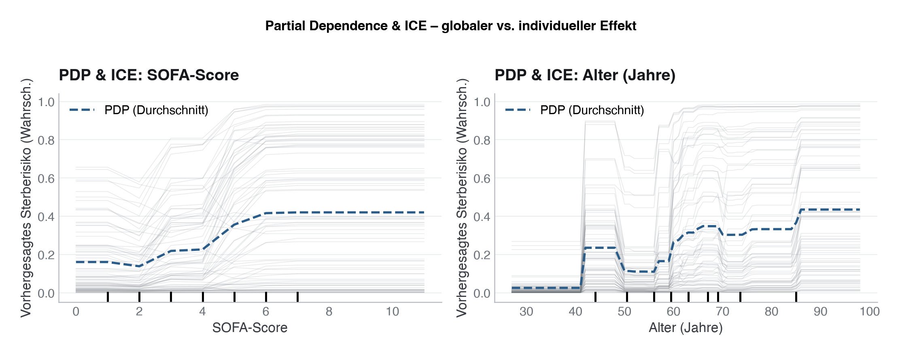

# 27 · Erklärbarkeit von Machine-Learning-Modellen

> **Teil 5 – Machine Learning und KI in der Medizin** · Dauer: ~70 min · Voraussetzung: Module 24 und 26 (Workflow und Ensembles)

## Lernziele
- Den Unterschied zwischen **globaler** und **lokaler** Erklärbarkeit verstehen.
- **Permutation Importance** korrekt berechnen und gegen Impurity-basierte Wichtigkeit abgrenzen.
- **Partial Dependence Plots (PDP)** und **Individual Conditional Expectation (ICE)** lesen und interpretieren.
- **SHAP-Werte** konzeptuell einordnen und, sofern installiert, für einzelne Patient:innen berechnen.
- Typische Fallstricke: korrelierte Merkmale, Wichtigkeit ≠ Kausalität.

## Klinischer Aufhänger
Du hast in Modul 26 ein Ensemble trainiert, das `verstorben_30d` mit guter AUC
vorhersagt. Die Stationsleitung fragt: „Warum sagt das Modell bei Patient 42 ein
hohes Sterberisiko voraus?“ Und der Ethikausschuss: „Welche Variablen treibt das
Modell überhaupt?“ Erklärbarkeit ist keine Kür, sondern Voraussetzung für Vertrauen,
Fehlerdiagnose und die Transparenzpflichten, die MDR und EU AI Act stellen
(Gebrauchsanweisung mit Leistung und Grenzen, menschliche Aufsicht). Eine
mathematische Erklärung des Modells schreibt keines der beiden Gesetze vor.

## 1 Globale vs. lokale Erklärbarkeit
**Globale Erklärbarkeit** beschreibt, welche Merkmale das Modell *im Durchschnitt*
über alle Patient:innen antreiben. Sie beantwortet: „Was hat das Modell gelernt?“
**Lokale Erklärbarkeit** beschreibt, warum das Modell *für eine konkrete Person*
eine bestimmte Vorhersage macht. Sie beantwortet: „Warum bekommt Patient 42 diesen
Score?“

Kein Verfahren allein genügt: Globale Methoden überdecken wichtige
Einzelfälle, lokale Methoden verzerren das Gesamtbild.

**Stolperstein:** Bevor du irgendetwas erklärst, prüfe, ob das Modell
überhaupt etwas gelernt hat. Ein Modell nahe der Zufallsgrenze (AUC ≈ 0,5)
liefert trotzdem plausibel aussehende SHAP-Plots und Permutation-Importance-
Balken, nur beschreiben die dann Rauschen, nicht Signal. `code/python.py`
prüft deshalb zuerst die kreuzvalidierte AUC (Abschnitt 0), bevor es
irgendeine Erklärungsmethode aufruft:

<!-- excerpt-note -->
> **Hinweis – die Codeblöcke unten sind Auszüge.** Sie zeigen die entscheidenden Schritte, nicht jede Import-Zeile. Das vollständige, am Stück lauffähige Skript ist [`code/python.py`](code/python.py) (im Browser über den **Python**-Reiter oben). In Colab führst du das ganze Modul mit einer Zeile aus: `!python module/27-erklaerbarkeit/code/python.py` – siehe das [in Colab öffnen](https://colab.research.google.com/github/schradern/data-science-coach/blob/main/notebooks/start.ipynb).

```python
# Excerpt from code/python.py: runs inside the full script, not on its own.
from sklearn.ensemble import HistGradientBoostingClassifier
from sklearn.model_selection import StratifiedKFold, cross_val_score, train_test_split

cv = StratifiedKFold(n_splits=5, shuffle=True, random_state=SEED)
probe = HistGradientBoostingClassifier(random_state=SEED, max_iter=200,
                                       learning_rate=0.05, max_depth=4,
                                       class_weight="balanced")
cv_auc = cross_val_score(probe, X, y, cv=cv, scoring="roc_auc")
print(f"CV-AUC: {cv_auc.mean():.3f} ± {cv_auc.std():.3f}")
# On our cohort: CV-AUC = 0.711 ± 0.060 – clearly above chance level,
# so explainability is worthwhile here.

# Only once predictive value is confirmed: train the final model.
X_train, X_test, y_train, y_test = train_test_split(
    X, y, test_size=0.25, stratify=y, random_state=SEED)
model = HistGradientBoostingClassifier(random_state=SEED, max_iter=200,
                                       learning_rate=0.05, max_depth=4,
                                       class_weight="balanced")
model.fit(X_train, y_train)
```

In R arbeitest du analog mit `ranger` (Random Forest), das die Permutation
Importance beim Fitten gleich mitrechnet (`importance = "permutation"`), sowie
`pdp` oder `DALEX` für PDP/ICE und lokale Erklärungen.

**Stolperstein:** Erklärbarkeit erklärt das **Modell**, nicht die Realität. Ein
Merkmal mit hoher Wichtigkeit ist nicht kausal, es könnte ein Proxy für eine
versteckte dritte Variable sein.
**Darüber hinaus:** Für die Zulassung als Medizinprodukt (MDR, z. B. Klasse IIb/III)
zählen klinische Validierung, technische Dokumentation und eine verständliche
Gebrauchsanweisung; Erklärbarkeitsmethoden können dabei helfen, ersetzen aber
nichts davon.

## 2 Permutation Importance, das ehrliche Maß
Impurity-basierte Wichtigkeit (Standard bei RandomForest) wird auf den
Trainingsdaten berechnet und *überschätzt* kontinuierliche Variablen mit vielen
Ausprägungen, weil sie viele mögliche Schnittpunkte bieten. **Permutation Importance** (PI) mischt die Werte eines Merkmals
zufällig durch und misst den Leistungsabfall auf dem **Testset**. So zeigt sie,
wie stark das Modell von diesem Merkmal abhängt, unabhängig von Skaleneffekten.

```python
# Excerpt from code/python.py: runs inside the full script, not on its own.
from sklearn.inspection import permutation_importance

result = permutation_importance(
    model, X_test_df, y_test,
    n_repeats=10, random_state=SEED, scoring="roc_auc"
)
importances_mean = result.importances_mean   # shape: (n_features,)
importances_std  = result.importances_std
```

Die Ausgabe enthält für jedes Merkmal den mittleren AUC-Abfall und seine
Standardabweichung über die 10 Wiederholungen. Merkmale mit kleinem Abfall und
großer Streuung nutzt das Modell kaum oder sie sind austauschbar.



**Stolperstein:** Bei korrelierten Merkmalen wird die PI unterschätzt, das Modell
kann das gemischte Merkmal durch sein Korrelat kompensieren. Dann sind beide
Variablen scheinbar unwichtig, obwohl sie zusammen viel tragen.
**Darüber hinaus:** `n_repeats=10` (wie in `code/python.py`) ist ein guter
Kompromiss zwischen Laufzeit und Stabilität für die Kursbeispiele. Für
Veröffentlichungen empfehlen sich mindestens 30 Wiederholungen.

## 3 Partial Dependence und ICE
**Partial Dependence Plots (PDP)** zeigen, wie sich die mittlere Modellvorhersage
ändert, wenn du ein Merkmal variierst und über die beobachteten Werte aller
anderen Merkmale mittelst (marginalisierst). Sie sind globale Aussagen über den durchschnittlichen Effekt.

**Individual Conditional Expectation (ICE)**: dieselbe Variation je Patient:in,
aber ohne Mittelung der Kurven. Verlaufen die ICE-Kurven nicht parallel (oder
kreuzen sich), hat das Modell eine **Interaktion** gelernt, der Effekt des Merkmals hängt vom Wert anderer
Variablen ab.

```python
# Excerpt from code/python.py: runs inside the full script, not on its own.
from sklearn.inspection import PartialDependenceDisplay

# PDP + ICE for sofa_score and alter (two panels in one figure)
PartialDependenceDisplay.from_estimator(
    model, X_test_df,
    features=["sofa_score", "alter"],
    kind="both",           # "average" = PDP only; "both" = PDP + ICE
    subsample=100,
    random_state=SEED,
    ax=axes,
)
```



**Stolperstein:** PDPs mit Merkmalen, die stark korreliert sind (z. B. `bmi`
und `gewicht_kg`), erzeugen beim Marginalisieren unrealistische Datenpunkte und
werden dann irreführend. Prüfe immer die Merkmalskorrelation.
**Darüber hinaus:** `kind="both"` kann bei großen Datensätzen langsam sein.
`subsample=100` beschleunigt die ICE-Linien auf Kosten von etwas Genauigkeit.
Für Veröffentlichungen alle Patient:innen nutzen.

## 4 SHAP, lokale Erklärungen
SHAP (SHapley Additive exPlanations) weist jeder Variable für jede einzelne
Vorhersage einen spieltheoretisch begründeten Beitrag zu: Wie viel trägt ein
Merkmal bei, verglichen mit dem Fall, dass es fehlt?

- **Beeswarm-Plot**: Alle Patient:innen auf einen Blick, Farbe = Merkmalswert,
 x-Position = SHAP-Wert (Beitrag zur Vorhersage).

- **Force-Plot / Waterfall**: Einzelne Person, zeigt, welche Merkmale den Score
 nach oben oder unten verschieben.

```python
# Excerpt from code/python.py: runs inside the full script, not on its own.
# Try shap; fall back to permutation importance if not installed.
try:
    import shap
    # Path-dependent TreeSHAP: exact for trees, shap checks additivity itself.
    explainer = shap.TreeExplainer(model)
    shap_values = explainer(X_test_df[:100])  # first 100 patients for speed
    print("SHAP summary (mean |SHAP|):")
    mean_abs = np.abs(shap_values.values).mean(axis=0)
    for feat, val in sorted(zip(FEATURES, mean_abs), key=lambda x: -x[1]):
        print(f"  {feat:<30} {val:.4f}")
    SHAP_AVAILABLE = True
except ImportError:
    print("SHAP not installed – using permutation importance for local explanation proxy.")
    print("Install with: uv pip install shap")
    SHAP_AVAILABLE = False
```


Ohne SHAP bleibt die Permutation Importance als globales Ersatzmaß gültig; die
lokale Erklärung eines Einzelfalls lässt sich über Koeffizienten (bei linearen
Modellen) oder LIME approximieren.

**Stolperstein: „exakt“ gilt nur für eine Variante.** Pfadabhängiges TreeSHAP
(`shap.TreeExplainer(model)`) ist für Baummodelle exakt: Die SHAP-Werte einer
Person plus Basiswert ergeben genau den Log-Odds-Score des Modells, und `shap`
prüft das selbst. Die interventionelle Variante mit Hintergrundstichprobe
(`shap.Explainer(model, X_train)`) erfüllt das bei diesem Modell **nicht**. Das
Skript misst eine Abweichung von bis zu 0,108 Log-Odds (SHAP-Summe 3,630 statt
3,522), höchstens 0,47 Prozentpunkte Risiko. Ursache: Mehrere Messwerte liegen
genau auf Split-Schwellen des HistGradientBoosting, und `shap` wertet die
Verzweigungen mit geringerer Rechengenauigkeit aus, einzelne Werte landen dann
im anderen Ast. Wer die Additivitätsprüfung mit `check_additivity=False`
abschaltet, versteckt genau diesen Fehler. Und auch exakte SHAP-Werte erklären
das **Modell** unter einer gewählten Referenz, sie sind keine exakte Eigenschaft
der Patientin. Für neuronale Netze oder Kernel-SHAP steigt der Rechenaufwand
außerdem stark an.

**Stolperstein – korrelierte Merkmale:** Wie bei Permutation Importance (Abschnitt 2)
können zwei korrelierte Merkmale (z. B. SOFA-Score und Leukozyten; im
synthetischen Datensatz hängen die Leukozyten direkt vom SOFA-Score ab) sich den
SHAP-Beitrag teilen. Ein kleiner mittlerer |SHAP|-Wert
bedeutet dann nicht zwingend „unwichtig“, sondern eventuell nur „das Signal
steckt teilweise im korrelierten Partner“. Prüfe Merkmalskorrelationen, bevor
du ein Merkmal aufgrund niedriger SHAP-Werte als irrelevant einstufst.

**Darüber hinaus:** SHAP-Interaktionswerte (`shap_interaction_values()` von `TreeExplainer`)
erklären Wechselwirkungen zwischen Merkmalen, wichtig, wenn PDP-Kreuzungen aufgefallen sind.

> **Wann du Hilfe holst.** Sobald jemand SHAP- oder Importance-Werte kausal deutet („Variable X senkt das Risiko“), stark korrelierte Merkmale die Zuschreibung verzerren, oder eine Erklärung regulatorisch (MDR, EU-AI-Act) belastbar sein muss, hol methodische Beratung – Wichtigkeit ist nicht Kausalität.

## Fallstricke und Merksätze
- **Erst Prädiktivität prüfen, dann erklären.** Ein Modell nahe der Zufallsgrenze
 (CV-AUC ≈ 0,5) liefert plausibel aussehende, aber bedeutungslose Erklärungen.

- **Wichtigkeit ≠ Kausalität.** Ein Merkmal kann wichtig sein, weil es mit dem
 wahren Treiber korreliert, nicht weil es selbst kausal ist.

- **Korrelierte Merkmale** schlagen sich die Wichtigkeit gegenseitig weg (PI) oder
 erzeugen unrealistische Extrapolationen (PDP).

- **Lokale Erklärungen variieren** von Patient:in zu Patient:in, eine einzelne
 Erklärung repräsentiert nicht das Modellverhalten allgemein.

- **Modell erklären, nicht Daten.** Erklärbarkeit zeigt, was das Modell gelernt
 hat, nicht, was in der Realität gilt.

- **SHAP ist nicht universell.** Bei nicht-baumbasierten Modellen oder sehr
 großen Datensätzen kostet SHAP erheblich Rechenzeit.

## Selbstcheck
1. **Warum bevorzugt Impurity-Importance Variablen mit vielen Ausprägungen, und wie hilft Permutation Importance?** – Impurity-Splits wählen häufiger aus vielen Schwellwerten; PI misst dagegen den tatsächlichen Leistungsabfall auf dem Testset und ist damit maßstabsunabhängig.
2. **Was zeigt ein PDP, und wann ist es irreführend?** – Den durchschnittlichen Effekt eines Merkmals; irreführend bei stark korrelierten Merkmalen, da dann unrealistische Merkmalskombinationen marginalisiert werden.
3. **Was ist der Unterschied zwischen globalem und lokalem SHAP?** – Globale SHAP-Zusammenfassungen mitteln |SHAP|-Werte über alle Patient:innen; lokale Erklärungen (Force/Waterfall) zeigen den Beitrag für einen einzelnen Fall.
4. **Warum prüft `code/python.py` die kreuzvalidierte AUC, bevor es Permutation Importance oder SHAP berechnet?** – Weil Erklärbarkeitsmethoden für jedes Modell ein Ergebnis liefern, auch für eines, das nicht besser als der Zufall ist. Ohne diesen Prädiktivitäts-Check könnte man Rauschen als „wichtige Merkmale“ fehlinterpretieren; auf unserer Kohorte liegt die CV-AUC bei 0,711, klar über der Zufallsgrenze 0,5.
