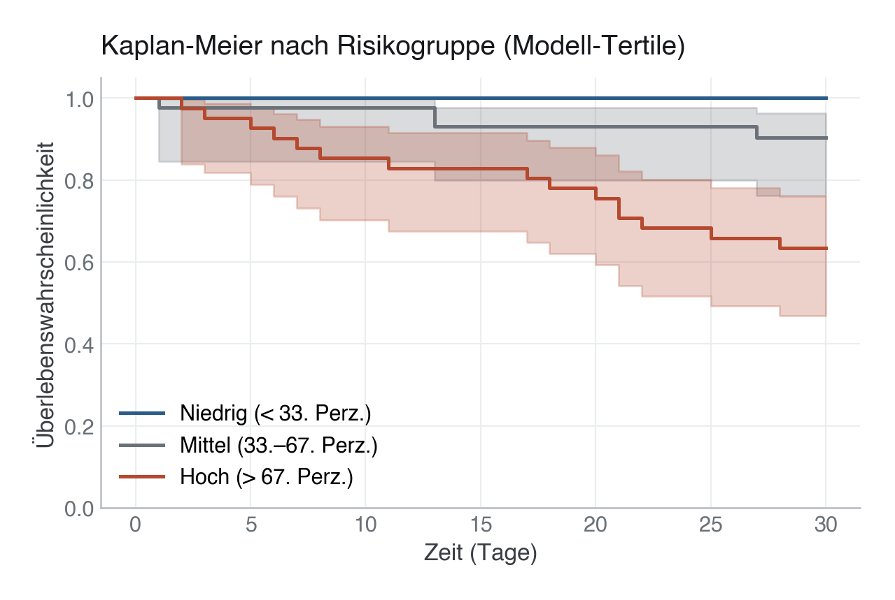

# 28 · Maschinelles Lernen für Überlebenszeiten

> **Teil 5 – Machine Learning und KI in der Medizin** · Dauer: ~75 min · Voraussetzung: Module 17 und 24 (klassisches Survival und Workflow)

## Lernziele
- Verstehen, warum klassische ML-Klassifikatoren Zensierung ignorieren und warum das zählt.
- **Random Survival Forests (RSF)** trainieren und interpretieren.
- Zeitabhängige AUC (`cumulative_dynamic_auc`) berechnen und gegen Cox-Baseline vergleichen.
- **Kaplan-Meier-Kurven** nach modellbasierter Risikogruppe darstellen.
- Die Konzepte **Zensierung**, **zeitvariantes Risiko** und **konkurrierende Risiken** einordnen.

## Klinischer Aufhänger
„Wie hoch ist das 7-Tage-Sterberisiko, und ändert sich diese Schätzung, wenn
der Patient noch 14 Tage überlebt?" Cox (Modul 12) nimmt proportionale Risiken an
und liefert eine einzelne Schätzung. Moderne Überlebens-ML lockert beide Annahmen:
Das Risiko kann sich über die Zeit verschieben, und ein Random Survival Forest
findet nichtlineare Interaktionen ohne manuelles Feature Engineering. Für
Intensivstationen mit stark variierender Verweildauer ist das klinisch relevant.

## 1 Warum nicht einfach einen Klassifikator nehmen?
Ein LogisticRegression oder RandomForest, der `verstorben_30d` als 0/1 lernt,
ignoriert, **wann** das Ereignis eintrat. Patient A, der am Tag 2 stirbt, und
Patient B, der am Tag 29 stirbt, bekommen dieselbe Label-1, obwohl ihr Risikoprofil
zu Tag 7 fundamental verschieden ist. Noch gravierender: Patient C, der am Tag 10
entlassen wird und dann noch lebt, ist **zensiert**, er hatte keine 30 Tage
Beobachtungszeit, und ein Klassifikator kodiert ihn falsch als Nicht-Ereignis.

<!-- excerpt-note -->
> **Hinweis — die Codeblöcke unten sind Auszüge.** Sie zeigen die entscheidenden Schritte, nicht jede Import-Zeile. Das vollständige, am Stück lauffähige Skript ist [`code/python.py`](code/python.py) (im Browser über den **Python**-Reiter oben). In Colab führst du das ganze Modul mit einer Zeile aus: `!python module/28-survival-ml/code/python.py` — siehe das [in Colab öffnen](https://colab.research.google.com/github/schradern/data-science-coach/blob/main/notebooks/start.ipynb).

```python
# Wrong: ignores censoring and event timing.
# clf.fit(X, df["verstorben_30d"]) <- this discards information

# Correct: use survival-aware models that use (time, event) pairs.
# survival_y = [(bool(event), float(time)) for event, time in zip(events, times)]
```

**Stolperstein:** Bei langen Follow-up-Fenstern unterschätzt ein Klassifikator
das Risiko für Frühverstorbene und überschätzt es für Spätüberlebende.
**Darüber hinaus:** Für sehr kurze, feste Horizonte (z. B. 24-h-ICU-Mortalität
ohne Zensierung) kann ein einfacher Klassifikator akzeptabel sein, aber nur wenn
wirklich alle Patient:innen vollständig beobachtet wurden.

## 2 Random Survival Forests
RSF baut Entscheidungsbäume, die statt des Gini-Index den **Log-Rank-Test** als
Splitkriterium nutzen, so werden Zensierung und Eventzeit korrekt
berücksichtigt. Jeder Baum gibt eine **kumulative Hazardfunktion** pro
Patient:in zurück; der Forest mittelt diese Schätzungen.

```python
# scikit-survival (sksurv) — preferred
try:
    from sksurv.ensemble import RandomSurvivalForest
    from sksurv.metrics import cumulative_dynamic_auc
    # survival_y is a structured array: (event: bool, time: float)
    rsf = RandomSurvivalForest(n_estimators=200, min_samples_leaf=10,
                               random_state=SEED, n_jobs=-1)
    rsf.fit(X_train, survival_y_train)
    SKSURV_AVAILABLE = True
except ImportError:
    # Fallback: Cox + HistGradientBoosting classifier at fixed horizon
    SKSURV_AVAILABLE = False
```

In R nutzt du `ranger` mit `importance="permutation"` und `type="survival"`,
oder das Paket `randomForestSRC` für vollständige RSF-Unterstützung.

**Stolperstein:** RSF mit vielen Bäumen und kleinen Blättern ist langsam.
`min_samples_leaf=10` ist ein guter Startpunkt für kleine Kohorten (< 1000).
**Darüber hinaus:** `predict_cumulative_hazard_function` liefert pro
Patient:in eine komplette Kurve über die Zeit, das erlaubt zeitabhängige
Entscheidungen statt nur einen festen 30-Tage-Score.

## 3 Zeitabhängige AUC
Eine einzige AUC misst die Diskriminierung an einem fixen Horizont. Die
**zeitabhängige AUC** (`cumulative_dynamic_auc`) berechnet die Fläche unter
der ROC-Kurve für jeden Zeitpunkt t, sie zeigt, ob das Modell auch an Tag 7,
14 oder 21 noch gut diskriminiert, nicht nur am Ende des Beobachtungsfensters.

```python
# With sksurv:
times = [7, 14, 21, 28]
auc_values, mean_auc = cumulative_dynamic_auc(survival_y_train,
                                              survival_y_test,
                                              risk_scores, times)
for t, a in zip(times, auc_values):
    print(f"  AUC @ t={t:2d}d: {a:.3f}")
print(f"  Mean AUC:      {mean_auc:.3f}")
# Punktschätzer ALLEIN genügen nicht: auf n=125 mit nur 19 Ereignissen
# (davon eine Handvoll bis Tag 7) sind sie extrem verrauscht. code/python.py
# bootstrappt den Testsatz und berichtet je Zeitpunkt ein 95%-KI sowie ein KI
# auf die Cox-minus-RSF-Differenz.
```

In R berechnet `timeROC` **denselben** Estimand (nicht nur Harrells C-Index) und
liefert das Konfidenzintervall gleich mit:
```r
library(timeROC)
td <- timeROC(T = test$fu_zeit_tage, delta = test$status,
              marker = cox_lp, cause = 1, times = c(7, 14, 21, 28), iid = TRUE)
ci <- confint(td)$CI_AUC / 100            # 95%-KI je Zeitpunkt (Prozent -> Anteil)
cbind(AUC = td$AUC, KI_unten = ci[, 1], KI_oben = ci[, 2])
```


Auf dieser Kohorte (500 Patient:innen, 78 Ereignisse, 75/25-Split, Testsatz
n = 125 mit 19 Ereignissen) ergibt der tatsächliche Lauf als **Punktschätzer**:
RSF-AUC ≈ 0,84 (Tag 7), 0,79 (Tag 14), 0,85 (Tag 21), 0,86 (Tag 28); Cox
≈ 0,92 (Tag 7), 0,83 (Tag 14), 0,88 (Tag 21), 0,88 (Tag 28). Auf den ersten
Blick liegt Cox überall etwas höher. Der Bootstrap zeigt aber: die 95%-KI der
**Differenz** (Cox − RSF) schließen bei Tag 14, 21 und 28 die Null ein
(z. B. Tag 28: +0,02 [−0,02, +0,06]) — dort ist der Unterschied von
Stichprobenrauschen **nicht zu unterscheiden**. Nur am frühesten, ereignisärmsten
Horizont (Tag 7: +0,09 [+0,02, +0,15]) liegt das Intervall knapp über null; und
gerade dieser Bootstrap hält die trainierten Modelle fest, misst also nur die
Test-Stichprobenstreuung und unterschätzt die Unsicherheit noch. Belastbar ist
darum nur: **kein Modell ist hier klar überlegen.** RSF ist
nicht automatisch überlegen — bei kleinen Kohorten und näherungsweise
proportionalen Hazards kann eine gut regularisierte Cox-Baseline mithalten —,
aber genauso wenig lässt sich hier ein Cox-Vorsprung nachweisen. RSFs
eigentlicher Vorteil liegt bei nichtlinearen Zusammenhängen, Interaktionen
und größeren Stichproben.

**Stolperstein:** `cumulative_dynamic_auc` aus sksurv erwartet strukturierte
NumPy-Arrays `(event: bool, time: float)`. Normale Python-Tuples werden nicht
akzeptiert, `np.dtype([("event","?"),("time","<f8")])` ist die korrekte Form.
**Stolperstein:** Übergib das **vollständige** Test-Array und den
**vollständigen** Score-Vektor an `cumulative_dynamic_auc` (zusammen mit der
Liste aller Zeitpunkte), die Funktion baut das Risk-Set pro Zeitpunkt intern
auf. Wer stattdessen vorab nach `zeit >= t` filtert und die gefilterten Arrays
einzeln pro Zeitpunkt übergibt, bekommt entweder einen `ValueError` ("times
must be within follow-up time of test data") oder, schlimmer, unbemerkt
verzerrte (zu hohe) AUC-Werte, weil das Risk-Set dann unvollständig ist.
**Darüber hinaus:** Der mittlere AUC fasst gut zusammen; für
klinische Entscheidungen an Tag 7 (z. B. ICU-Entlassung) zählt aber der
zeitpunktspezifische Wert.

## 4 Risikogruppen mit Kaplan-Meier
Modellvorhersagen werden in Tertile eingeteilt (niedrig / mittel / hoch) und
mit **Kaplan-Meier** visualisiert. Das erlaubt einen klinisch
intuitiven Vergleich: Trennen die Risikogruppen die Überlebenskurven klar?

```python
from lifelines import KaplanMeierFitter

for label, mask in [("Niedrig", risk_low), ("Mittel", risk_mid), ("Hoch", risk_high)]:
    kmf = KaplanMeierFitter()
    kmf.fit(durations=times_test[mask], event_observed=events_test[mask], label=label)
    kmf.plot_survival_function(ax=ax)
```



**Stolperstein:** Risikogruppen-Tertile nach dem Modell-Score einteilen, **nicht**
nach dem beobachteten Outcome, sonst optimierst du die Visualisierung auf dem
Testset und täuschst dich über die echte Trennschärfe.
**Darüber hinaus:** Log-Rank-Test zwischen den Gruppen quantifiziert, ob die
Trennung statistisch überzufällig ist; die Hazard Ratio zwischen dem oberen und
unteren Tertil ist ein gängiges Reportingmaß.
**Praxis:** Auf Station reicht selten „hohes Risiko" als Label, kommuniziere
mit, **wie** hoch (z. B. „30-Tage-Überlebenswahrscheinlichkeit ≈ 65 %, 95 %-KI
47–76 %") und für **welchen Zeitraum** die Kurve gilt, sonst wird die
Risikogruppe leicht mit einer festen Prognose verwechselt.

## 5 Zensierung, zeitvariantes Risiko, konkurrierende Risiken
**Zensierung** tritt auf, wenn das Beobachtungsfenster endet, bevor das Ereignis
eintritt (z. B. Entlassung ohne Tod). Das Modell muss wissen, dass diese Person
*zum Zeitpunkt der Entlassung noch lebte*, ohne anzunehmen, sie sterbe danach nie.

**Zeitvariantes Risiko**: Das Tagesrisiko kann sich verschieben, ein Patient kann
in der ersten Woche kritisch, danach stabil sein. Klassische Cox-Modelle
erlauben zeitvariante Kovariaten, RSF bildet zeitvariante Merkmale über
`tstart`/`tstop`-Formate ab.

**Konkurrierende Risiken**: Wenn ein Patient wegen einer anderen Ursache stirbt
(oder transplantiert wird), kann er nicht mehr am Ziel-Ereignis erkranken. Der
klassische KM überschätzt dann das Risiko; der **Aalen-Johansen-Schätzer** oder
das Fine-Gray-Modell sind korrekte Alternativen.

```r
# R concept: competing risks with cmprsk or tidycmprsk
# library(cmprsk)
# cuminc(ftime, fstatus, group) where fstatus = 1 (event), 2 (competing), 0 (censored)
```

**Stolperstein:** Einfaches KM bei konkurrierenden Risiken überschätzt das
kumulierte Risiko, oft erheblich bei älteren Kohorten mit Mehrfacherkrankungen.
**Darüber hinaus:** Das Fine-Gray-Modell gibt eine subdistribution hazard ratio,
die direkt für Risikoscores mit konkurrierenden Risiken genutzt werden kann.

> **Wann du Hilfe holst.** Bei wenigen Ereignissen, konkurrierenden Risiken oder wenn ein Random Survival Forest klinisch eingesetzt werden soll, reicht die zeitabhängige AUC allein nicht — Estimand, Zensierungsannahmen und externe Validierung gehören mit einer Biostatistikerin geklärt.

## Fallstricke und Merksätze
- **Klassifikator ≠ Überlebensanalyse.** Ohne Zensierungsinformation ist der
 Label-1-Trick systematisch falsch.

- **Zeitabhängige AUC** statt einmaliger AUC bei variierendem Beobachtungsfenster.
- **Risikogruppen-Tertile nach Score, nicht nach Outcome** einteilen, sonst
 garantierte Überanpassung.

- **Konkurrierende Risiken ignorieren** macht das kumulierte Risiko zu hoch.
- **RSF ist kein Black Box** gegenüber Cox, Permutation Importance und
 PDPs lassen sich auch für RSF berechnen; die Logik aus Modul 27 lässt sich übertragen.

> **Merksatz:** Ein flexibleres Modell (RSF) gewinnt nicht automatisch gegen
> eine einfache Baseline (Cox), immer beide gegeneinander evaluieren, statt
> die komplexere Methode blind zu bevorzugen, das gilt in der Überlebensanalyse
> genauso wie im Rest des maschinellen Lernens.

## Selbstcheck
1. **Warum ist ein einfacher Klassifikator für Überlebensdaten problematisch?**, Er ignoriert Zensierung (Patient wurde entlassen, nicht zensiert kodiert) und die Eventzeit, frühe vs. späte Todesfälle bekommen dasselbe Label.
2. **Was misst die zeitabhängige AUC, und warum ist sie informativer als eine feste AUC?**, Sie bewertet die Diskriminierung des Modells zu jedem Zeitpunkt t, nicht nur am Fenster-Ende; so sieht man, ob das Modell auch früh (Tag 7) noch gut trennt.
3. **Wann braucht man den Aalen-Johansen-Schätzer statt Kaplan-Meier?**, Bei konkurrierenden Risiken: Wenn Patient:innen aus anderen Gründen (andere Todesursache, Verlegung) das Ziel-Ereignis nicht mehr erreichen können. KM überschätzt dann das kumulierte Risiko.
