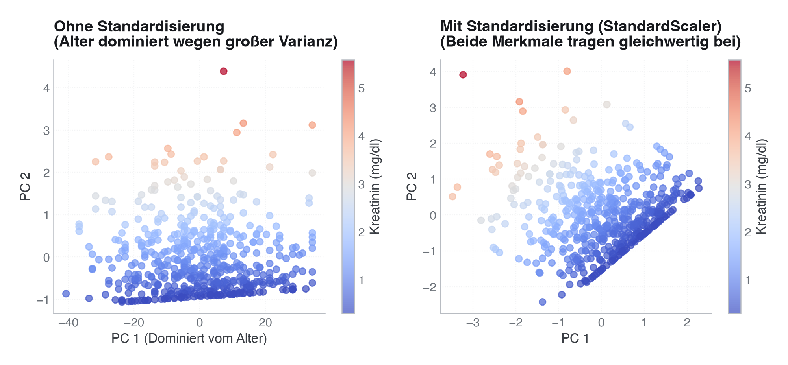

# 29 · Unüberwachtes Lernen und Phänotypisierung von Patient:innen

> **Teil 5 – Machine Learning und KI in der Medizin** · Dauer: ~80 min · Voraussetzung: Module 23–24 (ML-Grundlagen und Workflow)

## Lernziele
- Klinische Daten **ohne Labels** vorverarbeiten (Imputation, Standardisierung) und verstehen, warum Skalierung hier unverzichtbar ist.
- **k-Means** anwenden und k über Elbow-Kurve und Silhouettenkoeffizienten begründet wählen.
- **Hierarchisches Clustering** (Ward-Linkage) interpretieren und ein Dendrogramm lesen.
- **PCA** zur Dimensionsreduktion nutzen (erklärte Varianz, 2D-Projektion) und **UMAP** als nichtlineare Alternative einsetzen.
- Cluster zu klinischen **Phänotypen** profilieren und ehrlich kommunizieren, was sie nicht sind.

## Klinischer Aufhänger
Nicht jede Forschungsfrage hat ein vordefiniertes Label. Manchmal lautet sie: *Gibt es in unserer Kohorte distinkte Patientengruppen, die wir noch nicht kennen?* Phänotypisierung, das datengetriebene Erkennen von Subgruppen, ist in Intensivmedizin, Sepsis-Forschung und Onkologie ein aktives Feld. Das Versprechen: unbekannte klinische Profile sichtbar machen. Die Gefahr: Artefakte für Biologie zu halten.

## 1 Vorverarbeitung ohne Zielvariable
Ohne Outcome-Label entscheiden allein die **Merkmale** über die Cluster. Fehlende Werte und unterschiedliche Skalen verzerren jeden Distanzalgorithmus.

<!-- excerpt-note -->
> **Hinweis – die Codeblöcke unten sind Auszüge.** Sie zeigen die entscheidenden Schritte, nicht jede Import-Zeile. Das vollständige, am Stück lauffähige Skript ist [`code/python.py`](code/python.py) (im Browser über den **Python**-Reiter oben). In Colab führst du das ganze Modul mit einer Zeile aus: `!python module/29-unueberwacht-phenotyping/code/python.py` – siehe das [in Colab öffnen](https://colab.research.google.com/github/schradern/data-science-coach/blob/main/notebooks/start.ipynb).

```python
import pandas as pd
import numpy as np
from sklearn.impute import SimpleImputer
from sklearn.preprocessing import StandardScaler
from sklearn.pipeline import Pipeline

labs   = pd.read_csv("{{DATEN}}labor.csv")

NUMERIC = ["alter", "sofa_score", "crp_mg_l", "bmi",
           "leukozyten_g_l", "kreatinin_mg_dl", "laktat_mmol_l"]

df = pd.read_csv("{{DATEN}}kohorte.csv").merge(labs, on="patient_id", how="left")
X_raw = df[NUMERIC].values

prep = Pipeline([
    ("impute", SimpleImputer(strategy="median")),
    ("scale",  StandardScaler()),
])
X = prep.fit_transform(X_raw)
```

**Stolperstein:** Imputation und Skalierung erfolgen hier auf *allen* Daten, das ist korrekt, weil es keine Testmenge gibt, die wir schützen müssten. Trotzdem: Wer später einen neue:n Patient:in einem Cluster zuordnen will, muss denselben `prep`-Transformer wiederverwenden, nicht neu anpassen.  
**Darüber hinaus:** Bei kategorialen Merkmalen (z. B. `aufnahmegrund`) lieber **Gower-Distanz** (dann mit k-Medoids oder hierarchischem Clustering, denn k-Means braucht euklidische Distanzen) oder One-Hot-Encoding mit nachgelagerter PCA verwenden, euklidische Distanz auf Dummy-Variablen ist verzerrt.

> [!IMPORTANT]
> **Skalierungsabhängigkeit bei PCA und Clustering**  
> Wenn Merkmale unterschiedliche Einheiten und Skalen besitzen, dominiert die Variable mit der größten Varianz die Hauptkomponenten und das Clustering komplett.
> - **Ohne Standardisierung:** Das Alter streut (Standardabweichung ≈ 15 Jahre) viel stärker als Kreatinin (≈ 0,9 mg/dl). Die erste Hauptkomponente ist deshalb praktisch reines Alter und trägt über 99 % der Varianz; Kreatinin bleibt allein für PC 2 übrig (im linken Bild die senkrechte Farbabstufung). Wer nur die erste Komponente betrachtet oder euklidische Distanzen rechnet (k-Means), ignoriert das klinisch relevante Kreatinin damit praktisch.
> - **Mit Standardisierung (StandardScaler):** Beide Variablen gehen mit gleichem Gewicht in beide Hauptkomponenten ein.
>
> 

In R:

```r
library(tidyverse); library(recipes)

labs   <- read_csv("{{DATEN}}labor.csv", show_col_types = FALSE)
df <- read_csv("{{DATEN}}kohorte.csv", show_col_types = FALSE) |> left_join(labs, by = "patient_id")
numeric_cols <- c("alter","sofa_score","crp_mg_l","bmi",
                  "leukozyten_g_l","kreatinin_mg_dl","laktat_mmol_l")

rec <- recipe(~ ., data = df[numeric_cols]) |>
  step_impute_median(all_predictors()) |>
  step_normalize(all_predictors())
X_scaled <- rec |> prep() |> bake(new_data = NULL) |> as.matrix()
```

## 2 k-Means: k wählen mit Elbow und Silhouette

k-Means minimiert die Intra-Cluster-Varianz. Die Anzahl k lernt das Modell nicht, sie ist eine **Wahl des Analysten**.

```python
from sklearn.cluster import KMeans
from sklearn.metrics import silhouette_score

inertias, silhouettes = [], []
K_RANGE = range(2, 9)

for k in K_RANGE:
    km = KMeans(n_clusters=k, random_state=SEED, n_init=10)
    labels = km.fit_predict(X)
    inertias.append(km.inertia_)
    silhouettes.append(silhouette_score(X, labels))

# In this cohort the silhouette coefficient is highest at k=2 (0.130),
# just ahead of k=7 (0.123) and k=5 (0.122); k=3 is even lower at 0.115.
# All values lie between 0.10 and 0.13 -> weak, overlapping
# cluster structure; no k separates the cohort cleanly. Even so, the code below
# deliberately continues with k=3 (three severity levels), a clinically
# motivated rather than purely statistically optimal choice (see Stolperstein).
best_k = 3
km_final = KMeans(n_clusters=best_k, random_state=SEED, n_init=10).fit(X)
df["cluster"] = km_final.labels_
```


**Stolperstein:** Der Silhouettenkoeffizient bevorzugt kompakte, gut getrennte Cluster, er belohnt nicht notwendigerweise klinisch sinnvolle Gruppen. Hier ist er sogar bei k=2 am höchsten (0,130) und **nicht** bei k=3 (0,115), das statistisch „beste“ k muss trotzdem nicht das klinisch nützlichste sein: Zwei Cluster wären für eine differenzierte Risikostratifizierung oft zu grob. Wer k=3 wählt, muss das explizit klinisch begründen, nicht als „das Elbow/die Silhouette bestätigt 3“ ausgeben, das wäre hier schlicht falsch. Wie instabil dieses „beste“ k ist, zeigt der Vergleich der Sprachen: Das R-Skript findet mit seinem eigenen k-Means-Zufallsstart bei k=4 denselben Höchstwert (0,130) wie bei k=2 und meldet k=4 als bestes k. Bei so flachen Silhouettenkurven entscheidet der Zufallsstart, nicht die Datenstruktur.
**Darüber hinaus:** **k-Medoids** (PAM) ist robuster gegenüber Ausreißern als k-Means und liefert echte Patientenrepräsentanten als Clusterzentren, hilfreich für die klinische Kommunikation.

**Stolperstein:** k-Means setzt implizit voraus, dass Cluster im euklidischen Raum ungefähr **kugelförmig, varianzgleich und ähnlich groß** sind, es minimiert schließlich nur die Distanz zum jeweiligen Clusterzentrum. Längliche, unterschiedlich dichte oder stark unterschiedlich große Gruppen kann k-Means daher nicht sauber trennen, selbst nach Standardisierung. Passt die klinische Struktur nicht zu dieser Annahme, sind **Gaussian Mixture Models** (für elliptische, unterschiedlich orientierte Cluster), **DBSCAN/HDBSCAN** (für dichtebasierte Cluster beliebiger Form) oder **hierarchisches Clustering mit Ward-Linkage** (wenn die Verschmelzungsstruktur selbst interessiert) die geeigneteren Werkzeuge.

In R:

```r
library(factoextra)
fviz_nbclust(X_scaled, kmeans, method = "silhouette")
km <- kmeans(X_scaled, centers = 3, nstart = 10, iter.max = 100)
df$cluster <- km$cluster
```

## 3 Hierarchisches Clustering und Dendrogramm

Hierarchisches Clustering baut einen Baum aller Verschmelzungen. Du schneidest dort, wo ein großer Sprung im Abstand erscheint.

```python
from scipy.cluster.hierarchy import linkage, dendrogram, fcluster
import matplotlib.pyplot as plt

Z = linkage(X, method="ward")
# Cut at k=3 to match k-means
labels_hier = fcluster(Z, t=3, criterion="maxclust")
```

**Stolperstein:** Ward-Linkage minimiert die Varianz innerhalb von Clustern und setzt euklidische Distanz voraus, nach Standardisierung korrekt. **Average**- oder **complete**-Linkage reagieren anders auf Ausreißer und können sinnvoller sein, wenn die Daten nicht-sphärisch verteilt sind. 
**Darüber hinaus:** Ab einigen tausend Datenpunkten wird vollständiges hierarchisches Clustering speicher- und rechenintensiv, weil die Distanzmatrix quadratisch mit der Fallzahl wächst. **BIRCH** oder ein zweistufiger Ansatz (zuerst Mini-Batch-k-Means, dann Hierarchie auf Clusterzentren) skaliert besser.

In R:

```r
dist_mat <- dist(X_scaled, method = "euclidean")
hc <- hclust(dist_mat, method = "ward.D2")
plot(hc, labels = FALSE, main = "Dendrogramm (Ward)")
rect.hclust(hc, k = 3, border = "red")   # marks the cut height for k=3
df$cluster_hier <- cutree(hc, k = 3)
```

## 4 Dimensionsreduktion: PCA und UMAP

Hochdimensionale Daten lassen sich nicht direkt visualisieren. PCA und UMAP projizieren auf zwei Dimensionen, aber grundverschieden.

```python
from sklearn.decomposition import PCA

# PCA: linear, preserves global variance
pca = PCA(n_components=2, random_state=SEED)
X_pca = pca.fit_transform(X)
explained = pca.explained_variance_ratio_
print(f"PC1+PC2 explain {explained.sum():.1%} of variance")

# UMAP: non-linear, preserves local structure
try:
    import umap
    reducer = umap.UMAP(n_components=2, random_state=SEED)
    X_2d = reducer.fit_transform(X)
    method_label = "UMAP"
except (ImportError, TypeError) as exc:
    # ImportError: umap-learn not installed. TypeError: an installed
    # umap-learn can be incompatible with the installed scikit-learn version
    # (a real version-skew failure, not just a missing package).
    from sklearn.manifold import TSNE
    X_2d = TSNE(n_components=2, random_state=SEED, perplexity=30).fit_transform(X)
    method_label = "t-SNE (UMAP nicht verfügbar/inkompatibel)"
    print(f"Note: UMAP failed ({exc}), using {method_label}")
```


**Stolperstein:** UMAP-Ergebnisse hängen von `n_neighbors` und `min_dist` ab. Zwei Läufe mit verschiedenen Seeds können verschiedene Layouts erzeugen, nie ohne festen Seed veröffentlichen und Hyperparameter immer berichten.
**Stolperstein:** In UMAP ist nur die **lokale** Nachbarschaftsstruktur verlässlich. Der Abstand zwischen weit auseinanderliegenden Clustern, ihre relative Größe im Bild und ihre visuelle Dichte sind **keine** verlässlichen Maße für tatsächliche Ähnlichkeit, Gruppengröße oder Gruppendichte, UMAP verzerrt diese Größen algorithmisch beim Projizieren. Interpretiere nur, welche Punkte einander nahe liegen, nie wie weit Cluster auseinanderliegen oder wie groß/dicht sie erscheinen.
**Darüber hinaus:** PCA erklärt, *wie viel* Varianz jede Komponente trägt (erklärte Varianz); UMAP erklärt das nicht. Für explorative Kommunikation ist UMAP visuell eindrücklicher, für reproduzierbare Erklärbarkeit ist PCA transparenter.

In R:

```r
library(umap)  # install.packages("umap") if not installed
pca_res  <- prcomp(X_scaled, scale. = FALSE)
X_pca_r  <- pca_res$x[, 1:2]
# UMAP (fallback: use PCA if the package is missing)
tryCatch({
  umap_res <- umap(X_scaled)
  X_umap   <- umap_res$layout
}, error = function(e) {
  message("umap nicht verfügbar, nutze PCA-2D als Fallback")
  X_umap <<- X_pca_r
})
```

## 5 Cluster als klinische Phänotypen profilieren

Cluster erhalten Bedeutung erst durch die **Inhalte** ihrer Mitglieder, nicht durch ihre Nummer.

```python
import pandas as pd

profile = df.groupby("cluster")[NUMERIC + ["verweildauer_tage", "verstorben_30d"]].mean().round(2)
print(profile.T)

# Qualitative labels – assigned AFTER reading the profile, by ranking
# clusters on mean SOFA (illness severity). k-Means cluster IDs (0, 1, 2, …)
# are arbitrary and NOT guaranteed to come out in severity order (they don't,
# for this cohort/seed: the highest-SOFA cluster is ID 1, not ID 2), so a
# fixed {1: "mild", 2: "moderate", 3: "severe"}-style mapping keyed on raw
# IDs would silently mislabel the phenotypes.
severity_order = profile["sofa_score"].sort_values().index.tolist()
phenotype_names = dict(zip(severity_order, ["Leichter Verlauf", "Mittelschwer", "Hochrisiko"]))
df["phenotype"] = df["cluster"].map(phenotype_names)
```

**Stolperstein:** Die Etikettierung ist **interpretativ**, nicht algorithmisch. Zwei Analysten können dieselben Cluster unterschiedlich benennen. Jede Benennung muss durch die Merkmalsmittelwerte belegt und im Paper explizit gerechtfertigt sein. Zusätzlich: Cluster-**IDs** sind arbiträr, sie nach fester Nummer statt nach den tatsächlichen Profilwerten zu benennen, ist ein leicht zu übersehener Fehler. Auch die Rangfolge nach SOFA ist schon eine Deutung: In dieser Kohorte unterscheidet sich das „mittelschwere“ Cluster vom leichten vor allem im Alter (im Mittel 74 gegenüber 53 Jahren), kaum im SOFA-Score (3,3 gegenüber 2,4). Ein ehrlicheres Etikett wäre dort „älter, sonst ähnlich“.
**Darüber hinaus:** Validiere Phänotypen **extern**, etwa ob Cluster-Unterschiede in Verweildauer (`verweildauer_tage`) oder Mortalität mit unabhängigen klinischen Daten übereinstimmen. Interne Cluster-Güte (Silhouette) ist nicht dasselbe wie externe klinische Validität.

In R:

```r
profile <- df |>
  group_by(cluster) |>
  summarise(across(c(alter, sofa_score, crp_mg_l, laktat_mmol_l, verweildauer_tage,
                     verstorben_30d), mean, na.rm = TRUE))
print(profile)
```

> **Wann du Hilfe holst.** Bevor du gefundene Cluster als reale klinische Phänotypen kommunizierst, brauchst du Stabilitäts- und Reproduzierbarkeitsprüfungen und idealerweise eine externe Kohorte – ob eine Subgruppe Biologie oder Artefakt ist, entscheidet nicht der Silhouettenkoeffizient allein, und diese Einordnung trifft man mit Methodik und Fachdisziplin gemeinsam.

## Fallstricke und Merksätze
- **Cluster sind keine Diagnosen.** Sie sind datengetriebene Ähnlichkeitsgruppen, klinisch validieren, bevor du sie publizierst oder danach handelst.
- **Skalierung ist Pflicht.** k-Means auf rohen Werten wird von Merkmalen mit großer Varianz (z. B. CRP in mg/l) dominiert.
- **k ist eine Wahl, kein Faktum.** Elbow und Silhouette helfen, aber die finale Entscheidung ist klinisch zu begründen.
- **UMAP-Layouts sind nicht reproduzierbar ohne festen Seed.** Immer `random_state` setzen und Hyperparameter berichten.
- **Hierarchisches Clustering skaliert schlecht.** Bei großen Kohorten (>5 000) besser Mini-Batch-k-Means oder BIRCH.

## Selbstcheck
1. **Warum muss man vor k-Means standardisieren?** – k-Means nutzt euklidische Distanz; sonst dominieren Merkmale mit großer Streuung (z. B. CRP in mg/l) den Abstand, unabhängig von ihrer klinischen Relevanz.
2. **Was zeigt der Silhouettenkoeffizient, und was zeigt er nicht?** – Er misst, wie gut ein Punkt in sein Cluster passt im Vergleich zum nächsten Cluster. Über die klinische Bedeutung der Gruppen sagt er nichts.
3. **Wann ist UMAP besser als PCA für die Visualisierung?** – UMAP bewahrt lokale Nachbarschaftsstrukturen und zeigt oft klarere Gruppentrennungen (die aber auch Artefakte der Projektion sein können); PCA ist linear, hat interpretierbare Achsen (Ladungen) und ist reproduzierbarer.

