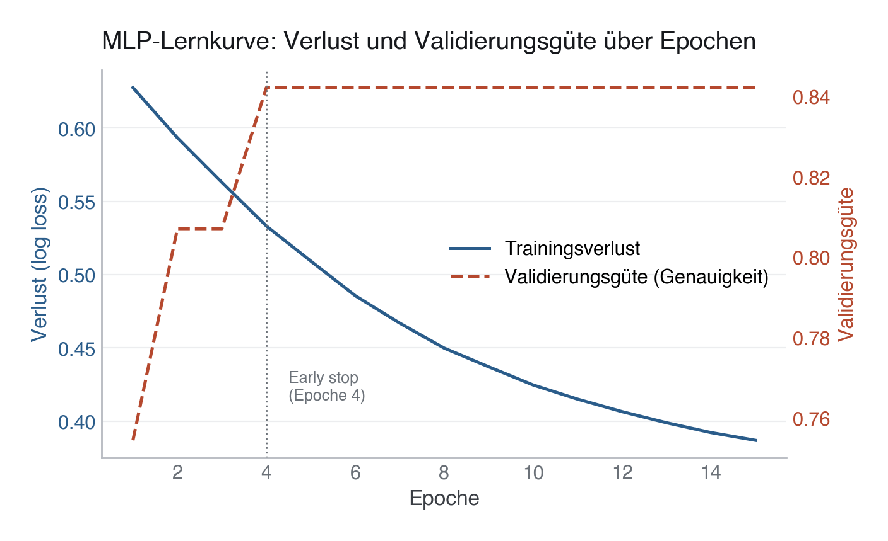

# 30 · Neuronale Netze und Deep Learning

> **Teil 5 – Machine Learning und KI in der Medizin** · Dauer: ~75 min · Voraussetzung: Module 24 und 26 (Workflow und Ensembles)

## Lernziele
- Ein **neuronales Netz** mit `MLPClassifier` in einer sklearn-Pipeline trainieren und dabei verstehen, warum Skalierung unverzichtbar ist.
- Die **Lernkurve** (Loss über Epochen) lesen und Überanpassung erkennen.
- **AUC** von MLP, logistischer Regression und Gradient Boosting auf denselben Daten vergleichen und das Ergebnis ehrlich einordnen.
- **Regularisierung** (`alpha`) und `early_stopping` als Gegenmaßnahmen zu Overfitting anwenden.
- Das Konzept von **CNNs für medizinische Bildgebung** in Prosa verstehen (ohne lauffähigen Torch-Code).

## Klinischer Aufhänger
„Deep Learning revolutioniert die Medizin", so die Schlagzeile. Auf klinischen Tabellendaten mit einigen hundert bis wenigen tausend Fällen ist die Realität nüchterner: einfachere Modelle wie logistische Regression und Gradient Boosting sind neuronalen Netzen auf solchen Tabellendaten oft mindestens ebenbürtig, teils sogar überlegen. Dieses Modul zeigt, *wann* und *warum*, und wann Deep Learning tatsächlich seinen Platz hat (Bildgebung, Sequenzen, Freitext).

## 1 MLPClassifier in einer Pipeline

Das Multilayer Perceptron ist die sklearn-Implementierung eines vollverbundenen neuronalen Netzes. Es erwartet skalierte Eingaben, rohe klinische Werte mit unterschiedlichen Einheiten lassen das Training scheitern.

```python
SEED = 42
import pandas as pd
from sklearn.pipeline import Pipeline
from sklearn.compose import ColumnTransformer
from sklearn.impute import SimpleImputer
from sklearn.preprocessing import StandardScaler, OneHotEncoder
from sklearn.neural_network import MLPClassifier

labs   = pd.read_csv("{{DATEN}}labor.csv")

NUMERIC = ["alter", "sofa_score", "crp_mg_l", "bmi",
           "leukozyten_g_l", "kreatinin_mg_dl", "laktat_mmol_l"]
CATEGORICAL = ["aufnahmegrund", "raucherstatus"]
BINARY = ["diabetes", "hypertonie"]
TARGET = "verstorben_30d"

df = pd.read_csv("{{DATEN}}kohorte.csv").merge(labs, on="patient_id", how="left")
X = df[NUMERIC + CATEGORICAL + BINARY]
y = df[TARGET]

pre = ColumnTransformer([
    ("num", Pipeline([("imp", SimpleImputer(strategy="median")),
                      ("scl", StandardScaler())]), NUMERIC),
    ("cat", OneHotEncoder(handle_unknown="ignore"), CATEGORICAL),
    ("bin", "passthrough", BINARY),
])

mlp_pipe = Pipeline([
    ("pre", pre),
    ("mlp", MLPClassifier(
        hidden_layer_sizes=(64, 32),
        activation="relu",
        alpha=0.01,
        early_stopping=True,
        validation_fraction=0.15,
        max_iter=300,
        random_state=SEED,
    )),
])
```

**Stolperstein:** Ohne `StandardScaler` konvergiert der Gradient-Descent-Optimierer nur langsam oder gar nicht. Bei klinischen Daten, CRP in mg/l (0–300), BMI (15–45), ist der Unterschied drastisch und macht die Pipeline-Pflicht anschaulich. 
**Darüber hinaus:** `MLPClassifier` eignet sich für Einstieg und Vergleiche, ist aber begrenzt erweiterbar. Eigene Architekturen (Dropout, Batch-Normalisierung, Residual-Verbindungen) erfordern PyTorch oder Keras, beide sind auf klinischen Tabellendaten selten besser als Gradient Boosting.

In R:

```r
library(tidyverse); library(tidymodels)
suppressPackageStartupMessages(library(nnet))

labs   <- read_csv("{{DATEN}}labor.csv", show_col_types = FALSE)
df <- read_csv("{{DATEN}}kohorte.csv", show_col_types = FALSE) |> left_join(labs, by = "patient_id") |>
  mutate(verstorben_30d = factor(verstorben_30d, levels = c(1, 0)))

split <- initial_split(df, prop = 0.75, strata = verstorben_30d)
train <- training(split)

rec <- recipe(verstorben_30d ~ alter + sofa_score + crp_mg_l + bmi +
                leukozyten_g_l + kreatinin_mg_dl + laktat_mmol_l +
                aufnahmegrund + raucherstatus + diabetes + hypertonie,
              data = train) |>
  step_impute_median(all_numeric_predictors()) |>
  step_dummy(all_nominal_predictors()) |>
  step_normalize(all_numeric_predictors())

spec_nnet <- mlp(hidden_units = 64, penalty = 0.01, epochs = 200) |>
  set_engine("nnet") |> set_mode("classification")

wf <- workflow() |> add_recipe(rec) |> add_model(spec_nnet)
fit <- fit(wf, data = train)
```

**Darüber hinaus:** Das R-Beispiel nutzt `nnet::nnet()` (über `parsnip::mlp()` mit `set_engine("nnet")`) und baut damit ein neuronales Netz mit genau **einer** versteckten Schicht (`hidden_units = 64`), während die Python-Pipeline oben ein `MLPClassifier` mit **zwei** Schichten (`hidden_layer_sizes=(64, 32)`) verwendet. Das ist kein Versehen: `nnet` ist über 25 Jahre alt und unterstützt architektonisch keine mehrschichtigen Netze; ergonomische Mehrschicht-MLPs sind in R selten (am ehesten über `brulee`, ein torch-Backend). Die AUC-Zahlen aus Python und R sind wegen dieses Architekturunterschieds nicht 1:1 vergleichbar.

## 2 Lernkurve lesen

Der MLP protokolliert seinen Trainingsverlust Epoche für Epoche. Eine flach werdende oder divergierende Kurve verrät Probleme frühzeitig.

```python
from sklearn.model_selection import train_test_split

X_train, X_test, y_train, y_test = train_test_split(
    X, y, test_size=0.25, stratify=y, random_state=SEED)

mlp_pipe.fit(X_train, y_train)
mlp = mlp_pipe.named_steps["mlp"]

print(f"Best validation score (accuracy): {mlp.best_validation_score_:.3f} "
      f"after {mlp.n_iter_} epochs")
loss_curve = mlp.loss_curve_
val_curve   = mlp.validation_scores_
```



**Stolperstein:** `mlp.best_validation_score_` ist bei `early_stopping=True` die **Genauigkeit (Accuracy)** auf dem internen Validierungssplit, keine AUC. Bei einem seltenen Zielereignis (hier ~16 % 30-Tage-Mortalität) ist Genauigkeit ein irreführendes Maß: Ein Modell, das stur „überlebt" vorhersagt, erreicht bereits ~84 % Genauigkeit, ohne einen einzigen Todesfall zu erkennen. Verlass dich für den Modellvergleich in diesem Modul auf die **AUC** (Abschnitt 3), nicht auf `best_validation_score_`. 
**Stolperstein:** Der Validierungssplit für `early_stopping` wird **intern** aus den Trainingsdaten entnommen und reduziert so die effektive Trainingsmenge. Bei wenig Daten solltest du abwägen, ob Early Stopping lohnt oder ein festes `max_iter` besser ist. 
**Darüber hinaus:** Bei `solver="adam"` (Standard) reagiert die Lernrate auf den Gradientenverlauf. `learning_rate_init` ist ein wichtiger Hyperparameter, zu groß führt zu Oszillation, zu klein zu sehr langsamer Konvergenz.

In R:

```r
# nnet gibt keine Epochenhistorie; brulee (torch-Backend) würde:
# history <- fit$fit$fit$training_history
```

## 3 AUC-Vergleich: MLP vs. Logistische Regression vs. Gradient Boosting

Das zentrale Experiment: Schlagen neuronale Netze die Klassiker auf kleinen klinischen Tabellendaten? Eine einzelne AUC-Zahl pro Modell verschweigt aber die Streuung zwischen den Folds, bei nur 5 Folds auf ~500 Patient:innen kann diese Streuung genauso groß sein wie der Abstand zwischen den Modellen. Deshalb: pro Modell alle Fold-AUCs, Mittelwert, Standardabweichung und ein 95-%-Konfidenzintervall (t-Verteilung, k = 5 Folds) ausgeben, und zusätzlich den **gepaarten** Unterschied pro Fold, weil jedes Modell auf denselben 5 Folds ausgewertet wird.

```python
from sklearn.linear_model import LogisticRegression
from sklearn.ensemble import GradientBoostingClassifier
from sklearn.model_selection import StratifiedKFold, cross_val_score
from scipy import stats
import numpy as np

cv = StratifiedKFold(n_splits=5, shuffle=True, random_state=SEED)

def make_lr():
    return Pipeline([("pre", pre),
                     ("clf", LogisticRegression(max_iter=1000,
                                                class_weight="balanced",
                                                random_state=SEED))])

def make_gb():
    return Pipeline([("pre", pre),
                     ("clf", GradientBoostingClassifier(n_estimators=200,
                                                        max_depth=3,
                                                        random_state=SEED))])

def summarise_folds(scores):
    k, mean, sd = len(scores), scores.mean(), scores.std(ddof=1)
    half_width = stats.t.ppf(0.975, df=k - 1) * sd / np.sqrt(k)
    return mean, sd, mean - half_width, mean + half_width

fold_scores = {
    "Logistische Regression": cross_val_score(make_lr(), X, y, cv=cv, scoring="roc_auc"),
    "Gradient Boosting":      cross_val_score(make_gb(), X, y, cv=cv, scoring="roc_auc"),
    "MLP":                    cross_val_score(mlp_pipe,  X, y, cv=cv, scoring="roc_auc"),
}
for name, scores in fold_scores.items():
    mean, sd, lo, hi = summarise_folds(scores)
    print(f"  {name:<28} Mean={mean:.3f} SD={sd:.3f} 95%-CI=[{lo:.3f}, {hi:.3f}]")

# Paired per-fold difference — the right comparison, since every model was
# evaluated on the exact same 5 folds.
diff_lr_gb = fold_scores["Logistische Regression"] - fold_scores["Gradient Boosting"]
mean, sd, lo, hi = summarise_folds(diff_lr_gb)
print(f"  LR - GB  Mean diff={mean:+.3f}  95%-CI=[{lo:+.3f}, {hi:+.3f}]")
```


Ausgeführt auf diesem Datensatz (n=500, 78 Ereignisse, k=5 Folds) liefert das:

| Modell | Mean | SD | 95-%-CI |
|---|---|---|---|
| Logistische Regression | 0,775 | 0,037 | [0,729; 0,821] |
| Gradient Boosting | 0,735 | 0,036 | [0,690; 0,780] |
| MLP | 0,656 | 0,047 | [0,598; 0,714] |

Und die gepaarten Differenzen pro Fold (Logistische Regression minus jeweils anderes Modell):

| Vergleich | Mean-Diff | 95-%-CI | Befund |
|---|---|---|---|
| LR − Gradient Boosting | +0,040 | [+0,010; +0,069] | CI schließt 0 knapp aus — bei k=5 Folds ein fragiles, kein robustes Ergebnis |
| LR − MLP | +0,119 | [+0,072; +0,166] | CI schließt 0 deutlich aus — vergleichsweise klarer Unterschied |

**Stolperstein:** Eine bloße Rangfolge der Mittelwerte (0,775 > 0,735 > 0,656) suggeriert einen klaren Sieger, verschweigt aber, dass bei nur k=5 Folds die Fold-zu-Fold-Streuung (SD ≈ 0,03–0,05) in der Größenordnung des LR-GB-Abstands (0,040) liegt. Erst die **gepaarte** Betrachtung pro Fold zeigt, wie belastbar ein Unterschied wirklich ist: Der LR-GB-Vorsprung ist zwar statistisch von 0 verschieden, aber nur knapp (CI-Untergrenze 0,010) und beruht auf gerade einmal 5 Wertepaaren, kein robuster Beleg. Der Abstand MLP zu den beiden Klassikern (≈ 0,12 AUC-Punkte, CI-Untergrenze 0,072) ist dagegen klar und deutet auf einen echten Unterschied hin. Die ehrliche Aussage lautet daher: **Das MLP ist auf diesem Datensatz eindeutig schwächer; ob logistische Regression oder Gradient Boosting das bessere der beiden Klassiker-Modelle ist, lässt sich bei dieser Stichprobengröße nicht zuverlässig entscheiden.** Das stützt weiterhin die Kernaussage des Moduls, mehr Modellkomplexität bringt auf kleinen klinischen Tabellendaten keinen verlässlichen Vorteil, nur eben mit der tatsächlich belegten Unsicherheit statt einer scheinbar sauberen Rangfolge.
**Darüber hinaus:** Auf sehr großen Registerdaten (>100 000 Zeilen) mit vielen Interaktionen können spezialisierte Architekturen wie **TabNet** oder **FT-Transformer** Gradient Boosting übertreffen. Bis dahin lohnt es sich, mit dem einfacheren Modell zu starten.

In R:

```r
library(yardstick)
folds <- vfold_cv(df, v = 5, strata = verstorben_30d)

spec_lr <- logistic_reg(penalty = 0.01, mixture = 0) |>
  set_engine("glmnet") |> set_mode("classification")
auc_lr <- workflow() |> add_recipe(rec) |> add_model(spec_lr) |>
  fit_resamples(folds, metrics = metric_set(roc_auc)) |>
  collect_metrics() |> filter(.metric == "roc_auc") |> pull(mean)
cat("Logistische Regression AUC:", round(auc_lr, 3), "\n")
```

## 4 Regularisierung und Early Stopping

Neuronale Netze mit vielen Parametern neigen zur Überanpassung. Zwei Gegenmaßnahmen dagegen:

```python
for alpha in [0.0001, 0.001, 0.01, 0.1, 1.0]:
    pipe = Pipeline([("pre", pre),
                     ("mlp", MLPClassifier(hidden_layer_sizes=(64, 32),
                                           alpha=alpha,
                                           max_iter=300,
                                           random_state=SEED))])
    auc = cross_val_score(pipe, X, y, cv=cv, scoring="roc_auc").mean()
    print(f"  alpha={alpha:.4f}  AUC={auc:.3f}")
```

**Stolperstein:** `early_stopping=True` hält einen internen Validierungssplit zurück, bei 500 Patient:innen kostet das ~75 Trainingsbeispiele. Bei kleinen Kohorten wählst du besser ein stabiles `max_iter` und regularisierst über `alpha`. 
**Darüber hinaus:** **Dropout** (zufälliges Abschalten von Neuronen während des Trainings) ist die wirksamste Regularisierungstechnik für tiefe Netze, in sklearn nicht verfügbar, aber in PyTorch/Keras trivial zu ergänzen.

## 5 CNNs für medizinische Bildgebung (Konzept)

Bei Bildgebungsdaten (Röntgen, CT, Histologie) verschiebt Deep Learning tatsächlich den Stand der Technik, weil **Faltungsschichten** translationsinvariante Muster (Kanten, Texturen, Formen) automatisch lernen.

```python
# ILLUSTRATIV — NICHT AUSFÜHREN (torch ist auf diesem System nicht installiert)

# import torch
# import torch.nn as nn
#
# class SimpleCNN(nn.Module):
#     def __init__(self):
#         super().__init__()
#         self.conv1 = nn.Conv2d(1, 32, kernel_size=3, padding=1)
#         self.pool = nn.MaxPool2d(2, 2)
#         self.conv2 = nn.Conv2d(32, 64, kernel_size=3, padding=1)
#         self.fc = nn.Linear(64 * 56 * 56, 2)  # 224x224 input image
#
#     def forward(self, x):
#         x = self.pool(torch.relu(self.conv1(x)))
#         x = self.pool(torch.relu(self.conv2(x)))
#         x = x.flatten(1)
#         return self.fc(x)
#
# # Transfer Learning: fine-tune pretrained weights on medical images
# # torchvision.models.resnet50(weights="IMAGENET1K_V1")
```

In der Praxis nutzt du für die Röntgenklassifikation **vortrainierte Modelle** (ResNet, EfficientNet) und passt nur die letzte Schicht an, dieses Transfer Learning benötigt deutlich weniger Daten als ein Training von Null.

**Stolperstein:** Vortrainierte Gewichte stammen aus ImageNet (Naturfotos), medizinische Bilder unterscheiden sich davon fundamental (Graustufen, spezifische Texturen). Die Übertragbarkeit muss validiert werden, nicht einfach „nimm ResNet" und fertig. 
**Darüber hinaus:** Für klinisch einsetzbare Bildmodelle zählen **Erklärbarkeit** (Grad-CAM, Saliency Maps) und **Kalibrierung** ebenso wie die AUC. Ein Modell, das den Scanner-Typ statt den Befund lernt, ist am Bett wertlos.

> **Wann du Hilfe holst.** Für Bildgebung, Sequenzen oder Freitext, wo Deep Learning tatsächlich seinen Platz hat, und erst recht vor jedem klinischen Einsatz brauchst du spezialisierte ML-Expertise, ausreichend große Datensätze und externe Validierung — auf kleinen Tabellendaten ist die ehrlichere Beratung oft, gar kein neuronales Netz zu nehmen.

## Fallstricke und Merksätze
- **Skalierung ist bei MLP zwingend**, nicht optional. Ohne StandardScaler konvergiert das Netz kaum.
- **Eine CV-AUC-Rangfolge ohne Streuungsmaß ist Kaffeesatzleserei.** Bei k=5 Folds vergleiche immer die (gepaarten) 95-%-Konfidenzintervalle, nicht nur die Mittelwerte, ein optisch klarer Abstand kann innerhalb der Fold-zu-Fold-Streuung liegen.
- **Mehr Parameter != besseres Modell** auf kleinen klinischen Datensätzen. Auf diesem Datensatz ist das MLP klar schwächer als die beiden Klassiker (CI schließt 0 deutlich aus); ob Gradient Boosting oder logistische Regression die Nase vorn hat, ist bei dieser Stichprobengröße dagegen nicht robust entscheidbar.
- **Early Stopping kostet Trainingsdaten**, bei kleinen Kohorten abwägen.
- **torch ist auf diesem System nicht installiert**, CNN-Code ist nur illustrativ, nicht ausführbar.
- **Transfer Learning > Training von Null** für medizinische Bildgebung, die Validierung der Übertragbarkeit bleibt Pflicht.

## Selbstcheck
1. **Warum sind einfachere Modelle wie Gradient Boosting und logistische Regression dem MLP auf kleinen Tabellendaten oft ebenbürtig oder überlegen?**, Sie sind dateneffizient (Gradient Boosting kommt ohne Skalierung aus und nutzt Nichtlinearitäten implizit über Splits; logistische Regression hat wenige Parameter und überpasst kaum) und haben weniger Parameter zu schätzen. MLPs brauchen große Datenmengen, um ihre Parameterzahl sinnvoll zu nutzen, das ist bei einigen hundert klinischen Fällen selten gegeben. Wichtig ist dabei die gepaarte CI-Betrachtung: Auf unserem Datensatz ist der Abstand des MLP zu beiden Klassikern robust belegt (CI schließt 0 klar aus), während der Abstand zwischen Gradient Boosting und logistischer Regression selbst nur knapp signifikant und bei k=5 Folds nicht als verlässliche Rangfolge zu werten ist.
2. **Was regelt `alpha` im MLPClassifier?**, L2-Regularisierung (Weight Decay): größeres alpha dämpft die Gewichte stärker und reduziert Überanpassung, kann aber zu Unteranpassung führen.
3. **Warum ist Transfer Learning für medizinische Bildgebung oft besser als Training von Grund auf?**, Vortrainierte Modelle haben bereits generische Bild-Merkmale gelernt; nur die aufgabenspezifische letzte Schicht muss auf wenigen medizinischen Bildern angepasst werden.

