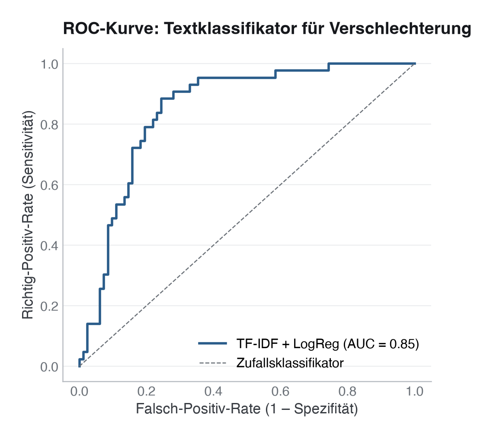

# 31 · Verarbeitung klinischer Freitexte mit LLMs

> **Teil 5 – Machine Learning und KI in der Medizin** · Dauer: ~70 min · Voraussetzung: Module 24 und 30 (Workflow und Deep Learning)

## Lernziele
- Klinische Freitexte mit **TF-IDF + Bag-of-Words** in Merkmale umwandeln und verstehen, was dabei verloren geht.
- Eine vollständige Textklassifikations-**Pipeline** (TfidfVectorizer + LogisticRegression) trainieren und mit AUC bewerten.
- Die **prädiktivsten Tokens** aus dem Modell auslesen und klinisch interpretieren.
- Das Konzept von **Embeddings** (Wörter als Vektoren mit semantischer Ähnlichkeit) von Bag-of-Words abgrenzen und `sentence-transformers` als kontextsensitiven nächsten Schritt einordnen.
- **Verantwortungsvoller LLM-Einsatz** in der Medizin: Halluzination, Schutz von Patientendaten (PHI, *protected health information*), Prompt-Design, Validierung, Human-in-the-Loop und regulatorische Vorsicht.

## Klinischer Aufhänger
Deine Notaufnahme dokumentiert Aufnahme-Anamnesen auf Deutsch. Du willst automatisch erkennen, ob eine Notiz auf eine **klinische Verschlechterung** hindeutet, noch bevor der SOFA-Score laborchemisch bestätigt ist. Oft steckt das erste Signal im Text: „zunehmende Dyspnoe“, „Laktat steigend“, „Patient agitiert“. Hier siehst du, wie weit klassische NLP trägt, und wo ihre Grenzen liegen.

## 1 Tokenisierung, Stoppwörter und N-Gramme
Jede Textverarbeitung beginnt damit, den Rohstring in **Tokens** zu zerlegen. Ein Token ist hier ein Wort, das nach Kleinschreibung, Entfernung der Interpunktion und Stoppwort-Filterung übrig bleibt.

**Stoppwörter** (der, die, das, und, in, …) sind semantisch leer und erhöhen nur die Dimensionalität. `TfidfVectorizer(stop_words=None)` überlässt dir die Wahl. scikit-learn bringt nur eine englische Liste mit; für deutsche Texte übergibst du eine eigene Liste (`stop_words=["der", "die", "und", …]`), denn `stop_words="english"` entfernt bei deutschen Notizen kaum etwas Sinnvolles.

**N-Gramme** fangen Mehrwort-Muster auf: `ngram_range=(1, 2)` erzeugt Uni- und Bigramme. So entsteht „Laktat steigend“ als einzelnes Merkmal statt zweier unverbundener Wörter.

<!-- excerpt-note -->
> **Hinweis – die Codeblöcke unten sind Auszüge.** Sie zeigen die entscheidenden Schritte, nicht jede Import-Zeile. Das vollständige, am Stück lauffähige Skript ist [`code/python.py`](code/python.py) (im Browser über den **Python**-Reiter oben). In Colab führst du das ganze Modul mit einer Zeile aus: `!python module/31-klinische-texte-llm/code/python.py` – siehe das [in Colab öffnen](https://colab.research.google.com/github/schradern/data-science-coach/blob/main/notebooks/start.ipynb).

```python
# Excerpt from code/python.py: runs inside the full script, not on its own.
from sklearn.feature_extraction.text import TfidfVectorizer
vec = TfidfVectorizer(ngram_range=(1, 2), min_df=2, max_df=0.95)
X_tfidf = vec.fit_transform(texts)   # shape: (n_docs, vocab_size)
```

**Stolperstein:** `fit_transform` auf dem Gesamtdatensatz erzeugt Leakage, die IDF-Gewichte kennen dann die Testdokumente. Die Lösung ist dieselbe wie in Modul 24: Der Vectorizer gehört in die **Pipeline** und wird so nur auf Trainingsdokumenten angepasst.

**Darüber hinaus:** Stemming (z. B. „zunehmend“ und „zunehmende“ → „zunehm“) und Lemmatisierung reduzieren den Vokabular-Raum weiter. Für Deutsch sind `spaCy de_core_news_sm` oder `nltk`-Stoplisten verbreitet. In klinischen Texten hilft medizinisches Fachvokabular-Mapping (z. B. „Dys.“ → „Dyspnoe“).

## 2 TF-IDF als Merkmalraum
**TF-IDF** gewichtet jeden Token doppelt:

- **Term Frequency (TF):** wie oft taucht das Wort im Dokument auf?
- **Inverse Document Frequency (IDF):** wie selten ist es im gesamten Korpus?

Seltene, spezifische Wörter (z. B. „Laktat“) erhalten hohe Gewichte; universelle Wörter (z. B. „Patient“) werden abgewertet. Das Ergebnis ist eine dünn besetzte Matrix; `code/python.py` druckt die Vokabulargröße aus – für die 375 Trainingsnotizen entstehen **742** Spalten (Unigramme und Bigramme, `min_df=2`, `max_df=0.95`).

```python
# Excerpt from code/python.py: runs inside the full script, not on its own.
from sklearn.pipeline import Pipeline
from sklearn.linear_model import LogisticRegression
from sklearn.feature_extraction.text import TfidfVectorizer

pipe = Pipeline([
    ("tfidf", TfidfVectorizer(ngram_range=(1, 2), min_df=2, max_df=0.95, sublinear_tf=True)),
    ("model", LogisticRegression(max_iter=1000, class_weight="balanced", C=1.0)),
])
pipe.fit(X_train, y_train)
```

**Stolperstein:** Bag-of-Words ignoriert **Reihenfolge** und **Kontext**: „kein Fieber“ und „Fieber“ haben denselben Fieber-Token. Negationsverarbeitung ist in TF-IDF nur über Bigramme teilweise möglich.

**Darüber hinaus:** `TfidfVectorizer(sublinear_tf=True)` dämpft hochfrequente Terme mit `log(1 + tf)`. Bei sehr kurzen Kliniktexten (< 50 Wörter) ist die Unterdrückung seltener Terme via `min_df=2` wichtiger als die IDF-Gewichtung.

## 3 Klassifikation und AUC
Die Pipeline wird auf `verschlechterung` (0/1) trainiert. Als Gütekriterium wählen wir die **AUC-ROC**, sie ist unabhängig von der Schwelle, und das Label ist leicht unbalanciert (34,6 % positiv).

```python
# Excerpt from code/python.py: runs inside the full script, not on its own.
from sklearn.metrics import roc_auc_score, classification_report

proba = pipe.predict_proba(X_test)[:, 1]
auc   = roc_auc_score(y_test, proba)
print(f"Test-AUC: {auc:.3f}")
print(classification_report(y_test, pipe.predict(X_test), target_names=["stabil", "Verschlechterung"]))
```



**Stolperstein:** Bei Klassenungleichgewicht ist `classification_report` mit der Standardschwelle 0,5 oft irreführend. Prüfe immer zuerst die AUC und lege die Schwelle danach klinisch fest (Modul 24, Abschnitt 6).

**Darüber hinaus:** `average_precision_score` (PR-AUC) ist bei starkem Klassenungleichgewicht aussagekräftiger als ROC-AUC, weil sie die Precision-Recall-Kurve integriert.

**Stolperstein:** Die hier erreichte Test-AUC von rund 0,85 (5-fach-CV-AUC ≈ 0,78) beruht auf **synthetischen** Notizen, die aus einem begrenzten Phrasen-Pool zusammengesetzt sind. Das macht die Trennung von „Verschlechterung“ und „stabil“ künstlich leichter als bei echten, unaufgeräumten klinischen Freitexten mit Tippfehlern, uneinheitlichen Abkürzungen und variablerem Stil. Die Zahl zeigt, dass die Pipeline technisch korrekt funktioniert, sie ist **kein** Beleg dafür, dass TF-IDF auf realen Krankenakten ebenso gut abschneiden würde.

## 4 Prädiktive Tokens interpretieren
Die Koeffizienten der logistischen Regression sind Log-Odds-Gewichte pro Token (genauer: pro Einheit seines TF-IDF-Werts). Positive Koeffizienten zeigen ein Verschlechterungs-Signal, negative stehen für stabile Verläufe.

```python
# Excerpt from code/python.py: runs inside the full script, not on its own.
import numpy as np
import pandas as pd

feature_names = pipe.named_steps["tfidf"].get_feature_names_out()
coef          = pipe.named_steps["model"].coef_[0]

top_n = 15
idx   = np.argsort(np.abs(coef))[::-1][:top_n]
tokens_df = pd.DataFrame({
    "token": feature_names[idx],
    "koeffizient": coef[idx],
})
```


**Stolperstein:** Hohe Koeffizienten bedeuten keine Kausalität, ein seltener, stark assoziierter Term (etwa ein Arztname, der stets bei schwerem Verlauf auftaucht) täuscht ein Signal vor. Prüfe immer Plausibilität und Kontext.

**Darüber hinaus:** LIME oder SHAP (`shap.LinearExplainer`) ermöglichen **instanzweise** Erklärungen: Welche Wörter treiben bei *diesem* Dokument die Vorhersage? Das ist klinisch informativer als globale Koeffizienten.

## 5 Embeddings, das Konzept
Bag-of-Words behandelt jeden Token als atomare Einheit ohne Bedeutungsähnlichkeit. **Word-Embeddings** (Word2Vec, GloVe) ordnen jedem Wort einen Vektor im geometrischen Raum zu: „Dyspnoe“ liegt nahe „Atemnot“, beides signalisiert dasselbe.

**Sentence-Transformer-Modelle** (z. B. `sentence-transformers/paraphrase-multilingual-MiniLM-L12-v2`) erzeugen für einen ganzen Satz oder ein Dokument einen einzigen Vektor, kontextsensitiv, vortrainiert auf Millionen von Texten. Sie helfen vor allem dort, wo dieselbe Sache mit verschiedenen Wörtern beschrieben wird. Ob sie TF-IDF auf den eigenen Daten schlagen, muss man messen: Bei kurzen, formelhaften Fachtexten ist TF-IDF eine überraschend starke Basislinie.

```python
# Concept snippet – NOT executed (needs network access and a ~400 MB model)
# from sentence_transformers import SentenceTransformer
# model_emb = SentenceTransformer("sentence-transformers/paraphrase-multilingual-MiniLM-L12-v2")
# embeddings = model_emb.encode(texts, show_progress_bar=True)
# Then: LogisticRegression(max_iter=1000).fit(embeddings[train_idx], y_train)
```

**Stolperstein:** Vortrainierte Modelle sind für Allgemeinsprache optimiert. Klinische Abkürzungen (z. B. „RR“, „HF“) können unbekannt sein oder falsch eingebettet werden. Feintuning eines deutschen Sprachmodells (z. B. `deepset/gbert-base`) auf eigenen klinischen Texten ist der nächste Schritt.

**Darüber hinaus:** Neben allgemeinsprachlichen deutschen Basismodellen wie `GottBERT` oder `gbert` gibt es medizinisch vortrainierte Varianten, etwa medBERT.de für deutsche und `Bio_ClinicalBERT` für englische Krankenakten. In Forschungskontexten mit Datenzugang lohnt sich das Feintunen auf eigenen Annotationen.

## 6 Verantwortungsvoller LLM-Einsatz in der Medizin
Große Sprachmodelle kommerzieller Anbieter können klinische Texte zusammenfassen, Differenzialdiagnosen vorschlagen und Dokumentation vereinfachen. Die Risiken sind real und spezifisch:

**Halluzination:** LLMs erfinden plausibel klingende, aber falsche Informationen, Medikamentendosen, Studienergebnisse, Befunde. Jede Ausgabe muss von klinisch geschultem Personal verifiziert werden.

**PHI an externe APIs:** Echte Patientendaten an externe Cloud-KI-Dienste zu senden, ist ohne Rechtsgrundlage für Gesundheitsdaten (Art. 9 DSGVO), Vertrag zur Auftragsverarbeitung (Art. 28 DSGVO) und Absicherung der ärztlichen Schweigepflicht (§ 203 StGB) unzulässig; bei Anbietern außerhalb der EU kommen die Regeln für Drittlandübermittlungen hinzu. Alternativen: lokal betreibbare offene Sprachmodelle (On-Premise-Betrieb) oder ausschließlich synthetische bzw. anonymisierte Texte.

**Prompt-Design:** Die Qualität der Ausgabe hängt stark vom Prompt ab. Strukturierte Prompts mit Rollenbeschreibung, Aufgabenformat und Negativbeispielen verbessern die Konsistenz; Ausgabe-Parser validieren das Format maschinell.

**Validation und Human-in-the-Loop:** Kein LLM-Output sollte ohne menschliche Überprüfung in klinische Workflows fließen. Das bedeutet Auditierbarkeit, Logging und klare Eskalationspfade.

**Regulatorisches Risiko:** Software mit medizinischer Zweckbestimmung, etwa zur Unterstützung von Diagnose- oder Therapieentscheidungen, ist ein Medizinprodukt nach MDR 2017/745, nach Regel 11 meist mindestens Klasse IIa (IIb oder III, wenn eine Fehlentscheidung schwere oder irreversible Folgen haben kann). Solche Produkte gelten nach dem EU AI Act in der Regel als Hochrisiko-KI. Klinische Bewertung, Konformitätsbewertung (CE-Kennzeichnung) und ein Plan zur Überwachung nach dem Inverkehrbringen gehören dann dazu, bevor ein Modell bei Patient:innen eingesetzt wird, gleich, ob selbst trainiert oder ein Foundation Model (Details in Modul 32).

**Stolperstein:** „Das Modell hat AUC 0,87 im Test“ ist kein Deployment-Clearance. Klinische Validierung bedeutet: prospektive Studie, kalibrierte Risikoeinschätzung, Subgruppenanalyse, unabhängige externe Kohorte (Modul 25).

**Darüber hinaus:** Für medizinisches Frage-Antworten gibt es Benchmark-Sammlungen wie MultiMedQA, ergänzt um ärztliche Bewertungen von Faktentreue, möglichem Schaden und Verzerrung. Ein gutes Benchmark-Ergebnis sagt aber wenig darüber, wie ein Modell mit den Dokumenten deiner Klinik umgeht; eine Evaluation auf eigenen, annotierten Beispielen ersetzt es nicht.

> **Wann du Hilfe holst.** Sobald echte Patiententexte (PHI) verarbeitet werden, ein LLM Befunde generieren statt nur klassifizieren soll, oder die Ergebnisse klinisch genutzt werden, brauchst du Datenschutz-, Ethik- und Methodikberatung samt Human-in-the-Loop-Validierung – ein extrahiertes Signal ist noch kein validierter Befund.

## Fallstricke und Merksätze
- **TF-IDF ignoriert Reihenfolge und Kontext.** „Kein Fieber“ hat denselben Fieber-Token wie „Fieber“.
- **Der Vectorizer gehört in die Pipeline**, sonst kennt er die Testdokumente (Leakage).
- **Koeffizienten ≠ Kausalität.** Immer auf klinische Plausibilität prüfen.
- **Kein PHI an externe APIs.** Lokale Modelle oder anonymisierte Texte als Standard.
- **LLM-Ausgaben sind nicht verlässlich ohne Validation.** Human-in-the-Loop ist Pflicht, nicht Option.

## Selbstcheck
1. **Warum muss der TfidfVectorizer in der Pipeline sitzen und nicht davor?** – Weil IDF-Gewichte auf dem Gesamtdatensatz auch die Testdokumente einbeziehen würden; dieses Information-Leakage führt zu optimistischen AUC-Werten.
2. **Was zeigt ein stark positiver Koeffizient bei einem Token?** – Das Vorkommen dieses Tokens erhöht die Log-Odds für Verschlechterung. Es ist ein Korrelat, keine Ursache.
3. **Warum sind Embeddings gegenüber TF-IDF im Vorteil?** – Embeddings erfassen semantische Ähnlichkeit (Synonyme wie Dyspnoe und Atemnot); kontextsensitive Modelle berücksichtigen zusätzlich die Wortumgebung, auch wenn Negation für sie schwierig bleibt. TF-IDF behandelt jeden Token atomar.
4. **Welche zwei regulatorischen Rahmen sind in Deutschland/EU für klinische KI-Modelle relevant?** – MDR 2017/745 (Medizinprodukte-Regulierung) und EU AI Act (Hochrisiko-KI).
