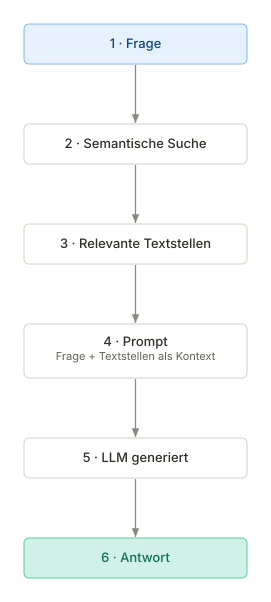
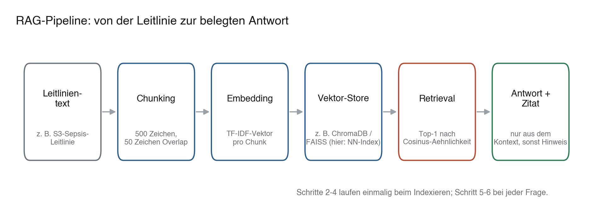

# 33 · Retrieval-Augmented Generation und Leitlinien-Q&A

> **Teil 5 – Machine Learning und KI in der Medizin** · Dauer: ~75 min · Voraussetzung: Modul 31 (Verarbeitung klinischer Freitexte mit LLMs)

## Lernziele
- Das Prinzip von **Retrieval-Augmented Generation (RAG)** erklären und von reinem Feintuning abgrenzen.
- Texte sinnvoll in Abschnitte (**Chunks**) unterteilen und in einem Vektor-Index ablegen (das Prinzip hinter Vektordatenbanken wie ChromaDB oder FAISS).
- Eine einfache lexikalische Suche (TF-IDF und Cosinus-Ähnlichkeit) implementieren und von der semantischen Suche mit Embeddings abgrenzen.
- Strategien zur **Halluzinationsvermeidung** und zum Prompt-Design im klinischen Kontext anwenden.

## Klinischer Aufhänger

Die S3-Leitlinie zur Sepsis-Therapie umfasst über 100 Seiten. Im klinischen Alltag ist es kaum praktikabel, das Dokument nach spezifischen Regeln für Nierenersatzverfahren zu durchsuchen. Ein allgemeines, kommerzielles Sprachmodell kennt die Leitlinie vielleicht grob, neigt aber bei Detailfragen zu gefährlichen Falschantworten (Halluzinationen). Der **Retrieval-Schritt** einer RAG-Pipeline extrahiert bei einer Frage automatisch die passenden Absätze aus dem Original-Dokument, damit ein Sprachmodell seine Antwort auf diese belegte Quelle stützen kann statt auf antrainiertes Allgemeinwissen. **Dieses Modul baut genau diesen Retrieval- und Grounding-Schritt** (Chunking, Vektor-Store, Top-k-Suche, Konfidenzschwelle) und **misst** seine Qualität; der eigentliche Generierungsschritt (das Formulieren der Antwort durch ein LLM) wird bewusst nicht ausgeführt. Ob eine Antwort halluzinationsfrei ist, entscheidet sich erst in dieser Generierung – gutes Retrieval ist die Voraussetzung dafür, aber keine Garantie.

**Stolperstein:** Welches konkrete Produkt hinter dem „LLM“ steckt (ein kommerzieller Cloud-Dienst oder ein lokal gehostetes Modell), ist für das RAG-Prinzip zweitrangig – entscheidend ist, dass es *nur* aus dem mitgelieferten Kontext zitiert. Für sensible Patient:innendaten ist ein lokal betriebenes Modell ohne Cloud-Übertragung oft die einzige datenschutzkonforme Option.

## 1 Das RAG-Prinzip (Retrieval-Augmented Generation)

LLMs haben ein statisches Wissen aus ihrem Training. Um aktuelles, spezifisches oder internes Wissen (wie Krankenhaus-Leitlinien) zu nutzen, gibt es zwei Wege:

1. **Feintuning:** Das Modell wird auf den Texten weitertrainiert. Das ist aufwendig, beseitigt die Neigung zu Halluzinationen nicht und liefert von sich aus keine nachprüfbaren Quellenangaben.
2. **RAG:** Wir suchen relevante Textstellen aus einer Datenbank heraus und kopieren sie direkt in den Prompt des LLMs. Das Modell fungiert nur noch als „intelligenter Leser und Zusammenfasser“.



---

## 2 Text-Chunking und Vektordatenbanken

Aktuelle Sprachmodelle können zwar sehr lange Kontexte verarbeiten, doch ganze Leitlinien-Sammlungen in jeden Prompt zu kopieren ist teuer und langsam, und einzelne Details gehen in langen Kontexten leichter unter. Daher zerlegen wir Dokumente in **Chunks** (z. B. Absätze mit Ziel 500 Zeichen und 50 Zeichen Überlappung, damit ein Satz an der Schnittstelle nicht verloren geht).
Jeder Chunk wird über ein Embedding-Modell in einen hochdimensionalen Vektor umgewandelt. Eine **Vektordatenbank** (z. B. ChromaDB oder FAISS) speichert diese Chunks und erlaubt es, bei einer Frage den semantisch ähnlichsten Textabschnitt blitzschnell zu finden. Dieses
Modul ersetzt das Embedding-Modell durch TF-IDF: Es findet Chunks, die **dieselben Wörter** enthalten,
nicht solche mit derselben Bedeutung. „Atemnot“ findet „Dyspnoe“ damit nicht (vgl. Modul 31, Abschnitt 5);
das leisten erst dichte Embeddings.



<!-- excerpt-note -->
> **Hinweis – die Codeblöcke unten sind Auszüge.** Sie zeigen die entscheidenden Schritte, nicht jede Import-Zeile. Das vollständige, am Stück lauffähige Skript ist [`code/python.py`](code/python.py) (im Browser über den **Python**-Reiter oben). In Colab führst du das ganze Modul mit einer Zeile aus: `!python module/33-rag-llm-pipelines/code/python.py` – siehe das [in Colab öffnen](https://colab.research.google.com/github/schradern/data-science-coach/blob/main/notebooks/start.ipynb).

```python
def chunk_text(text: str, chunk_size: int = 500, overlap: int = 50) -> list[str]:
    """Zerlegt ein Dokument in überlappende Chunks."""
    paragraphs = [p.strip() for p in text.split("\n\n") if p.strip()]
    chunks = []
    for para in paragraphs:
        if len(para) <= chunk_size:
            chunks.append(para)          # paragraph fits entirely into one chunk
            continue
        start = 0                         # paragraph too long: sliding window
        while start < len(para):
            end = start + chunk_size
            chunks.append(para[start:end].strip())
            if end >= len(para):
                break
            start = end - overlap
    return chunks
```

**Darüber hinaus:** Diese Funktion trennt zuerst an Absatzgrenzen (jede Leitlinien-Empfehlung bleibt möglichst intakt) und schneidet nur überlange Absätze mit einem festen Fenster. Eine rein zeichenbasierte Zerlegung ohne Rücksicht auf Absätze reißt Begriffe wie „Vasopressor“ mitten im Wort auseinander – das verschlechtert die spätere Suche messbar (probier es aus: entferne den `paragraphs`-Schritt und vergleiche die Ähnlichkeits-Scores in `code/python.py`).

Ohne installierte Vektordatenbank lässt sich das Prinzip einer solchen DB bereits mit `scikit-learn` nachbilden: ein `NearestNeighbors`-Index über den TF-IDF-Vektoren aller Chunks *ist* im Kern eine Vektordatenbank – er beantwortet dieselbe Frage („welcher gespeicherte Vektor ist meinem Such-Vektor am ähnlichsten?“), nur ohne Persistenz und Skalierung auf Millionen Chunks. ChromaDB und FAISS lösen dasselbe Problem, speichern den Index dauerhaft und nutzen für sehr große Sammlungen schnelle, meist approximative Suchverfahren.

---

## 3 Eine einfache RAG-Suche in Python

Um die Funktionsweise transparent zu zeigen, nutzen wir TF-IDF-Vektoren aus `scikit-learn` und einen `NearestNeighbors`-Index als minimalen Vektor-Store. Als Korpus dient ein kurzer, **synthetischer** Sepsis-Leitlinienauszug mit sechs Empfehlungen in `code/python.py`: an internationale Empfehlungen angelehnt, aber kein Originaltext einer Leitlinie und nicht für klinische Entscheidungen gedacht. Das Skript braucht weder Internet noch API-Schlüssel.

```python
# Excerpt from code/python.py: runs inside the full script, not on its own.
from sklearn.feature_extraction.text import TfidfVectorizer
from sklearn.neighbors import NearestNeighbors

# 1. Chunk the guideline text (see chunk_text() above)
chunks = chunk_text(leitlinien_text)

# 2. Vectorisation: TF-IDF is illustrative here and can be computed locally;
#    in practice, dense sentence embeddings are often used.
vec = TfidfVectorizer()
chunk_vectors = vec.fit_transform(chunks)

# 3. Vector store: a NearestNeighbors index over the chunk vectors
#    (stand-in for ChromaDB/FAISS, see box above). We fetch the top 3
#    so that a human or LLM can check several candidates (loesungen.md).
store = NearestNeighbors(n_neighbors=3, metric="cosine").fit(chunk_vectors)

# 4. Ask a question and retrieve the 3 most similar chunks
frage = "Welcher Vasopressor wird bei Sepsis empfohlen?"
frage_vector = vec.transform([frage])
distances, indices = store.kneighbors(frage_vector)
for rang, (dist, idx) in enumerate(zip(distances[0], indices[0]), start=1):
    print(f"{rang}. Ähnlichkeit {1 - dist:.3f}: {chunks[int(idx)][:80]} ...")
```

**Zeile für Zeile:**

* `TfidfVectorizer` wandelt unsere Text-Chunks und die Frage in numerische Vektoren um.
* `NearestNeighbors(metric="cosine")` baut einen kleinen Suchindex über allen Chunk-Vektoren – den minimalen Vektor-Store.
* `store.kneighbors(frage_vector)` liefert die Cosinus-*Distanzen* zu den 3 nächsten Chunks; `1 - distance` ist jeweils die Ähnlichkeit (1,0 = identisch, 0 = kein gemeinsames Wort).
* Die Indizes der Top-Treffer zeigen auf die Chunks, die als Kontext an das Sprachmodell übergeben würden.

**Retrieval messen statt behaupten:** `code/python.py` enthält ein kleines
Gold-Set (Frage → belegender Chunk) und berechnet daraus **recall@k** und
**precision@k** – misst also, ob der richtige Chunk überhaupt unter den Top-k
landet. Auf diesem Mini-Korpus liegt der Gold-Chunk jeder beantwortbaren Frage
auf Rang 1, recall@1 ist also 1,00. Die ebenfalls gedruckte recall@3 = 1,00 sagt
hier wenig: Der Korpus hat nur sechs Chunks, die Top-3 decken die Hälfte davon ab
(precision@3 = 0,33, weil von 3 zurückgegebenen Chunks genau einer relevant ist).
Auf einem echten Korpus mit Tausenden Chunks wird recall@k erst aussagekräftig.
Ohne diese Messung ist „das Retrieval funktioniert“ nur eine Behauptung.

---

**Praxis:** `code/python.py` und `code/r.R` implementieren exakt dasselbe Verfahren (TF-IDF + Cosinus-Ähnlichkeit) – in R ohne Zusatzpakete direkt in Basis-R nachgebaut, damit beide Sprachversionen offline laufen und **dieselbe** Logik zeigen.

## 4 Halluzinationsvermeidung und Prompt-Design

Um zu verhindern, dass das Sprachmodell bei fehlenden Informationen rät, nutzen wir zwei Sicherungen: einen strengen **System Prompt** und einen **Konfidenz-Schwellenwert** auf der Retrieval-Seite.

> **Merksatz:** Ein Sprachmodell mit RAG ist nur so sicher wie sein Retrieval. Ein perfekter Prompt rettet keine falsche oder fehlende Quelle – die Ähnlichkeits-Schwelle muss *vor* dem Prompt prüfen, ob überhaupt ein passender Chunk gefunden wurde.

Der Schwellenwert wird **nicht von Hand gesetzt**, sondern auf einem kleinen
gelabelten Set (Fragen *mit* Antwort im Korpus vs. *ohne*, n=8: 5 im Kontext,
3 außerhalb) kalibriert: Man nimmt je Frage den Top-1-Score, variiert die
Schwelle und wählt die mit dem besten F1 für die Entscheidung „Antwort ist im
Kontext“. F1 gewichtet beide Fehler gleich. Klinisch ist eine Antwort ohne Beleg
(falsch positiv) aber gefährlicher als eine verweigerte Antwort; mit mehr Daten
würde man die Schwelle deshalb über eine präzisionsbetonte Größe wie F0,5 oder
eine Mindest-Precision wählen.

```python
# Excerpt from code/python.py: runs inside the full script, not on its own.
# similarity = top-1 score of the question; schwelle comes from calibrate_threshold()
if similarity < schwelle:
    print("Information in den bereitgestellten Leitlinien nicht enthalten.")
else:
    # the top-k chunks are passed to the language model as context
    ...
```

**Stolperstein – Zirkuläre Kalibrierung:** Wenn man die Schwelle auf dem
gesamten gelabelten Set wählt und danach Precision/Recall/F1 *auf demselben
Set* berichtet, misst man nicht die Güte des Guards, sondern nur, wie gut
sich eine Schwelle an genau diese acht Datenpunkte anpassen lässt – das Ergebnis
ist tautologisch nahe bei 1,00 und sagt nichts über neue Fragen aus. Ehrlich
auswertbar ist nur eine **Out-of-Sample**-Metrik. Bei n=8 Fragen ist das Set
zu klein für einen sinnvollen Kalibrierungs-/Auswertungs-Split, deshalb nutzt
`code/python.py` (und `code/r.R`) **Leave-one-out-Kreuzvalidierung**: Für jede
der 8 Fragen wird die Schwelle auf den jeweils anderen 7 gewählt und nur auf
der zurückgehaltenen Frage angewendet; die 8 so gewonnenen Vorhersagen werden
zu einer gepoolten Precision/Recall/F1 zusammengefasst.

Ausgeführt liefert das: Die auf **allen** n=8 Fragen kalibrierte
Deployment-Schwelle liegt bei **0,167** (Python) und trennt die In-Kontext-
Scores (Minimum 0,173) gerade noch, mit hauchdünnem Abstand, von den
Außer-Kontext-Scores (Maximum 0,160) – die Out-of-Sample-Kennzahlen der Leave-one-out-Auswertung
sind **Precision 0,833, Recall 1,000, F1 0,909** (Python; tp=5, fp=1, fn=0).
Eine Außer-Kontext-Frage (Score 0,160, knapp unter der Schwelle) wird
fälschlich als „im Kontext“ vorhergesagt, sobald ihr eigenes Label bei der
Schwellenwahl nicht zur Verfügung steht – genau das verschweigt die In-
Sample-Zahl. Die R-Implementierung (eigene TF-IDF-Berechnung in Basis-R,
siehe Abschnitt 3) liefert wegen leicht abweichender Scores ein anderes
Ergebnis: **Precision 0,800, Recall 0,800, F1 0,800** (tp=4, fp=1, fn=1).
Führe den Code selbst aus, kleine Abweichungen zwischen den Sprachversionen
sind erwartbar; wichtig ist, dass **beide** Zahlen aus einer Out-of-Sample-
Auswertung stammen und nicht mehr 1,00 betragen.

**Stolperstein:** Dieser Schwellenwert ist kein Naturgesetz – er hängt von der Vektorisierung (hier TF-IDF) und vom Korpus ab und muss neu kalibriert werden, wenn sich eines ändert. Ein *hart kodierter* Wert, der auf drei handverlesene Demofragen passt, ist keine Kalibrierung. Das Set hier ist bewusst klein und damit nur illustrativ; in der Praxis braucht es deutlich mehr gelabelte Fragen, um Precision/Recall belastbar zu schätzen und einen echten Kalibrierungs-/Auswertungs-Split zu erlauben. `code/python.py`/`code/r.R` geben die gewählte Schwelle **und** die Leave-one-out-Kennzahlen aus, statt eine Magie-Konstante oder eine zirkuläre 1,00 zu verstecken.

### Beispiel-Prompt für ein klinisches Sprachmodell
```
[SYSTEM PROMPT]
Du bist ein klinischer Assistent. Beantworte die Frage des Users ausschließlich basierend auf dem bereitgestellten Kontext. Wenn die Antwort nicht im Kontext enthalten ist, antworte ehrlich mit: "Diese Information ist in den bereitgestellten Leitlinien nicht enthalten." Spekuliere nicht.

[KONTEXT]
{Top-k-Treffer aus dem Retrieval}

[USER FRAGE]
Welcher Vasopressor wird empfohlen?
```

---

> **Wann du Hilfe holst.** Sobald eine RAG-Pipeline reale klinische Fragen beantworten soll (z. B. Dosierungen aus Leitlinien), reicht gutes Retrieval nicht: Ein falsch gezogener oder falsch zitierter Absatz kann direkt zu einer Fehldosierung führen – Freigabe, Datenschutz (lokales Hosting) und eine klinische Validierung mit Fachexpertise sind vor jedem Einsatz Pflicht.

## Fallstricke und Merksätze
- **Chunk-Größe wählen.** Zu kleine Chunks verlieren den Kontext (z. B. worauf sich ein „er“ bezieht). Zu große Chunks verwässern das Signal und überlasten das Sprachmodell.
- **RAG ersetzt kein klinisches Denken.** Sprachmodelle verstehen Medizin nicht kausal. Sie fassen nur zusammen, was im Prompt steht. Die Letztverantwortung liegt immer bei den behandelnden Ärzt:innen.
- **Aktualität.** Wenn sich Leitlinien ändern, müssen die Vektoren in der Datenbank neu berechnet werden.

## Selbstcheck
1. **Warum ist RAG sicherer für den klinischen Einsatz als ein feingetuntes Modell ohne RAG?** – Weil das Sprachmodell bei RAG eine feste Informationsquelle (Kontext) erhält und angewiesen werden kann, nur daraus zu zitieren. Das ermöglicht überprüfbare Quellenangaben und senkt das Halluzinationsrisiko – vorausgesetzt, das Retrieval liefert den richtigen Chunk (dieses Modul misst genau das mit recall@k/precision@k). Die Halluzinationsfreiheit selbst entscheidet sich erst im Generierungsschritt, der hier nicht ausgeführt wird; gutes Retrieval ist Voraussetzung, keine Garantie.
2. **Was misst die Cosinus-Ähnlichkeit im RAG-Kontext?** – Sie misst die geometrische Nähe zweier Textvektoren im Vektorraum. Mit TF-IDF-Vektoren wie in diesem Modul heißt das: Je mehr (seltene) Wörter Frage und Chunk gemeinsam haben, desto näher liegt der Wert bei 1,0. Bedeutungsnähe ohne gemeinsame Wörter erfassen erst Embeddings.
3. **Warum reicht ein fester Ähnlichkeits-Schwellenwert allein nicht als Sicherheitsnetz?** – Weil er von der Vektorisierungsmethode und dem Korpus abhängt: dieselbe Schwelle kann bei TF-IDF andere Trennschärfe haben als bei dichten Embeddings, und ein zu niedrig gewählter Wert lässt Fragen ohne Antwort im Kontext trotzdem „durchrutschen“ (siehe `code/python.py`/`code/r.R`, die den tatsächlichen Score bei jeder Frage ausgeben statt ihn zu verstecken).
