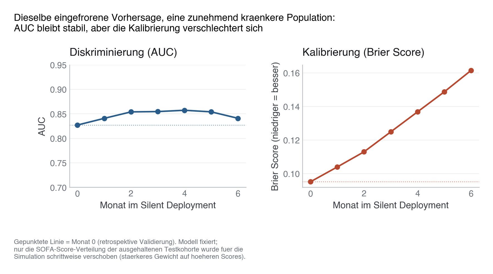

# 34 · Studiendesign zur Validierung klinischer KI-Systeme

> **Teil 5 – Machine Learning und KI in der Medizin** · Dauer: ~65 min · Voraussetzung: Module 25 und 32 (Validierung und Governance)

## Lernziele
- Den Unterschied zwischen **retrospektiver Validierung** und **prospektiver klinischer Evaluation** erklären.
- Das Konzept des **Schattenbetriebs (Silent Deployment)** zur risikoarmen Datenerfassung beschreiben.
- Spezifische Bias-Quellen beim Einsatz von KI im Krankenhaus (Automation Bias, Spectrum Bias, Alarm-Müdigkeit) identifizieren.
- Studiendesigns zur Evidenzgenerierung für klinische Entscheidungsunterstützungssysteme (CDSS) entwerfen.
- Die wichtigsten Berichtsstandards (**TRIPOD-AI**, **DECIDE-AI**, **CONSORT-AI**) kennen.

## Klinischer Aufhänger

Dein Sepsis-Vorhersagemodell hat retrospektiv eine beeindruckende AUC von 0,89 erzielt. Nun soll das System als klinisches Entscheidungsunterstützungssystem (CDSS) auf der Intensivstation eingeführt werden und Ärzt:innen per SMS warnen. Der Chefarzt fragt: *„Verbessert dieses System tatsächlich das Überleben der Patient:innen oder führt es nur zu mehr Fehlalarmen und zusätzlichem Stress?“* Um diese Frage zu beantworten, musst du eine klinische Studie konzipieren, die über rein statistische Metriken hinausgeht.

## 1 Prospektive vs. Retrospektive Validierung

Ein Modell, das auf historischen Daten hervorragend abschneidet, kann im echten Klinikalltag aus mehreren Gründen versagen:

- **Dataset Shift:** Die Patient:innenpopulation oder Dokumentationspraxis hat sich seit der Datensammlung verändert.
- **Fehlende Interaktion:** Retrospektive Daten zeigen nicht, wie Ärzt:innen reagieren, wenn sie einen Alarm erhalten.
- **Klinischer Nutzen:** Eine hohe AUC bedeutet nicht automatisch, dass Patient:innen früher behandelt werden oder seltener sterben.

| Validierungsart | Datenquelle | Zielgrößen | Risiko für Patient:innen |
|-----------------|-------------|------------|---------------------------|
| **Retrospektiv** | Historische Datenbanken | AUC, Brier Score, Sensitivität | Keine |
| **Prospektiv (Silent)** | Live-Daten im Hintergrund | Stabilität der Metriken, Drift | Keine |
| **Klinische Studie** | Live-Einsatz am Krankenbett | Mortalität, Liegedauer, Time-to-Antibiotics | Vorhanden (Fehldiagnose/Therapieverzögerung) |

---

## 2 Der Schattenbetrieb (Silent Deployment)

Bevor eine KI Patient:innen beeinflusst, sollte sie im **Schattenbetrieb (Silent Deployment)** laufen.

- Das Modell erhält Live-Daten aus dem KAS (z. B. via FHIR-Schnittstelle) und berechnet Risikoscores.
- **Niemand sieht diese Scores** – weder Pflegende noch Ärzt:innen. Es erfolgt keine Intervention.
- Die Scores und die tatsächlichen klinischen Outcomes werden protokolliert.

### Nutzen des Schattenbetriebs
1. **Technische Validierung:** Läuft die Pipeline stabil und ohne Latenzen?
2. **Prospektive Baseline:** Entspricht die prospektive AUC der retrospektiven?
3. **Kalibrierungs-Check:** Stimmen die vorhergesagten Wahrscheinlichkeiten auch im Live-Betrieb?

**Darüber hinaus:** Punkt 3 ist der unterschätzte Fall. Diskriminierung (AUC) und Kalibrierung (stimmen vorhergesagte Wahrscheinlichkeiten mit der beobachteten Ereignisrate überein?) können sich unabhängig voneinander verändern. Die Simulation unten zeigt genau das an der Kurskohorte: ein eingefrorenes, retrospektiv validiertes Modell wird auf eine zunehmend kränkere Population (höhere SOFA-Scores) angewendet.

<!-- excerpt-note -->
> **Hinweis — die Codeblöcke unten sind Auszüge.** Sie zeigen die entscheidenden Schritte, nicht jede Import-Zeile. Das vollständige, am Stück lauffähige Skript ist [`code/python.py`](code/python.py) (im Browser über den **Python**-Reiter oben). In Colab führst du das ganze Modul mit einer Zeile aus: `!python module/34-design-ki-studien/code/python.py` — siehe das [in Colab öffnen](https://colab.research.google.com/github/schradern/data-science-coach/blob/main/notebooks/start.ipynb).

```python
# Modell einmalig trainieren, dann auf zunehmend verschobenen Stichproben
# derselben Kohorte neu bewerten -- Simulation eines Spectrum-Shifts im
# Schattenbetrieb. Voller Code: code/python.py (Funktion simulate_drift()).
model = LogisticRegression(max_iter=1000).fit(X_train_scaled, y_train)
for monat in range(1, 7):
    stichprobe = ziehe_kraenkere_stichprobe(kohorte, staerke=0.15 * monat)
    proba = model.predict_proba(stichprobe)[:, 1]
    print(monat, roc_auc_score(y, proba), brier_score_loss(y, proba))
```



Im aktuellen Lauf (`code/python.py`) bleibt die AUC über sechs simulierte Monate stabil bis leicht steigend, während der Brier Score spürbar zunimmt (die genauen Prozentzahlen gibt das Skript bei jedem Lauf aus) — die Diskriminierung allein hätte die zunehmende Fehlkalibrierung nicht angezeigt. Führe `code/python.py` oder `code/r.R` selbst aus, um die exakten Werte für deinen Lauf zu sehen.

> **Merksatz:** Ein Silent Deployment prüft nicht nur, *ob* ein Modell noch läuft, sondern auch, *ob seine Wahrscheinlichkeiten noch stimmen*. Eine stabile AUC ist keine Garantie für stabile Kalibrierung.

---

## 3 Bias-Quellen im klinischen Einsatz

Bei der Interaktion zwischen Mensch und Maschine treten spezifische psychosoziale und methodische Effekte auf:

- **Automation Bias:** Das blinde Vertrauen in die Maschine. Ärzt:innen übersehen eigene klinische Warnsignale, weil die KI "grünes Licht" gibt.
- **Spectrum Bias:** Das Modell wurde an schwerkranken Intensivpatient:innen trainiert, wird aber nun auf einer Normalstation eingesetzt, wo das Patient:innenspektrum völlig anders ist. Die Falsch-Positiv-Rate steigt drastisch.
- **Alarm-Müdigkeit (Alert Fatigue):** Wenn 90 % der Alarme Fehlalarme sind, ignorieren Ärzt:innen das System irgendwann komplett – auch die echten Warnungen.

**Stolperstein:** Spectrum Bias ist nicht dasselbe wie die Kalibrierungsdrift aus Abschnitt 2 — Spectrum Bias verschiebt die *Population*, auf der ein Modell überhaupt eingesetzt wird (Intensivstation vs. Normalstation), während die Kalibrierungsdrift auch innerhalb derselben Station über die Zeit auftritt, wenn sich der Casemix schrittweise verändert. Beide führen zum selben Symptom: Vorhersagen, die nicht mehr zur beobachteten Ereignisrate passen.

---

## 4 Studiendesigns für klinische KI

Um den echten Nutzen nachzuweisen, reichen statistische Modelltests nicht. Es braucht interventionelle Studien:

1. **Vorher-Nachher-Vergleich:** Einfach zu implementieren, aber anfällig für historische Trends (z. B. Einführung neuer Leitlinien zeitgleich mit der KI).
2. **Cluster-randomisierte Studien (cRCT):** Die Randomisierung erfolgt nicht pro Patient:in (da Ärzt:innen sich durch das System beeinflussen lassen und dieses Wissen auf alle Patient:innen übertragen), sondern pro Station oder Schicht. Station A nutzt das System, Station B arbeitet standardmäßig.
3. **Nicht-Unterlegenheits-Studien:** Nachweis, dass der Einsatz der KI die Behandlungsqualität zumindest nicht verschlechtert, aber z. B. Ressourcen schont.

**Praxis:** Die Wahl des Studiendesigns hängt vom Reifegrad des Systems ab: ein brandneues Modell durchläuft typischerweise erst Silent Deployment (Abschnitt 2), dann eine cRCT auf wenigen Stationen, erst danach eine größere multizentrische Studie. Ein Sprung direkt zur klinischen Studie ohne Schattenbetrieb überspringt genau die Phase, in der technische Fehler und Kalibrierungsprobleme am billigsten zu entdecken sind.

---

> **Wann du Hilfe holst.** Der Sprung von retrospektiver AUC zur prospektiven Wirksamkeitsstudie ist ein eigenes Studiendesign mit eigener Fallzahl, Randomisierung und Ethikvotum — hol Biostatistik, Studienmethodik und Ethikkommission an Bord, bevor ein CDSS am Krankenbett Alarme auslöst.

## Fallstricke und Merksätze

**Stolperstein:** AUC ist kein klinischer Endpunkt. Der Nachweis einer AUC von 0,90 reicht für die Zulassung als Medizinprodukt der Klasse IIa nicht aus. Du musst den Nutzen für den/die Patient:in nachweisen.

**Berichtsstandards nutzen:**
- **TRIPOD-AI:** Für die Entwicklung und Validierung des Algorithmus.
- **DECIDE-AI:** Für die Evaluation in frühen klinischen Phasen.
- **CONSORT-AI:** Für randomisierte kontrollierte Studien mit KI-Beteiligung.

## Selbstcheck
1. **Warum ist ein Schattenbetrieb (Silent Deployment) vor dem klinischen Live-Gang wichtig?**, Weil er eine technische und statistische Validierung unter realen Live-Bedingungen ermöglicht, ohne Patient:innen dem Risiko fehlerhafter Algorithmus-Empfehlungen auszusetzen.
2. **Was beschreibt der Begriff Automation Bias?**, Die menschliche Tendenz, computergestützten Entscheidungen und Systemen unkritisch zu vertrauen und eigene, korrekte klinische Beobachtungen oder Zweifel zu überstimmen.
3. **Warum reicht eine stabile AUC im Silent Deployment nicht als alleiniger Beweis aus, dass ein Modell noch verlässlich ist?**, Weil die AUC nur die Rangfolge der Vorhersagen (Diskriminierung) misst, nicht ob die vorhergesagten Wahrscheinlichkeiten selbst noch stimmen (Kalibrierung). Verschiebt sich die Population (z. B. höhere durchschnittliche Krankheitsschwere), kann die AUC stabil bleiben, während der Brier Score deutlich ansteigt — die Vorhersagen werden systematisch falsch kalibriert, ohne dass die AUC das anzeigt.
